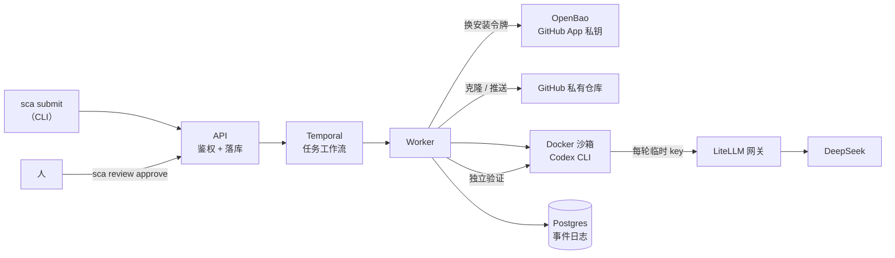

# 主流程跑通记录、架构图核对与后续计划

> 2026-11-16，基线提交 `196e8d1`。写给要决定下一步做什么的人：平台现在能做什么、是怎么跑通的、架构图哪里写得不对、还剩什么、建议先做什么。

> 本文保留 2026-11-16 的历史场景与计划。当前 a5a0d63（2026-11-18）快照见 [README](README.md) 和 [逐项审计](AUDIT.md)；Portal 场景见 [portal-demo.md](portal-demo.md)，四期最新验证见 [design-phase4.md](../docs/design-phase4.md)。

## 1 结论

- **主流程已经能真实跑通。** 2026-11-16 用真实模型对一个 GitHub 私有仓库跑了一遍：提交任务 → 沙箱里的 Agent 修 bug、补测试 → 平台独立验证 → 推送分支 → 人工审批 → 完成。从提交到等待审批 31 秒，模型花费约 0.0034 美元。全程没有用任何个人令牌：仓库凭证来自 GitHub App，模型凭证由网关按轮签发。
- **能跑通的边界是单机部署**：Docker 沙箱、本机 Temporal 和 Postgres。Kubernetes 上的沙箱和隔离有测试，但 K8s 沙箱接不上模型网关，所以 K8s 上还跑不了真实模型。
- **离“团队日常能用”还差几步**：平台只推分支、不开 PR；网页控制台很简陋；任务只能从 API/CLI 发起，不能从 Issue 或聊天触发。详见第 5、6 节。

## 2 我是怎么跑通的

### 2.1 场景

这是 Coding Agent 最典型的一类任务：**给一个仓库提一个改代码的需求，Agent 改完，平台用测试证明改对了，人看过 diff 后放行。**

| 项 | 值 |
| --- | --- |
| 仓库 | `phao1/sca-ci-fixture`，GitHub 私有仓库。`calc.py` 里的 `add` 故意写成了减法 |
| 需求 | “`calc.py` 的 add 结果不对，修好它，并在 `test_calc.py` 里加一个负数相加的测试” |
| 验证命令 | `python -m pytest -q`，由平台在沙箱里独立执行，不信 Agent 的自述 |
| Agent | Codex CLI，跑在沙箱容器里 |
| 模型 | `deepseek-flash`，经 LiteLLM 网关调用；每轮签发一个有预算上限的临时 key，用完作废 |
| 仓库凭证 | GitHub App（ID 5781020），私钥在 OpenBao 里；Worker 每次现换 1 小时有效的安装令牌 |
| 沙箱 | Docker 容器，受限网络，只能访问网关和 PyPI |

### 2.2 链路



### 2.3 步骤和命令

本机已有 Postgres（pgvector 镜像）、Temporal 和出口代理在跑。

```bash
# 1. 可选服务：模型网关、密钥服务
docker compose -f deploy/docker-compose.yml --profile gateway --profile openbao up -d --wait litellm openbao
.venv/bin/python scripts/github_app_setup.py store      # 把 GitHub App 凭证写入 OpenBao

# 2. 平台配置（模型密钥只在网关的 .env 里，平台进程拿不到）
export SCA_AGENT_BACKEND=codex SCA_DEFAULT_MODEL=deepseek-flash \
       SCA_MODEL_GATEWAY_URL=http://localhost:4000 \
       SCA_EGRESS_ALLOW=pypi.org,files.pythonhosted.org \
       SCA_SECRET_PROVIDER=openbao SCA_OPENBAO_TOKEN=sca-dev-root \
       SCA_API_TOKENS=demo-token:default

# 3. 启动 API 和 Worker
.venv/bin/alembic upgrade head
.venv/bin/uvicorn sca.api.app:create_app --factory --port 8000 &
.venv/bin/python -m sca.orchestration.worker &

# 4. 提交任务、看过程、看 diff、审批
export SCA_API_URL=http://127.0.0.1:8000 SCA_API_TOKEN=demo-token
sca submit --repo https://github.com/phao1/sca-ci-fixture.git \
  --instruction "The add function in calc.py returns the wrong result. Fix it, and add a test for adding negative numbers to test_calc.py." \
  --setup "pip install -q pytest" --verify "python -m pytest -q" --push
sca events <任务号>
sca patch  <任务号>
sca review <任务号> approve
```

### 2.4 实际结果

任务 `54b01ebb-329f-4f8e-bd03-e6d59fdb2f5a`，事件日志共 31 条，以下是删减版：

| # | 事件 | 内容 |
| --- | --- | --- |
| 1–2 | `task.created`、进入 `PROVISIONING` | |
| 3 | `workspace.prepared` | 用 GitHub App 令牌克隆私有仓库 |
| 4 | `memory.injected` | 注入经人确认的记忆（这次为空） |
| 5–6 | `sandbox.created`、`setup.completed` | 起容器，执行 `pip install -q pytest` |
| 7–8 | 进入 `RUNNING`，`agent.turn_started` | |
| 9–15 | `agent.message` / `agent.command` | Agent 看 `git status`、文件列表、`calc.py` 和测试，判断“bug 是 add 里用了减法” |
| 16 | `agent.file_change` | 改 `calc.py`，加测试 |
| 18–19 | `agent.command` | Agent 自己跑 `git diff --check` 和 `pytest` |
| 20–22 | `agent.message`、`agent.usage`、`agent.turn_completed` | “修好了，2 passed” |
| 23 | `workspace.checkpointed` | 提交检查点 |
| 24–25 | 进入 `VERIFYING`，`verification.completed` | **平台自己**在沙箱里重跑 `python -m pytest -q`，通过 |
| 26–28 | `artifact.published`、`review.requested`，进入 `AWAITING_REVIEW` | 补丁存入对象存储，等人审 |
| 29–31 | `review.submitted approve`，进入 `SUCCEEDED`，`sandbox.destroyed` | 审批后完成，销毁沙箱 |

产出的补丁：

```diff
--- a/calc.py
+++ b/calc.py
 def add(a, b):
-    return a - b
+    return a + b
--- a/test_calc.py
+++ b/test_calc.py
+def test_add_negative_numbers():
+    assert calc.add(-2, -3) == -5
```

| 指标 | 值 |
| --- | --- |
| 提交到等待审批 | 31 秒（09:15:01 → 09:15:32 UTC） |
| 轮数 | 1 |
| Token | 输入 52,288（其中 50,176 命中缓存），输出 2,030 |
| 花费 | 3,371 微美元，约 0.0034 美元 |
| 推送 | 分支 `sca/54b01ebb`，提交 `597a8d3`，作者显示为 SuperCloudAgents。分支留在仓库上供查看：<https://github.com/phao1/sca-ci-fixture/tree/sca/54b01ebb> |

注意一点：测试仓库里有一份 GitHub Actions 流水线，推送分支会触发它。这次自托管 Runner 没开，CI 一直排队，我手动取消了。要让 CI 结果反馈给 Agent，提交时加 `"ci": {...}`，同时启动 Runner；这条路径另有测试证明（见 2.5）。

### 2.5 其他跑过的场景

上面是手动演示。自动化测试覆盖的场景更多，最近一次结果见 `docs/handoff.md`：

| 场景 | 证明了什么 | 测试 |
| --- | --- | --- |
| 真实 CI 反馈 | 第一轮本地验证过了，但 CI 有一条本地不知道的规则（要求有 CHANGELOG）而失败；平台把 CI 结果喂回 Agent，第二轮通过。Gitea 和 GitHub 自托管 Runner 都跑过 | `tests/e2e/test_e2e_ci_real.py` |
| 验证失败自动重试 | 验证失败时把输出反馈给 Agent 再试，直到上限 | `test_e2e_verification.py` |
| 拆分子任务 | 规划 → 人审计划 → 子任务并行 → 合并 | `test_e2e_planning.py`、`test_e2e_subtasks.py` |
| 崩溃恢复 | Worker 中途被杀，任务从检查点继续 | `test_e2e_resilience.py` |
| 预算 | 金额超过预算时任务被停住 | `test_e2e_gateway.py` |
| 设计意图 | 设计稿和工单文件转成任务约束 | `test_e2e_intents.py` |
| 记忆 | 任务结束后提炼记忆，人确认后注入后续任务 | `test_e2e_memory.py` |
| 数据分析场景 | 同一内核上的第二个场景 | `test_e2e_analysis.py` |
| 评测 | 两个模型在同一评测集上对比，用隐藏验收判分 | `test_e2e_evaluation.py` |
| Kubernetes | 两节点 kind + Calico 上的沙箱、网络隔离、预热池 | `test_e2e_k8s.py` |

## 3 架构图核对

**总体判断：架构图基本是对的。** 原图 50 个节点加 2 项补充能力，状态分布为 `done` 14、`partial` 30、`adapted` 7、`planned` 1。逐项对照代码后，没有哪项需要调整状态等级，口径偏保守，这是好事。错的地方都是“过时”或“说得不准”，已经改掉。

改正的方式：由 Codex worker（gpt-6.1-sol）按 `README.md` 里“更新和校验”的流程，把 52 项逐项对照 `196e8d1` 的源码和测试，我再审查它的改动。

| 模块 | 原来的问题 | 改成 |
| --- | --- | --- |
| `kms` 密钥与证书 | 写着“真实 GitHub App 待验证” | 已用真实私有 App 验证，从缺口里删掉这一条 |
| `obs_store` 日志与告警 | 写着“Alertmanager 已有投递验证”，说得太满 | 只用本地 webhook 接收器验证过，真实 Slack/邮件投递未验证，补为缺口 |
| `repos` 代码仓 | 没说清平台只推分支 | 明确只推 `sca/<任务号>` 分支，不开 PR、不合入 |
| `compute` 算力池 | 写着“沙箱声明了 CPU/内存的请求和上限” | 实际只声明了上限（limits），没声明请求（requests） |
| 多项证据路径 | 有的指向空的 `sandbox/__init__.py`，有的漏了直接相关的测试 | 换成真正实现这项功能的文件，补齐测试 |
| 阶段页、路线图 | B4 写着“GitHub App 待验”，P0 路线图第一条还是“验证 GitHub App” | 改为已验证；这一条换成“验证真实告警渠道”（P1） |

快照基线从 `6d73e77` 更新到 `196e8d1`，`index.html` 已重新生成。`validate.py` 和 `build.py --check` 都通过了。阶段页和路线图的文字写在 `app.js` 里，所以 Codex 也改了 `app.js`，只改了这些文字，没动交互逻辑。这次没有在浏览器里重新验收页面交互，`QA.md` 里的验收记录还是旧基线的。

**这张图没体现、但影响决策的两点：**

1. 图是按 V1 构想画的“全量平台”，节点很多，但“主流程能用”只依赖其中十来个，而且这十来个都已经是 `done` 或可用的 `partial`。所以 30 个 `partial` 不代表主流程跑不起来，多数缺的是企业级的扩展能力。
2. 对日常使用影响最大的缺口在图上分散在几处，不够显眼：没有自动开 PR（`repos`），控制台简陋（`ui_*`），只能从 API/CLI 触发（`task_entry`）。第 5.1 节把它们集中列出来了。

## 4 平台现在是什么样

- **形态**：模块化单体。一个 API 进程加若干 Worker 进程，编排交给 Temporal，状态存在 Postgres 和对象存储里。
- **代码量**：Python 约 2.2 万行（含测试）。
- **场景**：编码（主场景）和数据分析，共用一个内核。
- **入口**：REST API、`sca` CLI，以及一个很简单的网页（只有任务列表）。

## 5 遗留任务

按“对主流程的影响”从大到小排。

### 5.1 影响“团队日常能用”的

| 项 | 现状 | 缺什么 |
| --- | --- | --- |
| 自动开 PR | 只推送 `sca/<任务号>` 分支，PR 要人去开 | 审批通过后用 GitHub App 开 PR 或更新已有 PR，并把 PR 链接写进结果 |
| 网页控制台 | `src/sca/api/static/index.html` 只有 39 行，只能看任务列表 | 提交任务、看实时事件流、看 diff、审批、管理记忆 |
| 从 Issue / 聊天触发 | 只能用 API 或 CLI 发起任务 | 收 GitHub Issue 评论或 webhook 来建任务，再把结果回帖 |
| 仓库接入 | 新仓库要手动用脚本存凭证 | 装好 GitHub App 后，自动发现它能访问的仓库 |

### 5.2 影响“规模化 / 企业级”的

| 项 | 现状 | 缺什么 |
| --- | --- | --- |
| K8s 上跑真实模型 | `sandbox_driver=k8s` 时一配模型网关就报错（`src/sca/orchestration/worker.py`） | K8s 沙箱接入网关，并配套网络策略 |
| Worker 部署到 K8s | 只有示例清单，做过服务端预检，没真正部署 | 镜像、RBAC、探针、优雅退出、HPA 或 KEDA 的实测 |
| 多机缓存 | pip 缓存只在挂载模式下可用，预热池容量固定 | 跨节点的依赖缓存，池容量随负载伸缩 |
| 部门工具域、企业知识库 | 没有 | 工具注册与授权；企业文档接入、权限同步、引用溯源 |

### 5.3 需要你提供东西才能验证的

| 项 | 需要什么 |
| --- | --- |
| 记忆的语义检索 | 一个能生成向量的 embedding 模型（DeepSeek 没有这个接口） |
| 告警真实投递 | 一个 Slack 或邮件的 webhook 地址 |
| 数据分析场景的真实模型测试 | 不用提供东西，跑一次就行，会产生少量花费 |

### 5.4 自进化（三期之后）

已经有了评测集、隐藏验收、多模型对比和回归门禁。还没有的是：自动生成改进（提示词或代码）、自动推广新版本、灰度和自动回滚。另外，现有评测样本太简单，两个模型都是 12/12，区分不出好坏。

## 6 建议的下一步

目标是“主流程真正可用”，所以建议先补 5.1 那一组，规模化放在后面。

| 顺序 | 事项 | 理由 | 规模 |
| --- | --- | --- | --- |
| P0-1 | **审批后自动开 PR** | 主流程最后一步现在要靠人手动完成；GitHub App 已经有开 PR 的权限 | 小，1 个 worker |
| P0-2 | **网页控制台**：提交、实时事件、diff、审批 | 现在只能用 CLI 演示，用不起来 | 中，1 个 worker |
| P1-1 | GitHub Issue 触发与回帖 | 让人在熟悉的地方用它 | 中 |
| P1-2 | 更难的真实评测集（真实仓库、多文件改动） | 现在没法判断换模型或改提示词是变好还是变坏 | 中 |
| P2 | K8s 网关接通，Worker 上 K8s 实测 | 规模化的前提，但单机够用之前不急 | 大 |
| 随时 | embedding 模型、告警 webhook | 等你提供 | 小 |

P0-1 和 P0-2 改的文件不重叠，可以交给两个 Codex worker 并行做。你点头后我就分派。
