# Portal 演示：用评测集发现 OpenCode 的缺陷、修源码、重编译、回归通过

> 2026-11-17。写给想在自己电脑上点一遍的人：这个场景是什么、在 Portal 里怎么点、每一步看到什么、背后发生了什么，以及顺带完成的四期第一步“脑手分离”。

## 1 结论

- **闭环已经在网页上点通。** 全程不碰命令行：选评测集跑基线（83%）→ 打开失败题的轨迹，证据指向“文件工具把中文删了” → 填写诊断、发起修复 → 平台派 Agent 改 OpenCode 源码、补回归测试、验证通过 → 批准、编译出新版本 → 用新版本重跑（100%）→ 结论卡“建议采纳”。一次完整闭环约 13 分钟，模型花费约 5 美分（两次评测各约 1 美分，修复任务约 3.3 美分）。
- 被打磨的 Agent 是 **OpenCode 2.3.0**（TypeScript + Bun；Rust 只用在桌面端和 PTY 守护进程，命令行版本不用编译 Rust）。在这台 2 核 3.7 GB 的机器上，单次编译约 20 秒，内存封顶 2.5 GB。
- 缺陷是**人为植入、可稳定复现**的：`packages/core/src/file-write.ts` 在写文件时用正则删掉了所有中日韩字符。它只在“文件内容含中文”的题上暴露，其它 5 题照常通过，正好检验观测能不能把人引到根因。
- **换电脑**：`make portal-setup`，填好 `DEEPSEEK_API_KEY` 再跑一次，即可得到 Portal 地址和登录令牌（见第 5 节）。

## 2 场景

| 项 | 值 |
| --- | --- |
| 评测集 | `evals/opencode-demo`，6 道小题：3 道修 bug、2 道加功能、1 道“改 `add` 函数，文件里还有中文问候语” |
| 验收 | 每题有对 Agent 隐藏的验收脚本；中文题要求源文件里**原样保留**中文（Agent 改用 `\u` 转义绕过也算失败） |
| 被测 Agent | OpenCode，版本 `2.3.0-sca.N`，由平台从本地私有仓库编译 |
| 修复 Agent | Codex CLI（也可以选 OpenCode 自己修自己） |
| 模型 | `deepseek-flash`，经 LiteLLM 网关，每轮签发临时 key |
| OpenCode 源码 | 本地私有裸仓库 `.data/opencode/opencode.git`：上游 v2.3.0 一个提交 + 植入缺陷一个提交 |

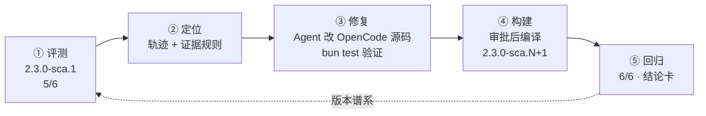

## 3 在 Portal 里怎么点

以下截图全部来自 2026-11-17 的一次真实运行，由浏览器自动化脚本像用户一样逐步点击并截图（`.data/tools/walkthrough.py`）。本次 ID：基线运行 `ed36ecb9`、失败任务 `98432901`、修复任务 `f796e891`、构建 `4e1eb230`、新版本 `2.3.0-sca.4`、复测运行 `dc49829e`。

### ① 评测

“评测中心”选套件 `opencode-demo`、后端 OpenCode、版本 `2.3.0-sca.1`，点“启动评测”。约 2.5 分钟后看到运行详情：顶部是“快 · 准 · 稳 · 省”四张卡，中间是每题每次重复的矩阵，底部是证据规则。

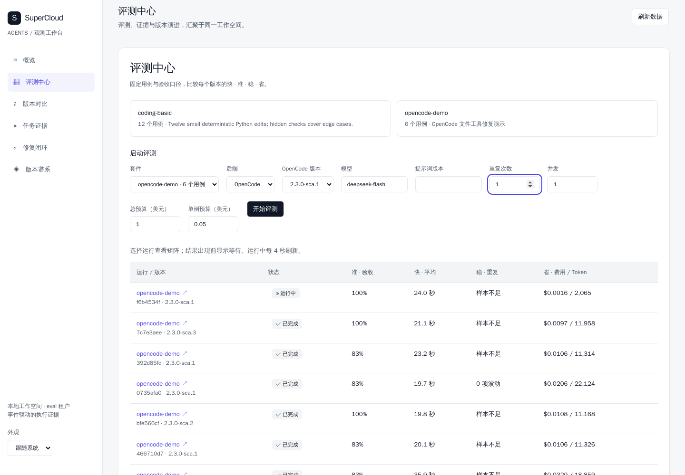
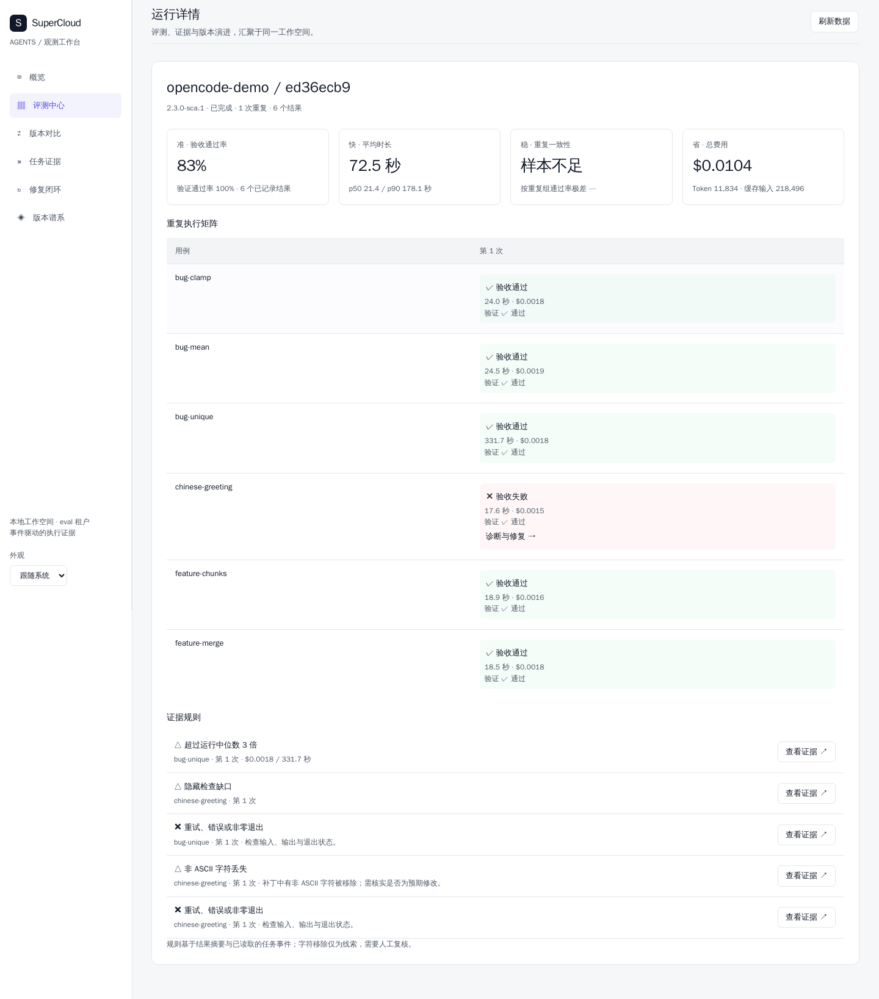

### ② 定位

点失败题进入“任务证据”。泳道图按真实时间排出模型调用、工具、命令、文件修改、验证；上方一行是模型 / 工具 / 其它时间占比。点“文件编辑”这一条，右侧证据面板显示：Agent 的编辑只把 `return a - b` 改成 `return a + b`，但文件里的两行中文问候语被清空了，规则自动标出“非 ASCII 字符丢失”。这就是指向 OpenCode 文件写入路径的直接证据。

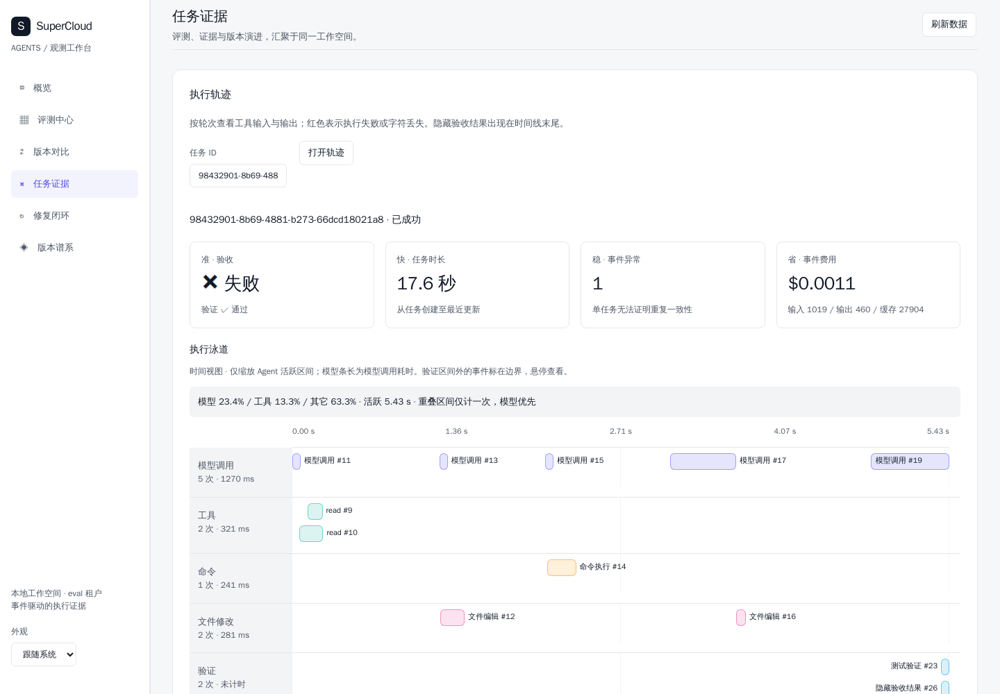
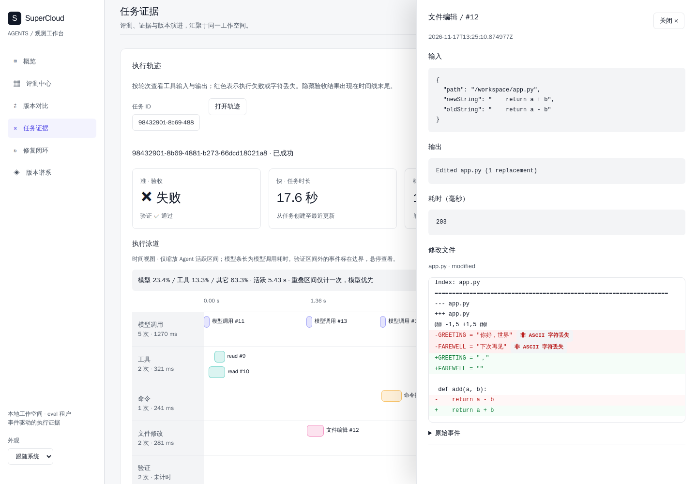
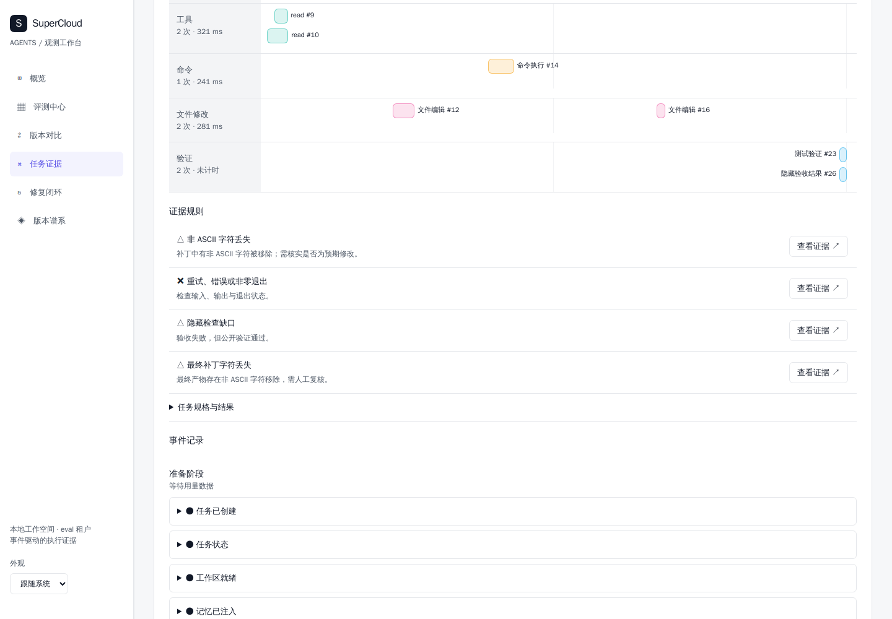

### ③ 修复

“修复闭环”页填写诊断（一两句话说明看到了什么），选修复 Agent 和模型，点“发起修复”。平台创建一个编码任务，仓库是 OpenCode 源码，带上来源标签（哪次评测、哪道题、哪个失败任务、哪个版本）。约 2 分钟后 Agent 找到 `FileWrite.commit` 里的正则、删掉它、为 edit 和 write 两个工具各补一条中文回归测试，`bun test` 通过，平台推送分支等待审批。

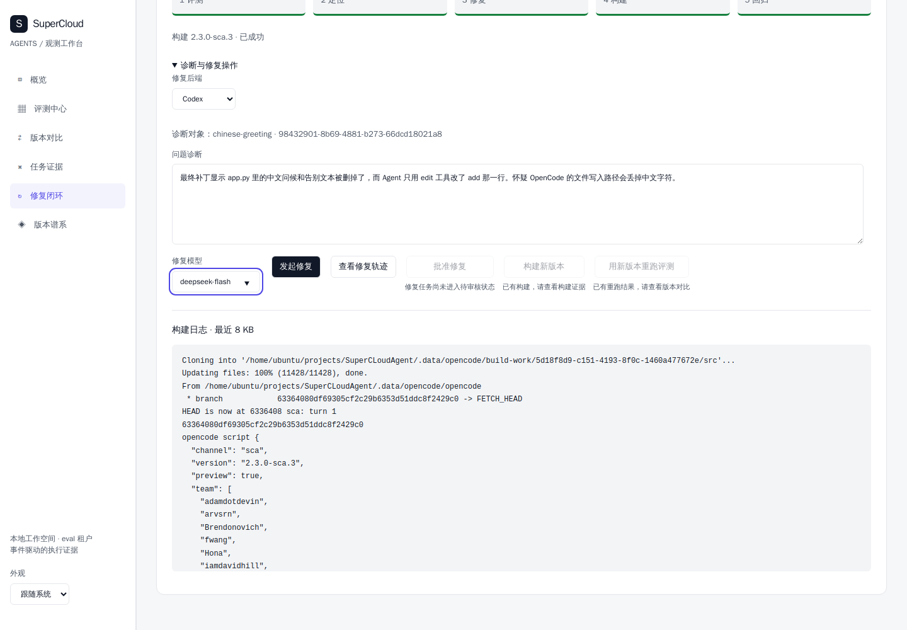
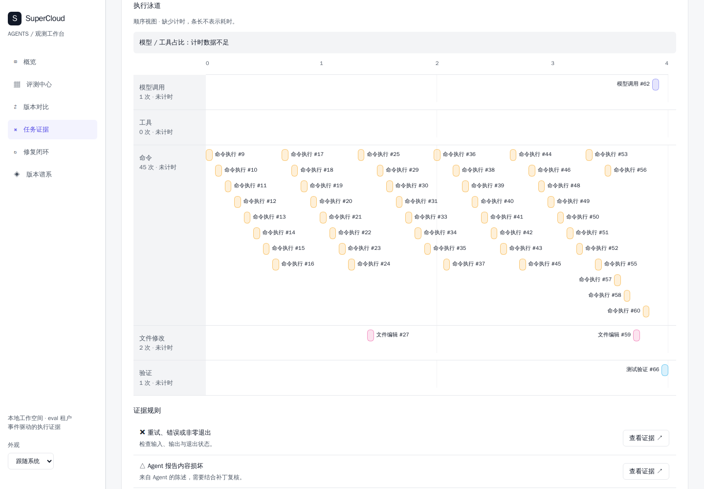
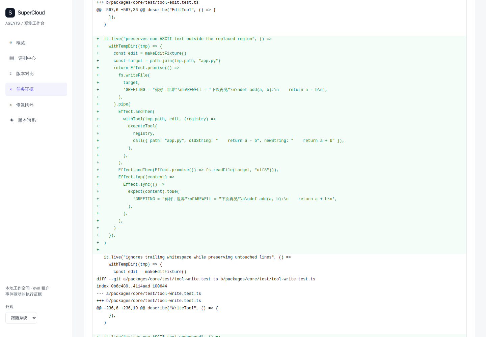

### ④ 构建

点“批准修复”，再点“构建新版本”。平台在一个断网、限内存的容器里编译修复后的提交，日志实时滚动；约 30 秒后得到 `2.3.0-sca.4`，版本元数据记录了源提交、来源修复任务和标签。

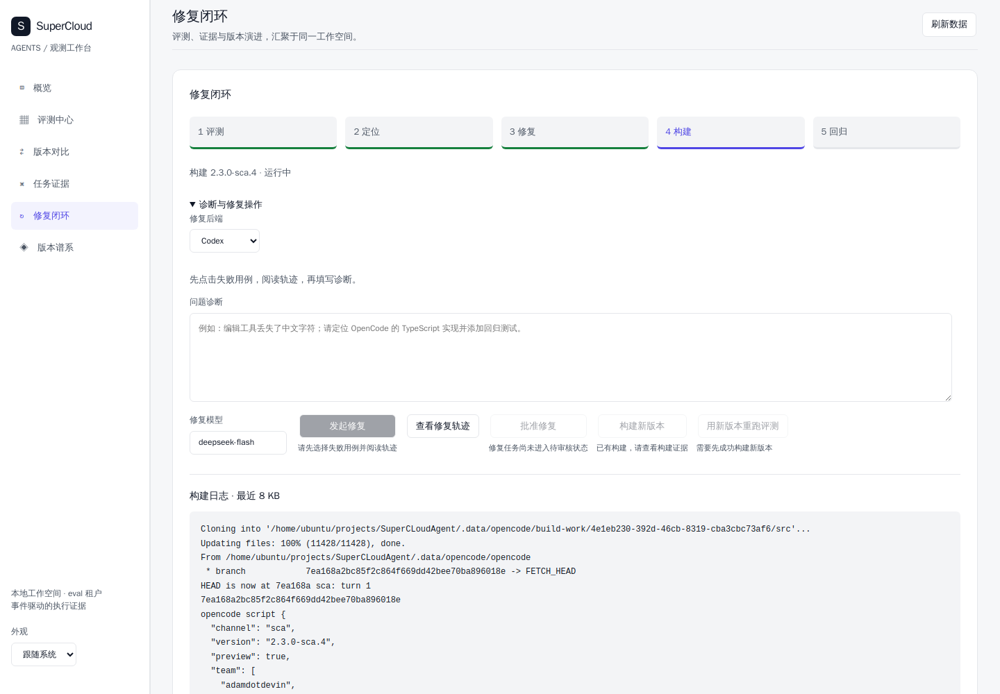

### ⑤ 回归

点“用新版本重跑评测”。约 2 分钟后跳到版本对比：结论卡“建议采纳”，准确率 83% → 100%，修复 1 题、回归 0 题；逐题表格可以点进两边的证据。“版本谱系”页能看到每个版本由哪个修复任务产生。

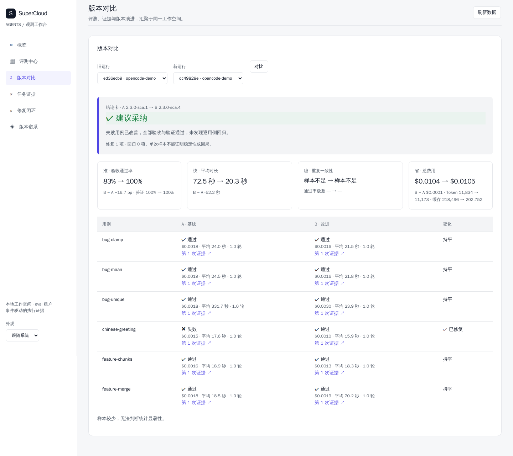
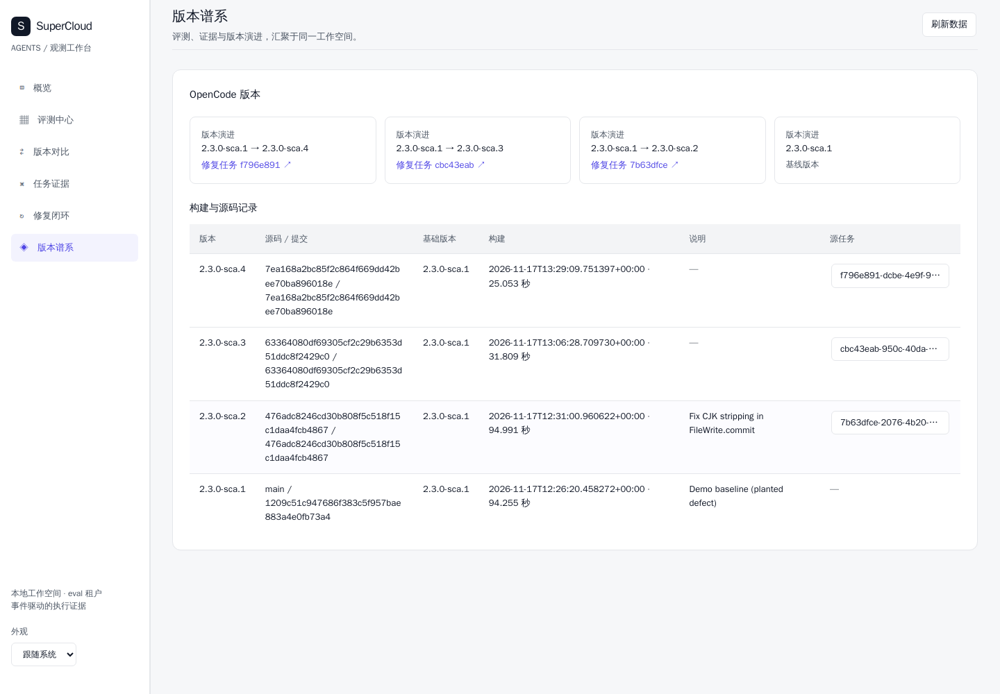
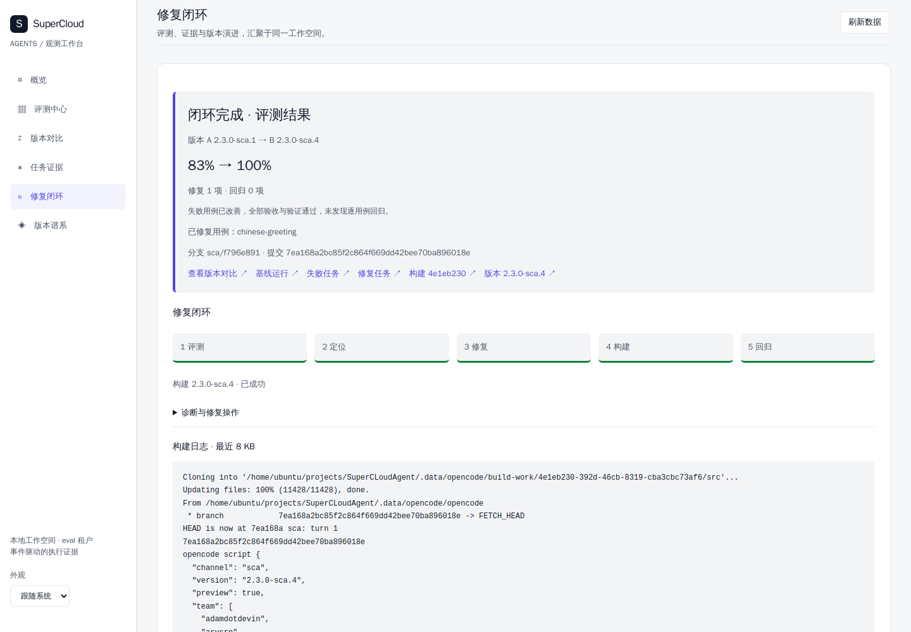

## 4 背后做了什么

| 部分 | 实现 |
| --- | --- |
| OpenCode 后端 | `src/sca/agents/opencode.py`：版本二进制只读挂进沙箱，`opencode run --format json`；JSON 事件映射为平台事件，工具、命令、文件修改带开始/结束时间，模型调用带耗时 |
| 编译 | `src/sca/agents/opencode_build.py`：Temporal 工作流；断网、2.5 GB 内存上限、依赖只读挂载；日志逐行写出；成功后删除编译目录 |
| 修复任务 | `POST /v1/agents/opencode/fixes`：任务标签记录来源；依赖缓存只读挂进沙箱，工作区从 3.3 GB 降到 343 MB |
| 评测 | `/v1/evals/*`：评测运行、结果、对比；eval 租户的数据有行级隔离（迁移 0011） |
| Portal | `src/sca/api/static/portal.html`：单文件、离线可用、明暗主题；路由 `#/overview` `#/evals` `#/runs/<id>` `#/compare/<a>/<b>` `#/tasks/<id>` `#/loop` `#/versions`；参考 awesomeTelemetry 的“快 · 准 · 稳 · 省”、泳道、结论卡和证据规则 |
| 清理 | 维护任务删除已归档终态任务的工作区（`SCA_WORKSPACE_RETENTION_HOURS`，默认 1 小时） |
| 网关 | 发 key 时对瞬时连接错误重试，修掉了首轮偶发 ECONNRESET |

## 5 在另一台电脑上运行

```bash
git clone <本仓库> && cd SuperCloudAgents
make portal-setup      # 第一次会生成 .env 并停下，填好 DEEPSEEK_API_KEY 后再跑一次
make portal-up         # 之后每次启动
make portal-status
make portal-down
```

需要 Python 3.12、Git、Docker（含 Compose）、至少 15 GB 空闲磁盘；建议 8 GB 以上内存。setup 会拉起数据库/Temporal/网关、建沙箱镜像、下载 OpenCode v2.3.0 和约 3 GB 依赖、植入缺陷、编译基线 `2.3.0-sca.1`，最后打印 Portal 地址和随机令牌。远程机器用 `ssh -L 8000:127.0.0.1:8000 <host>` 后在本地浏览器打开。

**干净目录验证（2026-11-17）**：把仓库里受 git 管理的文件和未被忽略的新文件拷到一个空目录（等同于提交后 clone），只放入 `.env`，运行 `bash scripts/portal_demo.sh setup`：一次通过，用时 6 分 39 秒（含 pip 安装、拉起服务、迁移、建镜像、从 GitHub 下载 OpenCode 与约 3.7 GB 依赖、植入缺陷、编译基线 26 秒）。随后用浏览器自动化在这个新实例上把五步闭环完整点了一遍：基线 5/6 → 修复 → 编译 `2.3.0-sca.2` → 复测 6/6。

这次验证暴露并修掉了三个问题：生成的配置没给 brain 模式设置 docker 命令前缀（需要 `sg docker` 的机器上会失败）；Portal 只按版本号认“复测运行”，版本号与旧记录重名时“重跑”按钮被误禁用（改为只认构建之后创建的运行）；setup 要求 15 GB 空闲磁盘，本机当时只有 13 GB，清掉一个过时的 5 GB 镜像后通过。

仍未覆盖：与本机共用了 Docker 和数据库服务（不是一台真正的新机器）；macOS 和 Windows 未在真机上测。2026-11-18 起 setup 按宿主芯片选择架构，Apple 芯片使用 arm64 原生镜像和 OpenCode 编译，不再依赖 amd64 模拟。macOS/Windows 的分步说明见 [verified-scenarios.md](verified-scenarios.md)。

## 6 顺带完成：四期第一步“脑手分离”

设计见 [`docs/design-phase4.md`](../docs/design-phase4.md)。要点：

- OpenCode 2.3 的所有文件读写和进程启动都经过可插拔的 `WorkspaceDriver`。平台在沙箱外跑一个嵌入 OpenCode SDK 的“脑”进程，注册 `sca` 驱动，把每个进程启动转成 `docker exec` 进沙箱。**没有改 OpenCode，也没有自研 Agent 循环。**
- 后端名 `opencode-brain`，Portal 里可以直接选。沙箱强制断网，里面没有任何模型 key。
- 实测：同一评测集在脑手分离模式下，缺陷版 5/6（失败题相同），修复版 6/6，与整体模式一致。
- 新发现：脑的时间里约 60% 花在“每轮新起进程、加载源码”上。随后完成了常驻 brain 池（P4.1b）：一个进程并发驱动多个会话、每轮 key 隔离，每轮额外开销从约 2.6 秒降到约 0.36 秒，评测结果不变。下一步是沙箱冻结（P4.2）和只读依赖层 + overlay 工作区（P4.3）。

## 7 已知问题

- 新建评测运行后立刻查询，偶尔返回 404：接口返回 ID 时运行记录还没落库。Portal 每 4 秒刷新会自愈，脚本需要容忍。应改成先落库再返回。
- “稳”这一维度只有重复次数 ≥ 2 才有数据；演示默认重复 1 次。
- 模型调用耗时由事件时间推算，不是网关侧的遥测。
- 脑手分离模式下，取消任务时容器内子进程的回收还没有真实容器测试。
- 已解决（2026-11-18）：闭环页刷新后立刻点“构建”，可能在修复任务还没加载时构建 main。按钮现在默认禁用，没有修复任务时拒绝构建。
- 已解决（2026-11-18）：restricted 沙箱的出口白名单可以被域前置（SNI / Host）绕过。出口代理改为 TLS 检查，详见 `docs/design-phase4.md`。副作用：restricted 沙箱的 HTTPS 由部署 CA 签发，固定证书的工具会拒绝连接；K8s 的 restricted 出口在补齐 CA 分发前不可用。
- 2026-11-18 setup 新增一步：构建出口代理镜像 `sca-egress:tls-v1`。在全新拷贝里同步当前代码后，单独无缓存跑了这一步，再用新镜像跑出口测试，21 个全部通过。当时磁盘只剩 4 GB，没有重跑完整 setup（完整 setup 约需 15 GB）。
- 2026-11-18 在 overlay 工作区下复跑过一次完整闭环：每个评测工作区 86 KB，83% → 100%。overlay 仍默认关闭。
- 已解决：Agent 绕开工具缺陷也能“通过验收”。现在评测在验收之外还做过程检查（工具输出完整性、Agent 报告工具故障），重新评分后那次绕过被判为失败，修复版不受影响。

## 8 选型：为什么是 OpenCode，不是 pi

目标原话是“先评估 OpenCode 2.0 能不能编译，不行就用更轻量的 pi”。评估结果（2026-11-17）：

| 项 | OpenCode 2.3.0 | pi（`earendil-works/pi`，原 `badlogic/pi-mono`） |
| --- | --- | --- |
| 语言 / 运行时 | TypeScript + Bun。Rust 只在桌面端（Tauri）和 PTY 守护进程里，命令行版本不用编 Rust | TypeScript + Node.js ≥ 22.19 |
| 在这台 2 核 3.7 GB 机器上编译 | 可以：Bun 单目标编译约 20 秒，容器内存封顶 2.5 GB。Node 版构建脚本曾把机器拖死，已弃用 | 未编译（没有必要） |
| 非交互 / 自动化 | `opencode run --format json` 输出 JSON 事件；SDK 可嵌入 | `--mode json`（JSONL 事件）、`--mode rpc`（常驻进程，stdin/stdout JSONL）、TypeScript SDK |
| 工具 | read / edit / write / shell / grep 等 | 默认 read、bash、edit、write，可选 grep、find、ls |
| 工具能否在别处执行（脑手分离的关键） | **能**：所有文件和进程操作经可插拔的 `WorkspaceDriver`，四期 P4.1 就是靠它把工具转进断网沙箱，没改 OpenCode | 文档没有远程工具执行；工具在 pi 进程所在处运行，官方建议整体放进容器 |
| 许可 | MIT | MIT |

结论：OpenCode 能编译，所以按目标原话不需要退到 pi。更重要的是，OpenCode 的 `WorkspaceDriver` 让“脑在沙箱外、手在沙箱内”不改源码就能实现，pi 目前做不到这一点。pi 更轻、`--mode rpc` 也很适合做常驻进程，值得作为第二个被测 Agent 接进来（按 `opencode.py` 的写法写一个 `pi` 后端，整体放在沙箱里跑），用同一套评测集对比两者，这件事放在后续。

### pi 后端

新增整体运行于沙箱的 `pi` 后端，固定 npm 包 `@earendil-works/pi-coding-agent@1.5.2`（Node ≥22.19）。Portal 选择 pi 时使用镜像内版本和默认模型（演示为 `deepseek-flash`），可用同一套件对比 OpenCode。`SCA_PI_SANDBOX_IMAGE` 默认 `sca-sandbox-pi:latest`，`SCA_PI_VERSION` 默认 `1.5.2`；更改版本需同步镜像构建参数 `PI_VERSION`。会话与不含密钥的 `models.json` 保存在 `/agent_home/pi/`，临时密钥仅通过进程环境传入。内核在任务没有指定镜像时使用后端声明的镜像，所以 pi 任务会自动跑在 pi 镜像里。

2026-11-18 用真实模型（deepseek-flash）跑同一套 opencode-demo：

| 后端 | 结果 | 单例耗时 | 单例费用 |
| --- | --- | --- | --- |
| OpenCode 2.3.0-sca.1（含预埋缺陷） | 5/6，chinese-greeting 过程检查不通过 | 22–57 秒 | 0.0013–0.0079 美元 |
| OpenCode 2.3.0-sca.6（修复版） | 6/6 | 19–39 秒 | 0.0010–0.0040 美元 |
| pi 1.5.2 | 6/6 | 17–39 秒 | 0.0007–0.0047 美元 |

pi 的 chinese-greeting 能通过，是因为预埋缺陷只在 OpenCode 里。pi 跑 bug-clamp 时总时长 752 秒，其中 728 秒是排队，不是 pi 本身慢（原因见 `docs/design-phase4.md` 的负责人验证一节）。在 Portal 的“版本对比”里选两次运行即可对比。
