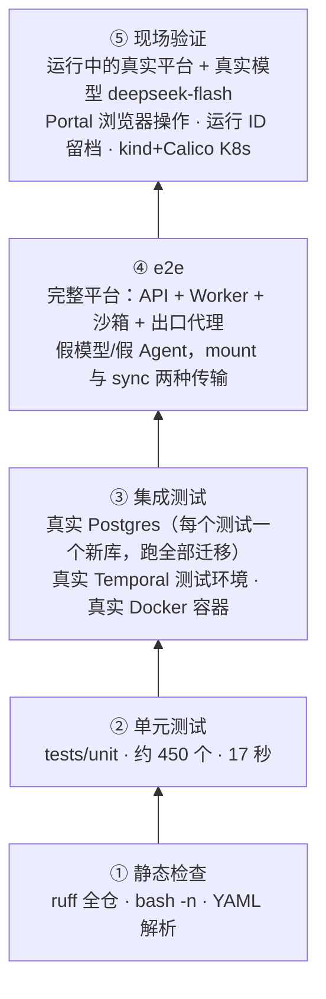
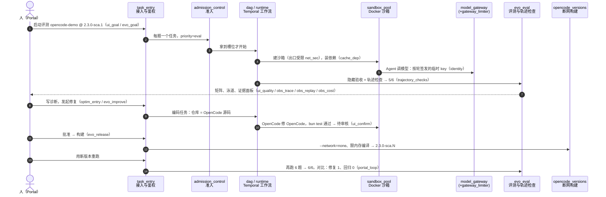

# 负责人自验证流程（按架构图展开）

快照：提交 `a816094` 之后（2026-11-19），架构图数据见 [data.json](data.json)，离线浏览器见 [index.html](index.html)。
本文回答三个问题：

1. 每项能力是**怎么**验证的（验证方法与分层）；
2. 一次完整的业务流程**经过了架构图上的哪些模块**，每一步用什么证据确认；
3. 架构图上 64 个模块**各自验证到了哪一级**、还缺什么。

最后一节是让另一台机器（例如 Mac + Docker Desktop）上的 agent 照着复现验证的步骤。

相关文档：[verified-scenarios.md](verified-scenarios.md)（已跑通场景与启动指引）、
[portal-demo.md](portal-demo.md)（Portal 闭环截图）、`docs/design-phase4.md`（每项的负责人现场验证原始记录）。

---

## 1 验证方法：五层，每层都必须过



| 层 | 跑什么 | 本批次结果 | 证明什么 / 不能证明什么 |
|---|---|---|---|
| ① 静态 | `ruff check src tests scripts`、`bash -n` | 全部通过 | 只证明代码风格和语法 |
| ② 单元 | `pytest tests/unit` | 449 passed、1 skipped | 单个模块逻辑；外部依赖都是假的 |
| ③ 集成 | `pytest tests/integration` | 包含在全量里 | 数据库迁移、RLS、Temporal 工作流、Docker 沙箱真实行为 |
| ④ e2e | `pytest tests/e2e` | 包含在全量里 | 整条任务链路；模型是假的 |
| ①–④ 全量 | `pytest tests`（约 16 分钟） | **711 passed、48 skipped、0 failed** | 48 个跳过是需要额外开关的用例（真实 Codex、K8s、可选 Docker 专项） |
| ⑤ 现场 | 真实平台上提交任务、跑评测、在 Portal 点按钮 | 见第 2、5 节，每次都有运行 ID | 真实模型下的行为；单次运行不代表稳定性 |
| ⑤ K8s | kind 两节点 + Calico，`SCA_TEST_EGRESS=1 pytest tests/integration/test_k8s_sandbox.py` | 23 passed、0 skipped | 真实集群里的沙箱、网络隔离、TLS 出口 |

**每项新能力的固定流程**（这批 pi / P4.2 / P4.4 / P4.5 / P4.6 / K8s CA 都走了一遍）：

1. 负责人写任务书：范围（只能改哪些文件）、契约、**退出条件**（要量什么、阈值多少）。
2. Codex worker 实现，自带单元/集成测试，交回报告（完成了什么、没验证什么）。
3. 负责人审 diff，重点看：默认值是否关闭、是否越界改文件、是否把“未验证”写成“已验证”。
4. 负责人在**运行中的平台**上打开开关现场跑，记录运行 ID 和数字，写进 `docs/design-phase4.md` 的“负责人现场验证”。
5. 全量回归 ①–④。本批次第一次全量 704 passed、5 failed，查出 worker 引入的 2 个真回归（见第 5 节），修完复跑 711 全绿。
6. 提交前扫描：`.env` 里的密钥值、私钥头、`ghp_`/`sk-` 前缀、个人邮箱，在全部改动文件里都不能出现。
7. 让 Codex 按新提交重审架构图（`Milestone/AUDIT.md`），`validate.py` 检查 210 个证据路径都存在。

---

## 2 主链路：一次 Portal 闭环经过了哪些模块

这是验证最完整的一条链路（真实模型、浏览器操作）。左边是架构图模块 id，可以在 [index.html](index.html) 里点开看详情。



每一步的确认方式：

| 步骤 | 确认方式 | 留档 |
|---|---|---|
| 1–3 评测启动、准入 | 事件流里有 `admission.waiting`/`admission.granted`；任务按 priority 排队 | 运行 `bc9c9caf`（开准入+限流） |
| 4 建沙箱 | `workspace.prepared` 事件；沙箱访问白名单外域名被拒（SNI/Host 前置也拒） | 出口测试 21 + kind 23 passed |
| 5 模型调用 | 网关日志有调用、沙箱里没有长期 key；限流代理 `/metrics` 计数 45 次、上游 429 为 0 | `bc9c9caf` |
| 6 评分 | 中文题：验收或轨迹规则任一失败即判失败 | `ed36ecb9`、`867435e6` 均 5/6 |
| 7 观测 | 浏览器里点开泳道、证据面板看到中文被清空 | portal-demo.md 截图 |
| 8–10 修复 | 修复任务带来源标签；补丁删掉出问题的正则并加测试；状态 AWAITING_REVIEW | `98432901`、`ae7a9c21` |
| 11–12 构建 | 版本元数据记录源提交和来源任务；构建容器断网 | `4e1eb230`→sca.4、`4969d9bf`→sca.6 |
| 13–14 回归 | 版本对比：83% → 100%，结论“建议采纳” | `dc49829e`、`20fd5709` |

同一条链路还换着开关跑过：overlay 工作区（`867435e6`→`20fd5709`）、空闲冻结（`3da076b2` 6/6）、
准入+限流（`bc9c9caf` 6/6）、换 pi 后端（`c822cb6a` 6/6）、快照分叉（`4ea19169`/`051793ca`，第二次跳过 setup）。

---

## 3 架构图着色：每个模块验证到哪一级

```mermaid
flowchart TB
  classDef live fill:#d3f9d8,stroke:#2b8a3e,color:#111
  classDef tested fill:#d0ebff,stroke:#1971c2,color:#111
  classDef planned fill:#f1f3f5,stroke:#868e96,color:#555,stroke-dasharray:4 3
  subgraph G0["人类工作入口层"]
    direction LR
    ui_goal["目标与任务指定"]
    ui_dispatch["任务下发"]
    ui_quality["任务质量看板"]
    ui_confirm["人工确认 / 再优化"]
    ui_approve["人工例外审批"]
    ui_history["任务历史与回放"]
  end
  subgraph G1["左翼 · 设计系统对接区"]
    direction LR
    design_in["设计稿与工单接入"]
    design_spec["设计规范与 Token"]
    design_intent["设计意图解析器"]
  end
  subgraph G2["右翼 · 验证反馈系统对接区"]
    direction LR
    verify_gw["验证反馈网关"]
    verify_parser["结构化验证解析器"]
    quality_echo["质量回显与例外审批"]
  end
  subgraph G3["接入与编排段"]
    direction LR
    task_entry["任务接入与统一鉴权"]
    planner["任务理解与规划器"]
    decouple["软件工程解耦分析器"]
    dag["全局 DAG 编排器"]
    checkpoint["检查点与续存管理"]
    subtask_q["子任务队列与调度"]
    optim_entry["再优化任务入口"]
    evo_trigger["自进化触发器"]
  end
  subgraph G4["Agent 运行时与沙箱执行段"]
    direction LR
    sandbox_sched["沙箱调度器"]
    sandbox_pool["沙箱池与并发实例"]
    runtime["Agent Runtime"]
    executor["子任务执行与装配"]
    recover_gate["会话恢复门"]
    hand_brain["Tool 网关与工具域"]
  end
  subgraph G5["共享服务段"]
    direction LR
    memory["共享记忆服务"]
    identity["Agent 身份与权限"]
    knowledge["企业私域知识库"]
    tool_domain["部门工具域"]
    audit["审计与合规服务"]
  end
  subgraph G6["缓存服务区"]
    direction LR
    cache_code["代码缓存服务"]
    cache_dep["依赖与二进制缓存"]
    cache_gw["缓存挂载网关"]
  end
  subgraph G7["存储与算力底座"]
    direction LR
    object_store["对象存储"]
    vector_store["向量索引存储"]
    repos["代码仓与制品库"]
    k8s["容器与 K8s 集群"]
    compute["CPU / GPU 算力池"]
    kms["密钥与证书 KMS"]
    obs_store["日志与追踪存储"]
    net_sec["网络与安全基础设施"]
  end
  subgraph G8["自进化引擎 ⑦"]
    direction LR
    evo_goal["目标与评测管理"]
    evo_eval["评测沙箱与结果"]
    evo_improve["策略与代码改进"]
    evo_release["版本发布与回滚"]
  end
  subgraph G9["可观测与任务追踪 ⑧"]
    direction LR
    obs_trace["Session→Trace→Span"]
    obs_replay["轨迹回放与可视化"]
    obs_cost["Token 与成本归因"]
    obs_risk["质量视图与风险回溯"]
  end
  subgraph G10["V2 新增能力"]
    direction LR
    analysis_kind["数据分析场景"]
    model_gateway["按轮签发的模型网关"]
    portal_loop["Portal 评测→修复→回归"]
    opencode_versions["OpenCode 构建与版本注册"]
    brain_split["OpenCode 脑手分离"]
    brain_pool["常驻 brain 池"]
    trajectory_checks["评测轨迹检查与重评分"]
    admission_control["准入控制与加权排序"]
    gateway_limiter["模型网关限流代理"]
    workspace_overlay["只读层与 overlay 工作区"]
    workspace_forks["准备快照与分叉"]
    pi_backend["pi 编码后端"]
    idle_suspend["沙箱空闲冻结"]
    handd["沙箱长连接执行 handd"]
  end
  G0 --> G3 --> G4 --> G5 --> G6 --> G7
  G1 --> G3
  G4 --> G2 --> G0
  G4 --> G9
  G8 --> G3
  G10 -.-> G4
  class ui_goal live
  class ui_dispatch live
  class ui_quality live
  class ui_confirm live
  class ui_approve tested
  class ui_history live
  class design_in tested
  class design_spec tested
  class design_intent tested
  class verify_gw tested
  class verify_parser tested
  class quality_echo tested
  class task_entry live
  class planner tested
  class decouple tested
  class dag tested
  class checkpoint tested
  class subtask_q tested
  class optim_entry live
  class evo_trigger tested
  class sandbox_sched live
  class sandbox_pool live
  class runtime live
  class executor live
  class recover_gate tested
  class hand_brain live
  class memory tested
  class identity live
  class knowledge tested
  class tool_domain planned
  class audit tested
  class cache_code tested
  class cache_dep live
  class cache_gw tested
  class object_store tested
  class vector_store tested
  class repos live
  class k8s live
  class compute tested
  class kms tested
  class obs_store tested
  class net_sec live
  class evo_goal live
  class evo_eval live
  class evo_improve live
  class evo_release live
  class obs_trace live
  class obs_replay live
  class obs_cost live
  class obs_risk tested
  class analysis_kind tested
  class model_gateway live
  class portal_loop live
  class opencode_versions live
  class brain_split live
  class brain_pool live
  class trajectory_checks live
  class admission_control live
  class gateway_limiter live
  class workspace_overlay live
  class workspace_forks live
  class pi_backend live
  class idle_suspend live
  class handd live
```




图例：🟢 绿色 = 在真实平台上跑通过（真实 Temporal / Postgres / Docker 沙箱 / 网关，大部分配真实模型 deepseek-flash）；🔵 蓝色 = 集成或 e2e 测试覆盖（真实基础设施、假模型）；⚪ 灰色虚线 = 未实现。连线只表示层与层之间的主要调用方向。

统计：64 个模块中 🟢 37 个、🔵 26 个、⚪ 1 个。

## 4 逐层验证明细（由 data.json 生成）

每个模块列出：架构图里的状态、本次的验证级别、覆盖它的测试文件、负责人的复核说明、仍然缺的部分。测试路径都在提交里存在（`Milestone/validate.py` 会逐个检查）。

### 4.1 人类工作入口层：设计平台 / 研发工作台（人类唯一工作入口）

| 模块 | 状态 | 验证级别 | 覆盖的测试 | 负责人复核 | 仍缺 |
|---|---|---|---|---|---|
| **目标与任务指定**<br>`ui_goal` | 完成 | 🟢 现场 | `test_api.py`<br>`test_kinds.py`<br>`test_portal_static.py`<br>`test_portal.py` | 原场景表单与预算契约保留；Portal 另提供后端/模型/版本选择。 | — |
| **任务下发**<br>`ui_dispatch` | 完成 | 🟢 现场 | `test_api.py`<br>`test_workflow.py`<br>`test_spec_priority.py`<br>`test_admission_store.py` | API 集成测试覆盖首次启动失败后重试，避免重复创建任务。 | — |
| **任务质量看板**<br>`ui_quality` | 部分 | 🟢 现场 | `test_e2e_obs.py`<br>`test_obs_queries.py`<br>`test_portal_static.py`<br>`test_portal.py` | Grafana 通过率来自验证活动计数。未配置编码验证命令的跳过分支也会计为通过。 | 稳定性维度与充分重复实验；缺陷 / 覆盖率跨项目聚合 |
| **人工确认 / 再优化**<br>`ui_confirm` | 完成 | 🟢 现场 | `test_e2e_fake.py`<br>`test_e2e_memory.py`<br>`test_portal_static.py`<br>`test_portal.py` | 审核期间保留沙箱及槽位，空闲超时才一同释放；修改反馈必要时重新准入。 | — |
| **人工例外审批**<br>`ui_approve` | 部分 | 🔵 测试 | `test_e2e_planning.py`<br>`test_e2e_fake.py`<br>`test_workflow.py` | 仍按规划/验证状态转人工，未按置信度或风险等级路由。 | 按置信度或风险等级路由审批；独立例外审批工作台 |
| **任务历史与回放**<br>`ui_history` | 部分 | 🟢 现场 | `test_notify.py`<br>`test_archive.py`<br>`test_portal_static.py`<br>`test_portal.py` | Portal 真实走查已验证失败题定位；时间来源包含事件估算，不等同于精确模型网关遥测。 | 任意时点的开发现场重演 |

### 4.2 左翼 · 设计系统对接区

| 模块 | 状态 | 验证级别 | 覆盖的测试 | 负责人复核 | 仍缺 |
|---|---|---|---|---|---|
| **设计稿与工单接入**<br>`design_in` | 部分 | 🔵 测试 | `test_e2e_intents.py`<br>`test_files.py` | 文件输入适配器仍无在线 Figma/工单连接；overlay 仓库相对路径 intent 未获支持。 | Figma API 连接；工单同步与回写 |
| **设计规范与 Token**<br>`design_spec` | 部分 | 🔵 测试 | `test_intents_adapters.py`<br>`test_e2e_intents.py` | 仍为规则配置及截图基准，不含 Token 语义或组件库同步。 | Design Token 语义解析；组件库同步 |
| **设计意图解析器**<br>`design_intent` | 完成 | 🔵 测试 | `test_intents_kernel.py`<br>`test_e2e_intents.py` | 三类适配器及沙箱检查保留；未宣称 overlay 下仓库相对路径输入已接通。 | — |

### 4.3 右翼 · 验证反馈系统对接区

| 模块 | 状态 | 验证级别 | 覆盖的测试 | 负责人复核 | 仍缺 |
|---|---|---|---|---|---|
| **验证反馈网关**<br>`verify_gw` | 完成 | 🔵 测试 | `test_e2e_verification.py`<br>`test_e2e_ci_real.py`<br>`test_ci_token_scope.py` | 独立命令验证与 CI 提交关联保留；四期过程评分另在 eval 层，不能替代命令验证。 | — |
| **结构化验证解析器**<br>`verify_parser` | 部分 | 🔵 测试 | `test_e2e_verification.py` | 结构化退出码/日志仍是通用验证核心；Portal 的启发式诊断不等于通用扫描报告根因解析。 | 通用扫描报告解析；自动根因 / 风险分析 |
| **质量回显与例外审批**<br>`quality_echo` | 部分 | 🔵 测试 | `test_e2e_fake.py`<br>`test_portal_static.py`<br>`test_portal.py` | — | 回写外部设计 / 工单平台；稳定性维度验收 |

### 4.4 接入与编排段

| 模块 | 状态 | 验证级别 | 覆盖的测试 | 负责人复核 | 仍缺 |
|---|---|---|---|---|---|
| **任务接入与统一鉴权**<br>`task_entry` | 完成 | 🟢 现场 | `test_tenancy.py`<br>`test_authz.py`<br>`test_e2e_live_services.py` | 认证、角色与 RLS 保留；活跃配额转为执行前准入，提交只限制排队积压。 | — |
| **任务理解与规划器**<br>`planner` | 完成 | 🔵 测试 | `test_planning.py`<br>`test_e2e_planning.py`<br>`test_workflow.py` | 仍校验 2–8 个子任务与已跟踪路径重叠；未新增语义依赖推导。 | — |
| **软件工程解耦分析器**<br>`decouple` | 部分 | 🔵 测试 | `test_planning.py`<br>`test_merge.py` | 仍不强制执行期的规划路径范围。 | 执行期路径边界强制；语义依赖与影响面分析；跨模块契约推导 |
| **全局 DAG 编排器**<br>`dag` | 改造 | 🔵 测试 | `test_workflow.py`<br>`test_e2e_resilience.py` | Temporal 编排边界保留，四期增加持久准入等待，不是通用 DAG 编辑器。 | 通用依赖图建模与编辑；V1 自研调度服务 |
| **检查点与续存管理**<br>`checkpoint` | 部分 | 🔵 测试 | `test_state.py`<br>`test_e2e_resilience.py`<br>`test_overlay_workspace.py`<br>`test_workspace_snapshots.py` | 跨 Worker 检查点续跑的历史验证适用于原有传输路径；常驻 brain 的共享 SQLite 尚不支持按任务归档/跨 Worker 迁移，当前需 Worker 亲和。 | 任意历史时点的任务分叉；跨节点 overlay 共享存储和恢复验证；常驻 brain 会话跨 Worker 迁移 |
| **子任务队列与调度**<br>`subtask_q` | 改造 | 🔵 测试 | `test_e2e_subtasks.py`<br>`test_merge.py` | 子任务依然共享父槽位；全局父任务限额不等于子沙箱限额。 | 通用子任务依赖调度器；独立队列服务 |
| **再优化任务入口**<br>`optim_entry` | 完成 | 🟢 现场 | `test_e2e_fake.py`<br>`test_e2e_resilience.py`<br>`test_e2e_codex.py` | 同任务反馈续接保留；审核超时释放后会先重新申请执行槽位。 | — |
| **自进化触发器**<br>`evo_trigger` | 部分 | 🔵 测试 | `test_e2e_evaluation.py`<br>`test_evaluation.py`<br>`test_eval_runner.py`<br>`test_opencode_linkage.py` | ADR-18 将自动改进闭环列为当前范围之外。 | 无需人工诊断的自动改进触发；自动推广版本 |

### 4.5 Agent 运行时与沙箱执行段

| 模块 | 状态 | 验证级别 | 覆盖的测试 | 负责人复核 | 仍缺 |
|---|---|---|---|---|---|
| **沙箱调度器**<br>`sandbox_sched` | 改造 | 🟢 现场 | `test_k8s_sandbox.py`<br>`test_e2e_k8s.py`<br>`test_admission.py`<br>`test_admission_store.py` | 历史多节点用例由宿主机上的 Worker 驱动，使用 nodeSelector 把沙箱 Pod 放在 kind 工作节点。 | 独立跨集群调度服务；子沙箱独立限槽 |
| **沙箱池与并发实例**<br>`sandbox_pool` | 部分 | 🟢 现场 | `test_k8s_sandbox.py`<br>`test_k8s_manifest.py` | 仍是固定容量池；四期 CA 指纹用于只认领当前证书配置的 restricted Pod，旧空闲 Pod 会回收。 | 池容量随负载伸缩；生产集群时延验证 |
| **Agent Runtime**<br>`runtime` | 改造 | 🟢 现场 | `test_codex_agent.py`<br>`test_e2e_codex.py`<br>`test_opencode.py`<br>`test_opencode_brain.py`<br>等 5 个 | ADR-03 和 ADR-05 将完整 Agent 循环保留在沙箱内，后端通过接口替换。 | V1 独立 Runtime 服务；K8s 上真实 Agent 模型网关接通 |
| **子任务执行与装配**<br>`executor` | 改造 | 🟢 现场 | `test_layering.py`<br>`test_kinds.py`<br>`test_e2e_analysis.py` | 内核通过场景实际 backend 取得附加挂载、网络与镜像，修复任务的只读依赖不再丢失。 | V1 独立执行与装配服务 |
| **会话恢复门**<br>`recover_gate` | 改造 | 🔵 测试 | `test_state.py`<br>`test_e2e_resilience.py`<br>`test_overlay_workspace.py` | 恢复前检查对象内容的 SHA-256；故障发生在轮次中途时，从上一份已发布状态重做。 | V1 多类检查点与外部副作用核验 |
| **Tool 网关与工具域**<br>`hand_brain` | 改造 | 🟢 现场 | `test_codex_agent.py`<br>`test_egress.py`<br>`test_opencode_brain.py`<br>`test_brain_cancellation.py` | P4.1 负责人确认 sca.1 5/6、修复版 6/6；P 小修复补记确认真实容器取消后 sleep 在 10 秒内消失。 | brain 工具路由到 handd；部门工具目录和授权；PTY 通道 |

### 4.6 共享服务段

| 模块 | 状态 | 验证级别 | 覆盖的测试 | 负责人复核 | 仍缺 |
|---|---|---|---|---|---|
| **共享记忆服务**<br>`memory` | 部分 | 🔵 测试 | `test_e2e_memory.py`<br>`test_memory_vectors.py`<br>`test_memory_gateway.py` | 仍是可审核短记忆与向量回退；池模式绕过工具缺陷的记忆提议不证明质量改善。 | 真实 embeddings 模型链路复验；记忆对任务质量的对比实验 |
| **Agent 身份与权限**<br>`identity` | 部分 | 🟢 现场 | `test_authz.py`<br>`test_ci_token_scope.py` | brain 临时 key 在沙箱外；其他整体后端仍在沙箱内使用受限临时 key，不是工作负载证书体系。 | Agent 工作负载证书身份；部门级工具授权模型 |
| **企业私域知识库**<br>`knowledge` | 部分 | 🔵 测试 | `test_memories.py`<br>`test_e2e_memory.py` | 四期未增加企业文档连接、权限同步或引用溯源。 | 企业文档连接与分块；文档级权限同步与引用溯源 |
| **部门工具域**<br>`tool_domain` | 规划 | ⚪ 未实现 | — | 目标提交仍无部门工具注册与授权产品；多个 Agent 后端不等于部门工具域。 | 部门工具注册与版本；按团队授予工具权限 |
| **审计与合规服务**<br>`audit` | 部分 | 🔵 测试 | `test_archive.py`<br>`test_memories.py`<br>`test_authz.py` | 新增准入、分叉及过程评分证据；未引入不可篡改审计导出。 | 合规策略与留存管理产品；防篡改审计导出 |

### 4.7 缓存服务区（本层核心加速能力）

| 模块 | 状态 | 验证级别 | 覆盖的测试 | 负责人复核 | 仍缺 |
|---|---|---|---|---|---|
| **代码缓存服务**<br>`cache_code` | 部分 | 🔵 测试 | `test_workspace_cache.py`<br>`test_layers.py`<br>`test_workspace_layers.py` | B1.6 规定每台 Worker 保有独立仓库缓存。 | 跨 Worker 分布式缓存管理；按负载预热与容量伸缩 |
| **依赖与二进制缓存**<br>`cache_dep` | 部分 | 🟢 现场 | `test_workspace_cache.py`<br>`test_e2e_verification.py`<br>`test_layers_build.py`<br>`test_opencode.py` | Portal 初期依赖挂载将工作区从 3.3 GB 降到 343 MB；四期 overlay 另以 upper 计量，不能混淆两者统计口径。 | 通用包管理器缓存；跨节点依赖分发与命中管理 |
| **缓存挂载网关**<br>`cache_gw` | 部分 | 🔵 测试 | `test_workspace_transport.py`<br>`test_prepared_workspace_forks.py` | — | 独立动态缓存挂载服务；跨节点依赖缓存管理 |

### 4.8 存储与算力底座

| 模块 | 状态 | 验证级别 | 覆盖的测试 | 负责人复核 | 仍缺 |
|---|---|---|---|---|---|
| **对象存储**<br>`object_store` | 完成 | 🔵 测试 | `test_object_store.py`<br>`test_e2e_live_services.py` | 本地/S3 与 manifest-last 持久化边界保留，overlay 新增校验过的状态对象。 | — |
| **向量索引存储**<br>`vector_store` | 部分 | 🔵 测试 | `test_memory_vectors.py` | 真实 pgvector + 确定性假向量历史验证保留；未找到真实 embeddings 验证补记。 | 真实 embeddings 服务验证；固定维度近似索引与容量评估 |
| **代码仓与制品库**<br>`repos` | 部分 | 🟢 现场 | `test_workspace.py`<br>`test_e2e_ci_real.py`<br>`test_e2e_secrets.py` | 仍只推分支、不自动创建 PR 或合入；OpenCode 版本仓库/构建另列 V2 能力。 | 自动创建 / 更新 PR；统一制品及镜像仓库产品 |
| **容器与 K8s 集群**<br>`k8s` | 部分 | 🟢 现场 | `test_k8s_sandbox.py`<br>`test_e2e_k8s.py`<br>`test_k8s_manifest.py` | 负责人 2026-11-18 kind + Calico 23 passed、无跳过，包含 TLS 出口。测试使用单 Worker 宿主目录；多副本 RWX CA PVC 未验证。K8s + model gateway 在 factory 仍被拒绝。 | Worker 实际集群部署、RBAC、探针、排空与伸缩；多副本 RWX CA PVC 实测；K8s 真实模型网关闭环；生产 HA 与容量 |
| **CPU / GPU 算力池**<br>`compute` | 部分 | 🔵 测试 | `test_k8s_manifest.py` | 资源 limits 与 HPA/KEDA 示例边界未扩成生产容量证明；父任务准入不限制所有子沙箱总数。 | GPU 资源调度；Worker 实际伸缩、KEDA 与容量基线 |
| **密钥与证书 KMS**<br>`kms` | 部分 | 🔵 测试 | `test_secrets.py`<br>`test_e2e_secrets.py`<br>`test_github_app_setup.py`<br>`test_egress_rules.py`<br>等 5 个 | B4 记录真实 Gitea + OpenBao 路径通过。2026-11-16 真实私有 App 仅安装在一个私有测试仓库：OpenBao 保存私钥，Worker 自行换取安装令牌，克隆、推送任务分支、审阅通过；令牌未进入事件、捕获日志或 Temporal 历史，测试分支已清理。接入脚本新增 import 命令，先调用 GET /app 核对私钥所属 App。 | 自动 CA 轮换 / 通用 KMS 生命周期；多副本 RWX CA 卷验证 |
| **日志与追踪存储**<br>`obs_store` | 完成 | 🔵 测试 | `test_e2e_obs.py`<br>`test_maintenance.py` | 三路观测和本地 webhook 历史结果保留；真实 Slack/邮件仍未验证。 | 真实 Slack / 邮件渠道投递验证 |
| **网络与安全基础设施**<br>`net_sec` | 部分 | 🟢 现场 | `test_egress.py`<br>`test_e2e_k8s.py`<br>`test_k8s_sandbox.py`<br>`test_egress_tls.py`<br>等 5 个 | 负责人补记覆盖早期 K8s exit 1 的阻塞；目标提交已恢复 restricted TLS 出口。不能把 23 项 TLS 测试算成 K8s 完整真实模型闭环。 | K8s 真实 Agent 模型网关安全接通；多副本 CA 共享与轮换运维验证；HTTP/2 合并、ECH 等进一步对抗覆盖 |

### 4.9 自进化引擎 ⑦：目标 → 评测 → 迭代 → 发布 → 回归

| 模块 | 状态 | 验证级别 | 覆盖的测试 | 负责人复核 | 仍缺 |
|---|---|---|---|---|---|
| **目标与评测管理**<br>`evo_goal` | 完成 | 🟢 现场 | `test_evaluation.py`<br>`test_eval_runner.py`<br>`test_eval_trajectory.py`<br>`test_eval_submission.py` | C4 使用 12 个 coding-basic 样本。2026-11-15 真实对比每模型每题 1 次，两个模型均为 12/12，无法区分通过表现。 | — |
| **评测沙箱与结果**<br>`evo_eval` | 完成 | 🟢 现场 | `test_e2e_evaluation.py`<br>`test_eval_runner.py`<br>`test_eval_trajectory.py`<br>`test_eval_trajectory_api.py` | 四期基线中文题即使绕行后文件验收通过，也因过程规则失败而计为失败；修复版 sca.6 为 6/6。规则是保守启发式，不是文件系统重演或因果证明。 | — |
| **策略与代码改进**<br>`evo_improve` | 部分 | 🟢 现场 | `test_prompt_versions.py`<br>`test_prompt_version_workflow.py`<br>`test_evaluation.py`<br>`test_opencode_linkage.py`<br>等 5 个 | 已不只是手动修改提示词；83% → 100% 来自受控植入缺陷演示，不证明任意缺陷自动修复能力。 | 全自动诊断、筛选及合入改进；更难真实缺陷与重复实验 |
| **版本发布与回滚**<br>`evo_release` | 部分 | 🟢 现场 | `test_prompt_versions.py`<br>`test_opencode_build.py`<br>`test_portal_static.py` | Portal 默认禁用闭环按钮，并要求修复任务就绪，防止恢复状态前误构建 main；通用构建 API 仍支持显式 ref 构建。 | 自动灰度、自动回滚与推广策略 |

### 4.10 可观测与任务追踪 ⑧

| 模块 | 状态 | 验证级别 | 覆盖的测试 | 负责人复核 | 仍缺 |
|---|---|---|---|---|---|
| **Session→Trace→Span**<br>`obs_trace` | 完成 | 🟢 现场 | `test_e2e_tracing.py`<br>`test_e2e_obs.py` | OTel 调用链保留；OpenCode 业务工具时间与 brain 模型耗时估计另由事件记录。 | — |
| **轨迹回放与可视化**<br>`obs_replay` | 部分 | 🟢 现场 | `test_archive.py`<br>`test_notify.py`<br>`test_portal_static.py`<br>`test_portal.py` | — | 可执行的现场重演；精确网关侧模型耗时归因 |
| **Token 与成本归因**<br>`obs_cost` | 完成 | 🟢 现场 | `test_budget.py`<br>`test_e2e_gateway.py` | LiteLLM 负责实际结算，limiter 的 token 估计只用于限流，不是账单。 | — |
| **质量视图与风险回溯**<br>`obs_risk` | 部分 | 🔵 测试 | `test_obs_queries.py`<br>`test_e2e_obs.py`<br>`test_portal_static.py`<br>`test_portal.py` | — | 人工介入率分析；统一风险因果归因；稳定性维度完成与验收 |

### 4.11 V2 新增能力

| 模块 | 状态 | 验证级别 | 覆盖的测试 | 负责人复核 | 仍缺 |
|---|---|---|---|---|---|
| **数据分析场景**<br>`analysis_kind` | 部分 | 🔵 测试 | `test_e2e_analysis.py`<br>`test_analysis_verification.py` | 仍有脚本化真实沙箱结果；四期没有真实模型分析验证或 Markdown 渲染交付。 | 真实模型分析用例验证；报告 Markdown 渲染 |
| **按轮签发的模型网关**<br>`model_gateway` | 部分 | 🟢 现场 | `test_e2e_gateway.py`<br>`test_gateway.py`<br>`test_maintenance.py`<br>`test_limiter.py`<br>等 5 个 | 负责人真实限流闭环 6/6，45 次调用全过代理。limiter 默认关闭，一键 setup 不部署该容器；不能把假模型 600/600 视为真实容量证明。 | Kubernetes 上真实 Agent 模型网关；真实 embeddings 验证；跨副本共享限流 |
| **Portal 评测→修复→回归**<br>`portal_loop` | 部分 | 🟢 现场 | `test_portal.py`<br>`test_portal_static.py`<br>`test_opencode_linkage.py` | 2026-11-17 首次浏览器走查及 11-18 overlay 走查均有负责人记录；人为植入 CJK 丢失缺陷，单次比较不能证明稳定性。 | 稳定性维度尚未完成；全自动诊断与推广 |
| **OpenCode 构建与版本注册**<br>`opencode_versions` | 完成 | 🟢 现场 | `test_opencode_build.py`<br>`test_opencode_api.py`<br>`test_layers_build.py` | SCA_OPENCODE_REPO_URL、SCA_OPENCODE_SRC_CACHE、SCA_OPENCODE_VERSIONS_DIR、SCA_OPENCODE_DEFAULT_VERSION 和 SCA_OPENCODE_BUILD_MEMORY；默认版本根 data_dir/opencode/bin，<V>/opencode、meta.json，builds/<id>.json/.log。构建内存默认 2500m；自动灰度另待实现。 | — |
| **OpenCode 脑手分离**<br>`brain_split` | 完成 | 🟢 现场 | `test_opencode_brain.py`<br>`test_opencode_brain_docker.py`<br>`test_brain_cancellation.py` | P4.1 三项退出条件负责人已验；初版缺少 @opencode/pty 导致 6 题全失败已修复。SCA_OPENCODE_BRAIN_* 控制宿主、Bun、网关与 Docker prefix；不代表 K8s 已支持该模式。 | — |
| **常驻 brain 池**<br>`brain_pool` | 部分 | 🟢 现场 | `test_opencode_brain_pool.py`<br>`test_opencode_brain_host.py`<br>`test_opencode_brain_docker.py` | 真实容器/假模型基准：冷启动 2742 ms，RSS 约 374 MiB；真实模型并发 3 基线 5/6。并发 1 曾 6/6 是绕开缺陷，后由轨迹评分补足。目录 data_dir/opencode/brain-run/<version>/<worker_id>/。 SCA_OPENCODE_BRAIN_POOL=true（默认），CONCURRENCY=3、IDLE_MINUTES=10、WORKER_ID=local（同样加 SCA_OPENCODE_BRAIN_POOL_ 前缀）；同数据目录的 Worker 必须使用不同且稳定的 ID。当前需要 Worker 亲和。 | 跨 Worker 会话库导出 / 导入与无亲和恢复；大量会话的长期内存稳定性验证 |
| **评测轨迹检查与重评分**<br>`trajectory_checks` | 完成 | 🟢 现场 | `test_eval_trajectory.py`<br>`test_can_rescore.py`<br>`test_eval_trajectory_api.py` | 负责人 overlay 基线中文题文件验收通过、过程失败；修复版通过。规则只提供可追溯启发式证据，不是完整文件系统回放或稳定性证明。 | — |
| **准入控制与加权排序**<br>`admission_control` | 部分 | 🟢 现场 | `test_admission.py`<br>`test_admission_store.py`<br>`test_spec_priority.py`<br>`test_workflow.py` | Postgres 模拟 300 任务完成，不是模型吞吐量证明。负责人修复 CommonSpec priority 接线及审核提前销毁沙箱回归；压力超过 30 秒/缺失视为未饱和。 | 子任务独立限槽；生产规模多 Worker 容量验证 |
| **模型网关限流代理**<br>`gateway_limiter` | 部分 | 🟢 现场 | `test_limiter.py`<br>`test_limiter_http.py` | SCA_GATEWAY_LIMITER=false，端口 4100；真实模型 6/6、45 调用、排队 6.4 秒；假模型 600/600、6 次 429 全恢复。SSE/结果不明传输失败不重放，usage 估计不改变账单。 | 多进程 / 多副本共享桶；一键 setup 自动部署；真实提供商容量压测 |
| **只读层与 overlay 工作区**<br>`workspace_overlay` | 部分 | 🟢 现场 | `test_layers.py`<br>`test_overlay.py`<br>`test_overlay_workspace.py` | 负责人真实 Portal overlay 闭环 5/6 → 6/6，评测 upper 86 KB；不能当成完整 task 物理磁盘大小。后续 P 小修复已接 SCA_DOCKER_BIN，不再保留写死 docker 的早期缺口。 | 仓库相对路径 intent 接线；sync/K8s overlay 与跨节点验证 |
| **准备快照与分叉**<br>`workspace_forks` | 部分 | 🟢 现场 | `test_workspace_snapshots.py`<br>`test_prepared_workspace_forks.py`<br>`test_snapshot_docker.py` | data_dir/snapshots/<content-id>/、<preparation-key>.json、<content-id>.refs/、locks/；保留 24h，上限 8 GiB。真实 setup 示例 2.8 → 1.6 秒、fork 0.07 秒；12/12 无 setup 评测没有分叉。 | Best-of-N 聚合、预算与 API；顶层 CodingSpec fork_from_snapshot 字段；完整 upper+base 差分存储 |
| **pi 编码后端**<br>`pi_backend` | 完成 | 🟢 现场 | `test_pi.py`<br>`test_pi_fixture.py` | SCA_PI_VERSION / SCA_PI_SANDBOX_IMAGE；默认 sca-sandbox-pi:latest。Portal 修 OpenCode 的后端选项不提供 pi，因为修复要带 Bun 的镜像；不是脑手分离模式。 | — |
| **沙箱空闲冻结**<br>`idle_suspend` | 部分 | 🟢 现场 | `test_sandbox_suspend.py`<br>`test_docker_suspend.py` | 8 容器 CPU 0.32–0.38% → 0%，内存始终 60.7 MiB；线上活跃率 0.80–0.97，60 秒 exec 48 / pause 3。冻结省 CPU，不省内存；负责人已修 exec 被全程锁串行化的问题。 | 同等内存提升并发的退出条件未达成；当前小评测收益有限 |
| **沙箱长连接执行 handd**<br>`handd` | 部分 | 🟢 现场 | `test_handd.py`<br>`test_docker_handd.py` | 串行 true/cat/rg p50 2.0/7.6/6.2 ms、p99 7–18 ms；docker exec p50 60–61 ms、p99 94–117 ms。并发 4 p50 4.2/21.6/16.7 ms、p99 8–34 ms；CPU 数据仅宿主脚本及子进程，不含 daemon/容器。 | brain driver 尚未接 handd；PTY / 交互 stdin；部署 wheel 不包含仓库级 daemon |

---

## 5 本批次的验证过程（时间线）

| 顺序 | 做了什么 | 结果 |
|---|---|---|
| 1 | 小修复：任务创建后立即查询 404；overlay 用 `docker_bin`；真实容器里的 brain 取消测试 | 立即 GET 返回 200；取消测试通过 |
| 2 | pi 后端现场评测 | `c822cb6a` 6/6，17–39 秒/题 |
| 3 | 准入 + 限流代理现场评测（`SCA_GATEWAY_LIMITER=true`） | `bc9c9caf` 6/6，45 次调用全过代理，上游 429 = 0。途中发现 `priority` 字段被 CodingSpec 拒绝、eval 启动失败留下孤儿运行，均已修 |
| 4 | 空闲冻结现场评测 + 基准 | `3da076b2` 6/6；CPU 0.35% → 0，但内存 60.7 MiB 不变 → 结论：默认关闭 |
| 5 | handd 基准（真实容器，每组 500 次） | p50 60 ms → 2–8 ms（并发 1），157 ms → 4–22 ms（并发 4） |
| 6 | 快照分叉：基准 + 两次相同任务 | 小用例 1.1 → 0.5 秒；第二个任务 `051793ca` 跳过 setup，分叉 0.07 秒 |
| 7 | K8s CA 分发：暂停平台服务腾内存，启动 kind 两节点 + Calico | `test_k8s_sandbox.py` 23 passed，无跳过 |
| 8 | 全量回归 | 首次 704 passed / 5 failed |
| 9 | 排查 5 个失败 | ① 沙箱锁把同一沙箱里的并发命令串行化（T 引入）→ 改为使用者计数；② 开准入后审核一开始就销毁沙箱（R 引入）→ 槽位跟随沙箱；③ sync Pod 测试断言过严 → 按本意改；④⑤ 网关、Worker 迁移 e2e 随 ①② 修复通过。补了回归测试 |
| 10 | 复跑全量 | **711 passed、48 skipped、0 failed** |
| 11 | 密钥扫描、提交推送 | `a5a0d63` |
| 12 | Codex 按 `a5a0d63` 重审架构图，负责人抽查“默认关闭/未验证”是否如实 | 64 模块、210 个证据路径通过 `validate.py`；`93a0c55` |
| 13 | arm64 适配（Apple 芯片原生） | x86 上单元 449 passed、amd64 镜像构建通过；arm64 未实测；`a816094` |

---

## 6 在另一台机器上复现验证（给 agent 执行，Mac + Docker Desktop 适用）

> 前提：已按 [verified-scenarios.md](verified-scenarios.md) 第二部分（macOS）或第三部分（Windows）完成
> `make portal-setup`，Portal 能打开。**不要读取或打印 `.env`。** 每一级做完把最后一行结果记下来；
> 失败时**不要修改代码**，把失败用例名和报错的 `E ` 行原样汇报。

所有命令在仓库根目录执行。V2、V3 的临时目录放在仓库内，保证 Docker Desktop 能挂载：

```bash
cd ~/code/SuperCloudAgents
mkdir -p .data/pytest
```

### V0 静态检查（1 分钟）

```bash
.venv/bin/ruff check src tests scripts          # 期望：All checks passed!
bash -n scripts/portal_demo.sh && echo ok        # 期望：ok
python3 Milestone/validate.py                    # 期望：Validated 64 modules ...
```

### V1 单元测试（1 分钟，不需要 Docker）

```bash
.venv/bin/pytest -q -p no:cacheprovider --basetemp=.data/pytest/v1 tests/unit
```

Linux 快照约 449 passed、1 skipped。macOS 的 V1 可使用短临时路径和 GNU `cp`，
并把 Linux 宿主专用的 brain 和 overlay 属性用例留到 Linux 上验证：

```bash
sca_v1_tmp=$(mktemp -d /tmp/sv1.XXXXXX)
sca_gnubin=${SCA_GNUBIN:-"$(brew --prefix coreutils)/libexec/gnubin"}
PATH="$sca_gnubin:$PATH" \
  .venv/bin/pytest -q -p no:cacheprovider --basetemp="$sca_v1_tmp" \
  --ignore=tests/unit/test_opencode_brain.py --ignore=tests/unit/test_opencode_brain_pool.py \
  --deselect=tests/unit/test_overlay.py::test_snapshot_keeps_ignored_files_and_opaque_value \
  --deselect=tests/unit/test_overlay.py::test_snapshot_restore_round_trip_with_fake_lifecycle \
  tests/unit
```

如果使用了解压版 GNU coreutils，把 `SCA_GNUBIN` 设为对应的 `libexec/gnubin` 目录。

### V2 集成测试（5–10 分钟，需要 setup 拉起的 Postgres 和 Docker）

```bash
.venv/bin/pytest -q -p no:cacheprovider --basetemp=$PWD/.data/pytest/v2 \
  -m "not e2e and not codex and not gateway" tests/integration
```

期望：全部 passed（有若干 skipped 是需要额外开关的专项，属正常）。

### V3 e2e（15–25 分钟，需要 `sca-sandbox:latest` 镜像，setup 已构建）

```bash
.venv/bin/pytest -q -p no:cacheprovider --basetemp=$PWD/.data/pytest/v3 \
  -m "e2e and not codex and not live and not gateway" tests/e2e
```

期望：全部 passed 或 skipped。Linux 服务器上 V1–V3 合计是 711 passed、48 skipped。

### V4 现场：Portal 闭环（约 10 分钟，真实模型）

按 [verified-scenarios.md](verified-scenarios.md) 第四部分在浏览器里点五步。记录：

| 记录项 | 期望 |
|---|---|
| 基线运行 ID 和通过数 | 5/6（chinese-greeting 失败） |
| 修复任务 ID | 进入待审核，补丁删掉 `file-write.ts` 里的正则 |
| 新版本号 | `2.3.0-sca.2`（新机器） |
| 重跑运行 ID 和对比结论 | 6/6，“建议采纳”，回归 0 |

### V4b 现场：OpenCode 系统提示词自演进

1. 在 Portal 概览连接 eval 管理员令牌并配置 DeepSeek API Key，点击「运行提示词基线」。
2. 选择 `opencode-prompt`、OpenCode、`2.3.0-sca.1` 和 `deepseek-flash`。重复 2 次，并发 1。
   使用表单里的预算开始评测。这个套件有 3 个用例，共应记录 6 个结果。
3. 在用例结果中点对应的通过或失败状态，进入「任务进度」。在「架构进度」查看工作流接入、沙箱、Agent 和验证事件。
   有任务拆分时可切换到各个子任务。有重试时可按「运行轮次」筛选。
   「播放回放」按事件顺序点亮原图，所有经过的节点使用同一种高亮色。「定位当前模块」将视图移到最近一步。点击节点可查看相关事件。
   回放时，图旁会显示当前步骤所做的动作和结果。拆分步骤列出子任务、文件范围与并行关系，沙箱步骤列出运行环境，记忆步骤说明匹配范围与本次注入情况。
   点「优化系统提示词」使用一个代表性用例，也可以从矩阵指定用例。通过的用例也可用来优化用量。
4. 在「自演进闭环」填写优化目标，例如「保持功能正确性，减少无关改动和重复命令」。点击「生成候选提示词」。
   待审核后，点击「查看提示词改动」，可展开两版完整内容。需要调整时，在「提示词修改意见」写明具体改动，
   点击「要求修改并进入下一执行轮」。等同一个任务重新进入待审核，检查候选只改动了 OpenCode 的
   `packages/core/src/session/runner/prompt/system.txt`，再点「批准候选」。
5. 点击「构建新版本」。构建日志应通过改动范围检查；「版本谱系」应显示基线、候选版本和提示词 SHA-256。
6. 点击「用新版本重跑评测」。候选复用基线的套件内容、模型、平台任务模板、重复次数、并发和预算。
   在「版本对比」记录基线与候选的通过率、Token、费用、耗时和逐题变化。
7. 点「用本轮回归继续第 2 轮」，以第 1 轮构建出来的 B 为新基线。根据上一轮的逐题对比，
   选一个有证据的改进点，再生成、审阅、构建并复测。可从「迭代记录」查看每一轮。

记录基线运行 ID、证据用例任务 ID、候选任务 ID、构建 ID、版本号和回归运行 ID。工作流跑通的标志是候选可追溯且能按原条件复测。提示词是否改善，以对比结果为准。初次验证可将重复次数设为 1，评估用量波动时至少跑 2 次。这里的「执行轮」是同一个任务内的重试或审核修改，「自演进迭代」每轮会构建一个新候选并单独做回归。

### V5 可选：pi 后端

评测中心后端选 pi，其余不变。期望 6/6。

### 已知平台差异

| 情况 | 说明 |
|---|---|
| `opencode-brain` 相关用例被跳过或失败 | 脑手分离在宿主机运行 Linux 版 bun，只支持 Linux 宿主机；Mac/Windows 上属预期 |
| K8s、overlay、kind 相关用例 | 需要 kind 集群或 Linux 内核特性，默认跳过 |
| Apple 芯片首次运行 | arm64 原生路径首次实测；OpenCode 编译失败时汇报 `.data/opencode/setup.log` |

### 汇报模板

```text
机器：<芯片 / 系统 / Docker Desktop 版本 / 分配内存>
提交：<git log --oneline -1>
V0：<结果>   V1：<结果>   V2：<结果>   V3：<结果>
V4：基线 <ID> <x/6> → 修复 <ID> → 版本 <sca.N> → 重跑 <ID> <x/6>，结论 <...>
V4b：基线 <ID> → 证据 <任务 ID> → 候选 <任务 ID> → 构建 <ID / 版本> → 重跑 <ID>，指标 <...>
失败用例：<名称 + E 行>
```
