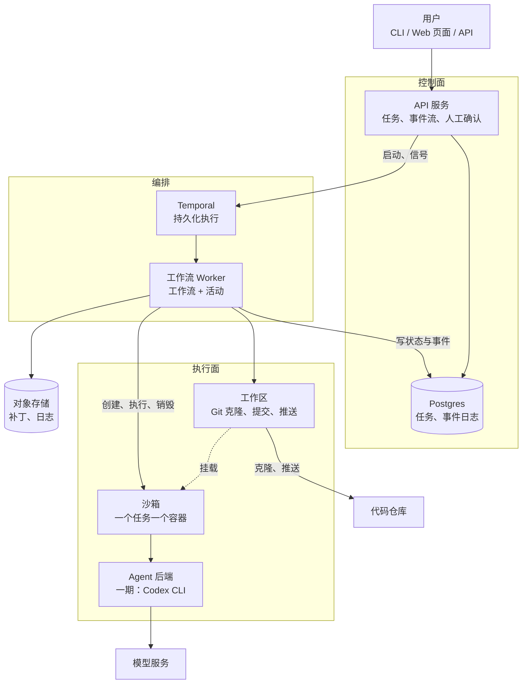
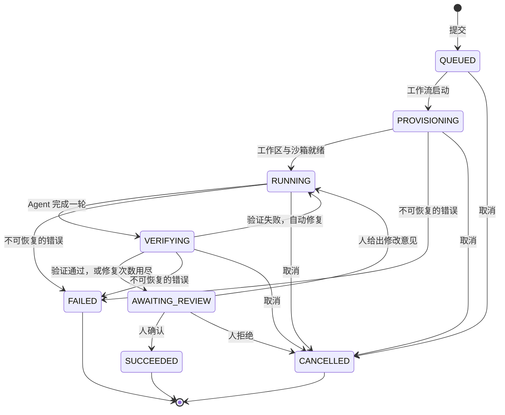
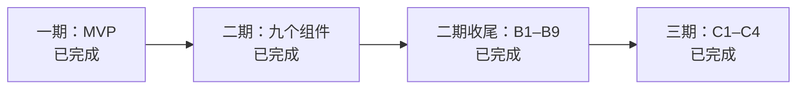

# SuperCloudAgents 架构设计

> 企业级云端 Agent 平台 · Coding Agent 为首个落地场景 · V2.1
>
> 上一版（V1.0，「云端 Coding Agent 研发接管平台」）保存在 [`archive/`](archive/)。本版是重写，不是修订；与 V1 的差异见[附录 A](#附录-a-与-v1-的差异)。

## 1 这份文档回答什么

- 平台要做什么、不做什么，以及按什么规模设计。
- 系统由哪几个部分组成，每个部分为什么这样选型，放弃了哪些方案。
- 各个阶段交付什么，现在做到了哪一步，接下来做什么。

实现细节在设计文档里。架构文档与设计文档冲突时以设计文档为准，并回改本文。

| 文档 | 内容 |
| --- | --- |
| [`design.md`](design.md) | 一期基线：接口、表结构、目录、工作流、测试 |
| [`design-phase2.md`](design-phase2.md) | 二期九个组件的设计与验证结果 |
| [`design-phase2b.md`](design-phase2b.md) | 二期收尾的设计（未开始） |
| [`design-phase3.md`](design-phase3.md) | 三期的设计（未开始） |
| [`handoff.md`](handoff.md) | 接手指南：现状、顺序、环境、完成标准 |

**V2.1 相对 V2.0 的变化**：各项决定补上了二期之后的现状；新增 ADR-13 至 ADR-18；第 8 节的路线图按实际进度重写，三期的范围从一句话变成了有交付和退出条件的计划。

## 2 定位与范围

### 2.1 定位

SuperCloudAgents 是一个**在云端托管长时间运行的 Agent 的平台**：用户提交一个目标，平台为它分配隔离的执行环境，让 Agent 自主工作，用可执行的验证来判定结果，并且只在需要人做决定的地方打断人。

平台内核与具体场景无关。第一个场景是 **Coding Agent**：输入「一个代码仓库 + 一段需求」，输出「一个通过验证的分支或 PR」。

### 2.2 内核与场景的分界

| 属于内核（场景无关） | 属于场景（Coding 是第一个） |
| --- | --- |
| 任务、会话、事件日志 | 任务规格里的仓库地址、基线分支、验证命令 |
| 沙箱的创建、执行、销毁 | 工作区如何准备（克隆仓库） |
| Agent 后端的统一接口 | 如何验证（跑测试命令） |
| 持久化编排、重试、暂停与恢复 | 如何发布结果（补丁、分支、PR） |
| 人工确认与反馈、租户与鉴权 | 给 Agent 的提示词模板 |

新增一个场景，等于新增一种任务类型（`kind`）：一个规格定义、一个工作流、几个活动函数。内核不改。

### 2.3 规模假设

所有容量与选型决定都以这组数字为准。数字变了，相应章节要重新评估。

| 维度 | 一期（MVP） | 二期目标 |
| --- | --- | --- |
| 租户 | 1 | 100 |
| 同时运行的任务 | 1–2（单机 2 核 3GB） | 1,000 |
| 单个任务时长 | 几分钟到 1 小时 | 几分钟到 24 小时 |
| 单个仓库大小 | 小于 1GB | 小于 20GB（需要缓存加速） |
| 每个任务的事件数 | 10²–10³ | 10³–10⁴ |
| 可用性 | 不承诺 | 控制面 99.9% |

### 2.4 非目标

- 不训练模型，不自研模型推理服务。
- 不直接变更生产环境；平台的产出止于分支、PR 或制品。
- 不做通用办公流程自动化。
- 一期不做：设计稿（Figma）接入、共享记忆、私域知识库、自进化评测、多 Agent 并行、多租户隔离。它们在[第 8 章](#8-演进路线)里有位置，并且一期已为它们留好扩展点。

## 3 设计原则

每条原则都对应一个可以检查的约束。

| 原则 | 具体约束 |
| --- | --- |
| **事件日志是唯一事实来源** | 任务发生的每件事都追加写入事件日志。界面、回放、审计、成本统计都只读这一份数据，不各自另存。 |
| **持久化执行交给引擎** | 重试、超时、心跳、暂停、崩溃后续跑由 Temporal 负责，业务代码里不写租约、Outbox 或看门狗。 |
| **沙箱是可丢弃的** | 沙箱里没有任何不可重建的状态。工作成果在每一轮结束时提交到 Git，会话历史保存在沙箱外的卷上。 |
| **凭证尽量不进沙箱** | 仓库的读写凭证只在沙箱外使用（克隆与推送由平台完成）。模型凭证在一期例外，见 ADR-06。 |
| **验证是可执行的** | 结果是否合格由一条命令的退出码决定，不由模型的自我评价或「置信度」决定。 |
| **人只处理例外** | 人只在两处出现：结果确认，以及验证多次失败后的求助。两处都可以给文字反馈，反馈会成为 Agent 的下一轮输入。 |
| **接口先于实现** | 沙箱、Agent 后端、对象存储、鉴权都先定义接口，一期各给一个最简实现。二期替换实现，不改调用方。 |
| **先纵向打通，再横向加固** | 一期只追求一条完整链路跑通，不追求任何单个组件完善。 |

## 4 总体架构

### 4.1 全景

### 4.2 组件职责

| 组件 | 职责 | 明确不做 |
| --- | --- | --- |
| **API 服务** | 接收任务、查询任务与事件、推送实时事件流、接收人工确认与取消，并把这些动作转成 Temporal 的启动与信号。 | 不执行任何任务逻辑，不直接操作沙箱。 |
| **Temporal** | 保存每个任务的执行进度；负责重试、超时、心跳检测和崩溃后续跑。 | 不保存业务数据；业务查询走 Postgres。 |
| **工作流 Worker** | 运行工作流（流程的步骤顺序）和活动（每一步的实际动作）。 | 不对外提供接口。 |
| **工作区** | 在沙箱外克隆仓库、在每轮结束时提交、生成补丁、推送分支。 | 不运行任何不受信任的代码。 |
| **沙箱** | 隔离地运行 Agent 和验证命令。 | 不保存状态，不持有仓库凭证。 |
| **Agent 后端** | 接收一段指令，在沙箱里自主工作一轮，把过程以事件流的形式吐出来。 | 不决定流程（是否重试、是否结束由工作流决定）。 |
| **Postgres** | 保存任务、事件日志、制品索引。 | 一期不做向量检索与分析查询。 |
| **对象存储** | 保存补丁、验证日志等大块内容。 | — |

可部署单元只有三个：API 服务、工作流 Worker、沙箱镜像。它们在同一个代码仓、同一个 Python 包里，靠模块边界隔开。

### 4.3 一个任务的生命周期

要点：

- **自动修复有上限。** 验证失败时，失败日志的尾部会作为下一轮的输入交给 Agent；超过上限（默认 2 次）不再重试，转给人，并明确标注「验证未通过」。
- **「再优化」不是新任务。** 人给出修改意见后，同一个任务、同一个会话继续工作，Agent 保有之前的上下文。
- **发布发生在确认之前。** 每次进入 `AWAITING_REVIEW` 前，平台都会生成补丁并（如果配置了）推送分支，人看到的是真实可检出的结果。
- **状态只由工作流改写。** API 不直接改任务状态，它只发信号。这样状态与执行进度不会不一致。

## 5 关键设计决定

每条记录写明：选了什么、为什么、放弃了什么、代价是什么。

### ADR-01 模块化单体，不拆微服务

- **决定**：一个代码仓、一个 Python 包、三个可部署单元。模块之间通过接口调用，不通过网络。
- **理由**：任务、编排、检查点共享同一份事务状态，拆开只会引入跨服务一致性问题。团队和负载都还没有大到需要独立伸缩或独立发布。
- **放弃**：V1 的 19 个服务、22 个仓、16 个库。
- **何时重新评估**：某个模块的伸缩需求或发布节奏明显不同于其他模块时再拆。最先会被拆出去的是沙箱管理（二期）。

### ADR-02 用 Temporal 做持久化编排

- **决定**：任务流程写成 Temporal 工作流。一期用单进程开发服务器，二期换成以 Postgres 为后端的集群，工作流代码不变。
- **理由**：V1 自研的 DAG 调度、租约、Outbox、Stored Work、看门狗、暂停恢复，合起来就是一个持久化执行引擎。Temporal 把这些作为基本能力提供，并且经过大规模验证。人工确认用信号实现，等几天也不占资源。
- **放弃**：自研 Postgres 状态机加队列。组件更少，但所有可靠性逻辑都要自己写、自己验证。
- **代价**：多一个要运维的组件；工作流代码必须是确定性的（不能直接做 I/O，I/O 都放进活动）。
- **现状（二期之后）**：Postgres 持久化的 Temporal 已作为可选部署验证过（服务重启后任务继续）。还不是多节点集群。

### ADR-03 Agent 后端是可插拔接口，一期封装 Codex CLI

- **决定**：定义 `AgentBackend` 接口：给定沙箱、会话和一段指令，运行一轮并产出事件流。一期的实现是在沙箱里运行 `codex exec --json`，多轮之间用会话续接。
- **理由**：成熟的编码 Agent 已经解决了工具调用、上下文压缩、代码编辑这些难题。平台的价值在托管、隔离、验证和人机协作，不在重写 Agent 循环。接口让二期可以加入自研循环或其他 Agent，而不动内核。
- **放弃**：V1 把 Agent 拆成 Runtime 和 Executor 两个服务、每步一次 HTTP 调用的设计。Agent 循环是一个整体，拆开只增加延迟和故障点。
- **代价**：一期受限于 Codex CLI 的行为和事件格式；Token 用量只能读它上报的数字。
- **现状（二期之后）**：另有一个脚本化后端用于测试。按任务选择后端要等三期的评测（C4）。

### ADR-04 沙箱是接口，一期用 Docker 容器，二期换 Kubernetes Pod

- **决定**：`SandboxProvider` 接口只有四个动作：创建、执行命令（流式输出）、查询、销毁。一个任务一个沙箱，任务结束即销毁。
- **理由**：容器与 Pod 的模型一致（镜像、挂载、资源上限、网络策略），二期迁移只需新增一个实现。
- **放弃**：
  - 不装容器、只用 bubblewrap 加 git worktree：与二期模型差距大。
  - 一期就上 Kubernetes 加 gVisor：单机 3GB 内存跑不动，也不是跑通链路所必需的。
- **代价**：一期的隔离强度只是普通容器级别，不能运行不受信任租户的任务。二期加 gVisor 或微虚拟机、出口白名单。
- **现状（二期之后）**：Docker 与 Kubernetes 两个驱动通过同一套契约测试；gVisor 是一个配置项；出口经 Squid 白名单。预热池没有做。Kubernetes 驱动仍只支持单节点，见 ADR-13。

### ADR-05 Agent 整体运行在沙箱内

- **决定**：Agent 进程和它操作的文件在同一个沙箱里。
- **理由**：编码 Agent 需要低延迟地读写文件和执行命令，把它和工作区放在一起最简单，也是现成 Agent CLI 唯一支持的方式。
- **放弃**：V1 的「脑在沙箱外、手在沙箱内」。那个设计的收益（沙箱崩溃不丢会话、凭证不进沙箱）在这里用别的办法取得：会话历史存在沙箱外的卷上，仓库凭证留在沙箱外。
- **何时重新评估**：二期自研 Agent 循环时，可以把循环放到沙箱外、只把工具执行放在沙箱内。`AgentBackend` 接口对两种布局都成立。

### ADR-06 凭证边界

- **决定**：
  - 仓库凭证只存在于 Worker 所在的环境。克隆和推送都由工作区模块在沙箱外完成，沙箱只拿到一个挂载进来的目录。
  - 模型凭证在一期以单文件挂载的方式进入沙箱（Codex CLI 需要它才能工作，并且需要在令牌刷新时写回）。
- **理由**：仓库写权限是最危险的凭证，必须留在沙箱外。模型凭证在一期没有不进沙箱的办法。
- **代价与二期补救**：沙箱内的恶意代码可以读到模型凭证。一期只跑自己信任的仓库。二期加模型网关：沙箱只拿到一个绑定到本任务、有额度和有效期的临时令牌，真实凭证留在网关。
- **现状（二期之后）**：有模型网关时，沙箱只拿到每轮签发、轮末撤销的临时密钥。仓库凭证仍靠宿主机配置，见 ADR-14。

### ADR-07 事件日志作为唯一事实来源

- **决定**：Postgres 里一张只追加的 `events` 表，每个任务内序号严格递增。Agent 的每条消息、每次命令、每次验证、每次状态变化、每次人工操作都是一个事件。
- **理由**：实时界面、历史回放、审计、成本统计本质上是对同一份数据的不同读法。只存一份，就不会出现回放与审计对不上的情况。
- **放弃**：V1 的 Trace 采样（默认 10%）。采样后的数据既不能回放，也算不准成本。事件必须全量保留。
- **代价**：事件表增长快。二期按时间分区，冷数据归档到对象存储；需要分析查询时再同步到列式库。
- **现状（二期之后）**：**没有按时间分区**：任务内序号和去重键的唯一性无法跨分区保证。改为把已结束任务的事件按任务归档到对象存储，读取对调用方透明。

### ADR-08 检查点等于「Git 提交 + 会话历史」

- **决定**：每一轮 Agent 工作结束后，工作区模块把全部改动提交到任务分支。会话历史保存在沙箱外的卷上。恢复时：新建沙箱、挂载同一个工作区与会话卷、让 Agent 续接会话。
- **理由**：对编码任务，工作成果就是 Git 里的内容；Agent 的「记忆」就是会话历史。这两样都有现成、可靠的保存方式，不需要另造快照格式。
- **放弃**：V1 的四种检查点类型、恢复门六项校验、外部副作用事实查询。它们没有可实现的定义。一期的任务除了推送分支之外没有外部副作用，而推送是幂等的。
- **代价**：一轮工作中途崩溃，会丢掉这一轮未提交的改动并重跑这一轮。可以接受。
- **现状（二期之后）**：二期据此实现了「等待确认时释放沙箱、之后重建」和「Worker 被杀后重做当前这一轮」。

### ADR-09 一个任务一个 Agent，不做前置 DAG 拆分

- **决定**：一期每个任务只有一个 Agent、一个会话、一个工作区，顺序执行。
- **理由**：在动手前把任务静态拆成可并行的子任务，前提是拆分准确且各部分互不冲突，实践中两者都很难保证；让多个 Agent 并行改同一个仓库的主要产出是合并冲突。V1 的解耦评分和调度权重没有数据依据。
- **留的扩展点**：会话与任务是一对多关系；工作流可以启动子工作流。二期做并行时，每个子任务拿独立的工作区分支，由一个专门的步骤负责合并。
- **现状（二期之后）**：二期做了并行：提交者给出子任务，各自在独立的沙箱和分支上执行，用 Git 的底层命令在可信镜像里合并，冲突转人工。自动拆分仍然没有做，理由不变；收尾阶段把它做成带校验、可退回的可选步骤（B8）。

### ADR-10 验证在沙箱内运行命令

- **决定**：任务规格里带一条验证命令（例如 `pytest -q`）。Agent 完成一轮后，平台在同一个沙箱里运行它，以退出码判定通过与否，把输出尾部作为反馈。
- **理由**：最直接，也最接近开发者的日常做法。失败日志就是最好的修复提示。
- **放弃**：V1 的风险评分、置信度和六行决策矩阵。这些数字没有来源，矩阵无法执行。
- **留的扩展点**：`Verifier` 是接口。二期加外部 CI 适配器（推送分支后等回调）和多条验证并行。
- **现状（二期之后）**：多条验证并行执行；外部 CI 通过回调接入。三期增加由意图来源编译出来的检查（`design-phase3.md` 的 C2）和 Agent 看不到的验收（ADR-18）。原则不变：通过与否只由可执行的检查决定。

### ADR-11 存储只用 Postgres 和对象存储

- **决定**：一期的全部持久化是 Postgres（任务、事件、制品索引）和一个对象存储接口（一期落本地目录，二期换 S3 或 MinIO）。
- **理由**：一期的数据量用不上任何专用存储。
- **放弃（推迟到有需求时）**：Redis、Kafka、ClickHouse、Qdrant。对应需求出现时的首选分别是：实时推送用 Postgres 的通知机制、事件外发用变更数据捕获、分析用列式库、向量检索用 pgvector。
- **现状（二期之后）**：对象存储有 S3 驱动；实时推送用了 Postgres 的通知机制。三期的记忆检索按预案用 pgvector。

### ADR-12 能用开源组件的地方不自研

| 能力 | V1 的做法 | 本版的做法 |
| --- | --- | --- |
| 编排 | 自研 3 个服务 | Temporal |
| 用户身份 | 自研身份服务 | 一期静态令牌；二期接 OIDC（本地用 Dex 验证） |
| 模型网关 | 自研 | LiteLLM |
| 可观测 | 自研采集与查询 | 事件日志；OpenTelemetry；Prometheus |
| 出口控制 | 未定义 | Squid |
| 密钥管理 | Vault | OpenBao（收尾阶段，ADR-14） |
| 策略 | OPA + SPIRE | 不引入；角色判断是一张表（ADR-15） |

### ADR-13 任务状态以对象存储为准，Worker 的本地磁盘只是缓存

- **决定**：每一轮结束后，把可信镜像和会话记录存进对象存储。Worker 与沙箱之间不再靠目录挂载，而是通过沙箱接口上传和下载。任何一台 Worker 都能从对象存储重建任务。
- **理由**：挂载把 Worker 和沙箱绑在同一台机器上，也把任务绑在某一台 Worker 的磁盘上。二期的「释放与重建沙箱」已经证明状态可以脱离沙箱存在，只差跨机器搬运。
- **放弃**：
  - 共享文件系统（NFS 一类）：把一个不可信环境写过的目录直接共享给所有 Worker，放大了信任边界，也引入一个新的单点。
  - 每个任务一个持久卷：把任务钉在卷所在的可用区，沙箱启动变慢，卷的回收要另外管理。
- **代价**：每轮多一次打包和上传；大仓库的开销要实测。单机开发仍可用挂载方式。
- **状态**：已实现（B1）。两节点集群上、没有任何宿主机挂载时完整任务通过；删掉数据目录换一个 Worker 也能续跑。

### ADR-14 密钥通过接口从密钥服务取，用完即弃

- **决定**：定义 `SecretProvider` 接口。仓库凭证在活动里按「租户 + 仓库」取得，通过 Git 自带的询问机制交给那一个子进程，不写进地址、配置或命令行。第一个实现对接 OpenBao。
- **理由**：宿主机上的长期凭证不分租户、不留记录、换机器要重配。真正的短期凭证（例如代码托管平台的应用安装令牌）需要一个保管私钥并签发令牌的地方。
- **放弃**：把凭证放进任务规格（会进数据库和工作流历史）；自己实现加密存储。
- **状态**：已实现（B4），用 OpenBao 和本机 Gitea 验证：凭证不出现在沙箱、事件、工作流历史和镜像配置里。

### ADR-15 权限是「角色 + 受限令牌」，不引入策略引擎

- **决定**：租户内三个角色（只读、成员、管理员），判断集中在一张「动作 → 最低角色」的表里。机器调用方（如 CI）使用只能做一件事、可绑定到一个仓库、会过期的令牌。
- **理由**：需要表达的规则只有十几条，一张表比一门策略语言更容易审查。租户之间的隔离已经由数据库的行级安全保证，不依赖这一层。
- **何时重新评估**：出现按资源属性授权的需求（例如「只能审批自己团队的仓库」）时。
- **状态**：已实现（B5）。

### ADR-16 一个通用工作流，场景通过活动和两个扩展点接入

- **决定**：轮次循环、暂停恢复、预算、沙箱的释放与重建、人工确认，这些逻辑只在内核的一个工作流里。场景提供按名字调用的活动（准备工作区、保存成果、验证、发布、构造提示词），以及可选的两处子工作流扩展（第一轮之前；验证之后、发布之前）。检查点对所有场景都是 Git 提交。
- **理由**：现在通用逻辑和编码专用逻辑混在一个模块里，「内核与场景无关」只是一句话。用第二个差异足够大的场景（数据分析：输入是文件而不是仓库，成果是报告而不是补丁）把边界逼出来，并用一条「内核不导入任何场景」的测试把它固定住。
- **放弃**：每个场景一个独立工作流（通用逻辑要复制，改一处漏一处）；通用的插件系统（只有两个场景时设计不出好的抽象）。
- **代价**：升级前要排空运行中的任务，因为工作流的结构变了。
- **状态**：已实现（C1）。数据分析场景作为第二个场景接入，两个场景共用内核的暂停恢复、空闲释放、预算等行为。实现中踩到一个坑：场景包的初始化文件里任何导入都会被 Temporal 工作流沙箱在每次运行时重新加载，现由测试禁止。

### ADR-17 记忆是有来源、经人确认的短条目

- **决定**：跨任务复用的知识是一条条不超过几百字的约定，属于一个租户下的一个范围（仓库、场景或整个租户），记录来自哪个任务、谁确认的。Agent 和系统可以提议，人确认后才生效。条目少时全部带上，多了才用 pgvector 检索。
- **理由**：最有价值的信号是审阅者的修改意见，它短、明确、有人背书。把历史会话或代码整个做成向量库，既重复了 Agent 自己读代码的能力，也无法审查其中有什么。
- **放弃**：自动写入记忆（一个任务的错误会污染之后所有任务）；独立的向量数据库；跨租户的通用经验。
- **代价**：需要人花时间确认。这是有意的。
- **状态**：已实现（C3），不含向量检索（条目少时不需要，按设计推后）。

### ADR-18 评测复用任务本身，判分用 Agent 看不到的验收

- **决定**：评测的一个样本就是一个普通任务，判分就是任务的验证。内核增加「隐藏验收」：验收文件和命令只在验收时进入一个新的沙箱，Agent 自始至终看不到，结果不反馈给它。评测集是仓库里的文件；一次评测运行是一个可恢复的工作流；比较以逐样本对照为主，并说明差异是否超出噪声。
- **理由**：平台已经具备隔离执行、可执行验证、用量统计，评测只缺固定样本、不可迎合的判分和成组比较。提示词改为带版本的文件之后，换模型、换提示词、开关功能都能并排比较。
- **放弃**：让模型给结果打分作为通过与否的依据；自动改进提示词的闭环（样本集太小，优化出来的是过拟合；有了评测之后它只是一个普通工作流，随时可以加）。
- **状态**：已实现（C4）。第一个评测集对两个 DeepSeek 模型都是 12/12，区分不出它们：机制可用，评测集需要更难的用例。

## 6 横切关注点

### 6.1 安全

| 威胁 | 一期的处置 | 二期 |
| --- | --- | --- |
| 沙箱内代码窃取仓库凭证 | 凭证不进沙箱（ADR-06） | 不变 |
| 沙箱内代码窃取模型凭证 | 接受风险，只跑受信任仓库 | 模型网关 + 任务级临时令牌 |
| 沙箱逃逸 | 非 root 用户、资源上限、不挂载 Docker 套接字 | gVisor 或微虚拟机 |
| 沙箱对外发起任意连接 | 不限制 | 默认拒绝 + 出口白名单 |
| 仓库内容里的提示词注入 | 影响范围限于沙箱和任务分支；合并需要人确认 | 加上出口限制后，数据外泄路径被切断 |
| 越权访问他人任务 | 所有表带租户字段，所有查询按租户过滤 | 接 OIDC，加行级安全策略 |

二期之后的实际状态：表里「二期」一列的各项都已实现并有测试，只有「沙箱逃逸」一行是可选配置（gVisor 默认不启用）。三期新增两个不可信输入的入口——记忆和意图来源——对策分别见 ADR-17 和 `design-phase3.md` 的 C2.4。

提示词注入没有可靠的检测手段。平台的对策是限制 Agent 被操纵后能造成的后果，而不是试图识别注入。

### 6.2 可观测与成本

- 事件日志同时是轨迹回放和审计记录。
- Agent 后端每一轮上报 Token 用量，作为事件写入，并累加到任务上。
- 服务日志是结构化的，每行带任务标识。
- 二期已做：OpenTelemetry 跨进程追踪；Prometheus 指标；按任务和按租户的 Token 预算，超出即停。
- 收尾阶段：按金额的预算（B6）；观测后端、仪表盘、告警（B7）。

### 6.3 多租户

一期只有一个租户，但数据模型从第一天就带 `tenant_id`，API 鉴权从第一天就经过 `Authenticator` 接口。二期据此接入了 OIDC、数据库行级安全和按租户的配额，没有改已有的表结构。租户内的角色在收尾阶段做（ADR-15）。

### 6.4 失败处理

| 失败 | 谁处理 | 怎么处理 |
| --- | --- | --- |
| 活动中的瞬时错误（网络、容器启动） | Temporal | 按退避策略自动重试 |
| Worker 进程崩溃 | Temporal | 心跳超时后在别的 Worker 上重跑当前活动 |
| Agent 一轮超时或异常退出 | 工作流 | 有限次重试，之后任务失败 |
| 验证失败 | 工作流 | 自动修复，有上限，之后转人工 |
| 仓库地址或凭证错误 | 工作流 | 不重试，任务直接失败并说明原因 |
| 任务结束或取消 | 工作流 | 无论哪种结局都销毁沙箱 |

## 7 技术选型

| 层 | 一期的选择 | 现状与计划 |
| --- | --- | --- |
| 语言 | Python 3.12 | 不变 |
| API | FastAPI + Pydantic v2 | 不变 |
| 数据访问 | SQLAlchemy 2（异步）+ asyncpg + Alembic | 不变 |
| 数据库 | PostgreSQL 16 | 加了行级安全与事件归档；三期加 pgvector。主备未做 |
| 编排 | Temporal（Python SDK）；开发服务器 | 可选 Postgres 持久化；集群未做 |
| 沙箱 | Docker 容器 | 加了 Kubernetes 驱动、gVisor、Squid 出口代理 |
| Agent | Codex CLI（`gpt-6.1-sol`） | 可经 LiteLLM 网关换模型；其他后端未做 |
| 对象存储 | 本地目录（经接口） | 加了 S3 驱动（本地用 SeaweedFS 验证） |
| 界面 | 命令行 + 单页 HTML | 不变。独立前端未做 |
| 测试 | pytest | 加了契约测试和杀进程、重启服务的故障测试。压测未做 |

版本号不写进本文，以 `pyproject.toml` 和 `deploy/` 为准。

## 8 演进路线

### 8.1 一期：MVP，端到端跑通（已完成）

**交付**：提交「仓库 + 需求 + 验证命令」→ 沙箱里 Agent 编码 → 验证与自动修复 → 生成补丁并推送分支 → 人确认或提修改意见 → 结束。全过程可通过事件流实时观看和事后回放。

**退出条件**：一条自动化的端到端测试在真实的 Temporal、Postgres、Docker 和 Codex 上通过，包含一次人工提出修改意见的回合。已达到。

### 8.2 二期：按组件逐个加固（已完成）

目标是「能给不信任的人用、能扩到多台机器、出了问题能恢复」。每个组件的设计和验证结果在 [`design-phase2.md`](design-phase2.md)。

| 顺序 | 组件 | 做到了 | 没做到（去向） |
| --- | --- | --- | --- |
| 1 | 沙箱 | 出口白名单、gVisor、Kubernetes 驱动、两个驱动共用的契约测试 | 多节点（B1）；集群内网络隔离未证明（B2）；预热池（B9） |
| 2 | 凭证 | 每轮的临时模型密钥，真实密钥不进沙箱 | 仓库凭证的密钥管理（B4）；按金额计费（B6） |
| 3 | 身份与多租户 | OIDC、行级安全、配额 | 租户内的角色（B5） |
| 4 | 编排 | 空闲释放与重建沙箱、暂停恢复、Worker 被杀后续跑、Temporal 用 Postgres 持久化 | 换一台机器续跑（B1）；Worker 自动伸缩 |
| 5 | 存储 | S3、备份恢复、事件归档 | 归档的定时调度（B7） |
| 6 | 验证 | 多条验证并行、CI 回调接口 | 对接真实 CI（B3） |
| 7 | 可观测 | 跨进程追踪、指标、Token 预算、事件推送 | 观测后端、看板、告警（B7） |
| 8 | 加速 | 仓库镜像缓存、pip 下载缓存 | 包索引代理 |
| 9 | 并行 | 子任务并行、合并、冲突转人工 | 自动拆分（B8） |

三个目标里，「能给不信任的人用」和「出了问题能恢复」在单机部署下达到了；「能扩到多台机器」没有达到。

### 8.3 二期收尾（已完成）

把上表右列补齐。设计和每项的验证结果在 [`design-phase2b.md`](design-phase2b.md)。除 B3 的 GitHub 路径（令牌缺 `workflow` 权限，Gitea 路径已通过）外全部完成。

| 顺序 | 事项 | 退出条件 |
| --- | --- | --- |
| B1 | 多节点 | Worker 与沙箱不共享任何目录时全部端到端测试通过；任务能被另一台机器上的 Worker 接着做 |
| B2 | Kubernetes 网络隔离 | 沙箱访问集群 API 失败，契约测试里不再有预期失败 |
| B3 | 真实 CI | 真实流水线的结果驱动任务修复并通过 |
| B4 | 仓库凭证 | 任务用密钥服务里的短期凭证访问私有仓库；凭证不出现在沙箱、事件、工作流历史里 |
| B5 | 权限 | 只读角色不能提交和审批；CI 令牌只能回报结果 |
| B6 | 按金额计费 | 任务的花费有数值；超金额预算被停下 |
| B7 | 运维 | 追踪和指标在真实后端里看得到；归档、缓存淘汰、孤儿沙箱清理自动执行 |
| B8 | 自动拆分 | 不给子任务也能拆分并行完成；拆不了时退回单 Agent |
| B9 | 预热池评估 | 有 Kubernetes 上的启动时延数据和书面结论 |

**阶段退出条件**：在一个没有任何宿主机挂载的两节点集群上，一个任务从提交到完成的全过程通过；期间杀掉 Worker 并在另一个数据目录上重启，任务继续。

**仍然不在范围内**：高可用部署（Postgres 主备、Temporal 多节点集群、API 多副本的验证）、压测、独立的前端工程。它们是部署和运营的工作，等有真实的部署目标时再做。

### 8.4 三期：扩展能力（已完成）

设计和每项的验证结果在 [`design-phase3.md`](design-phase3.md)。每一项交付的是机制和度量；参数要靠真实使用数据来调。

| 顺序 | 事项 | 交付 | 退出条件 |
| --- | --- | --- | --- |
| C1 | 第二个场景 | 把内核从编码场景里抽出来；新增数据分析场景 | 「内核不导入任何场景」的测试通过；两个场景共用同一套暂停、恢复、预算、续跑测试 |
| C2 | 设计意图接入 | 把接口规范、基准截图、规则文件编译成上下文和可执行的检查 | 只给一份接口规范、不给文字说明，真实模型完成任务 |
| C3 | 记忆与知识库 | 从审阅意见提炼、经人确认的项目约定，注入后续任务 | 第二个任务用上了第一个任务里确认的约定；别的租户看不到 |
| C4 | 评测 | 隐藏验收、评测集、成组运行、变体比较、回归闸门 | 第一个评测集在两个模型上的对比结果，如实记录 |

顺序的理由：C1 改动内核结构，后三项都建在它上面；C4 放最后，因为它是回答「C2、C3 有没有用」的工具。

**不做**：自动改进提示词的闭环（见 ADR-18）；直接对接设计工具和项目管理工具的接口；模型做裁判。

## 附录 A 与 V1 的差异

| 主题 | V1 | V2 |
| --- | --- | --- |
| 定位 | Coding Agent 专用 | 通用 Agent 平台，Coding 先行 |
| 部署形态 | 19 个微服务，22 个仓 | 模块化单体，3 个可部署单元，1 个仓 |
| 编排 | 自研 DAG、租约、Outbox、看门狗 | Temporal |
| Agent | Runtime 与 Executor 两个服务 | 一个可插拔的后端接口 |
| 任务拆分 | 前置解耦分析 + 全局 DAG | 单任务单 Agent，留并行扩展点 |
| 检查点 | 四种类型 + 恢复门六项校验 | Git 提交 + 会话历史 |
| 验证 | 外部网关 + 风险与置信度矩阵 | 沙箱内命令的退出码 |
| 中间件 | PG、Redis、Kafka、ClickHouse、Qdrant、OPA、SPIRE、Vault | Postgres、Temporal、对象存储 |
| 追踪 | 采样 10% | 事件全量保留 |
| 一期范围 | 全部能力 | 一条纵向链路 |
| 并行 | 前置解耦分析 + 全局 DAG | 提交者给出子任务；自动拆分是带校验、可退回的可选步骤 |
| 记忆 | 向量库 | 经人确认的短条目，多了才检索 |
| 规模依据 | 无 | 2.3 节 |

## 附录 B 术语

| 术语 | 含义 |
| --- | --- |
| 任务（Task） | 用户提交的一个目标，平台的基本工作单元。 |
| 任务类型（kind） | 一个场景，例如 `coding`。决定任务规格和工作流。 |
| 会话（Session） | Agent 的一段连续对话。多轮之间保有上下文。 |
| 轮（Turn） | 给 Agent 一段指令，它自主工作直到停下，算一轮。 |
| 事件（Event） | 任务过程中发生的一件事，只追加，不修改。 |
| 沙箱（Sandbox） | 隔离的执行环境，一个任务一个。 |
| 工作区（Workspace） | 任务的代码目录，是一个 Git 克隆，挂载进沙箱。 |
| 工作流（Workflow） | Temporal 里描述步骤顺序的代码，可以在崩溃后续跑。 |
| 活动（Activity） | 工作流里的一步实际动作，可以有 I/O，可以被重试。 |
| 信号（Signal） | 从外部发给运行中工作流的消息，用于人工确认与取消。 |
| 场景扩展点 | 内核工作流里留给场景插入子工作流的固定位置。 |
| 意图来源 | 已经写在别处的要求（接口规范、基准截图、规则文件），可以编译成上下文和检查。 |
| 记忆 | 一条经人确认、可跨任务复用的项目约定。 |
| 隐藏验收 | Agent 看不到的检查，只用于判定结果，不反馈给它。 |
| 评测集 | 一组固定的任务和各自的隐藏验收，用来比较不同的模型、提示词和设置。 |
