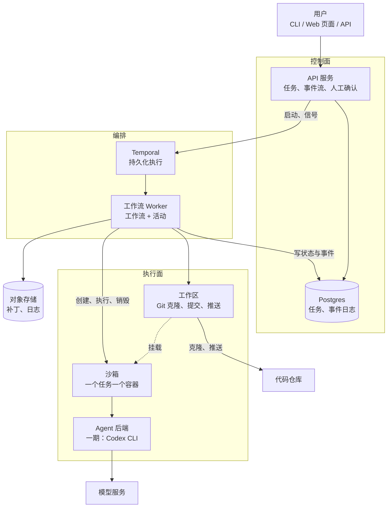
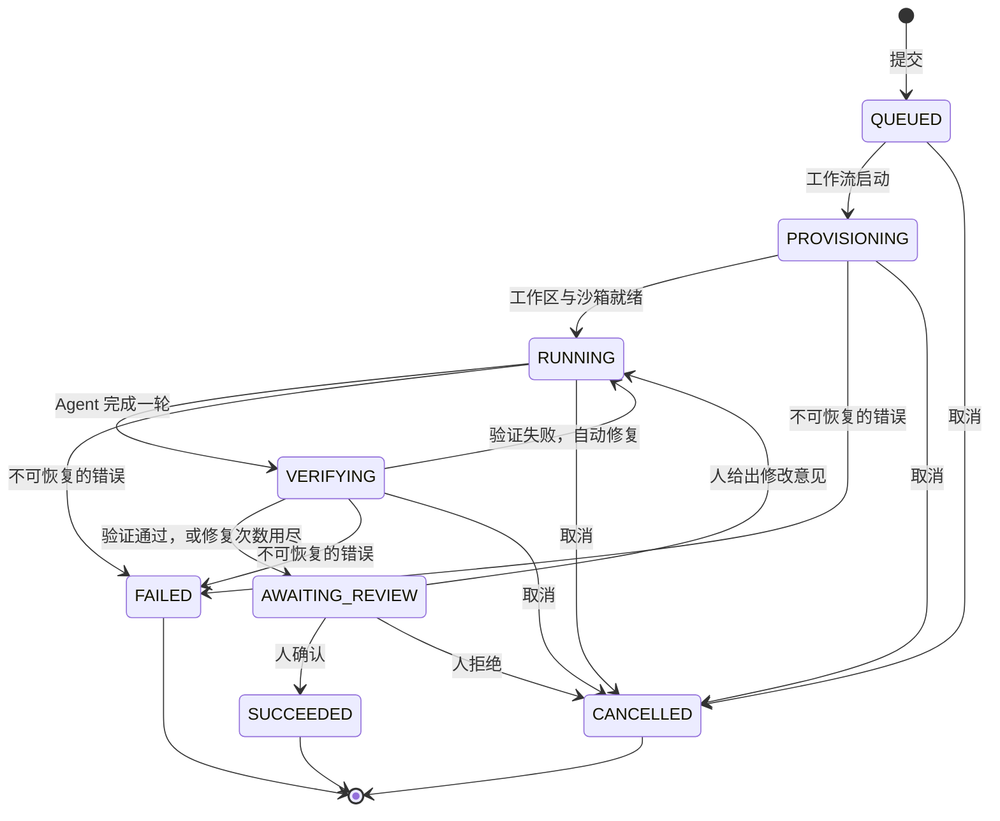

# SuperCloudAgents 架构设计

> 企业级云端 Agent 平台 · Coding Agent 为首个落地场景 · V2.0
>
> 上一版（V1.0，「云端 Coding Agent 研发接管平台」）保存在 [`archive/`](archive/)。本版是重写，不是修订；与 V1 的差异见[附录 A](#附录-a-与-v1-的差异)。

## 1 这份文档回答什么

- 平台要做什么、不做什么，以及按什么规模设计。
- 系统由哪几个部分组成，每个部分为什么这样选型，放弃了哪些方案。
- 两个阶段各交付什么，一期（MVP）的哪些决定是为二期留路的。

实现细节（接口、表结构、目录、测试）在 [`design.md`](design.md)。两份文档冲突时以 `design.md` 为准，并回改本文。

## 2 定位与范围

### 2.1 定位

SuperCloudAgents 是一个**在云端托管长时间运行的 Agent 的平台**：用户提交一个目标，平台为它分配隔离的执行环境，让 Agent 自主工作，用可执行的验证来判定结果，并且只在需要人做决定的地方打断人。

平台内核与具体场景无关。第一个场景是 **Coding Agent**：输入「一个代码仓库 + 一段需求」，输出「一个通过验证的分支或 PR」。

### 2.2 内核与场景的分界

| 属于内核（场景无关） | 属于场景（Coding 是第一个） |
| --- | --- |
| 任务、会话、事件日志 | 任务规格里的仓库地址、基线分支、验证命令 |
| 沙箱的创建、执行、销毁 | 工作区如何准备（克隆仓库） |
| Agent 后端的统一接口 | 如何验证（跑测试命令） |
| 持久化编排、重试、暂停与恢复 | 如何发布结果（补丁、分支、PR） |
| 人工确认与反馈、租户与鉴权 | 给 Agent 的提示词模板 |

新增一个场景，等于新增一种任务类型（`kind`）：一个规格定义、一个工作流、几个活动函数。内核不改。

### 2.3 规模假设

所有容量与选型决定都以这组数字为准。数字变了，相应章节要重新评估。

| 维度 | 一期（MVP） | 二期目标 |
| --- | --- | --- |
| 租户 | 1 | 100 |
| 同时运行的任务 | 1–2（单机 2 核 3GB） | 1,000 |
| 单个任务时长 | 几分钟到 1 小时 | 几分钟到 24 小时 |
| 单个仓库大小 | 小于 1GB | 小于 20GB（需要缓存加速） |
| 每个任务的事件数 | 10²–10³ | 10³–10⁴ |
| 可用性 | 不承诺 | 控制面 99.9% |

### 2.4 非目标

- 不训练模型，不自研模型推理服务。
- 不直接变更生产环境；平台的产出止于分支、PR 或制品。
- 不做通用办公流程自动化。
- 一期不做：设计稿（Figma）接入、共享记忆、私域知识库、自进化评测、多 Agent 并行、多租户隔离。它们在[第 8 章](#8-演进路线)里有位置，并且一期已为它们留好扩展点。

## 3 设计原则

每条原则都对应一个可以检查的约束。

| 原则 | 具体约束 |
| --- | --- |
| **事件日志是唯一事实来源** | 任务发生的每件事都追加写入事件日志。界面、回放、审计、成本统计都只读这一份数据，不各自另存。 |
| **持久化执行交给引擎** | 重试、超时、心跳、暂停、崩溃后续跑由 Temporal 负责，业务代码里不写租约、Outbox 或看门狗。 |
| **沙箱是可丢弃的** | 沙箱里没有任何不可重建的状态。工作成果在每一轮结束时提交到 Git，会话历史保存在沙箱外的卷上。 |
| **凭证尽量不进沙箱** | 仓库的读写凭证只在沙箱外使用（克隆与推送由平台完成）。模型凭证在一期例外，见 ADR-06。 |
| **验证是可执行的** | 结果是否合格由一条命令的退出码决定，不由模型的自我评价或「置信度」决定。 |
| **人只处理例外** | 人只在两处出现：结果确认，以及验证多次失败后的求助。两处都可以给文字反馈，反馈会成为 Agent 的下一轮输入。 |
| **接口先于实现** | 沙箱、Agent 后端、对象存储、鉴权都先定义接口，一期各给一个最简实现。二期替换实现，不改调用方。 |
| **先纵向打通，再横向加固** | 一期只追求一条完整链路跑通，不追求任何单个组件完善。 |

## 4 总体架构

### 4.1 全景

### 4.2 组件职责

| 组件 | 职责 | 明确不做 |
| --- | --- | --- |
| **API 服务** | 接收任务、查询任务与事件、推送实时事件流、接收人工确认与取消，并把这些动作转成 Temporal 的启动与信号。 | 不执行任何任务逻辑，不直接操作沙箱。 |
| **Temporal** | 保存每个任务的执行进度；负责重试、超时、心跳检测和崩溃后续跑。 | 不保存业务数据；业务查询走 Postgres。 |
| **工作流 Worker** | 运行工作流（流程的步骤顺序）和活动（每一步的实际动作）。 | 不对外提供接口。 |
| **工作区** | 在沙箱外克隆仓库、在每轮结束时提交、生成补丁、推送分支。 | 不运行任何不受信任的代码。 |
| **沙箱** | 隔离地运行 Agent 和验证命令。 | 不保存状态，不持有仓库凭证。 |
| **Agent 后端** | 接收一段指令，在沙箱里自主工作一轮，把过程以事件流的形式吐出来。 | 不决定流程（是否重试、是否结束由工作流决定）。 |
| **Postgres** | 保存任务、事件日志、制品索引。 | 一期不做向量检索与分析查询。 |
| **对象存储** | 保存补丁、验证日志等大块内容。 | — |

可部署单元只有三个：API 服务、工作流 Worker、沙箱镜像。它们在同一个代码仓、同一个 Python 包里，靠模块边界隔开。

### 4.3 一个任务的生命周期

要点：

- **自动修复有上限。** 验证失败时，失败日志的尾部会作为下一轮的输入交给 Agent；超过上限（默认 2 次）不再重试，转给人，并明确标注「验证未通过」。
- **「再优化」不是新任务。** 人给出修改意见后，同一个任务、同一个会话继续工作，Agent 保有之前的上下文。
- **发布发生在确认之前。** 每次进入 `AWAITING_REVIEW` 前，平台都会生成补丁并（如果配置了）推送分支，人看到的是真实可检出的结果。
- **状态只由工作流改写。** API 不直接改任务状态，它只发信号。这样状态与执行进度不会不一致。

## 5 关键设计决定

每条记录写明：选了什么、为什么、放弃了什么、代价是什么。

### ADR-01 模块化单体，不拆微服务

- **决定**：一个代码仓、一个 Python 包、三个可部署单元。模块之间通过接口调用，不通过网络。
- **理由**：任务、编排、检查点共享同一份事务状态，拆开只会引入跨服务一致性问题。团队和负载都还没有大到需要独立伸缩或独立发布。
- **放弃**：V1 的 19 个服务、22 个仓、16 个库。
- **何时重新评估**：某个模块的伸缩需求或发布节奏明显不同于其他模块时再拆。最先会被拆出去的是沙箱管理（二期）。

### ADR-02 用 Temporal 做持久化编排

- **决定**：任务流程写成 Temporal 工作流。一期用单进程开发服务器，二期换成以 Postgres 为后端的集群，工作流代码不变。
- **理由**：V1 自研的 DAG 调度、租约、Outbox、Stored Work、看门狗、暂停恢复，合起来就是一个持久化执行引擎。Temporal 把这些作为基本能力提供，并且经过大规模验证。人工确认用信号实现，等几天也不占资源。
- **放弃**：自研 Postgres 状态机加队列。组件更少，但所有可靠性逻辑都要自己写、自己验证。
- **代价**：多一个要运维的组件；工作流代码必须是确定性的（不能直接做 I/O，I/O 都放进活动）。

### ADR-03 Agent 后端是可插拔接口，一期封装 Codex CLI

- **决定**：定义 `AgentBackend` 接口：给定沙箱、会话和一段指令，运行一轮并产出事件流。一期的实现是在沙箱里运行 `codex exec --json`，多轮之间用会话续接。
- **理由**：成熟的编码 Agent 已经解决了工具调用、上下文压缩、代码编辑这些难题。平台的价值在托管、隔离、验证和人机协作，不在重写 Agent 循环。接口让二期可以加入自研循环或其他 Agent，而不动内核。
- **放弃**：V1 把 Agent 拆成 Runtime 和 Executor 两个服务、每步一次 HTTP 调用的设计。Agent 循环是一个整体，拆开只增加延迟和故障点。
- **代价**：一期受限于 Codex CLI 的行为和事件格式；Token 用量只能读它上报的数字。

### ADR-04 沙箱是接口，一期用 Docker 容器，二期换 Kubernetes Pod

- **决定**：`SandboxProvider` 接口只有四个动作：创建、执行命令（流式输出）、查询、销毁。一个任务一个沙箱，任务结束即销毁。
- **理由**：容器与 Pod 的模型一致（镜像、挂载、资源上限、网络策略），二期迁移只需新增一个实现。
- **放弃**：
  - 不装容器、只用 bubblewrap 加 git worktree：与二期模型差距大。
  - 一期就上 Kubernetes 加 gVisor：单机 3GB 内存跑不动，也不是跑通链路所必需的。
- **代价**：一期的隔离强度只是普通容器级别，不能运行不受信任租户的任务。二期加 gVisor 或微虚拟机、出口白名单。

### ADR-05 Agent 整体运行在沙箱内

- **决定**：Agent 进程和它操作的文件在同一个沙箱里。
- **理由**：编码 Agent 需要低延迟地读写文件和执行命令，把它和工作区放在一起最简单，也是现成 Agent CLI 唯一支持的方式。
- **放弃**：V1 的「脑在沙箱外、手在沙箱内」。那个设计的收益（沙箱崩溃不丢会话、凭证不进沙箱）在这里用别的办法取得：会话历史存在沙箱外的卷上，仓库凭证留在沙箱外。
- **何时重新评估**：二期自研 Agent 循环时，可以把循环放到沙箱外、只把工具执行放在沙箱内。`AgentBackend` 接口对两种布局都成立。

### ADR-06 凭证边界

- **决定**：
  - 仓库凭证只存在于 Worker 所在的环境。克隆和推送都由工作区模块在沙箱外完成，沙箱只拿到一个挂载进来的目录。
  - 模型凭证在一期以单文件挂载的方式进入沙箱（Codex CLI 需要它才能工作，并且需要在令牌刷新时写回）。
- **理由**：仓库写权限是最危险的凭证，必须留在沙箱外。模型凭证在一期没有不进沙箱的办法。
- **代价与二期补救**：沙箱内的恶意代码可以读到模型凭证。一期只跑自己信任的仓库。二期加模型网关：沙箱只拿到一个绑定到本任务、有额度和有效期的临时令牌，真实凭证留在网关。

### ADR-07 事件日志作为唯一事实来源

- **决定**：Postgres 里一张只追加的 `events` 表，每个任务内序号严格递增。Agent 的每条消息、每次命令、每次验证、每次状态变化、每次人工操作都是一个事件。
- **理由**：实时界面、历史回放、审计、成本统计本质上是对同一份数据的不同读法。只存一份，就不会出现回放与审计对不上的情况。
- **放弃**：V1 的 Trace 采样（默认 10%）。采样后的数据既不能回放，也算不准成本。事件必须全量保留。
- **代价**：事件表增长快。二期按时间分区，冷数据归档到对象存储；需要分析查询时再同步到列式库。

### ADR-08 检查点等于「Git 提交 + 会话历史」

- **决定**：每一轮 Agent 工作结束后，工作区模块把全部改动提交到任务分支。会话历史保存在沙箱外的卷上。恢复时：新建沙箱、挂载同一个工作区与会话卷、让 Agent 续接会话。
- **理由**：对编码任务，工作成果就是 Git 里的内容；Agent 的「记忆」就是会话历史。这两样都有现成、可靠的保存方式，不需要另造快照格式。
- **放弃**：V1 的四种检查点类型、恢复门六项校验、外部副作用事实查询。它们没有可实现的定义。一期的任务除了推送分支之外没有外部副作用，而推送是幂等的。
- **代价**：一轮工作中途崩溃，会丢掉这一轮未提交的改动并重跑这一轮。可以接受。

### ADR-09 一个任务一个 Agent，不做前置 DAG 拆分

- **决定**：一期每个任务只有一个 Agent、一个会话、一个工作区，顺序执行。
- **理由**：在动手前把任务静态拆成可并行的子任务，前提是拆分准确且各部分互不冲突，实践中两者都很难保证；让多个 Agent 并行改同一个仓库的主要产出是合并冲突。V1 的解耦评分和调度权重没有数据依据。
- **留的扩展点**：会话与任务是一对多关系；工作流可以启动子工作流。二期做并行时，每个子任务拿独立的工作区分支，由一个专门的步骤负责合并。

### ADR-10 验证在沙箱内运行命令

- **决定**：任务规格里带一条验证命令（例如 `pytest -q`）。Agent 完成一轮后，平台在同一个沙箱里运行它，以退出码判定通过与否，把输出尾部作为反馈。
- **理由**：最直接，也最接近开发者的日常做法。失败日志就是最好的修复提示。
- **放弃**：V1 的风险评分、置信度和六行决策矩阵。这些数字没有来源，矩阵无法执行。
- **留的扩展点**：`Verifier` 是接口。二期加外部 CI 适配器（推送分支后等回调）和多条验证并行。

### ADR-11 存储只用 Postgres 和对象存储

- **决定**：一期的全部持久化是 Postgres（任务、事件、制品索引）和一个对象存储接口（一期落本地目录，二期换 S3 或 MinIO）。
- **理由**：一期的数据量用不上任何专用存储。
- **放弃（推迟到有需求时）**：Redis、Kafka、ClickHouse、Qdrant。对应需求出现时的首选分别是：实时推送用 Postgres 的通知机制、事件外发用变更数据捕获、分析用列式库、向量检索用 pgvector。

### ADR-12 能用开源组件的地方不自研

| 能力 | V1 的做法 | 本版的做法 |
| --- | --- | --- |
| 编排 | 自研 3 个服务 | Temporal |
| 用户身份 | 自研身份服务 | 一期静态令牌；二期接 OIDC（例如 Keycloak） |
| 模型网关 | 自研 | 一期不需要；二期用 LiteLLM 或同类 |
| 可观测 | 自研采集与查询 | 事件日志 + 结构化日志；二期接 OpenTelemetry |
| 策略 | OPA + SPIRE + Vault | 一期不需要；二期按实际威胁引入 |

## 6 横切关注点

### 6.1 安全

| 威胁 | 一期的处置 | 二期 |
| --- | --- | --- |
| 沙箱内代码窃取仓库凭证 | 凭证不进沙箱（ADR-06） | 不变 |
| 沙箱内代码窃取模型凭证 | 接受风险，只跑受信任仓库 | 模型网关 + 任务级临时令牌 |
| 沙箱逃逸 | 非 root 用户、资源上限、不挂载 Docker 套接字 | gVisor 或微虚拟机 |
| 沙箱对外发起任意连接 | 不限制 | 默认拒绝 + 出口白名单 |
| 仓库内容里的提示词注入 | 影响范围限于沙箱和任务分支；合并需要人确认 | 加上出口限制后，数据外泄路径被切断 |
| 越权访问他人任务 | 所有表带租户字段，所有查询按租户过滤 | 接 OIDC，加行级安全策略 |

提示词注入没有可靠的检测手段。平台的对策是限制 Agent 被操纵后能造成的后果，而不是试图识别注入。

### 6.2 可观测与成本

- 事件日志同时是轨迹回放和审计记录。
- Agent 后端每一轮上报 Token 用量，作为事件写入，并累加到任务上。
- 服务日志是结构化的，每行带任务标识。
- 二期：接入 OpenTelemetry 做跨进程追踪；按租户做用量预算与熔断。

### 6.3 多租户

一期只有一个租户，但数据模型从第一天就带 `tenant_id`，API 鉴权从第一天就经过 `Authenticator` 接口。二期要做的是替换鉴权实现、加配额、加沙箱级隔离，不需要改表结构。

### 6.4 失败处理

| 失败 | 谁处理 | 怎么处理 |
| --- | --- | --- |
| 活动中的瞬时错误（网络、容器启动） | Temporal | 按退避策略自动重试 |
| Worker 进程崩溃 | Temporal | 心跳超时后在别的 Worker 上重跑当前活动 |
| Agent 一轮超时或异常退出 | 工作流 | 有限次重试，之后任务失败 |
| 验证失败 | 工作流 | 自动修复，有上限，之后转人工 |
| 仓库地址或凭证错误 | 工作流 | 不重试，任务直接失败并说明原因 |
| 任务结束或取消 | 工作流 | 无论哪种结局都销毁沙箱 |

## 7 技术选型

| 层 | 选择 | 二期变化 |
| --- | --- | --- |
| 语言 | Python 3.12 | 不变 |
| API | FastAPI + Pydantic v2 | 不变 |
| 数据访问 | SQLAlchemy 2（异步）+ asyncpg + Alembic | 不变 |
| 数据库 | PostgreSQL 16 | 主备、分区；需要时加 pgvector |
| 编排 | Temporal（Python SDK）；开发服务器 | Temporal 集群 |
| 沙箱 | Docker 容器 | Kubernetes Pod + gVisor |
| Agent | Codex CLI（`gpt-6.1-sol`） | 增加其他后端 |
| 对象存储 | 本地目录（经接口） | S3 或 MinIO |
| 界面 | 命令行 + 单页 HTML | 独立前端工程 |
| 测试 | pytest | 加压测与故障演练 |

版本号不写进本文，以 `pyproject.toml` 和 `deploy/` 为准。

## 8 演进路线

### 8.1 一期：MVP，端到端跑通

**交付**：提交「仓库 + 需求 + 验证命令」→ 沙箱里 Agent 编码 → 验证与自动修复 → 生成补丁并推送分支 → 人确认或提修改意见 → 结束。全过程可通过事件流实时观看和事后回放。

**退出条件**：一条自动化的端到端测试在真实的 Temporal、Postgres、Docker 和 Codex 上通过，包含一次人工提出修改意见的回合。

**明确不管**：高可用、性能、多租户隔离、强沙箱隔离、出口控制。

### 8.2 二期：按组件逐个加固

顺序按「谁先挡住真实使用」排列。每一项都是替换或增强一个接口的实现。

| 顺序 | 组件 | 内容 |
| --- | --- | --- |
| 1 | 沙箱 | Kubernetes 实现、gVisor、出口白名单、预热池 |
| 2 | 凭证 | 模型网关与任务级临时令牌；密钥管理 |
| 3 | 身份与多租户 | OIDC、配额、行级安全 |
| 4 | 编排 | Temporal 集群；Worker 自动伸缩；暂停与恢复对用户开放 |
| 5 | 存储 | 事件分区与归档；S3；备份与恢复演练 |
| 6 | 验证 | 外部 CI 适配器；多条验证并行 |
| 7 | 可观测 | OpenTelemetry；用量预算与熔断；看板 |
| 8 | 加速 | 仓库与依赖缓存 |
| 9 | 并行 | 子任务与多 Agent（见 ADR-09） |

### 8.3 三期：扩展能力

以下各项在 V1 里是一期内容。它们都依赖前两期的基础，并且每一项都需要先有真实使用数据才能设计好。

- **第二个场景**：验证内核确实与场景无关。
- **设计意图接入**：把设计稿和规范转成任务的约束与验收命令。
- **记忆与知识库**：跨任务复用项目约定和经验。
- **评测与自进化**：用固定评测集比较提示词、模型和 Agent 后端的不同版本。

## 附录 A 与 V1 的差异

| 主题 | V1 | V2 |
| --- | --- | --- |
| 定位 | Coding Agent 专用 | 通用 Agent 平台，Coding 先行 |
| 部署形态 | 19 个微服务，22 个仓 | 模块化单体，3 个可部署单元，1 个仓 |
| 编排 | 自研 DAG、租约、Outbox、看门狗 | Temporal |
| Agent | Runtime 与 Executor 两个服务 | 一个可插拔的后端接口 |
| 任务拆分 | 前置解耦分析 + 全局 DAG | 单任务单 Agent，留并行扩展点 |
| 检查点 | 四种类型 + 恢复门六项校验 | Git 提交 + 会话历史 |
| 验证 | 外部网关 + 风险与置信度矩阵 | 沙箱内命令的退出码 |
| 中间件 | PG、Redis、Kafka、ClickHouse、Qdrant、OPA、SPIRE、Vault | Postgres、Temporal、对象存储 |
| 追踪 | 采样 10% | 事件全量保留 |
| 一期范围 | 全部能力 | 一条纵向链路 |
| 规模依据 | 无 | 2.3 节 |

## 附录 B 术语

| 术语 | 含义 |
| --- | --- |
| 任务（Task） | 用户提交的一个目标，平台的基本工作单元。 |
| 任务类型（kind） | 一个场景，例如 `coding`。决定任务规格和工作流。 |
| 会话（Session） | Agent 的一段连续对话。多轮之间保有上下文。 |
| 轮（Turn） | 给 Agent 一段指令，它自主工作直到停下，算一轮。 |
| 事件（Event） | 任务过程中发生的一件事，只追加，不修改。 |
| 沙箱（Sandbox） | 隔离的执行环境，一个任务一个。 |
| 工作区（Workspace） | 任务的代码目录，是一个 Git 克隆，挂载进沙箱。 |
| 工作流（Workflow） | Temporal 里描述步骤顺序的代码，可以在崩溃后续跑。 |
| 活动（Activity） | 工作流里的一步实际动作，可以有 I/O，可以被重试。 |
| 信号（Signal） | 从外部发给运行中工作流的消息，用于人工确认与取消。 |
