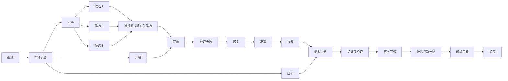

# 任务执行图 DAG

在 Portal 的「所有线程」中打开任务，查看「执行图 DAG」。默认从上往下排列，点击「横向」可切换为从左往右。子任务、Best-of-N 候选和主任务执行默认折叠，节点显示轮次、工具调用和验证次数，以及状态、耗时与费用。点击带箭头的节点可原地展开执行轮次、工具调用、验证和修复链，再次点击可收起。审核、插话、合并、PR 和 CI 等节点始终可以在图中查看。

「查看全图」按面板大小缩放，保留可读的最小字号。图超出面板时，滚动、拖动或按方向键可查看其余节点。按住 Ctrl 或 ⌘ 滚动、使用双指或按加减键可缩放。任务事件流刷新时保留展开状态、缩放和当前查看位置。点击节点可查看起止时间、费用、Token 和工具明细。有独立任务记录的子任务可以从详情打开。

任务参与者和同租户的只读用户都可以查询。执行图读取任务记录、事件和同租户的后代任务，已归档事件也可读取。旧任务缺少的时间或用量字段显示为 `null`。无需数据库迁移。

```bash
curl -fsS "$SCA_API_URL/v1/tasks/$TASK_ID/dag" \
  -H "Authorization: Bearer $SCA_API_TOKEN"
```

返回完整的 `nodes` 和 `edges`。每条边包含 `from`、`to` 和 `kind`。五种边分别表示执行顺序（`sequence`）、子任务依赖（`dependency`）、派生（`spawn`）、候选选择（`select`）和合并（`merge`）。`merge` 节点的 `meta.action` 表示候选选择或子任务合并。`tool_group` 节点的 `meta` 包含工具列表和按名称统计的调用次数。可折叠的执行节点通过可选的 `meta.parent` 引用所属节点 ID。费用单位为美元，耗时单位为秒。

## 运行脚本化演示

启动部署的 API 和 Worker，并提供可提交、插话和审核的租户令牌。使用 Worker 能读取的临时 Git 仓库。下例适用于 Worker 和脚本在同一台机器的场景。

```bash
demo_repo=$(mktemp -d)
git -C "$demo_repo" init -b main
git -C "$demo_repo" -c user.name=SCA -c user.email=demo@example.invalid \
  commit --allow-empty -m "Demo base"
python scripts/dag_demo.py --url "$SCA_API_URL" --repo "$demo_repo"
```

脚本使用 `agent_backend: "fake"` 生成 8 个带路径范围的子任务。FX 子任务用 `"best_of": {"n": 3}` 从同一个准备快照启动三个候选。各候选独立验证，平台按现有费用和差异规则自动选择通过验证的候选。定价子任务的第一次验证失败，下一轮修复后通过。合并后脚本发送一条插话，等待它应用到新一轮并进入第二次人工审核，然后批准任务。此流程不调用模型。加 `--hold-review` 可让操作者在 Portal 完成最后一次审批。



## 真实任务示例

选择一个已有订单、计税、发票和报表的电商仓库，使用真实 Agent 提交以下需求，可在规格中设置 `"plan": "auto"` 和 `"plan_review": true`，并填写仓库已有的验证命令。

> 给商店增加多币种能力。现有订单、历史发票和老 API 调用必须保持兼容。用最小货币单位存储金额，按 ISO 4217 处理小数位，覆盖 JPY、USD 和 KWD。抽象可替换的汇率供应商，订单创建时记录锁定汇率。用锁定汇率计算商品、折扣、税费和退款，验证舍入之和与订单总额一致。发票应记录交易币种和记账币种，报表按币种聚合并支持对账。提供可回填、可回滚的迁移，为旧客户端保留默认币种行为，并补充汇率失效、换汇失败和重复退款的测试以及运维手册。

预期先确定币种模型，再并行开展汇率、税务与数据库迁移。汇率和税务汇入定价，定价依次解锁发票和报表。迁移与报表汇入集成测试，文档在接口和迁移稳定后收尾。最终合并后运行全库验证并人工审核。若仓库配置了 CI 或 PR，执行图也会显示对应节点。

## 验证结果

脚本化演示生成 58 个节点和 86 条边，Portal 初始视图显示 21 个节点和 34 条边。展开定价子任务后，可查看两次验证与其间的修复轮次。布局测试覆盖纵向、横向、节点间距与跨层连线，模拟事件流测试覆盖刷新后的展开状态、缩放和平移。
