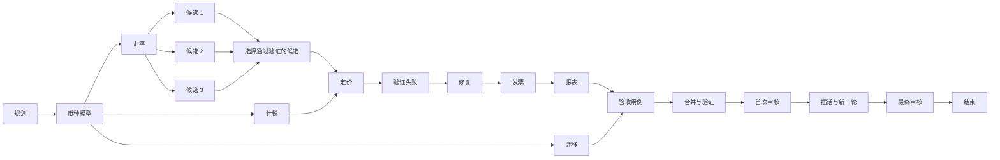

# 任务执行图 DAG

在 Portal 的「任务」中打开「任务执行图」。默认从左往右排列，点击「纵向」切换方向。彩色圆点区分任务、规划、Agent、汇合和验证，细曲线显示节点间的关系。子任务、Best-of-N 候选和主任务执行默认折叠。点击带箭头的节点可展开执行轮次、工具调用、验证和修复链，再次点击可收起。审核、插话、合并、PR 和 CI 等节点始终可以在图中查看。

「查看全图」将整个图缩放到面板内。图超出面板时，滚动、拖动或按方向键可查看其余节点。按住 Ctrl 或 ⌘ 滚动、使用双指或按加减键可缩放。任务事件流刷新时保留展开状态、缩放和当前查看位置。点击节点可查看起止时间、费用、Token 和工具明细。有独立任务记录的子任务可以从详情打开。

任务参与者和同租户的只读用户都可以查询。执行图读取任务记录、事件和同租户的后代任务，已归档事件也可读取。旧任务缺少的时间或用量字段显示为 `null`。无需数据库迁移。

```bash
curl -fsS "$SCA_API_URL/v1/tasks/$TASK_ID/dag" \
  -H "Authorization: Bearer $SCA_API_TOKEN"
```

返回完整的 `nodes` 和 `edges`。每条边包含 `from`、`to` 和 `kind`。五种边分别表示执行顺序（`sequence`）、子任务依赖（`dependency`）、派生（`spawn`）、候选选择（`select`）和合并（`merge`）。`merge` 节点的 `meta.action` 表示候选选择或子任务合并。`tool_group` 节点的 `meta` 包含工具列表和按名称统计的调用次数。可折叠的执行节点通过可选的 `meta.parent` 引用所属节点 ID。费用单位为美元，耗时单位为秒。

## 演进执行图与访客历史

在 Portal 打开「自动演进」→「演进记录」，选择一次运行。执行图从基线评测向下展示各代候选、开发集与留出集评测、晋升决定和登记的冠军。评测节点默认收起用例任务。点击评测节点展开用例，选中用例后点击「打开用例任务」进入该任务的执行图。演进排队、运行、暂停或待审批时，Portal 每 4 秒刷新，保留展开状态和查看位置。

节点区分排队、运行、完成、失败和停止。`score` 是 0 到 1 的通过率，未取得成绩时为 `null`。候选显示开发集通过率，评测按已收集且可评分的用例计算通过率。`cost_usd` 为记录的美元费用。候选的评测关联尚未写入时，执行图按已保存的时间、分组和覆盖内容展示进度，无法确认归属的评测仍可在图中打开。

接口使用演进详情的读权限，返回 `nodes` 和 `edges`。用例节点的 `task_id` 指向同租户任务，`meta.parent` 指向可展开的评测节点。无需数据库迁移。

```bash
curl -fsS "$SCA_API_URL/v1/evolutions/$EVOLUTION_ID/dag" \
  -H "Authorization: Bearer $SCA_API_TOKEN"
```

在 API 启用 `SCA_GUEST_VIEW=local` 并设置 `SCA_GUEST_TENANT=eval`，访客可从本机打开演进记录、执行图、评测和冠军谱系。演示启动脚本默认使用 `eval` 租户。访客响应会清除操作者和凭据信息，界面隐藏启动、停止、审批、固化、定期计划等管理功能。历史浏览无需模型密钥。[访客模式配置](operations.md#只读访客模式)

```bash
curl -fsS http://127.0.0.1:8000/v1/evolutions
curl -fsS "http://127.0.0.1:8000/v1/evolutions/$EVOLUTION_ID/dag"
curl -fsS "http://127.0.0.1:8000/v1/evals/runs/$EVAL_RUN_ID"
curl -fsS "http://127.0.0.1:8000/v1/champions/$CHAMPION_ID"
```

## 对话与运行中干预

在「自动演进」选择 OpenCode 或 DeepSeek Harness、评测套件和模型。套件选项显示开发集和留出集用例数。启动表单默认 1 代、每代 2 个候选、每用例评测 1 次、总预算 1 美元。启动后直接进入执行图和「对话」。任务详情也提供同一面板。窄屏上对话显示在执行图下方。

演进图按基线、各代和结果分段。同一代的候选并排展示，开发集和留出集位于对应候选下方。收起的评测节点显示用例和通过数。图例区分阶段、候选、评测、门禁和结果，颜色与文字显示状态，执行图突出冠军或失败路径。对话每 4 秒更新，点击「定位节点」会展开对应的组并聚焦。任务对话按轮汇总工具调用，可查看验证结果、规划、候选比较、审核和插话回执。

`eval` 租户的成员和管理员可发送演进消息。最新指引应用于下一次提议的反思及候选生成，后续各代沿用，直到新指引取代它。「已应用于第 N 代提议」表示提议步骤已使用该指引。暂停在步骤边界生效，恢复后继续原步骤。选择「本代结束后停止」会完成当前一代，待审批的候选仍需先完成审批。跳过当前候选后，已提交的用例结算费用，评测停止派发新用例，并将该候选排除出晋升。剩余预算在下一步骤边界调整，受租户当日及当月剩余额度约束，设为 `0` 可停止启动新的评测。

任务成员可选择「排队」或「打断」。运行结束后输入框停用并显示原因。访客可浏览进度，操作者字段及敏感信息会脱敏。查询对话时把返回的 `cursor` 原样传入下一页，`has_more` 表示还有可立即读取的页。两种对话均返回稳定的 `id`、时间与 `dag_node_id`。

```bash
curl -fsS "$SCA_API_URL/v1/evolutions/$EVOLUTION_ID/messages" \
  -H "Authorization: Bearer $SCA_API_TOKEN" \
  --json '{"text":"优先改进边界条件的验证"}'
curl -fsS "$SCA_API_URL/v1/evolutions/$EVOLUTION_ID/messages" \
  -H "Authorization: Bearer $SCA_API_TOKEN" \
  --json '{"mode":"budget","remaining_budget_usd":0.5}'
curl -fsS "$SCA_API_URL/v1/evolutions/$EVOLUTION_ID/messages" \
  -H "Authorization: Bearer $SCA_API_TOKEN"
curl -fsSG "$SCA_API_URL/v1/evolutions/$EVOLUTION_ID/conversation" \
  -H "Authorization: Bearer $SCA_API_TOKEN" --data-urlencode 'limit=50'
curl -fsSG "$SCA_API_URL/v1/tasks/$TASK_ID/conversation" \
  -H "Authorization: Bearer $SCA_API_TOKEN" --data-urlencode "cursor=$CURSOR"
```

演进消息默认使用 `guidance` 模式，快捷操作对应 `pause`、`resume`、`stop`、`skip` 和 `budget`。写入返回 `202`，应用结果通过对话回执或消息列表查询。新功能使用数据库迁移 `0026` 及更新后的 Worker。消息与回执保存在演进日志中，可跟随现有的历史导出和导入。

### 演进图演示

使用 `SCA_DATABASE_URL` 指向已迁移的演示数据库，并使用具有写权限的数据库用户。脚本在 `eval` 租户写入两代、六个候选以及 `fake` 后端的历史任务，包含一次晋升和一次未通过的留出集评测。费用为演示数据，全程无需 Worker 或模型调用。打开脚本打印的 Portal 链接即可查看。

```bash
python scripts/evo_dag_demo.py --url http://127.0.0.1:8000
```

## 进行中的任务工作区

更新 Worker 后，已有的子工作区继续使用原路径。以 `SCA_DATA_DIR/tasks/<id>/sub/` 为基准，
规划器、普通子任务和任务级 Best-of-N 候选的目录分别为 `plan-<n>`、`<name>` 和
`best-of-<n>`。子任务内的 Best-of-N 候选使用 `<name>/sub/best-of-<n>`。
使用原任务 ID 查询状态，也可在 Portal 查看执行图。

```bash
curl -fsS "$SCA_API_URL/v1/tasks/$TASK_ID" \
  -H "Authorization: Bearer $SCA_API_TOKEN"
```

## 运行脚本化演示

启动部署的 API 和 Worker，并提供可提交、插话和审核的租户令牌。使用 Worker 能读取的临时 Git 仓库。下例适用于 Worker 和脚本在同一台机器的场景。

```bash
demo_repo=$(mktemp -d)
git -C "$demo_repo" init -b main
git -C "$demo_repo" -c user.name=SCA -c user.email=demo@example.invalid \
  commit --allow-empty -m "Demo base"
python scripts/dag_demo.py --url "$SCA_API_URL" --repo "$demo_repo"
```

脚本使用 `agent_backend: "fake"` 生成 8 个带路径范围的子任务。FX 子任务用 `"best_of": {"n": 3}` 从同一个准备快照启动三个候选。各候选独立验证，平台按现有费用和差异规则自动选择通过验证的候选。定价子任务的第一次验证失败，下一轮修复后通过。合并后脚本发送一条插话，等待它应用到新一轮并进入第二次人工审核，然后批准任务。此流程不调用模型。加 `--hold-review` 可让操作者在 Portal 完成最后一次审批。



## 真实任务示例

选择一个已有订单、计税、发票和报表的电商仓库，使用真实 Agent 提交以下需求，可在规格中设置 `"plan": "auto"` 和 `"plan_review": true`，并填写仓库已有的验证命令。

> 给商店增加多币种能力。现有订单、历史发票和老 API 调用必须保持兼容。用最小货币单位存储金额，按 ISO 4217 处理小数位，覆盖 JPY、USD 和 KWD。抽象可替换的汇率供应商，订单创建时记录锁定汇率。用锁定汇率计算商品、折扣、税费和退款，验证舍入之和与订单总额一致。发票应记录交易币种和记账币种，报表按币种聚合并支持对账。提供可回填、可回滚的迁移，为旧客户端保留默认币种行为，并补充汇率失效、换汇失败和重复退款的测试以及运维手册。

预期先确定币种模型，再并行开展汇率、税务与数据库迁移。汇率和税务汇入定价，定价依次解锁发票和报表。迁移与报表汇入集成测试，文档在接口和迁移稳定后收尾。最终合并后运行全库验证并人工审核。若仓库配置了 CI 或 PR，执行图也会显示对应节点。

## 验证结果

脚本化演示生成 58 个节点和 86 条边，Portal 初始视图显示 21 个节点和 34 条边。展开定价子任务后，可查看两次验证与其间的修复轮次。布局测试覆盖纵向、横向、节点间距与跨层连线，模拟事件流测试覆盖刷新后的展开状态、缩放和平移。
