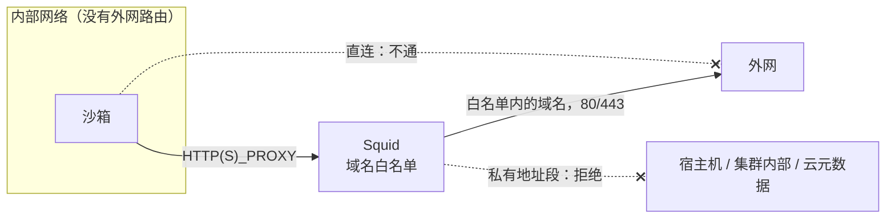
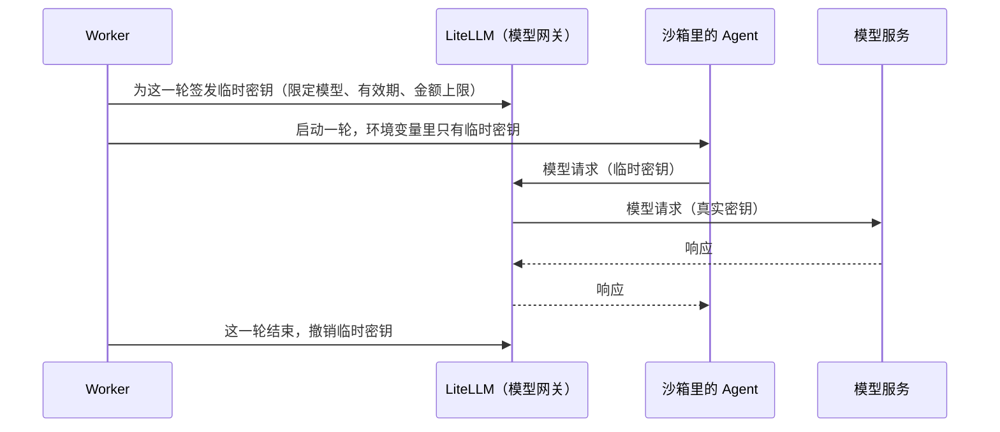
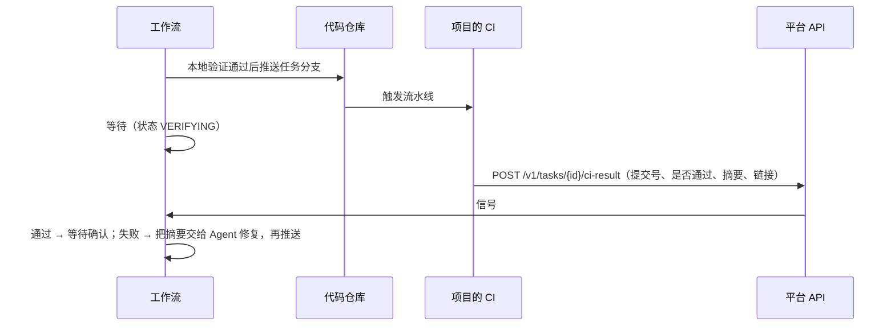
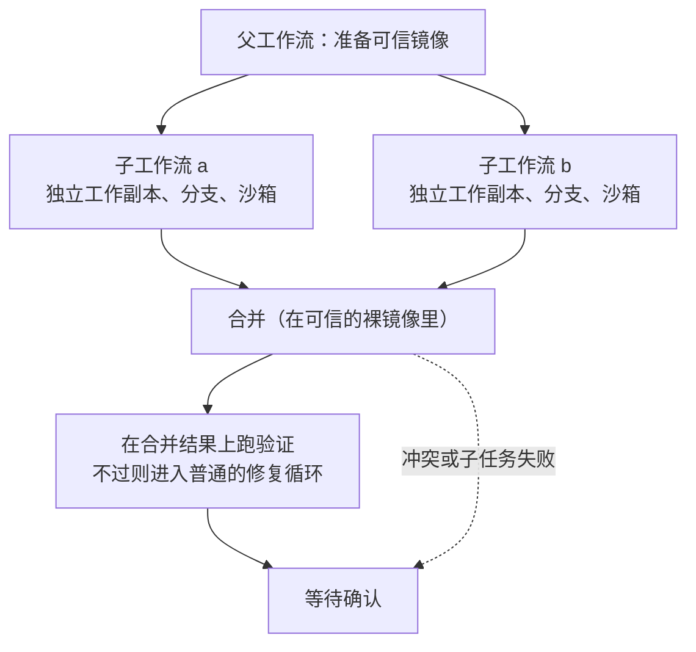

# SuperCloudAgents 二期设计

> 对应 [`architecture.md`](architecture.md) 8.2 节。一期的实现基线见 [`design.md`](design.md)。
> 本文按组件组织：每个组件先写设计，最后的「结果」一节如实记录验证到了什么程度、什么没有做到。

## 0 总则

### 0.1 目标

一期证明链路能跑通。二期要让平台**能给不信任的人用、能扩到多台机器、出了问题能恢复**。

其中「扩到多台机器」只完成了一部分，见第 10 节。

### 0.2 做法

- 每个组件都是替换或增强一期留好的接口，不改内核。
- **能用开源组件就不自己写。** 自己写的只有两类：把开源组件接到平台接口上的驱动，以及产品本身的逻辑（任务模型、工作流、API）。
- 每个组件完成的标准：有可执行的测试证明它的目标；一期的全部测试保持通过。

### 0.3 组件、选型与目标

| 顺序 | 组件 | 开源组件 | 自己写的部分 | 目标（可验证） |
| --- | --- | --- | --- | --- |
| 1 | 沙箱 | gVisor、Kubernetes、NetworkPolicy、Squid | 沙箱接口的 Docker 与 Kubernetes 驱动 | 沙箱访问白名单外的地址失败；同一套契约测试在两个驱动上都通过 |
| 2 | 凭证 | LiteLLM | 为任务签发和回收临时密钥 | 真实凭证不进沙箱；任务结束后临时密钥失效 |
| 3 | 身份与多租户 | Dex（OIDC）、PyJWT、Postgres 行级安全 | 配额检查 | 租户之间在数据库层隔离；超配额返回 429 |
| 4 | 编排 | Temporal（Postgres 持久化） | 工作流 | Worker 被杀后任务自动续跑；等待确认时不占沙箱 |
| 5 | 存储 | S3 兼容存储（SeaweedFS）、boto3 | 事件归档 | 换成 S3 后测试全过；备份可恢复并能回放历史任务 |
| 6 | 验证 | 项目自己的 CI 系统 | CI 回调适配 | 多条验证并行；CI 回调能驱动任务继续 |
| 7 | 可观测 | OpenTelemetry、Prometheus、Postgres LISTEN/NOTIFY | 用量预算判断 | 跨进程追踪完整；超预算任务被自动停下 |
| 8 | 加速 | Git 引用仓库机制、pip 下载缓存 | 缓存键与锁 | 同一仓库第二个任务的准备时间明显缩短 |
| 9 | 并行 | Temporal 子工作流、Git 合并底层命令 | 拆分与合并步骤 | 两个子任务并行完成并合并；冲突转人工 |

---

## 1 沙箱

### 1.1 要解决的问题

一期的沙箱是一个可以任意联网的普通容器（`design.md` 第 13 节）。两个后果：沙箱里的代码可以把仓库内容和凭证发到任何地方；容器逃逸的防线只有内核本身。另外，一期只有 Docker 一种实现，Worker 和沙箱必须在同一台机器上。

### 1.2 契约的变化

`SandboxSpec` 的 `network` 从布尔值改为三种模式，并新增 `runtime`：

| 字段 | 取值 | 含义 |
| --- | --- | --- |
| `network` | `restricted`（默认） | 没有直连外网的路由，只能经出口代理访问白名单里的主机。 |
| | `none` | 完全没有网络。 |
| | `open` | 不限制。只用于调试。 |
| `runtime` | 空或运行时名 | 容器运行时。填 `runsc` 即使用 gVisor。 |

默认值从「不限制」变成了「受限」。这是有意的：安全的行为应该是默认行为。

### 1.3 出口控制

- **代理用 Squid**，不自己写。平台只负责根据白名单生成它的配置（`sca/sandbox/egress.py`）。
- **规则顺序**：先拒绝非 80/443 端口，再拒绝所有私有地址段，然后放行白名单域名，最后全部拒绝。私有地址段排在白名单之前，所以即使有人把内部地址写进白名单，代理也不会成为进入宿主机、集群或云元数据服务的通道。
- **白名单条目会被校验**。条目最终被写进 Squid 配置，不合法的条目（含空格、换行等）直接报错，避免配置注入。
- **Docker 驱动**：沙箱加入一个 `--internal` 网络；Squid 容器同时接在这个网络和默认网桥上。
- **Kubernetes 驱动**：命名空间内默认拒绝所有出口流量；受限沙箱只允许连到 Squid 的 3128 端口；Squid 允许访问外网但不允许访问私有地址段。
- **白名单是平台级配置**（`SCA_EGRESS_ALLOW`），默认只有模型服务和 Python 包索引。第 2 个组件完成后，模型服务会从白名单里移除，改为只允许访问模型网关。

HTTPS 流量走 `CONNECT` 隧道，代理只看到域名，不解密内容。

### 1.4 隔离强度

`runtime` 字段让 gVisor 成为一个配置项：Docker 驱动传给 `--runtime`，Kubernetes 驱动写进 `runtimeClassName`。两个驱动都以非 root 用户运行沙箱；Kubernetes 驱动另外禁止提权、丢弃全部 capabilities、不挂载服务账号令牌。

### 1.5 Kubernetes 驱动

- 一个沙箱一个 Pod。和 Docker 驱动一样用命令行工具（`kubectl`）驱动，不引入新依赖；流式执行的逻辑两个驱动共用。
- 沙箱的测试改成**契约测试**：同一组断言对两个驱动各跑一遍。以后再加驱动（例如微虚拟机），先过这组测试。
- **已知限制**：挂载用 `hostPath`，所以 Worker 和节点必须共享文件系统。单节点可用，多节点不行。解决办法是把「挂载」换成「通过执行通道同步」。二期没有做，见第 10 节。

### 1.6 预热池：不做，及原因

实测 Docker 驱动创建一个沙箱约 0.5 秒，相对于几分钟的任务可以忽略。预热池还要求沙箱在创建时不绑定任务的挂载，而这依赖 1.5 里提到的同步机制。等 Kubernetes 上有真实的启动时延数据、并且同步机制就绪后再评估。

### 1.7 结果

- **出口控制**：`tests/integration/test_egress.py` 在 Docker 驱动上通过——白名单内的域名可达；其他域名被代理拒绝；不经代理没有外网路由；把私有地址写进白名单，代理仍然拒绝。同一组断言在 Kubernetes 驱动（kind 集群）上也通过。
- **契约测试**：`tests/integration/sandbox_contract.py` 的 5 项断言在两个驱动上都通过。
- **gVisor**：本机安装了 `runsc`。真实 Codex 任务在 `runsc` 沙箱里经出口代理和模型网关端到端完成（见第 2 节）。gVisor 不支持 Docker 的内置 DNS，所以代理和网关按 IP 地址传给沙箱。
- **没有做到的**：
  - kind 自带的网络插件不过滤 Pod 到本节点 API Server 的流量，`test_none_cannot_reach_cluster_api` 标记为预期失败。生产集群需要 Calico 或 Cilium。Pod 没有服务账号令牌，能碰到的只是未认证的 API 表面。
  - Kubernetes 驱动的挂载仍是 `hostPath`，只支持单节点（见第 10 节）。
  - 没有做预热池（原因见 1.6）。

## 2 凭证

### 2.1 要解决的问题

一期把 Codex 的登录凭证文件只读挂载进沙箱。沙箱里的代码能读到它，而这份凭证长期有效、不区分任务。仓库凭证一期就留在沙箱外，本节不改它。

### 2.2 做法

- **网关用 LiteLLM**，不自己写。平台只写一个很小的客户端（`sca/gateway/litellm.py`）实现 `ModelGateway` 接口：签发密钥、撤销密钥。
- **密钥的范围是「一轮」**，不是「一个任务」。别名为 `task-<任务>-turn<轮>-attempt<重试>`，轮次结束时在 `finally` 里撤销；同名密钥签发前先撤销旧的，所以活动重试不会留下多余的有效密钥。有效期略长于轮次超时，作为撤销失败时的兜底。
- **密钥不进工作流历史**。签发和使用都在同一个活动里完成，Temporal 里看不到它。
- **真实密钥只在网关里**。配置了 `SCA_MODEL_GATEWAY_URL` 后，Worker 不再把登录凭证文件挂进沙箱；Codex 通过 `-c model_providers...` 指向网关，密钥从环境变量 `SCA_MODEL_KEY` 读取。
- **网络**：网关容器接入沙箱所在的内部网络，沙箱直连它（不经出口代理）。模型服务的域名可以从出口白名单里去掉。

### 结果

- `tests/e2e/test_e2e_gateway.py` 通过：真实 Codex 任务在 gVisor 沙箱里经网关调用模型（DeepSeek 的 flash 模型）完成修复；沙箱里找不到真实密钥，也没有登录凭证文件；轮次结束后用那把临时密钥再请求网关，被拒绝。
- **没有做到的**：按金额计费没有验证。LiteLLM 的花费取决于它的价格表里有没有这个模型，本次测试用的模型没有，所以 `usage.cost_micro_usd` 没有数值。按 Token 的用量和预算是可用的（第 7 节）。
- 仓库凭证仍由部署者通过宿主机的 Git 凭证配置提供，没有接入密钥管理服务。

## 3 身份与多租户

### 3.1 要解决的问题

一期的静态令牌只适合本地使用，任务查询依赖应用传入租户条件；漏写条件就可能暴露其他租户的数据。任务数量也没有上限，一个租户可以占满执行资源。

### 3.2 身份认证

- 使用 PyJWT 的 `PyJWKClient` 获取并缓存 OIDC 公钥，只接受 RS256、ES256，校验签名、签发者、受众和有效期，并要求 `sub` 与租户声明存在。整个同步校验放在线程中，JWKS 网络请求不会阻塞事件循环。
- 认证链先尝试静态令牌，再尝试 OIDC，保留本地开发方式。配置签发者时同时要求受众，避免误接受签给其他客户端的令牌。
- 本地身份提供方使用 Dex，配置位于 `deploy/dex/config.yaml`，端口 5556，客户端 `sca-cli`，用户 `dev@example.com`，密码 `password`。密码模式仅用于本地验证，配置依据 [Dex 本地连接器文档](https://dexidp.io/docs/connectors/local/)。Dex 的本地用户默认不提供自定义 `tenant` 声明；联调时可把 `oidc_tenant_claim` 设为 `email` 并请求 `email` scope，正式接入则由身份提供方提供租户声明。

### 3.3 数据库隔离

- API 使用独立数据库连接配置 `api_database_url`，生产环境以 `sca_api` 登录。迁移只创建 NOLOGIN 角色，登录方式和凭证由部署配置管理，不把开发密码写进迁移。
- tasks、events、sessions、artifacts 都有非空租户列。迁移从任务回填子表租户，并在四张表启用 Postgres RLS，以事务内的 `app.tenant_id` 同时约束读取和写入；未设置租户时不可见。
- 每个请求使用 `Store.for_tenant()`，每次事务通过 `set_config(..., true)` 设置租户，事务结束自动清除，避免连接池复用时串租户。应用层仍保留租户检查，数据库策略作为第二道防线。
- 不使用 FORCE ROW LEVEL SECURITY。Worker 使用表所有者连接，继续跨租户处理任务；API 必须使用非所有者、非超级用户连接才能获得数据库层保护。

### 3.4 配额与并发

`tenants` 表保存租户配额，首次使用默认 20。提交事务先创建租户行并锁定，再检查幂等键，最后统计非终态任务并插入。配额检查与插入处于同一个事务，同租户并发提交串行检查，不会同时抢到最后一个名额；不同租户互不争锁。幂等重放先于配额检查，因此满额时重试仍返回原任务。终态任务不占名额；超额通过标准错误体返回 HTTP 429。

管理端通过 `Store.set_tenant_quota()` 调整额度，不增加公开 API。配额配置与任务数量都留在 Postgres，不引入额外缓存或分布式锁。

### 结果

- `tests/integration/test_tenancy.py` 通过：以 `sca_api` 角色直接执行 SQL，不设置租户时四张表都看不到数据，设置后只能看到本租户的；跨租户写入被数据库拒绝。并发提交不会超过配额；超额返回 429；幂等重放在满额时仍返回原任务。
- `tests/e2e/test_e2e_live_services.py` 通过：Dex 签发的真实令牌被平台接受，租户取自令牌里的声明；签给其他受众的令牌被拒绝。
- **没有做到的**：没有角色和细粒度权限，同一租户内的用户权限相同。本地联调用 `email` 充当租户声明，正式接入需要身份提供方提供租户声明。

## 4 编排

### 4.1 要解决的问题

一期的任务在等待确认时一直占着沙箱；人不来，资源就不释放。一期没有验证过 Worker 进程中途死掉会怎样。Temporal 用的是开发模式的单文件存储。

### 4.2 等待时释放沙箱

任务的全部状态在沙箱之外：工作副本和 Agent 的会话记录在任务目录里，事件和结果在 Postgres 里。所以沙箱可以随时销毁、之后重建。

- 进入 `AWAITING_REVIEW` 后等待 `SCA_REVIEW_IDLE_RELEASE_S`（默认 600 秒）。超时仍没人处理，就销毁沙箱，任务状态不变，照常可以查看补丁、批准或拒绝。
- 需要继续干活时（要求修改、恢复暂停），在同一个工作副本和会话记录上重建沙箱，并重跑一次 `setup_command`——安装在挂载目录之外的东西随旧沙箱一起没了。
- 事件 `sandbox.released` 和 `sandbox.restored` 记录这两个动作。

### 4.3 暂停与恢复

新增状态 `PAUSED`，以及工作流信号 `pause`、`resume`（API：`POST /v1/tasks/{id}/pause`、`/resume`）。

- 暂停只在**两轮之间**生效，不会打断正在执行的一轮。打断一轮会丢掉模型已经花掉的用量，而且会话可能停在不一致的位置。
- 暂停时释放沙箱，恢复时重建。暂停中的任务可以取消。

### 4.4 Worker 故障

- 活动在执行中持续发心跳。Worker 死掉后心跳停止，超过 `SCA_TURN_HEARTBEAT_TIMEOUT_S`（默认 120 秒）Temporal 把这一轮交给另一个 Worker 重做。
- 重做是安全的：事件按去重键写入，不会重复；每次重试用新的临时密钥；沙箱还在就继续用，不在就重建。
- 一轮重做意味着这一轮的模型调用重来一遍。这是有意的取舍：把「一轮」作为最小重试单位，比尝试接管一个半途的 Agent 进程简单可靠。

### 4.5 Temporal 用 Postgres 持久化

`deploy/docker-compose.yml` 增加 `temporal-pg`（profile 同名）：Temporal 官方的 auto-setup 镜像，数据存在已有的 Postgres 实例里，端口 7234。生产环境应该用它或 Temporal Cloud，而不是开发模式的服务。

### 结果

- `tests/integration/test_workflow.py`：空闲释放后要求修改会重建沙箱；及时处理则不释放；暂停不打断正在执行的一轮、恢复后继续；暂停中可以取消。
- `tests/e2e/test_e2e_resilience.py`（真实沙箱）：
  - 等待确认 2 秒后沙箱容器消失，任务仍可查看补丁；要求修改后在新沙箱里继续，`setup_command` 重跑，原有改动都在，验证通过。
  - Worker 作为独立进程运行，在 Agent 一轮执行到一半时用 `SIGKILL` 杀掉；启动新的 Worker 后任务自动重做这一轮并走到等待确认，事件序号连续无重复。
- `tests/e2e/test_e2e_temporal_pg.py`：任务等待确认时重启 Temporal 服务，重启后任务继续接受指令并完成。
- **没有做到的**：Worker 和沙箱仍然要在同一台机器上（见第 10 节）。所以「Worker 被杀后续跑」验证的是同一台机器上换一个进程，不是换一台机器。

## 5 存储

### 5.1 对象存储驱动

保留 `ObjectStore` 的 `put/get` 调用方式，新增 boto3 驱动 `S3ObjectStore`。SDK 的阻塞操作在线程中执行，使用 path-style 地址以兼容 S3 和 MinIO；首次访问时检查桶，不存在则创建。`put` 返回 `s3://bucket/key`，本地驱动仍返回文件 URI。两个驱动的缺失对象统一抛 `NotFoundError`，拒绝空键、绝对路径和包含 `..` 的键，并提供幂等删除与按前缀列出键的能力。

`make_object_store(settings)` 根据 `object_store` 选择 `local`（默认）或 `s3`，读取桶、端点、凭证与区域配置。API 和 Worker 都通过它取得对象存储。本地驱动继续保留 `key_for`，制品键仍为 `tasks/{task_id}/{name}`。

### 5.2 备份与恢复

`deploy/backup.sh <output-dir>` 在 Postgres 容器内运行 `pg_dump --format=custom`，同时复制本地对象目录，记录 UTC 时间与大小清单。输出目录必须不存在，失败后的目录不能作为完整备份使用。备份期间须暂停写入，以保证数据库与对象副本一致。

`deploy/restore.sh <backup-dir> <target-database-name>` 创建新数据库后运行 `pg_restore`，再复制对象到新的目录。数据库和对象目录均拒绝覆盖；恢复失败保留现场供排查。容器、数据库用户、备份源数据库与对象路径通过脚本头部列出的环境变量覆盖。恢复后应用须指向新的对象目录，按任务和制品名生成键读取；数据库中的旧文件 URI 不作改写。

S3 桶使用存储服务自身的版本管理、复制等工具备份与恢复，这两个脚本只复制本地对象。契约测试对本地目录和 moto S3 服务运行同一组断言；备份恢复集成测试在独立的临时数据库中写入任务、事件及制品，恢复后校验历史数据与字节内容，Docker 不可达时跳过。

### 5.3 事件增长的处理决定

事件表**不按时间分区**：任务内 `(task_id, seq)` 和 `(task_id, dedup_key)` 的唯一性无法跨时间分区强制保证。改为将旧的已结束任务的事件按任务归档到对象存储，每个任务一个压缩 JSONL 对象，以此控制在线事件表的增长。归档使用 `sca.archive`，通过 `python -m sca.archive --older-than-days N --limit M` 批量执行。

### 5.4 归档事务与读取

`tasks.events_archived_at` 标记事件已迁往对象存储。仅允许归档终态任务，键为 `tasks/<task_id>/events.jsonl.gz`；每行保存一个完整 Event，按 seq 排序。归档事务锁住任务行，与事件追加共用锁；上传后读回解压，比较完整事件内容（包含数量与最后序号），成功后才删除在线事件并设置标记。失败回滚数据库，重试覆盖同一对象；已有标记则直接返回。归档后拒绝追加事件，避免序号重置。

`Store` 可注入 ObjectStore，`for_tenant` 保留该依赖。`list_events` 先验证任务与租户，再根据标记读取数据库或对象，保留 after/limit 语义；读取与归档用任务锁协调，避免切换期间漏读。API 与 SSE 无需区分存储位置。对象必须与数据库一起备份；目前历史读取会解压整个任务的对象，超大任务后续再评估索引。

### 结果

- 对象存储的契约测试在本地目录和 S3（moto）上都通过。`tests/e2e/test_e2e_live_services.py` 用真实的 S3 兼容服务（SeaweedFS）跑完一个完整任务，补丁和验证日志都从桶里读回。
- `tests/integration/test_backup_restore.py` 通过：备份后恢复到新的数据库和对象目录，历史任务的事件和制品内容与原来一致。
- `tests/integration/test_archive.py` 通过：归档前后 API 返回的事件完全相同；重复归档无副作用；未结束的任务拒绝归档；校验失败时在线数据原样保留。
- **没有做到的**：归档需要定时执行（`python -m sca.archive`），没有内置调度。S3 桶的备份依赖存储服务自身。读取已归档任务的事件会解压整个对象。

## 6 验证

### 6.1 要解决的问题

一期只有一条验证命令，在沙箱里串行执行。真实项目有多项检查（测试、静态检查、类型检查），而且权威的检查往往在项目自己的 CI 里，沙箱里跑不了或跑不全。

### 6.2 多条验证并行

`spec.verify_commands` 是在 `verify_command` 之外的更多检查。全部命令在同一个沙箱里**同时**执行，全部通过才算通过。

- 事件 `verification.completed` 里的 `checks` 记录每条命令的结果；日志制品按命令分段。
- 交给 Agent 修复的只有**失败的那几条**的输出，通过的不占提示词。
- 命令在同一个工作副本里并行，互相写同一个文件的检查不适合放在一起，这由任务提交者负责。

### 6.3 外部 CI

不替代任何 CI 系统，只做一个适配：平台把分支推上去，CI 跑完后回调平台。

- 用 `spec.ci` 开启，可设超时。本地验证不过不会去打扰 CI。
- **结果按提交号匹配**。迟到的、针对旧提交的结果不会让新提交通过。
- **超时算失败**，不会无限等待。CI 失败和本地验证失败共用同一个修复次数上限。
- 回调使用普通的 API 令牌，由项目作为 CI 的密钥保存。在 CI 配置里加一步 `curl` 即可，不需要为每种 CI 系统写插件。

### 结果

- `tests/e2e/test_e2e_verification.py`（真实沙箱）：
  - 三条各需 4 秒的检查共用约 4.8 秒完成；其中一条失败时任务判为失败，反馈里只有失败那条的输出；修复后三条全过。
  - 外部 CI：测试里的流水线真的检出被推送的分支并运行项目的测试，外加一条本地验证不知道的规则。第一次回报失败，Agent 修复后推送新提交，第二次回报通过，任务进入等待确认。
- `tests/integration/test_workflow.py`：针对旧提交的重复回报被忽略；CI 超时按失败处理；本地验证失败时不触发 CI。
- **没有做到的**：没有对接真实的 CI 服务（GitHub Actions 等），回调方用测试代码代替。回调没有独立的、只能回报结果的受限令牌。

## 7 可观测

### 7.1 指标

使用 prometheus-client，API 提供免认证 `/metrics`。每个应用实例持有独立注册表；HTTP 次数与延迟按路由模板、状态码标记，未知路由统一记为 unmatched，避免任务 ID 造成高基数。创建任务只在首次插入时计数，人工审核在事件写入成功后计数。

任务状态 Gauge 在抓取时查库并缓存 3 秒。API 连接受 RLS 约束，迁移提供固定 search_path 的 SECURITY DEFINER 聚合函数，只返回各状态数量，不返回租户或任务内容；仅授权 sca_api 执行。

### 7.2 追踪

配置 `otlp_endpoint` 时，`setup_tracing` 初始化 OpenTelemetry SDK、服务名与 OTLP/HTTP 批量导出器，重复调用不重复安装。未配置则不安装导出器。FastAPI 使用官方 instrumentation 自动建立请求 Span；任务首次创建时将当前 trace ID 写入 `result.trace_id`。`tracing_interceptors()` 返回 Temporal 官方的 TracingInterceptor，API 和 Worker 连接 Temporal 时都带上它，追踪上下文因此从 API 请求传到工作流和活动。

### 7.3 用量预算

`Store.check_budget` 比较任务 spec.max_tokens 与 input_tokens + output_tokens；再比较 tenants.daily_token_budget 与该租户当前 UTC 日创建任务的累计用量。达到额度返回可读原因，未配置返回 None；缓存输入 Token 不重复计入。预算只负责判断，停止任务由工作流负责，因此并发任务在轮次边界检查时可能少量超额。管理操作使用 `set_tenant_budget`，不增加公开接口。

### 7.4 实时事件与暂停

事件追加与状态事件在同一事务执行 `pg_notify('sca_events', task_id)`，提交后通知才可见。API lifespan 管理一个独立 asyncpg LISTEN 连接，断开后指数退避重连；同任务多个 SSE 各有独立唤醒器。订阅后先读历史，读前清除唤醒标记，防止读写竞态；每 5 秒兜底查询，通知丢失只增加延迟。连接结束注销等待器。

暂停与恢复 API 只发送编排信号。终态或已暂停不能再暂停，仅 PAUSED 可恢复；暂停要到下一轮边界才生效，返回状态可能仍是原值。CLI 与页面提供同名操作。

### 结果

- **追踪**：`tests/e2e/test_e2e_tracing.py` 通过。一个任务从 API 请求、启动工作流、工作流执行到每个活动，都在同一条追踪里，追踪号记录在 `result.trace_id`。
- **指标**：`/metrics` 的测试通过，包含请求数、延迟、各状态任务数。
- **预算**：`tests/e2e/test_e2e_verification.py` 通过。任务超过自己的 `max_tokens`，或租户超过当日额度，都会在下一轮开始前被停下，状态为 `FAILED`，原因写明超出预算；已有的改动留在任务分支上。
- **事件推送**：`tests/integration/test_notify.py` 通过。事件在远小于兜底轮询间隔的时间内到达；监听连接不可用时仍能靠轮询工作。
- **没有做到的**：没有部署追踪和指标的后端，也没有仪表盘和告警规则；导出到真实 OTLP 端点没有验证。预算在两轮之间检查，一轮之内可能超出一些。按金额的预算没有做（见第 2 节）。

## 8 加速

### 8.1 要解决的问题

同一仓库的多个任务反复下载相同 Git 对象，依赖安装也重复下载包。缓存必须减少准备时间，同时每次仍以远端当前引用为准，不能把旧分支或旧提交当作最新代码。

### 8.2 仓库缓存

- 使用 Git 裸镜像，路径为 `root/<规范化 URL 的 SHA256>.git`。URL 规范化保留凭证与路径大小写，只统一协议、主机名和末尾斜杠；本地路径转为绝对路径。
- `RepoCache.ensure()` 首次克隆，后续执行 `fetch --prune`。每个 URL 用独立的 `fcntl` 文件锁串行化，等待时不阻塞事件循环；不同仓库可同时准备。锁文件不删除，避免等待者锁住不同 inode。
- 非网络错误导致抓取失败时，删除损坏镜像并重新克隆一次；网络或认证失败保留现有镜像并报错，不回退到旧代码。Git 错误文本固定为英文后分类。
- `GitWorkspace(..., cache=...)` 从缓存以 `--mirror --reference --dissociate` 创建任务镜像，再将 origin 改回原仓库并执行 `fetch --prune`。复制期间持有缓存锁；完成后任务镜像没有 alternates，清理缓存不会影响运行中的任务。
- `await RepoCache.prune(max_entries)` 按最后成功使用时间淘汰，删除前获取同一把锁并重新检查顺序。缓存只存在于可信宿主机，不挂入沙箱；凭证只用于可信镜像，宿主机不在已交给沙箱的工作副本内执行 Git。

### 8.3 依赖下载缓存

使用 pip 自带的下载缓存，不新增服务或依赖。`pip_cache_mount(root, tenant_id)` 创建 `root/pip/<tenant_id>`，可写挂载到 `/cache/pip`，配合 `PIP_CACHE_ENV` 设置 `PIP_CACHE_DIR=/cache/pip`。租户标识必须是单个安全路径分量。沙箱创建时带上这个挂载和环境变量（可用 `SCA_PIP_CACHE=false` 关闭）。

共享可写缓存有投毒风险：一个任务可能修改另一个任务将安装的 wheel。因此默认按租户分目录，不能跨租户共用；同租户任务仍互相信任。需要更强边界时改为只读制品服务或任务独立缓存。缓存只是下载优化，不能替代锁文件、哈希校验与安装验证。

### 8.4 验证方法

Git 集成测试覆盖远端新增提交、删除分支、缓存删除后任务镜像独立可用、同 URL 并发、不同 URL 独立锁、损坏恢复、失败不回退与 LRU 淘汰。性能测试创建 96 MiB 不可压缩对象，通过 `file://` 真正传输，测量首次与重复的完整 `prepare`，输出秒数并断言重复耗时小于首次的一半；不注入延时。Docker 不可达时，原有沙箱提交测试跳过，纯 Git 测试继续运行。

### 结果

- `tests/integration/test_workspace_cache.py` 通过。对一个 96 MiB 的仓库，首次准备约 12 到 14 秒，有缓存后约 2 秒。远端新增的提交、删除的分支在有缓存时都能正确反映；缓存目录被删掉不影响已建好的任务。
- `tests/e2e/test_e2e_verification.py`：同一仓库的两个任务共用一个缓存镜像；沙箱里 `PIP_CACHE_DIR` 指向按租户分开的可写目录。
- **没有做到的**：没有部署包索引的代理（如 devpi），只用了 pip 自带的下载缓存，所以省的是下载，不是安装。缓存的淘汰（`RepoCache.prune`）没有接入定时任务。

## 9 并行

### 9.1 要解决的问题

一个任务只有一个 Agent 串行工作。能拆开的大任务（互不相关的几处改动）只能排队做。

### 9.2 做法

`spec.subtasks` 给出 2 到 8 个子任务（名字 + 指令）。**拆分由提交者给出**，平台不做自动规划。没有子任务时一切照旧。

- **并行用 Temporal 子工作流**，每个子任务一个，同时启动。子任务各有自己的目录、分支（`sca/<任务>-<名字>`）和沙箱，互不可见；各自走「一轮 → 提交 → 验证 → 修复」的循环，结束时销毁自己的沙箱。
- **事件和用量都记在父任务上**，事件里带子任务名。所以预算检查覆盖整个任务，取消父任务会连带取消全部子任务。
- **合并不执行仓库里的任何东西。** 在父任务的可信裸镜像里用 `git merge-tree --write-tree` 和 `git commit-tree` 逐个合入，没有工作目录、没有检出、没有钩子。这延续了一期的规则：宿主机不在不可信的工作副本里运行 Git。
- **只合并通过了验证且没有冲突的子任务。** 合并之后才创建父任务的工作副本和沙箱，直接从「验证」开始：验证跑在合并后的结果上，因为各自通过不代表合起来也通过。
- **冲突和失败转人工。** 任务照常走到等待确认，但 `verification_passed` 为假，`result.subtasks` 列出每个子任务的状态（已合并、冲突及冲突的文件、失败、无改动），没合进去的改动作为补丁制品 `subtask-<名字>.patch` 发布。审阅者可以接受部分结果、拒绝，或要求修改——这时 Agent 在父沙箱里继续，提示词里列出未合并的子任务，补丁放在 `/workspace/.sca/` 下供它参考（该目录不会被提交）。

### 结果

- `tests/integration/test_merge.py`：改不同文件、改同一文件的不同位置都能干净合并；真冲突时报告冲突的文件，分支停在最后一次干净合并；没有改动的子任务被跳过。
- `tests/integration/test_workflow.py`：两个子任务的执行时间有重叠；合并结果直接进入验证，不多跑一轮；子任务失败或冲突时进入等待确认且验证为未通过；冲突后要求修改，下一轮的提示词点名未合并的子任务；取消父任务后所有沙箱都被销毁。
- `tests/e2e/test_e2e_subtasks.py`（真实沙箱）：
  - 两个子任务各含 5 秒的工作，并行完成并合并，合并后的补丁同时包含两处改动，验证通过，从开始到合并不到 9 秒（串行至少要 10 秒）。
  - 两个子任务把同一行改成不同内容：一个合并、一个冲突，冲突的补丁可以下载；要求修改后 Agent 解决冲突，验证通过，批准后任务成功，没有沙箱残留。
- **没有做到的**：没有自动拆分任务。合并顺序固定为提交的顺序。子任务之间不能通信，也没有依赖关系。并行度受单机资源限制（见第 10 节的多节点问题）。

## 10 尚未完成的事

二期结束时，下面这些没有做。每一项的设计在 [`design-phase2b.md`](design-phase2b.md)。它们不影响单机部署下已验证的结论，但在宣称「可以多机生产部署」之前必须解决。

| 事项 | 现状 | 需要做什么 |
| --- | --- | --- |
| 多节点 | Worker 通过宿主机目录挂载把工作副本交给沙箱，所以 Worker 和沙箱必须在同一台机器；Kubernetes 驱动只能用于单节点。 | 把「挂载」换成「通过执行通道或对象存储同步工作副本和会话记录」。沙箱释放与重建（第 4 节）已经证明状态可以脱离沙箱存在，缺的是跨机器搬运。 |
| Kubernetes 网络隔离 | kind 自带的网络插件不执行到 API Server 的策略。 | 在使用 Calico 或 Cilium 的集群上重跑契约测试。 |
| 按金额计费 | 只有 Token 用量。 | 在网关里配置模型价格，验证花费回写。 |
| 运维 | 没有部署追踪、指标后端；归档和缓存淘汰没有调度。 | 部署观测后端；用定时工作流执行归档和淘汰。 |
| 权限 | 租户内没有角色；CI 回调用普通令牌。 | 角色模型；受限用途的令牌。 |
| 仓库凭证 | 依赖宿主机的 Git 凭证配置。 | 接入密钥管理服务，按任务取短期凭证。 |
