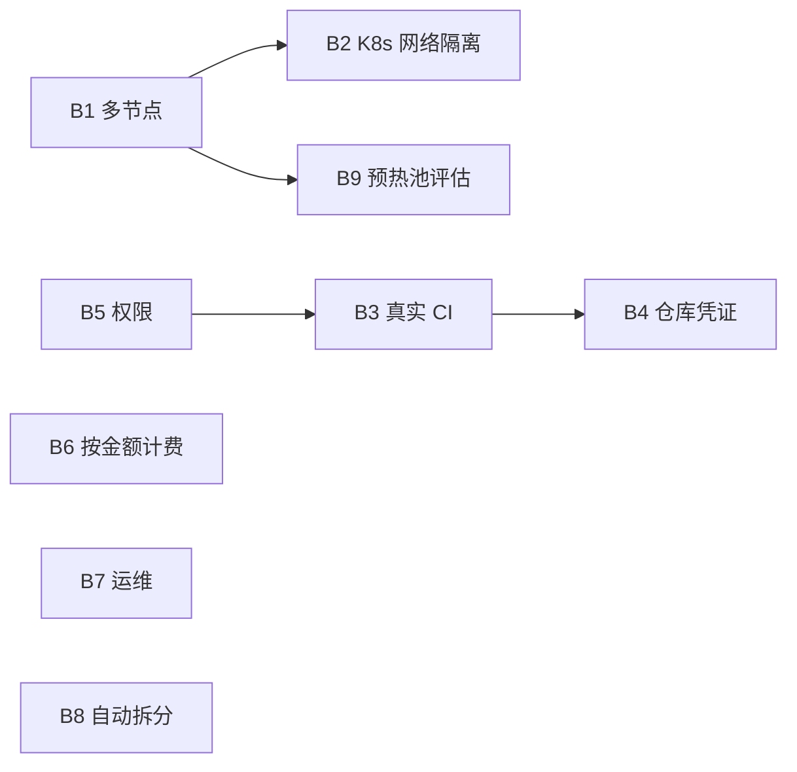
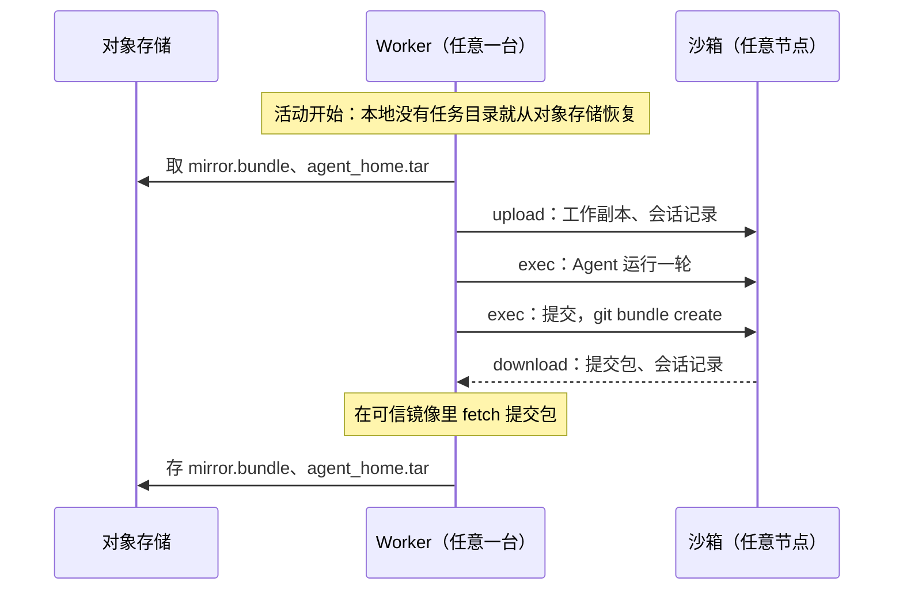
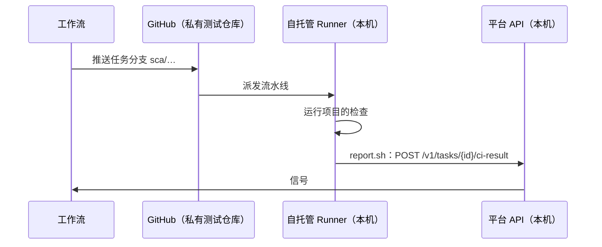
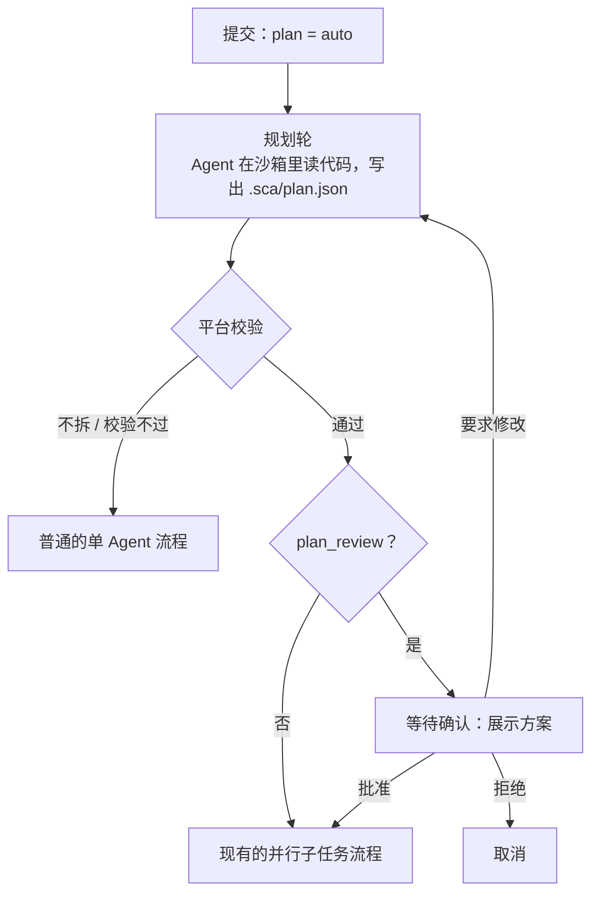

# SuperCloudAgents 二期收尾设计

> 对应 [`architecture.md`](architecture.md) 8.3 节。二期已完成的部分和验证结果见 [`design-phase2.md`](design-phase2.md)；本文设计它第 10 节列出的未完成事项。
> 怎么开工（环境、命令、分工方式、完成标准）见 [`handoff.md`](handoff.md)。
> 每一项完工后，在该节末尾补「结果」：验证到了什么程度，什么没有做到。

## 0 总览

### 0.1 目标

二期的目标是「能给不信任的人用、能扩到多台机器、出了问题能恢复」。其中「扩到多台机器」没有达到，另有几项验证不充分。收尾阶段把它们补齐。

### 0.2 事项、顺序与依赖

| 顺序 | 事项 | 开源组件 | 自己写的部分 | 完成标准（可验证） |
| --- | --- | --- | --- | --- |
| B1 | 多节点 | 对象存储、`git bundle`、`tar` | 状态同步 | Worker 与沙箱不共享任何目录时全部端到端测试通过；任务能被另一台「机器」上的 Worker 接着做 |
| B2 | Kubernetes 网络隔离 | Calico | 无 | 沙箱访问 API Server 失败；去掉那条预期失败 |
| B3 | 真实 CI | GitHub Actions 自托管 Runner（不行则 Gitea） | 回报脚本 | 真实流水线的结果驱动任务修复并通过 |
| B4 | 仓库凭证 | OpenBao | 密钥接口与驱动 | 任务用从密钥服务取到的短期凭证克隆和推送私有仓库；凭证不出现在沙箱、事件、工作流历史里 |
| B5 | 权限 | 无（PyJWT 已有） | 角色与受限令牌 | 只读角色不能提交和审批；CI 令牌只能回报结果 |
| B6 | 按金额计费 | LiteLLM | 花费回写与预算判断 | 任务的花费有数值；超金额预算被停下 |
| B7 | 运维 | Prometheus、Grafana、Jaeger、Temporal Schedules | 维护工作流 | 追踪和指标在真实后端里看得到；归档、缓存淘汰、孤儿沙箱清理按计划自动执行 |
| B8 | 自动拆分 | 无 | 规划步骤 | 不给子任务也能拆分并行完成；拆不了时退回单 Agent |
| B9 | 预热池评估 | 无 | 取决于结论 | 有 Kubernetes 上的启动时延数据和书面结论 |

依赖关系：



B3 需要 B5 里的受限令牌才算完整，但可以先用普通令牌打通，再换。B6、B7、B8 互相独立，可以并行分给不同的 worker。

### 0.3 不变的约束

- 替换或增强接口实现，不改内核。
- 能用开源组件就不自己写。
- 安全规则不放松：宿主机不在不可信的工作副本里运行 Git；仓库凭证和真实模型密钥不进沙箱；沙箱默认没有直连外网的路由。
- 现有测试保持通过。单机开发方式（目录挂载、Docker）继续可用。

---

## B1 多节点

### B1.1 要解决的问题

Worker 把任务目录（工作副本、Agent 的会话记录）挂载进沙箱。挂载要求 Worker 和沙箱在同一台机器上，或共享文件系统。三个后果：

- Kubernetes 驱动只能用于单节点集群。
- 任务的状态在某一台 Worker 的本地磁盘上，这台机器没了，任务就没了。
- Worker 不能自由伸缩，任务被钉在创建它的那台机器上。

### B1.2 思路

二期的「沙箱释放与重建」已经证明：任务的状态可以完全脱离沙箱存在。缺的只是两段搬运。

- **Worker ↔ 沙箱**：不再挂载，改为通过沙箱接口传文件。
- **Worker ↔ Worker**：每一轮结束后把任务状态存进对象存储。任何一台 Worker 都能从对象存储重建任务目录。本地磁盘从「唯一的一份」变成「缓存」。



### B1.3 沙箱接口的变化

`SandboxProvider` 增加两个方法。它们是容器运行时本来就有的能力，不是新发明：

```python
async def upload(self, sandbox_id: str, target_dir: str, archive: AsyncIterator[bytes]) -> None:
    """把一个 tar 流解开到沙箱里的 target_dir。目录不存在则创建，归沙箱用户所有。"""

def download(self, sandbox_id: str, path: str) -> AsyncIterator[bytes]:
    """把沙箱里的 path（文件或目录）作为 tar 流取出。"""
```

| 驱动 | upload | download |
| --- | --- | --- |
| Docker | `docker cp - <容器>:<目录>` | `docker cp <容器>:<路径> -` |
| Kubernetes | `kubectl exec -i -- tar -xf - -C <目录>` | `kubectl exec -- tar -cf - -C <父目录> <名字>` |

二进制安全：两个驱动都直接接子进程的管道，不经过按行解析的 `exec` 输出。契约测试（`tests/integration/sandbox_contract.py`）增加：往返一个含二进制文件、符号链接、可执行位的目录，内容和权限一致；空目录；大文件（100 MiB）不把内存撑爆（流式）；路径不存在时报 `SandboxError`。

**解包的安全**：`download` 得到的 tar 来自不可信的沙箱。Worker 解包时必须拒绝绝对路径、`..`、指向目录之外的链接、设备文件。用 Python 标准库 `tarfile` 的 `data` 过滤器（3.12 已有），不自己写校验。

### B1.4 状态传输方式

新增配置 `SCA_STATE_TRANSPORT`：

| 取值 | 含义 |
| --- | --- |
| `mount`（默认） | 现在的方式：宿主机目录挂载。单机开发用。 |
| `sync` | 不挂载任务目录。沙箱里的 `/workspace` 和 `/agent_home` 是沙箱自己的临时存储，内容靠上传下载。 |

在代码里是一个小接口，两个实现，由 `CodingActivities` 使用，工作流不变：

```python
class StateTransport(Protocol):
    def mounts(self, task_dir: Path) -> list[Mount]: ...          # sync 返回 []
    async def push(self, sandbox_id: str, task_dir: Path) -> None: ...   # Worker → 沙箱
    async def pull_commit(self, sandbox_id: str, ws: GitWorkspace) -> str: ...  # 沙箱 → 可信镜像，返回提交号
    async def pull_agent_home(self, sandbox_id: str, task_dir: Path) -> None: ...
```

`sync` 模式下各步骤的做法：

- **创建或重建沙箱后**：`push` 上传工作副本和会话记录。
- **检查点**：沙箱内提交（和现在一样），然后沙箱内执行 `git bundle create /tmp/sca.bundle <分支>`，`download` 取回，在可信镜像里 `git fetch <bundle文件> +HEAD:refs/heads/<分支>`。从提交包 fetch 和现在从不可信工作副本 fetch 的信任模型相同：只读取对象，不执行任何东西。
- **每轮结束**：`pull_agent_home` 取回会话记录。
- **子任务**（`sca/kinds/coding/subtasks.py`）用同一个接口，不单独处理。

### B1.5 任务状态进对象存储

每一轮的检查点之后，以及子任务合并之后，把任务状态存进对象存储：

| 键 | 内容 |
| --- | --- |
| `tasks/<id>/state/mirror.bundle` | 可信镜像的全部引用（`git bundle create --all`） |
| `tasks/<id>/state/agent_home.tar` | 会话记录 |
| `tasks/<id>/state/manifest.json` | 轮次、提交号、两个对象的校验和 |

规则：

- **先写两个数据对象，最后写 manifest**。读的一方只认 manifest 里记录的校验和，所以写到一半崩溃不会留下半新半旧的状态。
- **每个活动开始时**检查本地任务目录是否存在且与 manifest 的轮次一致；不一致就从对象存储重建。重建过程：下载、校验、`git clone --mirror` 提交包、解开会话记录、从镜像检出工作副本。
- 任务结束后这些对象按制品的保留策略处理，本地任务目录可以直接删。
- `mount` 模式下也存，只是不强制从对象存储恢复。这样两种模式的代码路径差异最小，单机部署也得到「换机器恢复」的能力。

### B1.6 缓存在多节点下怎么办

- **仓库缓存**（`RepoCache`）：每台 Worker 各自一份，本来就是纯缓存，不用同步。
- **pip 缓存**：`sync` 模式下没有共享目录可挂。先关闭（`sync` 模式忽略 `SCA_PIP_CACHE`），在结果里写明。之后要加速依赖安装，应该部署一个带缓存的包索引代理（devpi），把它加进出口白名单，而不是共享可写目录。

### B1.7 一轮执行到一半时 Worker 没了

沙箱还在（它在别的节点上，或在同一台机器的容器运行时里）。Temporal 把这一轮交给另一台 Worker 重做：

1. 新 Worker 从对象存储恢复任务目录（上一轮结束时的状态）。
2. 沙箱还在：丢弃沙箱里这一轮的半成品。做法是销毁并重建沙箱，再 `push`。不尝试在原沙箱里回滚——沙箱不可信，回滚命令的结果不可信。
3. 重做这一轮。

代价与 ADR-08 相同：丢掉未完成的那一轮。

### B1.8 Kubernetes 驱动的调整

- `sync` 模式下 Pod 不再有 `hostPath`，`/workspace` 和 `/agent_home` 用 `emptyDir`（可设 `sizeLimit`）。
- `deploy/kind/cluster.yaml` 改为两个节点（一个控制面、一个工作节点），**去掉** `extraMounts`。保留一份单节点带挂载的配置供 `mount` 模式的契约测试用，或者让 Kubernetes 驱动只支持 `sync`（建议后者：少一种组合）。
- 沙箱镜像需要在每个节点上可用：`kind load` 到所有节点，或起一个本地镜像仓库。

### B1.9 文件

| 文件 | 改动 |
| --- | --- |
| `src/sca/core/interfaces.py` | `SandboxProvider` 加 `upload`、`download`；新增 `StateTransport` |
| `src/sca/sandbox/docker.py`、`k8s.py` | 实现两个方法 |
| `src/sca/workspace/transport.py`（新） | `MountTransport`、`SyncTransport` |
| `src/sca/workspace/state.py`（新） | 任务状态的保存与恢复 |
| `src/sca/workspace/git.py` | 从提交包 fetch；从镜像重建工作副本 |
| `src/sca/kinds/coding/activities.py`、`subtasks.py` | 通过 `StateTransport` 工作；活动开头恢复状态 |
| `src/sca/agents/codex.py`、`fake.py` | `sandbox_additions` 在 `sync` 模式下不返回会话目录的挂载 |
| `src/sca/config.py` | `state_transport` |
| `tests/integration/sandbox_contract.py` | 上传下载的契约 |
| `tests/e2e/conftest.py` | `state_transport` 可参数化 |

Codex 的二进制目录目前是只读挂载进沙箱的。`sync` 模式下改为打进沙箱镜像（`deploy/sandbox/Dockerfile` 加一个可选的构建参数），不再依赖宿主机路径。

### B1.10 验证

1. **契约**：上传下载的断言在 Docker 和 Kubernetes 两个驱动上通过。
2. **全量回归**：`tests/e2e` 里不依赖模型的全部测试，在 `SCA_STATE_TRANSPORT=sync` 下再跑一遍并通过（把夹具参数化成两种模式）。
3. **换机器续跑**（Docker 上就能做）：扩展 `tests/e2e/test_e2e_resilience.py`。第一个 Worker 进程用数据目录 A，一轮结束后（等待确认时）杀掉它并删除目录 A；第二个 Worker 用空的数据目录 B 启动；要求修改 → 任务在新 Worker 上继续并通过。再加一例：一轮执行到一半杀掉，目录 B 上重做成功。
4. **真正的多节点**：两节点的 kind 集群，没有任何宿主机挂载，沙箱 Pod 用 `nodeSelector` 固定在工作节点上，Worker 跑在宿主机。脚本化 Agent 的完整任务通过。
5. **不可信的归档**：单元测试构造含 `../`、绝对路径、越界链接的 tar，恢复时被拒绝。

### B1.11 明确不做

- Worker 自动伸缩（HPA）。有了 B1，Worker 已经是无状态的，伸缩是部署配置的事；写一份示例清单即可，不做验证。
- 跨区域。

### B1.12 结果

- **Worker 伸缩示例**：`deploy/k8s/worker/` 提供 sync + S3、回环 HTTP 就绪探针、资源限制、PDB 和保守 CPU HPA，另附可选 KEDA Temporal 积压示例；YAML 解析、客户端 kustomize 渲染和 kind 上的服务端预检（`kubectl apply --dry-run=server`）通过；未实际部署，未验证伸缩。限制见 `deploy/k8s/worker/README.md`。

- **沙箱接口**：`upload`、`download` 两个方法在 Docker 和 Kubernetes 驱动上都通过契约测试。测试覆盖二进制文件、符号链接、可执行位、空目录、100 MiB 大文件（流式）和路径不存在。
- **不可信的归档**：解包统一走 `sca/workspace/tarsafe.py`，用标准库 `tarfile` 的 `data` 过滤器，另外显式拒绝绝对路径和 `..`。单元测试覆盖越界路径、越界链接、设备文件。
- **两种模式的全量回归**：`tests/e2e` 中不依赖模型的 17 个测试，在 `mount` 和 `sync` 两种模式下各跑一遍，全部通过。
- **换机器续跑**（`tests/e2e/test_e2e_resilience.py`，两种模式都通过）：
  - Worker A 做完一轮后被杀，数据目录 A 被删除；Worker B 在空目录上启动，任务从对象存储恢复并完成。
  - 一轮执行到一半被杀时，同样能在新 Worker 上重做这一轮并完成。
- **真正的多节点**（`tests/e2e/test_e2e_k8s.py`）：在两节点 kind 集群（Calico）上，Worker 跑在宿主机，沙箱 Pod 用 `nodeSelector` 固定在工作节点。完整的两轮任务通过。测试断言 Pod 没有任何 `hostPath` 卷，任务状态清单写进了对象存储，任务结束后 Pod 被删除。
- **集成时发现并修正的问题**：
  - Codex 的登录凭证在 sync 模式下会被复制进会话目录，原本会随会话记录一起存进对象存储。现在打包时排除，并有测试断言对象存储里找不到它。
  - 本地对象存储的写入改为先写临时文件再改名。状态清单依赖「读到的对象要么完整、要么不存在」。
  - sync 模式的 Kubernetes 卷名 `agent_home` 含下划线，被 API Server 拒绝。已改正并加单元测试。
- **与设计的出入**：
  - 状态对象按校验和寻址（`blobs/<sha256>`），清单最后写。写到一半崩溃时，上一份完整状态仍然可读。这比设计里「覆盖同名对象」更稳妥。
  - Kubernetes 驱动仍同时支持两种模式，没有像 B1.8 建议的那样只保留 sync。挂载模式的契约测试还在用，两节点集群的节点也保留了挂载目录，供这些测试使用。
- **没有做到的**：
  - 每轮打包上传的开销没有在大仓库上测量。
  - sync 模式下没有 pip 缓存（按 B1.6 的决定）。
  - Codex 二进制打进镜像的构建参数写好了，但没有用真实 Codex 在 sync 模式下跑过。
  - 模型网关只接到了 Docker 驱动上：Kubernetes 驱动加网关时，Worker 会直接报错退出。

---

## B2 Kubernetes 网络隔离

### B2.1 要解决的问题

kind 自带的网络插件（kindnet）不过滤 Pod 到本节点 API Server 的流量，`test_none_cannot_reach_cluster_api` 标记为预期失败。「沙箱碰不到集群内部」在 Kubernetes 上没有被证明。

### B2.2 做法

- kind 集群配置 `networking.disableDefaultCNI: true`，安装 **Calico**（官方清单）。
- 现有的 `NetworkPolicy`（`sca/sandbox/k8s.py` 的 `isolation_manifests`）不变，先重跑契约测试看结果。
- 如果到 API Server 的流量仍然通：这是 Calico 对「Pod 访问自己所在节点」的默认放行。处理办法是在驱动的隔离清单里增加 Calico 的 `GlobalNetworkPolicy`，或把 Felix 的 `defaultEndpointToHostAction` 设为 `Drop`。优先用标准 `NetworkPolicy` 能表达的方式；用到 Calico 专有资源时，把它做成驱动的一个可选项（`network_policy_flavor="calico"`），标准集群不受影响。
- 测试通过后去掉 `xfail`。

### B2.3 验证

Kubernetes 契约测试全部通过，没有预期失败。另加两条：`none` 和 `restricted` 模式的沙箱都连不上云元数据地址（`169.254.169.254`）和节点的 kubelet 端口（10250）。

### B2.4 资源

Calico 在这台机器上要多占约 300–400 MiB。跑这一项时停掉 LiteLLM、SeaweedFS、Dex。如果两节点加 Calico 起不来，B2 可以在单节点 Calico 集群上验证（网络策略与节点数无关），B1 的多节点验证用 kindnet 的两节点集群。把实际采用的组合写进结果。

### B2.5 结果

- 本机集群换成两节点、关闭 kindnet、安装 Calico v3.28.2（`deploy/kind/cluster-2node-calico.yaml`、`deploy/kind/calico.sh`）。
- Kubernetes 契约测试 20 个全部通过，**没有预期失败，也没有跳过**。下面这些都被证明访问不到：
  - `none` 模式下的集群 API；
  - `none`、`restricted` 两种模式下的云元数据地址 `169.254.169.254` 和节点 kubelet 端口 10250。
- **对照实验**：在同一个 Calico 集群上只启用标准 `NetworkPolicy`（不加 Calico 专有策略），API Server、kubelet、元数据地址同样全部访问不到。所以二期那条预期失败的原因是 kindnet **不执行**网络策略，而不是策略写得不够。
- 驱动的 `network_policy_flavor="calico"` 额外生成一条 Calico 的命名空间级策略，作为纵深防御保留。它用的是命名空间级资源，而不是 B2.2 设想的全局策略或改 Felix 配置——在这个实验里两者都不需要。
- **没有做到的**：只在 kind 上验证过。Cilium 和云厂商的网络插件没有测。

---

## B3 真实 CI

### B3.1 要解决的问题

CI 回调接口做好了，但回调方一直是测试代码。没有任何真实 CI 系统调用过它。

### B3.2 做法

**先用 GitHub Actions 的自托管 Runner；走不通再用 Gitea。** 托管 Runner 回调不到本机，自托管 Runner 跑在本机，所以能访问 `localhost` 上的平台。



**流水线怎么知道任务号。** 平台在自己创建的每个提交的说明里加一行尾注：

```text
sca: turn 2

Sca-Task-Id: 0b6f…（完整任务号）
```

回报脚本 `deploy/ci/report.sh` 从 `git log -1` 里读出任务号和提交号，调用回调接口。它只依赖 `git` 和 `curl`，所以任何 CI 系统都能用。仓库里放两份示例流水线：`deploy/ci/github-actions.yml`、`deploy/ci/gitea-actions.yml`（语法兼容，基本相同）。

脚本的约定：

| 输入 | 来源 |
| --- | --- |
| 平台地址 | 环境变量 `SCA_API_URL` |
| 令牌 | 环境变量 `SCA_CI_TOKEN`（CI 的密钥） |
| 是否通过 | 第一个参数 `passed` 或 `failed` |
| 摘要 | 标准输入（失败日志的尾部，脚本截到 20000 字节） |
| 链接 | CI 系统提供的运行地址（`GITHUB_SERVER_URL/…/actions/runs/…`） |

提交说明里没有尾注（不是平台的提交）时脚本直接退出 0，不打扰平台。

**流水线只对任务分支触发**（`on.push.branches: ['sca/**']`），并且用 `if: always()` 保证失败时也回报。

### B3.3 准备工作

- 在用户的 GitHub 账号下建一个**私有**测试仓库（例如 `sca-ci-fixture`），内容是 `tests/e2e/conftest.py` 里那个带缺陷的小项目，外加一条本地验证不知道的规则（和现有测试里的「必须有 CHANGELOG」一致）。
- 在本机注册一个仓库级的自托管 Runner（`gh api` 取注册令牌）。Runner 只服务这个私有仓库。**不要**把自托管 Runner 挂到公开仓库上：公开仓库的 PR 可以让任何人在 Runner 所在机器上执行代码。
- 推送凭证：本机 `gh auth` 已有的令牌，通过宿主机的 Git 凭证助手提供（B4 完成后改为从 OpenBao 取）。
- 出口白名单不需要改：推送发生在沙箱外。

### B3.4 测试

`tests/e2e/test_e2e_ci_github.py`，标记 `live` 和新标记 `github`，没有 Runner 或没有 `gh` 登录时跳过：

1. 提交任务：仓库是那个私有仓库，`ci` 开启，本地验证只跑测试。
2. 第一次推送后，真实流水线失败（缺 CHANGELOG），回报失败，摘要进入修复提示词。
3. Agent（脚本化）补上 CHANGELOG，第二次推送，流水线通过，任务进入等待确认。
4. 断言：两条 `ci.completed` 事件的 `url` 指向真实的运行；提交说明带尾注；批准后任务成功。
5. 结束时删除远端的任务分支。

### B3.5 退路：Gitea

以下任一情况改用 Gitea：Runner 注册失败、账号策略不允许、流水线迟迟不被派发。

- compose profile `gitea`：Gitea 加它的 `act_runner`，全在本机。
- 仓库、令牌、Runner 注册都通过 Gitea 的 API 在测试夹具里自动完成，所以这条路径可以完全自动化、不依赖外部账号。
- 即使 GitHub 走通了，也建议把 Gitea 这条做成 `live` 测试：B4 的私有仓库凭证验证需要一个本机的、需要认证的 Git 服务，正好共用。

### B3.6 明确不做

GitHub App、Checks API、PR 评论、状态徽章。它们是「发布结果」一侧的集成，属于三期之后的产品化工作。

### B3.7 结果

- **Gitea 路径通过**（`tests/e2e/test_e2e_ci_real.py::test_gitea_actions_drive_the_task`）。
  - 测试在本机 Gitea 里新建私有仓库，放入 `deploy/ci/gitea-actions.yml` 和 `ci/report.sh`。
  - 平台推送任务分支后，Gitea Actions 的 Runner 真实运行流水线：检出、跑测试、检查 CHANGELOG。
  - 第一次因缺 CHANGELOG 失败，`report.sh` 回调平台；Agent 修复后第二次通过。
  - 两条 `ci.completed` 事件的链接都指向 Gitea 上真实的运行记录，并且各自对应推送的那个提交。
- **一次意外的验证**：第一次跑时 Runner 没在运行，平台等到超时后按失败处理、让 Agent 修复；Runner 恢复后，第二轮由真实流水线回报通过。超时处理在真实环境里也是对的。之后给 Gitea 和 Runner 加上了自动重启。
- 平台的每个提交（每轮检查点、子任务合并）都带上 `Sca-Task-Id:` 尾注。`report.sh` 只依赖 `git`、`curl`、`awk`。
- **GitHub 路径**（`test_github_actions_drive_the_task`）通过：
  - 私有测试仓库 `phao1/sca-ci-fixture`，自托管 Runner 由 `deploy/ci/github-runner.sh` 注册和启动，脚本拒绝公开仓库。
  - 与 Gitea 相同的两轮流程：第一轮 GitHub Actions 因缺 CHANGELOG 失败并回调平台，Agent 修复后第二轮通过；`ci.completed` 的链接指向 GitHub 上真实的运行记录。
  - 第一次跑时 Runner 主机的 Python 没有 pytest，流水线失败。示例流水线 `deploy/ci/github-actions.yml` 因此改为每次在 `$RUNNER_TEMP` 里建一个临时虚拟环境安装 pytest，不依赖 Runner 主机的环境。
  - 推送流水线文件需要 `gh` 令牌带 `workflow` 权限（`gh auth refresh -h github.com -s workflow`）；没有时测试跳过并说明原因。
- **回调令牌**：真实 CI 测试改为通过 API 创建租户及仓库受限的 `ci:report` 令牌，断言不能读取任务；无 Docker 的集成测试验证回调成功及越权拒绝。Gitea 和 GitHub 两条真实流水线都用这种令牌跑通。
  - 复验时发现：启用 OpenBao 后，平台按设计不再借用主机的 `gh` 身份，GitHub 测试因此克隆失败。之前它能通过，只是因为当时 OpenBao 没开。测试现在会像 Gitea 那条一样，先把仓库凭证写进 OpenBao，结束后删除。

---

## B4 仓库凭证

### B4.1 要解决的问题

克隆和推送私有仓库靠 Worker 宿主机上的 Git 凭证配置。这份凭证长期有效、所有租户共用、换机器要重新配置，也没有任何记录说明哪个任务用了它。

### B4.2 接口

```python
class RepoCredential(BaseModel):
    username: str
    password: str            # 令牌
    expires_at: datetime | None

class SecretProvider(Protocol):
    async def repo_credential(self, tenant_id: str, repo_url: str) -> RepoCredential | None:
        """这个租户访问这个仓库用的凭证；没有配置时返回 None（匿名访问）。"""
```

| 实现 | 行为 |
| --- | --- |
| `HostGitCredentials`（默认） | 返回 None，Git 用宿主机自己的配置。现在的行为。 |
| `OpenBaoSecretProvider` | 从 OpenBao 读取。 |

### B4.3 用 OpenBao

OpenBao 是 Vault 的开源分支，API 兼容。用官方 Python 客户端 `hvac`（需要新增依赖），不自己写 HTTP 调用。

路径约定（KV v2）：`sca/tenants/<租户>/repos/<主机>/<所有者>/<仓库>`，找不到时依次回退到 `…/<主机>/<所有者>`、`…/<主机>`。这样一个组织只需要配置一次。

条目有两种：

| 类型 | 字段 | 行为 |
| --- | --- | --- |
| `token` | `username`、`token` | 直接使用。适用于 Gitea、GitLab 的访问令牌。 |
| `github_app` | `app_id`、`installation_id`、`private_key` | 用私钥签一个 JWT，向 GitHub 换一个安装令牌（一小时有效）。这才是真正的短期凭证。签名用已有的 PyJWT。 |

Worker 向 OpenBao 认证：本地用令牌（`SCA_OPENBAO_TOKEN`），集群里用 AppRole 或 Kubernetes 认证。平台只有读权限。

### B4.4 凭证怎么交给 Git

**不放进 URL，不写进 Git 配置，不出现在命令行参数里。** 用 Git 自己的 `GIT_ASKPASS` 机制：

- 仓库里带一个固定的小脚本 `sca/workspace/askpass.sh`，内容只是按提示输出环境变量里的用户名或密码。
- `GitWorkspace._git` 在需要网络的命令（`clone`、`fetch`、`push`）上设置 `GIT_ASKPASS` 和两个环境变量；凭证只活在那个子进程的环境里。
- 同时设置 `credential.helper=`（空），避免宿主机上别的凭证助手把它存下来。
- 错误信息里可能带 URL，记录前照旧脱敏。

凭证在活动里取、在活动里用，不作为活动的输入输出，所以不进 Temporal 的历史。事件里只记录「用了哪个路径的哪种凭证」，不记录内容。

`RepoCache` 的缓存镜像按 URL 存放，凭证不同的租户共用一份对象是安全的吗？不安全：租户 A 有权限的私有仓库不能让租户 B 通过缓存读到。缓存键改为「租户 + URL」。

### B4.5 验证

compose profile `openbao`（开发模式）和 `gitea`。`tests/e2e/test_e2e_secrets.py`，标记 `live`：

1. 夹具在 Gitea 里建私有仓库和访问令牌，把令牌写进 OpenBao 对应租户的路径。
2. 任务克隆、修改、推送这个私有仓库，成功。
3. 断言：沙箱的环境变量和文件系统里找不到令牌；全部事件的文本里找不到；Temporal 工作流历史（导出为 JSON）里找不到；任务目录下 `mirror.git/config` 里找不到。
4. 另一个租户提交同一个仓库的任务：没有凭证，`prepare_workspace` 失败，且读不到前一个租户的缓存。
5. 在 OpenBao 里换一个令牌并吊销旧的：下一个任务仍然成功。

`github_app` 类型：单元测试覆盖 JWT 的构造和换令牌的请求（用 `httpx.MockTransport`）。没有真实的 GitHub App 就不做端到端，并在结果里写明。

### B4.6 结果

- **端到端**（`tests/e2e/test_e2e_secrets.py`，真实 Docker、Gitea、OpenBao）通过，覆盖 B4.5 的全部五步：
  - 测试在 Gitea 里建私有仓库和访问令牌，把令牌写进 OpenBao 中该租户的路径；任务克隆、修改、推送成功。
  - 令牌**不出现**在以下任何地方：
    - 任务的全部事件；
    - Temporal 的工作流历史（导出为 JSON 后检索）；
    - 任务的 `mirror.git/config`；
    - 沙箱的 `docker inspect` 输出；
    - 导出的沙箱文件系统；
    - 沙箱里 `/workspace` 和 `/agent_home` 的完整打包。
  - 另一个租户提交同一个仓库：没有凭证，准备阶段失败，也读不到前一个租户的仓库缓存（缓存按「租户 + 地址」分开）。
  - 在 OpenBao 里换成新令牌并吊销旧令牌后，下一个任务仍然成功。
- **真实 CI 也改用 OpenBao**：OpenBao 在运行时，Gitea 真实 CI 测试的克隆和推送凭证都来自 OpenBao，测试通过。
- **凭证交给 Git 的方式**：只通过 `GIT_ASKPASS` 和那一个子进程的环境变量，同时用 `-c credential.helper=` 关掉其他凭证助手。错误信息里的凭证会被替换掉。
- **集成时修正的问题**：测试收尾时吊销 Gitea 令牌，用的是令牌认证；Gitea 只接受用户名加密码。
- **GitHub App 接入与待验证**：新增 `scripts/github_app_setup.py`，依次运行 `manifest --owner <用户> --repo <所有者/私有仓库>`、打开生成的 HTML 创建私有 App、从跳转地址复制 code 后运行 `convert --code <code>`、按输出链接安装到目标仓库，再运行 `status`、`store`（默认租户 default，可用 `--tenant` 指定）。私钥和安装信息保存在已忽略的 `.data/github-app/`，目录 700、文件 600；JWT 签名复用凭证提供器。新增 `test_github_app_real`：设置 `SCA_E2E_GITHUB_APP_REPO=所有者/私有仓库` 后，经 OpenBao 获取安装令牌，验证 HTTPS 克隆、推送分支、令牌不进入事件与捕获日志，并清理分支。当前没有真实 App，真实端到端未验证；缺少本地凭证或环境变量时明确跳过。

---

## B5 权限

### B5.1 要解决的问题

同一租户里所有用户权限相同。CI 回调用的是能做任何事的普通令牌。人工操作的事件里没有记录是谁做的。

### B5.2 角色

`Principal` 增加 `role` 和 `scopes`：

| 角色 | 能做什么 |
| --- | --- |
| `viewer` | 查看任务、事件、制品 |
| `member` | 以上，加提交任务、审批、取消、暂停恢复 |
| `admin` | 以上，加管理本租户的令牌、配额和预算 |

权限判断集中在一处（`sca/api/authz.py`）：一张「动作 → 最低角色」的表，路由通过一个依赖声明自己是哪个动作。不引入策略引擎。

角色的来源：

- **OIDC**：取令牌里的一个声明（`SCA_OIDC_ROLE_CLAIM`，默认 `roles`）。声明可以是字符串或列表；取其中平台认识的最高角色；没有时用 `SCA_OIDC_DEFAULT_ROLE`（默认 `member`，保持现有行为）。
- **静态令牌**：`SCA_API_TOKENS` 的格式从 `令牌:租户` 扩展为 `令牌:租户[:角色]`，省略时为 `admin`，保持现有行为。

### B5.3 受限令牌

新表 `api_tokens`：

| 列 | 说明 |
| --- | --- |
| `id`、`tenant_id`、`name` | |
| `token_hash` | 只存 SHA-256；明文只在创建时返回一次 |
| `role` | 可为空 |
| `scopes` | 例如 `["ci:report"]` |
| `repo_url` | 可为空；有值时只对这个仓库的任务有效 |
| `expires_at`、`created_by`、`revoked_at` | |

- 接口（`admin`）：`POST /v1/tokens`、`GET /v1/tokens`、`DELETE /v1/tokens/{id}`。CLI：`sca token create --scope ci:report --repo <url> --days 90`。
- `ci:report` 只允许调用 `POST /v1/tasks/{id}/ci-result`，并且任务的仓库必须与令牌绑定的仓库一致。
- 认证链变为：静态令牌 → 数据库令牌 → OIDC。数据库令牌带前缀 `sca_`，认证时据此分流，不必每个请求都查表。
- 表启用行级安全，和其他表一致。

### B5.4 操作留痕

人发起的事件（`review.submitted`，以及新增的 `task.cancel_requested`、`task.pause_requested`、`task.resume_requested`）在 `payload.actor` 里记录 `Principal.subject`。`task.created` 同样记录。

### B5.5 验证

`tests/integration/test_authz.py`：对「角色 × 路由」做全表断言（参数化），`viewer` 的每个写操作返回 403；`ci:report` 令牌除回调外全部 403；绑定仓库不一致时 403；过期和吊销的令牌 401；别的租户的令牌看不到本租户的任务（404，不是 403，避免泄露存在性）。Dex 的静态用户带不出角色声明时，用测试里自签的令牌覆盖 OIDC 的角色映射。

### B5.6 结果

- `tests/integration/test_authz.py` 通过：
  - 「角色 × 路由」全表断言；
  - `ci:report` 令牌只能调用回调接口，并且只能用于绑定仓库的任务；
  - 过期和吊销的令牌返回 401；别的租户的任务返回 404；
  - 列出令牌时既没有哈希也没有明文；
  - OIDC 角色声明的映射；人工操作的事件里记录了操作者。
- 数据库令牌的查找走一个只授权给 `sca_api` 的 `SECURITY DEFINER` 函数，在行级安全下也能工作。测试通过 `sca_api` 角色运行。
- 令牌**必须**有过期时间（默认 90 天），表结构不允许为空。
- **没有做到的**：网页上没有令牌管理界面，只有 API 和命令行。

---

## B6 按金额计费

### B6.1 要解决的问题

只有 Token 用量。不同模型单价差很多倍，Token 预算不能表达「这个任务最多花多少钱」。另外，Token 预算只在两轮之间检查，一轮之内可以超出。

### B6.2 做法

花费由 LiteLLM 计算，平台只读取，不自己维护价格表。

- **价格**：在 `deploy/litellm/config.yaml` 里为每个模型写 `model_info.input_cost_per_token` 等字段。数值必须取自模型服务方当前公布的价目，并在配置里注明来源和日期。**不要凭印象填。**
- **读取花费**：LiteLLM 异步更新密钥的花费。`revoke_key` 之前轮询 `/key/info` 直到花费不再变化或超时（几秒）；超时就用当时的值并在事件里标记 `cost_final=false`。读取失败不影响任务。
- **回写**：`usage.cost_micro_usd` 累加（代码已有，只是一直拿不到数）。
- **预算**：
  - `spec.max_cost_usd`：任务的金额上限。
  - `tenants.daily_cost_budget_usd`：租户的当日上限。
  - `Store.check_budget` 把这两项和已有的 Token 上限一起判断。
- **一轮之内的硬上限**：签发每轮的临时密钥时，`max_budget` 设为「任务剩余预算」和 `SCA_MODEL_GATEWAY_TURN_BUDGET_USD` 中较小的一个。花完后网关直接拒绝请求，这一轮失败，下一次预算检查把任务停下。这补上了「一轮之内可能超出」的缺口。
- 没有配置网关时（Codex 直接用登录凭证），金额功能不可用，只有 Token 预算。写进文档。

### B6.3 验证

`tests/e2e/test_e2e_gateway.py` 扩展（标记 `gateway`，花真钱，用最便宜的模型）：

1. 一个真实任务完成后 `usage.cost_micro_usd > 0`，并且与 LiteLLM 的花费记录一致（允许异步更新造成的小差异）。
2. `max_cost_usd` 设成极小的值：任务在第一轮内或第一轮后被停下，状态 `FAILED`，原因写明超出金额预算。

单元测试用 `httpx.MockTransport` 覆盖轮询逻辑：花费逐步增长后稳定、一直为空、接口报错。

### B6.4 结果

- **价格**：写在 `deploy/litellm/config.yaml`，来自 DeepSeek 官方价目页（2026-11-15 读取，页面本身不带日期）。`deepseek-flash` 有高峰和低谷两档，低谷是高峰的一半；配置用的是高峰价，所以预算只会估高。
- **真实模型测试**（`tests/e2e/test_e2e_gateway.py`）通过：
  - 一个真实修复任务记录到的花费，与 LiteLLM 自己的请求日志在 5% 以内一致。例如一次运行：输入 38956 Token，其中 38016 命中缓存；输出 1437 Token；花费 $0.0022。
  - `max_cost_usd=0.00001` 的任务被停下，状态 `FAILED`，原因写明超出预算。
- **集成时发现并修正的问题**：
  - 新版 LiteLLM 删除不存在的密钥会返回 404。平台原来把它当错误，导致任务失败。现在视为「已撤销」，并有单元测试。
  - LiteLLM 是成批异步写花费的。最初的「连续两次轮询不变即结算」会在两批之间提前结束，少记约 30%。现在网关配置为每秒落库一次，平台要求花费 5 秒不变才算结算完成。最初定的 3 秒在最终回归中又出过一次偏差：结束前 4 秒发出的一个请求，花费迟迟没计入密钥的累计值。代价是使用网关时，每轮结束要多等几秒。事件里的 `cost_final` 标明是否结算完成。
- **没有做到的**：
  - 低谷时段的实际花费会比记录的少一半左右，平台不区分时段。
  - 没有配置网关时（Codex 用自己的登录凭证），只有 Token 预算。

---

## B7 运维

### B7.1 要解决的问题

追踪和指标只在测试里用内存导出器验证过，没有真实后端。归档和缓存淘汰要人手动执行。任务异常结束后可能留下没人管的沙箱和网关密钥。

### B7.2 观测后端

compose profile `obs`，三个服务，全部用官方镜像和配置文件，不写代码：

| 服务 | 作用 | 配置 |
| --- | --- | --- |
| Prometheus | 抓取 API 和 Worker 的 `/metrics` | `deploy/obs/prometheus.yml`、`deploy/obs/alerts.yml` |
| Grafana | 仪表盘 | `deploy/obs/grafana/`（数据源和仪表盘都用预置文件，启动即有） |
| Jaeger（all-in-one） | 接收 OTLP、查看追踪 | 无 |

选 Jaeger 而不是 Tempo：单进程、内存占用小，这台机器跑得动。接口是 OTLP，以后换后端不改平台。

### B7.3 补齐指标

API 的指标已有。补上 Worker 一侧：

- **Temporal SDK 自带的指标**：创建 `Runtime` 时配置 `PrometheusConfig`，Worker 进程在 `SCA_WORKER_METRICS_PORT` 上暴露。活动耗时、重试、任务队列积压都在里面，不用自己埋点。
- **业务指标**（在活动里埋，`sca/observability.py` 里定义）：

| 指标 | 类型 | 标签 |
| --- | --- | --- |
| `sca_task_duration_seconds` | 直方图 | `kind`、`final_state` |
| `sca_task_turns` | 直方图 | `kind` |
| `sca_tokens_total` | 计数器 | `kind`、`direction` |
| `sca_cost_usd_total` | 计数器 | `kind` |
| `sca_verifications_total` | 计数器 | `kind`、`passed` |
| `sca_sandbox_create_seconds` | 直方图 | `driver` |

  标签里不放租户和任务号：基数会失控。按租户的统计从 Postgres 查。

### B7.4 仪表盘与告警

一份仪表盘 `deploy/obs/grafana/dashboards/sca.json`：各状态任务数、提交速率、任务耗时分位数、验证通过率、Token 与花费速率、沙箱创建耗时、API 错误率、活动重试率。

告警规则（Prometheus 规则文件，只定义规则，不部署 Alertmanager）：

| 告警 | 条件 |
| --- | --- |
| 任务卡住 | 有任务处于 `RUNNING` 或 `PROVISIONING` 超过 2 小时 |
| 失败率高 | 最近 1 小时任务失败率超过 30% |
| API 错误 | 5xx 比例超过 2%，持续 5 分钟 |
| 活动重试风暴 | 活动重试速率异常升高 |
| Worker 不在 | 任务队列没有轮询者 |

「任务卡住」需要一个新的指标 `sca_oldest_active_task_age_seconds`（抓取时查库，和现有的状态计数用同一个缓存）。

### B7.5 维护工作流

用 Temporal 的 Schedule，不引入新的调度器。一个 `MaintenanceWorkflow`，每小时一次，依次执行四个活动，各自独立失败：

| 活动 | 做什么 |
| --- | --- |
| `archive_events` | 调用已有的 `archive_finished`（默认归档结束超过 30 天的任务） |
| `prune_repo_cache` | 调用已有的 `RepoCache.prune` |
| `reap_sandboxes` | 列出带 `sca.task_id` 标签的沙箱，任务已是终态或不存在的，销毁 |
| `expire_gateway_keys` | 删除别名形如 `task-…` 且任务已是终态的网关密钥 |

- `reap_sandboxes` 需要 `SandboxProvider` 增加一个 `list(labels) -> list[SandboxInfo]`。两个驱动都有现成的查询命令。
- Schedule 由 Worker 启动时幂等创建（已存在则跳过）。间隔和阈值都是配置项。
- 重叠策略设为跳过：上一次没跑完就不启动下一次。

### B7.6 验证

- `tests/e2e/test_e2e_obs.py`（标记 `live`）：跑一个任务后，通过 Jaeger 的查询接口按 `result.trace_id` 取到这条追踪，里面有 API、工作流、活动三类 Span；通过 Prometheus 的查询接口取到 `sca_task_duration_seconds_count` 增加了。
- `deploy/obs/alerts.yml` 用 `promtool check rules` 校验（在 Prometheus 容器里执行）。仪表盘 JSON 能被 Grafana 加载（调它的健康检查和仪表盘接口）。
- 维护工作流：集成测试里手动触发一次，断言四个活动的效果——一个过期任务被归档；人为留下的孤儿沙箱被销毁，而运行中任务的沙箱不受影响；孤儿密钥被删除（用假的网关实现）。

### B7.7 结果

- **真实后端**（`tests/e2e/test_e2e_obs.py`）通过：
  - API 和 Worker 作为两个独立进程运行，追踪导出到 Jaeger。
  - 按任务的 `result.trace_id` 能查到同一条追踪，里面有 `sca-api` 和 `sca-worker` 两个服务的 Span，覆盖 API 请求、工作流和活动。
  - Prometheus 抓到了 `sca_task_duration_seconds_count` 的增长。
- **Grafana**：启动即加载仪表盘「SuperCloudAgents」（10 个面板），数据源是 Prometheus 和 Jaeger。
- **告警**：5 条规则用 `promtool check rules` 校验通过，在 Prometheus 中全部为健康状态。测试结束、Worker 停止后，`ScaWorkerDown` 立即进入 pending，说明规则确实在评估。
- **Worker 指标**：Temporal SDK 自带的指标在 9464 端口，业务指标在 9465 端口——Temporal 独占了它的端口，两者不能共用。
- **维护工作流**（`tests/integration/test_maintenance.py`）通过：
  - 过期任务被归档；
  - 孤儿沙箱被销毁，运行中任务的沙箱保留；
  - 孤儿网关密钥被删除；
  - 一个活动失败不影响其他活动。

  Worker 启动时幂等地创建 Temporal Schedule，重叠策略为跳过。
- **集成时修正的问题**：
  - 测试启动子进程时用了 `Path(".venv/bin/python").resolve()`，解析到系统 Python，丢了虚拟环境。
  - 端口探测没设 `SO_REUSEADDR`，把 TIME_WAIT 误判为被占用。
  - 开发库缺少 `sca_task_counts()`：执行迁移 0003 时这个函数还没加进去，之后才补进迁移文件，开发库里手工补建了。这只影响本机开发库，没有发布过的部署。
- **与设计的出入**：孤儿沙箱的清理只认平台自己生成的沙箱名（父任务和子任务），并在删除前核对标签。`list` 只返回标识，拿不到任意标签的值。
- **没有做到的**：
  - 已补 Alertmanager v0.27.0：Prometheus 转发到本机 9093，按严重级别分组通知 webhook，Worker 离线时抑制任务卡住和重试风暴；邮件和 Slack 配置有注释示例。新增 live 测试检查 Prometheus 的 Alertmanager 目标，并通过 v2 API 注入告警验证 webhook 内容、恢复 URL 文件；本环境服务不可达，实投递待集成验证。
  - 启动前在仓库根目录执行 `mkdir -p .data/obs && chmod 700 .data/obs`，用 `read -rs -p 'Webhook URL: ' webhook_url; printf '%s\n' "$webhook_url" > .data/obs/alert-webhook-url; unset webhook_url; chmod 644 .data/obs/alert-webhook-url` 写入地址（文件需供容器用户读取，父目录仅本用户可访问，`.data/` 已忽略）；再执行 `docker compose -f deploy/docker-compose.yml --profile obs up -d prometheus alertmanager`。
  - 已逐一核对 10 个面板和 5 条告警的指标、标签与单位；Temporal SDK 默认不加 `_total`，原指标名正确，修正 API 混合单位和活动失败的重试描述，新增离线查询回归测试。
  - 用持续运行的 API 和 Worker 跑了几个真实任务，在 Prometheus 上执行全部查询，各面板都有数据（花费面板因为假 Agent 不产生花费，所以是空的）。
  - 发现并修正了一个真实问题：带标签的计数器在第一次计数时才创建，而 `rate()` 会丢掉一个序列的第一个样本。例如 3 次验证失败都发生在第一次抓取之前时，失败被算成 0 次，「验证通过率」显示 100%。Worker 现在启动时把各场景的计数器预先导出为 0（`BusinessMetrics.prime`），修正后同样的场景显示约 39%。API 一侧按路由和状态码计数的请求数无法预先列举，第一次 5xx 仍可能漏计，对「API 错误」告警影响很小。

---

## B8 自动拆分

### B8.1 要解决的问题

并行子任务要提交者自己拆。提交者往往不了解代码结构，拆不好。

### B8.2 原则

ADR-09 的担忧仍然成立：事前拆分很难保证准确，并行改同一个仓库的主要产出是冲突。所以自动拆分是**可选的**，并且有三道保险：

1. **规划者可以说「不拆」**。这是默认结果，只有任务明显由互不相关的几部分组成时才拆。
2. **平台检查拆分结果**。每个子任务必须声明自己要改的路径范围，范围之间不能重叠。重叠就不拆。
3. **可以让人先看一眼**。`plan_review: true` 时，拆分方案先交给人确认。

### B8.3 流程



- `spec.plan`：`"none"`（默认）或 `"auto"`。与显式的 `subtasks` 互斥。
- **规划轮**是一次普通的 Agent 轮次，用专门的提示词：只读代码，不改代码，把结果写到 `.sca/plan.json`。这一轮的工作副本改动被丢弃（规划沙箱用完即销毁，不做检查点）。
- **方案的格式**：

```json
{
  "split": true,
  "reason": "两处改动分别在 billing 和 notifications 模块，互不引用",
  "subtasks": [
    {"name": "billing", "instruction": "…", "paths": ["src/billing/**", "tests/billing/**"]},
    {"name": "notify",  "instruction": "…", "paths": ["src/notifications/**"]}
  ]
}
```

- **校验**（平台做，用 Pydantic 模型）：格式合法；2 到 8 个；名字符合现有规则；`paths` 两两不相交（用 `pathspec` 库——需要新增依赖——在仓库的文件列表上实际匹配，任何一个文件同时被两个子任务匹配即为相交）。文件读不到、JSON 不合法、校验不过：一律退回单 Agent 流程，并记录事件 `plan.rejected` 及原因。**规划失败不应该让任务失败。**
- **路径范围只用于校验，不用于强制**。子任务实际改了范围外的文件不会被拦，合并时照常处理冲突。强制会让 Agent 在需要改一个公共文件时卡死。
- 事件：`plan.started`、`plan.completed`（含方案）、`plan.rejected`。方案同时存为制品 `plan.json`。

### B8.4 验证

- 工作流测试（假活动）：方案通过 → 启动子工作流；规划者说不拆 → 单 Agent；路径重叠 → 单 Agent 且有 `plan.rejected`；`plan_review` 下批准、要求修改（重新规划，提示词带上意见）、拒绝三条路径。
- 端到端（脚本化 Agent）：脚本写出一份合法方案，任务并行完成并合并；脚本写出重叠的方案，任务以单 Agent 完成。
- 真实模型一例（标记 `codex`）：一个由两个独立模块组成的小仓库，一句话的需求涉及两个模块。断言任务成功；不断言一定拆了（模型的判断不稳定），只把是否拆分、方案内容打印出来并写进结果。

### B8.5 结果

- `tests/integration/test_planning.py`（19 项）通过：
  - 校验在真实 Git 仓库上用 `pathspec` 判断路径是否重叠；
  - 非法 JSON、数量越界、名字不合法、超过 64 KiB 都被拒绝。
- `tests/integration/test_workflow.py` 通过：
  - 方案通过即启动子工作流；规划者说「不拆」时走单 Agent；
  - 路径重叠时走单 Agent，并记录 `plan.rejected`；
  - `plan_review` 下批准、要求修改（重新规划，提示词带上意见）、拒绝三条路径都覆盖。
- **端到端**（`tests/e2e/test_e2e_planning.py`，真实沙箱，脚本化 Agent）通过：
  - 合法方案：两个子任务并行执行（两轮的开始都早于任何一轮的结束），合并后验证通过，`plan.json` 制品与方案一致。
  - 重叠方案：被拒绝，单 Agent 完成。
- **集成时修正的问题**：
  - 测试脚本原本没考虑「子任务的提示词也带着整个任务的指令」，导致两个子任务做了同一件事。改为脚本按所在分支决定行为。
  - 父任务把未合并子任务的补丁交给 Agent 时，原来只认提交者显式给出的子任务。现在自动拆分的也一样处理。
- **与设计的出入**：`plan_review` 时任务先经过 `VERIFYING` 再进入 `AWAITING_REVIEW`，为的是遵守现有的状态转换表。
- **没有做到的**：真实模型的规划质量没有评测，这要等 C4。

---

## B9 预热池评估

### B9.1 问题

二期没有做预热池，理由是 Docker 上创建沙箱只要约 0.5 秒。Kubernetes 上没有数据。

### B9.2 做法

先量，再决定。B1 完成后做。

`scripts/bench_sandbox_start.py`：在 kind 集群上，镜像已在节点上的前提下，测「调用 `create` 到第一条 `exec` 成功返回」的耗时，20 次，报告 p50 和 p95。分四种情况：普通运行时与 gVisor（如果 kind 节点上装得了），`none` 与 `restricted` 网络。

**决定规则**（事先定好，免得事后找理由）：

| p95 | 决定 |
| --- | --- |
| 小于 5 秒 | 不做。在结果里记录数据。 |
| 5 秒以上 | 做。设计见下。 |

kind 的数据不代表生产集群（镜像拉取、节点扩容都没有体现）。结果里要写明这一点，并说明在真实集群上应该重新测。

### B9.2.1 测量结果（2026-11-15）

`scripts/bench_sandbox_start.py`，每种情况 20 次，镜像已在节点上，先热身一次（命名空间、出口代理已存在）。两节点 kind 集群（Calico），沙箱固定在工作节点；这台机器 2 核、3.7 GiB。

| 驱动 | 网络 | p50 | p95 | 最大 |
| --- | --- | --- | --- | --- |
| Kubernetes | `none` | 4.04 s | 4.90 s | 5.02 s |
| Kubernetes | `restricted`（默认） | 5.95 s | **7.68 s** | 12.64 s |
| Docker | `none` | 0.56 s | 0.88 s | 1.03 s |
| Docker | `restricted` | 0.69 s | 0.90 s | 1.10 s |

gVisor 没有测：kind 节点里没有装 `runsc`。

**决定：做。** 默认的 `restricted` 模式 p95 超过 5 秒，按 B9.2 的规则进入实现。Docker 驱动不需要。

### B9.3 如果要做

B1 之后沙箱创建时不再绑定任务的目录，预热才成为可能。

- 池子是一组已经运行的、未分配的 Pod，带标签 `sca.pool=<镜像与规格的哈希>`、`sca.state=idle`。
- `create` 先尝试认领：用带 `resourceVersion` 的标签更新把一个空闲 Pod 改成 `sca.state=claimed` 并写上任务标签。更新冲突说明被别人抢了，换一个；没有空闲的就照常新建。认领靠 Kubernetes 自己的乐观并发，不需要锁。
- 补充由维护工作流（B7）负责：每次运行把空闲数补到 `SCA_SANDBOX_POOL_SIZE`。
- 认领来的 Pod 已经在运行，所以环境变量不能在创建时注入：改为每次 `exec` 时传入（驱动已支持）。
- **用过的沙箱不回池**。一个任务一个沙箱、用完销毁的规则不变。

只在 Kubernetes 驱动里做。

### B9.4 结果

- **实现**（`sca/sandbox/k8s.py`）：
  - 池中的 Pod 带 `sca.pool=<规格哈希>`、`sca.state=idle` 标签。
  - 认领时用带 `resourceVersion` 的标签更新，冲突就换下一个；没有空闲 Pod 就照常新建。认领后用 `sca.name` 记录沙箱名，同名再次创建仍返回同一个 Pod。
  - 用过的 Pod 不回池。
  - 维护工作流负责补充池子；Worker 启动时也补一次。只在 `sync` 模式且 `SCA_K8S_POOL_SIZE > 0` 时启用。
- **环境变量**：认领来的 Pod 已经在运行，环境变量只能在每次执行时传入。为了 Worker 重启后还能找回，非敏感的环境变量（代理、`CODEX_HOME`、`PIP_*`、不含 `SCA_MODEL_KEY` 的 `SCA_*`）记在 Pod 的注解里。规格里有任何其他变量时不走预热池，照常新建，免得把可能敏感的值写进集群对象。
- **测试**：Kubernetes 集成测试 23 个全部通过，包括：
  - 认领后执行、上传、下载都正常，且带着规格里的环境变量；
  - 同名再次创建返回同一个 Pod；
  - 销毁后补充回到池的大小；
  - 两个并发创建认领到两个不同的 Pod。
- **效果**（同一集群、同样 20 次）：

| 网络 | 没有池 p95 | 池大小 3 时 p95 |
| --- | --- | --- |
| `none` | 4.90 s | 0.78 s |
| `restricted` | 7.68 s | 0.64 s |

  这是池里始终有空闲 Pod 时的数字。池被用空时，后续创建退回原来的时延。
- **没有做到的**：池的大小是固定配置，不随负载伸缩。kind 的数据不代表生产集群。

---

## 附：这台机器上怎么排资源

2 核 3.7 GiB。各项验证需要的服务不能同时开。

| 事项 | 要开的 | 要停的 |
| --- | --- | --- |
| B1 | Postgres、Temporal、kind（两节点） | LiteLLM、SeaweedFS、Dex、观测后端 |
| B2 | 同上加 Calico | 同上 |
| B3 | Postgres、Temporal、GitHub Runner（或 Gitea） | kind、LiteLLM |
| B4 | Postgres、Temporal、OpenBao、Gitea | kind、LiteLLM |
| B5 | Postgres | 其余 |
| B6 | Postgres、Temporal、LiteLLM | kind、其余 |
| B7 | Postgres、Temporal、Prometheus、Grafana、Jaeger | kind、LiteLLM |
| B8 | Postgres、Temporal | 其余（真实模型那一例除外） |
| B9 | Postgres、Temporal、kind | 其余 |

如果换成 4 核 8 GiB 的机器，除 kind 与 LiteLLM 之外可以全部常开。
