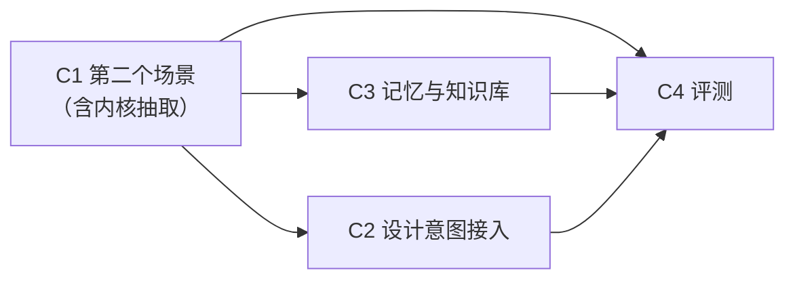
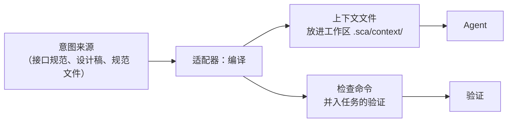
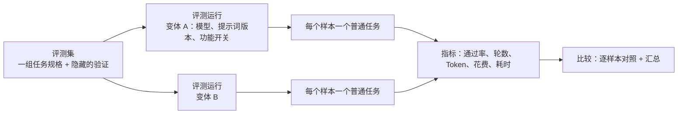

# SuperCloudAgents 三期设计

> 对应 [`architecture.md`](architecture.md) 8.4 节。前置条件：[`design-phase2b.md`](design-phase2b.md) 的 B1（多节点）、B5（权限）、B6（按金额计费）已完成。
> 怎么开工见 [`handoff.md`](handoff.md)。每一项完工后在该节末尾补「结果」。

## 0 总览

### 0.1 目标

前两期做的是「把一个编码任务可靠、安全地跑完」。三期回答四个问题：

| 问题 | 对应事项 |
| --- | --- |
| 内核真的与场景无关吗？ | C1 第二个场景 |
| 除了「一段话 + 一条命令」，还能怎么告诉 Agent 要做成什么样？ | C2 设计意图接入 |
| 做过的任务能让以后的任务做得更好吗？ | C3 记忆与知识库 |
| 换模型、换提示词之后是变好还是变坏了？ | C4 评测 |

### 0.2 顺序与依赖



C1 必须先做：它把内核从 `kinds/coding` 里抽出来，后三项都建在抽出来的结构上。C4 放最后：有了它才能说 C2、C3 到底有没有用；但 C4 的最小版本（只比较模型）不依赖 C2、C3，人手够时可以提前开始。

### 0.3 不变的约束

- **验证必须是可执行的。** 不引入「让模型给结果打分」作为通过与否的依据。模型的判断可以作为给人看的参考信息，不能作为闸门。
- **人的确认点不减少。** 新增的自动化（记忆写入、提示词改进）都要经过人确认才生效。
- 能用开源组件就不自己写；不改已有的安全规则；现有测试保持通过。
- 每一项都需要真实使用数据才能调好。三期交付的是**机制和度量**，不是调好的参数。

---

## C1 第二个场景

### C1.1 要解决的问题

架构文档说内核与场景无关，但只有一个场景，这句话没有被检验过。现在的代码里，通用的东西（沙箱生命周期、轮次循环、暂停恢复、预算、审批）和编码专用的东西（Git 仓库、分支、推送、CI）都写在 `sca/kinds/coding/` 里。API 里写死了 `kind == "coding"`。

### C1.2 选哪个场景

**数据分析（`analysis`）**：输入「一批数据文件 + 一个问题」，输出「一份报告和产生它的脚本」。

选它的理由是它和编码任务在几个关键点上不同，能逼出内核的边界：

| | `coding` | `analysis` |
| --- | --- | --- |
| 输入 | 一个 Git 仓库 | 上传的文件（CSV、Parquet、JSON） |
| 工作区来源 | 克隆 | 平台新建，放入输入文件 |
| 成果 | 补丁、分支 | 报告（Markdown 或 HTML）、图表、脚本 |
| 发布 | 推送分支 | 制品 |
| 验证 | 项目的测试 | 报告存在且符合约定；脚本可重跑并得到同样的结果 |
| 外部凭证 | 仓库凭证 | 无 |

它又足够相似，可以复用 Agent 后端（编码 Agent 写分析脚本没有问题）、沙箱、事件、审批。不选客服、运维之类需要接入外部系统的场景：那会把工作量变成集成，而不是检验内核。

### C1.3 内核抽取

目标结构：

```text
src/sca/
  kernel/                  # 新：与场景无关的任务执行
    workflow.py            # TaskWorkflow：轮次循环、暂停恢复、预算、沙箱释放重建、审批
    activities.py          # KernelActivities：沙箱、Agent 轮次、状态、预算、通用发布
    kind.py                # Kind 协议与注册表
  kinds/
    coding/                # 只剩编码专用的部分
    analysis/              # 新
```

**一个场景要提供的东西**（`Kind` 协议）：

```python
class Kind(Protocol):
    name: str                                   # "coding"
    spec_model: type[BaseModel]                 # 任务规格

    def activities(self, deps: KindDeps) -> list:    # 场景自己的活动，名字带前缀 "<kind>."
        ...

    hooks: KindHooks                            # 活动的名字，供内核工作流按名调用
```

```python
@dataclass
class KindHooks:
    prepare: str        # 准备工作区；返回 WorkspaceInfo
    checkpoint: str     # 一轮之后保存成果；返回 CheckpointResult
    verify: str         # 验证；返回 VerifyResult
    publish: str        # 发布成果
    initial_prompt: str # 构造第一轮的提示词（活动，因为它可能要读数据库里的记忆）
    fix_prompt: str
    feedback_prompt: str
    extensions: list[str] = field(default_factory=list)   # 见下
```

设计上的几个决定：

- **一个通用工作流，不是每个场景一个工作流。** 轮次循环、暂停、预算、释放重建、审批这些逻辑只写一遍。场景通过「按名字调用的活动」插入自己的步骤。Temporal 本来就按名字调用活动，这不需要任何额外机制。
- **提示词改成活动。** 现在提示词是工作流直接调用的纯函数。改成活动之后，场景可以在构造提示词时读记忆（C3）、读意图约束（C2），工作流仍然是确定的。
- **编码专用的流程作为扩展点。** 外部 CI 和并行子任务不是所有场景都有。内核工作流在两个固定位置留扩展：「验证通过之后、发布之前」（CI 挂在这里）和「第一轮之前」（子任务、自动拆分挂在这里）。扩展是子工作流，由场景注册。场景不注册就没有这一步。不做通用的插件系统——只开这两个口子，等第三个场景证明需要更多时再加。
- **工作流的名字和任务队列不变**（`CodingTaskWorkflow` 保留为内核工作流的别名），正在运行的任务不受影响。迁移时用 Temporal 的补丁机制（`workflow.patched`）区分新旧历史，或者要求升级前排空运行中的任务。**选排空**：还没有生产用户，不值得为兼容写补丁分支。把这个要求写进升级说明。
- **API 不再写死场景。** `POST /v1/tasks` 从注册表取 `spec_model` 做校验；`GET /v1/kinds` 列出可用场景和各自规格的 JSON Schema（Pydantic 直接生成），网页据此渲染提交表单。

**检查点仍然是 Git 提交**（ADR-08）。对 `analysis`，工作区是平台 `git init` 出来的本地仓库，不存在远端。这样检查点、差异、状态同步（B1）、回滚的全部机制原样复用，场景只需要决定「工作区从哪来」和「成果怎么发布」。

### C1.4 `analysis` 场景

**规格**：

| 字段 | 说明 |
| --- | --- |
| `question` | 要回答的问题 |
| `inputs` | 输入文件的列表，每项是一个已上传文件的标识 |
| `report_format` | `markdown`（默认）或 `html` |
| `checks` | 额外的验证命令（可选） |
| `setup_command`、`image`、`model`、`max_tokens`、`max_cost_usd`、`turn_timeout_s` | 与 `coding` 相同，来自内核的公共规格 |

**文件上传**（内核能力，不属于某个场景）：`POST /v1/files` 接收一个文件，存进对象存储 `tenants/<租户>/files/<id>`，返回标识。表 `files` 记录租户、名字、大小、校验和。大小上限可配置，默认 200 MiB。流式写入，不整个读进内存。

**工作区**：`prepare` 新建目录并 `git init`，把输入文件放进 `data/`（只读属性），写入 `.gitattributes` 把 `data/**` 标成二进制，提交为基线。约定输出放在 `output/`。

**约定的成果**：

```text
output/report.md      报告
output/figures/       图
analysis.py           入口脚本：从 data/ 读，重新生成 output/ 下的全部内容
```

**验证**（全部可执行）：

1. `output/report.md` 存在且非空；里面引用的图片文件都存在。
2. **可重现**：在一个干净的工作副本上重跑 `python analysis.py`，退出码为 0，并且重新生成的 `output/` 与提交的一致。图片按字节比较不稳定，所以比较的是报告文本和一份数值结果清单：约定脚本同时写出 `output/results.json`（报告里出现的关键数字），重跑后这份文件必须相同。
3. `data/` 没有被改动。
4. 规格里的 `checks`。

第 2 条是这个场景的核心：它挡住「报告里的数字是模型编的」。失败时把差异作为修复反馈。

**发布**：`report.md`、图片、脚本、`results.json` 作为制品。没有推送。网页上直接渲染报告。

**沙箱镜像**：`deploy/sandbox-analysis/Dockerfile`，在基础镜像上加 pandas、pyarrow、matplotlib、duckdb。场景可以声明默认镜像。

**出口**：默认白名单即可（包索引）。数据在沙箱里，问题里可能含敏感信息——这正是出口白名单存在的原因，不需要新机制。

### C1.5 文件

| 文件 | 改动 |
| --- | --- |
| `src/sca/kernel/`（新） | 从 `kinds/coding/workflow.py`、`activities.py` 搬出通用部分 |
| `src/sca/kinds/coding/` | 只留 Git、CI、子任务、编码提示词 |
| `src/sca/kinds/analysis/`（新） | 规格、活动、提示词 |
| `src/sca/orchestration/worker.py`、`client.py` | 从注册表注册工作流和活动 |
| `src/sca/api/routes.py` | 去掉写死的场景；`/v1/kinds`；`/v1/files` |
| `src/sca/api/static/index.html` | 按 Schema 渲染表单；渲染报告 |
| `src/sca/cli.py` | `sca submit --kind`；`sca files upload` |
| 迁移 | `files` 表 |

### C1.6 验证

1. **内核抽取不改变行为**：抽取完成后、加新场景之前，现有全部测试原样通过。这一步单独提交。
2. **依赖方向**：一条测试（用 `ast` 扫描导入，或 `import-linter`）断言 `sca/kernel/` 不导入 `sca/kinds/` 下的任何东西，`kinds/coding` 和 `kinds/analysis` 互不导入。这是「内核与场景无关」的可执行定义。
3. **`analysis` 端到端**（脚本化 Agent）：上传一个 CSV；任务产出报告；验证通过；制品可下载。再一例：脚本写了一份数字与重跑结果不符的报告 → 验证失败 → 修复后通过。
4. **两个场景共用内核能力**：对 `analysis` 任务重跑暂停恢复、空闲释放重建、Worker 被杀续跑、预算超限这几个已有测试（把它们参数化成对两个场景各跑一遍）。
5. **真实模型一例**（标记 `codex`）：一个几百行的 CSV 和一个明确的问题，任务成功，报告里的数字与 `results.json` 一致。

### C1.6.1 结果：内核抽取（第一部分）

- **结构**：
  - `src/sca/kernel/`：场景协议与注册表、通用工作流、内核活动。
  - `src/sca/kinds/coding/kind.py`：编码场景的注册。
  - 外部 CI、子任务、自动拆分改为编码场景在两个扩展点上注册的子工作流。
  - 提示词改成活动。
  - API 不再写死场景：`GET /v1/kinds` 列出场景和各自规格的 JSON Schema。
- **依赖方向**：`tests/unit/test_layering.py` 用 `ast` 检查，内核不导入任何场景，场景之间互不导入。
- **行为不变**：
  - 单元和集成测试 295 个全过；
  - 端到端测试在挂载、sync 两种模式下全过；
  - 追踪测试只改了断言里的活动名，因为场景活动按设计加了 `coding.` 前缀。
- **集成时发现的严重问题**：
  - 现象：重构后整个工作流测试文件跑不完。内存涨到 2.8 GB，测试卡死；而单独跑每个测试都正常。
  - 根因：`sca/kinds/__init__.py` 在包导入时注册了编码场景，连带导入活动、SQLAlchemy 等一大串。Temporal 的工作流沙箱每次运行工作流都会在沙箱里重新导入这个包，每次约 130 MB。
  - 修正：包初始化文件不再导入任何东西，内置场景由 `sca.kinds.builtin.load()` 显式注册。修复后工作流测试 28 个、62 秒、峰值 148 MB，与重构前一致；全量集成测试的峰值从 1.8 GB 降到 276 MB。另加了一条测试，禁止 `sca` 下的包初始化文件包含任何导入。
- **升级说明**：工作流结构变了，升级前要排空运行中的任务（按设计不写 `workflow.patched` 兼容分支）。
- **不稳定测试**：sync 模式下，并行子任务测试的耗时上限（9 秒）太紧，上传下载会多出一两秒。改为断言两个子任务的执行区间重叠，这才是「并行」的直接证据。

### C1.6.2 结果：数据分析场景（第二部分）

- **文件上传**：`POST /v1/files` 流式写入对象存储，边写边算 SHA-256，有大小上限。用 Werkzeug 的流式 multipart 解析器，不把整个文件读进内存；Werkzeug 已声明为运行时依赖。`files` 表启用行级安全。另一个租户的文件标识作为输入会被拒绝。
- **`analysis` 场景**：
  - 工作区是平台 `git init` 出来的本地仓库，输入文件放在 `data/`，基线提交之后才交给 Agent。
  - 验证项按 C1.4：报告存在且引用的图存在；可重现（在干净副本里重跑 `analysis.py`，`results.json` 和报告逐字节一致）；`data/` 未被改动。
  - 发布报告、图、脚本和 `results.json`，不推送。
  - 沙箱镜像是 `deploy/sandbox-analysis/`。
- **端到端**（`tests/e2e/test_e2e_analysis.py`，真实沙箱，脚本化 Agent）6 个全部通过：
  - 上传 CSV、产出报告、制品可下载；
  - 故意写出与脚本结果不一致的 `results.json`，可重现性检查判失败，修复轮纠正后通过；
  - 暂停恢复、空闲释放与重建、超预算停止，这三项内核行为在分析任务上同样成立。
- **集成时修正的设计缺陷**：
  - 问题：内核活动原本通过编码场景的实例注册，有两个场景时会重复注册，而且内核活动跑在编码场景的实现上。
  - 修正：Worker 只注册一份内核活动（`KernelActivities.kernel_all()`）。内核里唯一的场景扩展点 `_before_agent_turn` 按任务所属场景转发，场景对象由 Worker 注入，内核仍不导入任何场景。
  - 测试：新增一条，断言两个场景加内核时没有任何活动名重复。
- **没有做到的**：真实模型的分析任务（标记 `codex`）还没有跑。网页上的报告只做了转义显示，没有渲染 Markdown。

### C1.7 明确不做

多个 Agent 后端针对不同场景的选择策略；笔记本（Jupyter）形式的成果；连接数据库或数据仓库作为输入（需要凭证和出口放行，等有真实需求）。

---

## C2 设计意图接入

### C2.1 要解决的问题

现在告诉 Agent「做成什么样」只有两个手段：一段自然语言，和一条验证命令。真实项目里，意图往往已经写在别的地方：接口规范、设计稿、编码规范。让人把它们手工翻译成验证命令，既费事又容易漏。

### C2.2 思路

把一份「意图来源」**编译**成两样东西：给 Agent 看的上下文，和平台执行的检查。



```python
class IntentBundle(BaseModel):
    context_files: dict[str, bytes]     # 相对路径 → 内容，放进 .sca/context/
    prompt_notes: list[str]             # 加进提示词的说明，每条一两句
    checks: list[Check]                 # 名字 + 命令
    setup: list[str]                    # 检查需要的额外安装命令

class IntentAdapter(Protocol):
    type: str
    def compile(self, source: IntentSource, workspace: Path) -> IntentBundle: ...
```

规格里新增 `intents: list[IntentSource]`，每项有 `type`、一个文件引用（已上传的文件，或仓库里的路径）和适配器自己的参数。属于内核的公共规格，所有场景可用。

**检查必须是可执行的命令**，和手写的验证命令走同一条路（并行执行、失败反馈给 Agent）。适配器的全部价值就是替人写出这些命令。

`.sca/` 已经被排除在提交之外（子任务功能加的），所以上下文文件不会进入成果。

### C2.3 第一批适配器

选三个，覆盖「接口、界面、规范」三类，并且各自有成熟的开源工具可用：

| 类型 | 输入 | 上下文 | 检查 | 用到的开源工具 |
| --- | --- | --- | --- | --- |
| `openapi` | OpenAPI 规范文件；启动服务的命令；地址 | 规范文件本身 | 启动服务，对照规范做契约测试：每个接口的响应符合声明的结构和状态码 | Schemathesis |
| `visual` | 一组「页面地址 + 基准截图」；启动命令 | 基准截图 | 启动应用，逐页截图，与基准比较，差异超过阈值即失败；失败时把差异图存为制品 | Playwright（自带截图比较） |
| `rules` | 检查工具的配置文件（Ruff、ESLint、Semgrep 规则等） | 配置文件；规则的文字说明（如果有） | 用给定配置运行对应工具 | 各工具自身 |

关于 `visual`：

- 基准截图是意图的载体。设计稿（例如从 Figma 导出的图）可以直接当基准用，阈值相应放宽。不做「读设计稿、理解设计」——那不是可执行的验证。
- 字体和渲染差异会造成误报。检查在沙箱里跑，环境固定；镜像里固定字体。阈值可配置，默认允许很小的像素差异。
- 差异图作为制品发布，并在修复提示词里告诉 Agent 文件路径。Agent 后端支持图片输入时，这是最有效的反馈。
- 需要一个带浏览器的沙箱镜像（`deploy/sandbox-web/`），体积大，单独构建。

关于 `openapi`：契约测试需要服务能在沙箱里启动。启动命令、就绪探测地址、超时都是适配器的参数。服务启动失败本身就是一次检查失败，日志作为反馈。

### C2.4 编译在哪里执行

适配器的 `compile` 在 Worker 上运行，读的是用户提供的文件。所以：

- `compile` **只做解析和模板填充**，不执行来源里的任何东西，不访问网络。解析 YAML 用安全加载。
- 生成的命令里凡是来自用户输入的部分都要转义。检查在沙箱里执行，沙箱本来就是不可信的环境，所以注入的后果被沙箱限制住；但仍然不该让一个规范文件能改变检查命令的含义。
- 文件大小和数量有上限。

### C2.5 文件

`src/sca/intents/`（新）：`base.py`（模型与协议、注册表）、`openapi.py`、`visual.py`、`rules.py`。内核的 `prepare` 之后增加一步 `compile_intents`：编译、写上下文文件、把检查和安装命令并入任务。事件 `intents.compiled` 记录每个来源产出了哪些检查。

### C2.6 验证

- 每个适配器的单元测试：给定来源，产出的命令和文件符合预期；恶意输入（规范里的字段含引号、换行、`$()`）不改变命令结构。
- 端到端（脚本化 Agent，真实沙箱），每个适配器一正一反：
  - `openapi`：一个小的 HTTP 服务，规范要求某接口返回一个新字段。脚本第一次没加 → 契约测试失败，反馈指出哪个接口不符 → 第二次加上 → 通过。
  - `visual`：一个静态页面，基准截图里按钮是另一种颜色。第一次不改 → 失败并产出差异图制品 → 改样式 → 通过。
  - `rules`：一条自定义规则禁止某种写法。
- 真实模型一例（`openapi`，标记 `codex`）：只给规范、不给文字说明哪里要改，任务成功。这一例说明「意图来源」本身足以驱动任务。

### C2.6.1 结果

- **实现**：
  - `src/sca/intents/` 下有三个适配器：`openapi`（Schemathesis）、`visual`（Playwright 截图比较）、`rules`（按给定配置运行检查工具）。
  - 公共规格 `CommonSpec.intents` 对所有场景生效；两个场景的规格都继承它。
  - 编译在 Worker 上执行：只解析、不执行、不联网，YAML 用安全加载，所有来自用户的值都做了 shell 转义，大小有上限。
  - 意图检查与其他检查一样并行运行，失败时反馈给 Agent。视觉对比失败时，差异图作为制品发布，路径写进修复提示词。
  - 带浏览器的镜像是 `deploy/sandbox-web/`，默认镜像保持不变。
- **端到端**（`tests/e2e/test_e2e_intents.py`，真实沙箱）7 个全部通过：
  - 三个适配器各有「一次通过」和「先失败、修复后通过」两个用例；
  - 一个真实模型（Codex）用例：**只给接口规范、不给任何文字说明**，任务完成。
- **集成时修正的两处默认值**：
  - `openapi` 原来用 Schemathesis 的 `--checks all`，其中包括「规范外的 HTTP 方法必须返回 405」这类附加约定，超出了「响应符合声明的状态码和结构」。现在默认只跑四项（不出现服务端错误、状态码、内容类型、响应结构），项目可以通过参数 `checks` 指定更多，检查名经过校验。
  - `visual` 原来按「差异像素占整页的比例」判定，默认 0.1%。一个按钮整个变色在 1280×720 的页面上不到这个比例，会被判为通过。现在默认按绝对像素数（不超过 50 个），比例阈值保留为可选参数。
- **可观测性补充**：`intents.checked` 事件里，失败的检查带上了输出尾部。这次两个问题就是靠它定位的。
- **没有做到的**：没有直接对接 Figma 等设计工具（按设计，先用导出的文件）。`rules` 只用 Ruff 验证过。

### C2.7 明确不做

直接对接 Figma、Jira、Confluence 的接口（那是集成，等有用户需要；先用导出的文件）；从自然语言需求文档自动生成测试（生成的测试对不对没法验证，违反 0.3 的第一条）。

---

## C3 记忆与知识库

### C3.1 要解决的问题

每个任务都从零开始。上一个任务里人指出过的问题（「这个项目用 pnpm 不用 npm」「测试要加 `--runInBand`」），下一个任务照样再犯。审阅者的修改意见是最有价值的信号，现在用完就丢了。

### C3.2 原则

- **记忆是有来源、可审查、可删除的短条目**，不是把历史对话塞进向量库。每一条都能回答「这是谁在哪个任务里说的」。
- **写入要经过人。** Agent 可以提议，人确认后才生效。未经确认的记忆等于让一个任务的错误污染之后所有任务。
- **范围明确。** 一条记忆属于一个租户下的一个范围（一个仓库，或整个租户）。不存在跨租户的记忆。
- **仓库里已有的约定文件优先。** 很多项目已经有 `AGENTS.md`、`CONTRIBUTING.md` 之类的文件，Agent 本来就会读。平台的记忆补充它，不替代它；并且提供「把记忆导出成对这个文件的修改」的途径，让知识最终回到仓库里。

### C3.3 数据

表 `memories`（启用行级安全）：

| 列 | 说明 |
| --- | --- |
| `id`、`tenant_id` | |
| `scope` | `repo:<规范化的仓库地址>` 或 `tenant` 或 `kind:<场景>` |
| `text` | 一条约定或经验，不超过 500 字 |
| `category` | `convention`（约定）、`pitfall`（坑）、`command`（命令）、`preference`（偏好） |
| `status` | `proposed`、`active`、`rejected`、`retired` |
| `source_task_id`、`source` | 来自哪个任务；`reviewer_feedback`、`agent_proposal`、`manual` |
| `created_by`、`approved_by`、时间戳 | |
| `uses`、`last_used_at` | 被注入过多少次 |
| `embedding` | 向量，可为空（见 C3.6） |

### C3.4 记忆从哪来

三个来源，按可信程度排序：

1. **人直接写**：`POST /v1/memories`、网页上的管理页、`sca memory add`。直接是 `active`。
2. **从审阅意见提炼**：任务成功结束后，如果这个任务有过「要求修改」，运行一个提炼步骤——一次便宜的模型调用（经网关，不进沙箱），输入是审阅者的原话和最终的差异，输出是零到三条候选记忆。提示词要求只提炼**对以后的任务也成立**的内容，一次性的要求（「把这个函数改名」）不提炼。候选是 `proposed`。
3. **Agent 提议**：最后一轮的提示词里加一句，请 Agent 把值得记住的项目约定写到 `.sca/memory-proposals.md`。平台读出来作为 `proposed`。

`proposed` 的记忆出现在任务的确认页上，审阅者在批准任务的同时勾选接受哪些。也可以事后在管理页处理。**不处理就不生效。**

提炼步骤需要直接调用模型（不通过 Agent 后端）。在 `ModelGateway` 接口上加一个 `complete(messages, model) -> str`，由 LiteLLM 驱动实现（它提供与 OpenAI 兼容的接口，用 `httpx` 调用即可）。没有配置网关时，来源 2 关闭，来源 1 和 3 照常。

### C3.5 记忆怎么用

内核的 `initial_prompt` 活动（C1 里已经改成活动）在构造提示词前取记忆：

- 取这个任务的范围内全部 `active` 的记忆：仓库的、场景的、租户的。
- 数量不超过上限（默认 30 条，约 3000 字）时全部带上，按类别分组。**大多数仓库到不了这个数**，所以第一版不需要检索。
- 超过上限时按相关性取前 N 条（见 C3.6）。
- 写进工作区的 `.sca/context/MEMORY.md`，并在提示词里加一句指向它。不直接塞进提示词：文件可以被 Agent 按需重读，也不会在每一轮的提示词里重复占位。
- 事件 `memory.injected` 记录用了哪些条目的标识。这样事后能回答「这个任务当时知道什么」，评测（C4）也能据此比较有无记忆的差别。

**记忆是不可信输入的一个新入口。** 一条恶意的记忆可以指挥之后所有任务。防线：写入要有 `member` 以上角色的人确认；文本长度有限；提示词里明确把它标为「项目约定，供参考」，与任务指令分开；记忆的增删改全部进审计事件。

### C3.6 检索

记忆多到需要挑选时才需要。按 ADR-11 的预案用 **pgvector**，不引入独立的向量库。

- 迁移启用 `vector` 扩展，`embedding` 列加索引。Postgres 镜像换成带 pgvector 的官方构建（`pgvector/pgvector:pg16`）。
- 向量通过网关的 embeddings 接口生成（LiteLLM 支持），在记忆变为 `active` 时计算。
- 查询：用任务的指令做查询向量，取最近的 N 条；同时保证 `command` 和 `pitfall` 类别各至少若干条（这两类最容易救命）。
- 没有配置网关或 embeddings 模型时退化为「按最近使用和创建时间取前 N 条」。**功能不能因为没有向量就不可用。**

这一节可以整体推后：先做不带检索的版本，等有仓库真的超过上限再做。

### C3.7 记忆的维护

- **冲突与过时**：新记忆与旧记忆矛盾时，系统不判断谁对。管理页按范围列出全部记忆，人来改。`retired` 的不再注入但保留记录。
- **用得上吗**：`uses` 和 `last_used_at` 让人看到哪些记忆从没被用过。
- **回到仓库**：`sca memory export --repo <地址>` 把一个仓库的 `active` 记忆格式化成一段 Markdown。更进一步：可以直接提交一个任务，指令是「把这些约定合并进 `AGENTS.md`」——这只是一个普通的编码任务，不需要新机制。

### C3.8 验证

- 集成测试：行级安全（别的租户看不到）；范围匹配（仓库地址的不同写法规范化后相同）；`proposed` 不被注入；超过上限时的截断规则。
- 端到端（脚本化 Agent）：
  - 第一个任务里审阅者要求修改；任务结束后出现候选记忆（提炼步骤用假的网关实现返回固定结果）；审阅者接受。
  - 同一仓库的第二个任务：工作区里有 `MEMORY.md` 且含那条记忆（脚本用 `grep` 验证并据此走不同分支）；事件里有 `memory.injected`。
  - 另一个租户、另一个仓库的任务：没有这条记忆。
- 真实模型（标记 `gateway`）：提炼步骤对一组人工准备的「审阅意见 + 差异」样例运行，把输出打印出来人工看。这一步的质量没法自动断言，只断言格式合法、条数不超限。**记忆到底有没有用，由 C4 的对比实验回答。**

### C3.8.1 结果

- **实现**（没有向量检索，按 C3.6 推后）：
  - `memories` 表（行级安全）和 `memory_events` 审计表；
  - API 与命令行的增删改查、批准、拒绝、退役、导出；
  - 确认任务时可以一并接受候选记忆（`accept_memories`）。
- **记忆的三个来源**：
  - 人直接写入；
  - Agent 写在 `.sca/memory-proposals.md` 里的提议；
  - 任务成功后从审阅意见里提炼——通过 `ModelGateway.complete` 调用网关，没有配置网关时跳过。
- **记忆的使用**：内核在第一轮之前按「仓库、场景、租户」三个范围取出生效的记忆，写入 `.sca/context/MEMORY.md`，记录 `memory.injected` 事件，并累计使用次数。两个场景都适用。
- **测试**：
  - 记忆相关的集成测试通过：行级安全、仓库地址不同写法的规范化、候选记忆不注入、条数上限、审计记录、确认时接受。
  - 端到端（`tests/e2e/test_e2e_memory.py`）通过：第一个任务里审阅者要求修改，任务结束后产生候选记忆并被接受；同一仓库的第二个任务的工作区里有这条记忆；别的租户的任务里没有。
- **真实网关提炼**（`tests/integration/test_memory_gateway.py`，`deepseek-flash`）：对三组人工准备的「审阅意见 + 差异」样例，提炼出「依赖安装用 pnpm，不用 npm」和「测试用 `--runInBand` 串行运行」两条约定；第三组只是一次性的修改要求，正确地没有提炼出任何东西。
- **没有做到的**：
  - 已补齐 pgvector 检索：可选扩展迁移、激活时生成向量、按任务相关性及 command/pitfall 最低配额选取，失败回退时间排序；事件记录选取方式，CLI 支持 reindex。无固定维度以兼容模型维度，查询过滤维度；暂不建需要固定维度的近似索引。本机没有扩展，向量集成测试按原因跳过，需在 pgvector 镜像复验。
  - 向量检索在真实的 pgvector（开发环境的 Postgres 已换成 `pgvector/pgvector:pg16`）上用确定性的假向量验证通过。真实的 embeddings 模型没有验证：当前网关只接了 DeepSeek，它不提供 embeddings 接口。没有配置 `SCA_MEMORY_EMBEDDING_MODEL` 时，按时间回退。
  - 已将记忆配置统一并入 `config.py`，保留 SCA_MEMORY_* 环境变量，增加嵌入模型、检索条数与类别最低配额。

### C3.9 明确不做

把完整的历史会话或代码库做成可检索的知识库（Agent 自己会读代码，重复建设）；自动接受记忆；跨租户共享的「通用经验」。

---

## C4 评测

### C4.1 要解决的问题

换一个模型、改一句提示词、升级 Agent 后端的版本，结果是变好还是变坏，现在只能凭感觉。C2、C3 加的功能有没有用，也没有办法回答。

### C4.2 思路

平台本身就是一个评测执行器：评测的一个样本就是一个任务，判分就是任务的验证。需要补的只有三样：**固定的样本集、不让 Agent 看到的验证、成组运行与比较**。



### C4.3 隐藏的验证

评测的判分不能是 Agent 看得到、能迎合的那条命令。内核规格新增：

| 字段 | 说明 |
| --- | --- |
| `acceptance_files` | 一个已上传的归档。**只在验收时**解开到工作区的一个副本里 |
| `acceptance_command` | 在那个副本里执行的命令 |

- 验收在任务到达「等待确认」之前运行一次，结果写进 `result.acceptance_passed`，**不反馈给 Agent**，不触发修复循环。
- 运行在一个新的沙箱里：工作副本是当前提交的干净检出，再覆盖上验收文件。Agent 的沙箱里从头到尾没有这些文件，提示词里也不提它们。
- 这个能力不只用于评测：用户也可以用它放一组 Agent 不该看到的验收测试。所以它属于内核，不属于评测模块。

### C4.4 评测集

一个评测集是仓库里的一个目录，用文件定义，便于评审和版本管理：

```text
evals/<名字>/
  suite.yaml               # 名字、说明、场景、默认设置
  cases/<样本名>/
    task.yaml              # 任务规格（指令、可见的验证命令等）
    repo/ 或 repo.bundle   # 起始代码（coding）；或 data/（analysis）
    acceptance/            # 隐藏的验收文件
    acceptance.yaml        # 验收命令
```

- 运行时，执行器把 `repo/` 做成一个本地裸仓库（或把 `data/` 上传），把 `acceptance/` 打包上传，然后提交任务。全部通过现有 API，不走后门。
- **第一个评测集自己做**：`evals/coding-basic/`，10 到 20 个小样本，每个是一个几个文件的小项目加一个明确的改动要求和隐藏测试。来源：从现有端到端测试的夹具扩展，覆盖「修缺陷、加功能、重构不改行为、按规范改接口」几类。样本要小（单个任务几分钟内完成），因为它要被反复运行。
- 公开的基准（例如 SWE-bench 一类）可以写转换脚本导入成同样的目录结构。不作为第一步：它们的样本大、耗时长、花费高，而且镜像构建复杂。先让机制跑起来。

### C4.5 变体

一次评测运行在一个变体下执行整个评测集。变体是一组覆盖项：

| 可以变的 | 怎么实现 |
| --- | --- |
| 模型 | 规格里的 `model` |
| Agent 后端 | 规格新增 `agent_backend`（现在是全局配置；改成可按任务覆盖，Worker 持有全部已配置的后端） |
| 提示词版本 | 见下 |
| 功能开关 | 记忆开或关；意图来源带或不带；自动拆分开或关 |
| 每个样本重复次数 | 模型输出不稳定，单次结果不可靠；默认 3 次 |

**提示词版本化**：提示词现在是代码里的函数。改成带版本的模板：`sca/kinds/<场景>/prompts/<版本>/`，每个版本一组模板文件；规格里 `prompt_version` 选择版本，默认值是配置项。模板用 Python 的 `string.Template` 或 Jinja2 的沙箱环境（需要新增依赖时选前者）。这样改提示词不必改代码，新旧版本可以同时存在、并排比较。

### C4.6 运行与存储

表 `eval_runs`（评测集、评测集内容的哈希、变体、发起人、状态、时间）和 `eval_results`（运行、样本、第几次重复、任务号、是否通过验收、可见验证是否通过、轮数、Token、花费、耗时）。

执行器是一个 Temporal 工作流 `EvalRunWorkflow`：按并发上限提交任务、等它们结束、自动批准或取消（评测任务不需要人确认——规格里 `auto_finish: true`，到达等待确认时自动结束）、汇总结果。用工作流的好处是评测运行本身可恢复，跑到一半 Worker 重启不用重来。

- 评测任务用一个专门的租户（`eval`），有自己的配额和预算，不挤占真实任务。
- 评测运行有总预算上限，超过就停止提交剩余样本。
- 任务打上标签（`result.eval_run_id`），日常统计里可以排除。

命令行：

```bash
sca eval run evals/coding-basic --model <模型> --prompt-version v2 --repeat 3
sca eval show <运行号>
sca eval compare <运行号A> <运行号B>
```

### C4.7 比较

`compare` 的输出：

- 汇总：通过率、平均轮数、平均花费、平均耗时，各自带上重复之间的波动范围。
- **逐样本对照**：哪些样本 A 过 B 不过、哪些相反。这比汇总数字有用得多——总通过率相同的两个变体，可能各自坏在不同的地方。
- 显著性：样本少、重复少，差异很可能是噪声。对通过率做配对的符号检验（或自助法），输出「差异是否超出噪声」的判断，并在样本量不足以下结论时明说。用 `scipy`（需要新增依赖）或自己写符号检验（十几行，不必为此加依赖——选后者）。

比较结果可以输出成 Markdown，方便贴进合并请求。

### C4.8 回归闸门

一个可以放进项目自己 CI 的命令：

```bash
sca eval gate evals/coding-basic --baseline <运行号> --min-pass-rate-delta -0.05
```

对当前配置跑一遍评测，通过率比基线低出阈值就以非零状态退出。用于「改了提示词或升级了后端」的合并请求。花真钱，所以不放在每次提交上，放在人手动触发或标签触发的流水线里。

### C4.9 关于「自进化」

架构文档的路线图里这一项原来叫「评测与自进化」。三期只做到**有度量、能比较、能把关**，不做自动改进的闭环。理由：

- 自动改进的前提是评测集足够大、足够有代表性，否则优化出来的是对这十几个样本的过拟合。这个前提现在不成立。
- 有了 C4 之后，「让一个 Agent 提出提示词的修改、用评测判断是否采纳」只是一个普通的工作流，随时可以加。它不需要现在设计。

留一个明确的接口：提示词版本是文件，评测是命令。任何想做自动改进的人（或 Agent）都可以用这两样东西搭出来，并且最后一步仍然是人看 `compare` 的结果决定是否把新版本设为默认。

### C4.10 验证

- 隐藏验收：端到端测试断言 Agent 的沙箱里找不到验收文件（脚本化 Agent 执行 `find` 并把结果写进输出）；提示词事件里没有验收命令；可见验证通过而隐藏验收不通过时，`acceptance_passed` 为假且没有触发修复。
- 执行器（脚本化 Agent）：一个三样本的小评测集，其中一个样本的脚本故意做错。运行结束后结果表里是两过一不过；重复次数生效；并发上限生效；运行到一半杀掉 Worker，重启后继续并得到完整结果。
- 比较：对两次构造好的结果运行 `compare`，输出里逐样本对照正确；样本量不足时给出「不足以下结论」。
- 提示词版本：同一个任务分别用两个版本提交，事件里记录的提示词不同。
- 真实运行（标记 `gateway`，花真钱，控制在很小的预算内）：`coding-basic` 在两个模型上各跑一遍，把 `compare` 的输出写进结果。**这是三期唯一需要如实报告数字的地方**——不管结果好不好看。

### C4.10.1 结果

- **隐藏验收**（`tests/e2e/test_e2e_evaluation.py`，真实沙箱）通过：
  - Agent 的沙箱里找不到验收文件（脚本化 Agent 在全盘搜索标记文件）；
  - 提示词事件里从不出现验收命令；
  - 可见验证通过而隐藏验收不通过时，`acceptance_passed` 为假，且不会多跑一轮修复。
- **评测执行器**（`tests/e2e/test_eval_runner.py`）通过：
  - 三个用例、重复两次、并发上限 2；其中一个用例故意做错，结果是 4 过 2 不过；
  - 并发从未超过 2；
  - 跑到一半杀掉 Worker，新 Worker 接着跑完，结果完整。
- **集成时修正的问题**：评测工作流的活动原来一律设 10 分钟执行超时、且没有心跳。Worker 中途死掉后，要等满 10 分钟才会重试，续跑测试因此超时。现在提交、收集、收尾三个活动改为 1 分钟（它们只是几次 API 调用），准备评测集保持 10 分钟。
- **第一个评测集** `evals/coding-basic/`：12 个小用例，分修缺陷、加功能、重构不改行为、按规范改接口四类，每个都有比可见验证更严格的隐藏验收。
- **两个模型的真实对比**（2026-11-15，经 LiteLLM 网关，Codex 后端，提示词 v1，每个用例 1 次）：

| 指标（每个用例的平均） | `deepseek-flash` | `deepseek-v4-pro` |
| --- | --- | --- |
| 隐藏验收通过率 | 12/12 | 12/12 |
| 花费 | $0.0031 | $0.0096 |
| 耗时 | 20.6 s | 22.6 s |
| Token | 50.0k | 46.1k |
| 轮数 | 1.0 | 1.0 |

  `compare` 给出的结论是「数据不足以下结论」：两个模型每个用例都通过，配对检验没有任何不一致的样本可用。这说明**这个评测集对这两个模型太容易，区分不出它们**；在这个评测集上，便宜的模型花费约为三分之一，完成质量相同。要比较模型，需要更难的用例和多次重复。两次运行合计花费约 $0.15。
- **提示词版本**：编码、分析、自动拆分、外部 CI 和子任务统一使用任务选择的版本；子任务继承父任务版本，轮次事件记录实际版本，提交时检查模板完整性。v1 文本逐字回归、临时版本切换及 Temporal + Postgres 轮次事件测试通过。
- **没有做到的**：
  - 没有导入公开基准；没有网页看板（按设计，先用命令行和 Markdown）。

### C4.11 明确不做

评测结果的网页看板（先用命令行和 Markdown）；公开基准的排行榜成绩；模型做裁判的打分。

---

## 附：对已有文档的影响

三期完成后需要回改的地方：

- `architecture.md`：2.2 的分界表（内核与场景的分界从描述变成代码结构）；ADR-09、ADR-10 的现状；4.1 的全景图加上意图、记忆、评测三个模块。
- `design.md`：它描述的是一期基线。C1 的内核抽取会让它的第 2 节（代码结构）和第 7 节（工作流）过时。届时把 `design.md` 重写为当前状态的描述，一期、二期的设计文档移入 `archive/`。
