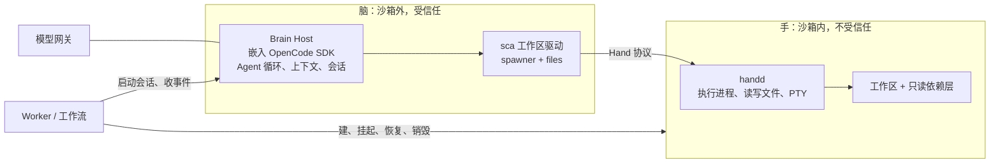

# 四期设计：脑手分离与大规模并行

> 2026-11-17。前三期把单个任务做“对”了，四期要把它做“多”：同样的机器跑更多任务，任务之间互不拖累，模型密钥彻底不进沙箱。本文先给出依据（今天测到的数据），再给设计，最后是分步计划和每步的退出条件。

## 1 为什么现在做

### 1.1 今天实测暴露的问题

| 现象 | 数据（2026-11-17，本机 2 核 3.7 GB） | 说明 |
| --- | --- | --- |
| 沙箱大部分时间空等模型 | OpenCode 评测任务中，Agent 工作时段里工具执行只占约 21%，其余约 80% 在等模型推理或流式返回 | 沙箱（CPU、内存、文件系统）和任务同生共死，模型思考时也被占着 |
| 准备开销比 Agent 工作还长 | 单题总耗时约 21 秒，Agent 工作约 9 秒，其余约 12 秒是建沙箱、setup、验证和隐藏验收 | 每个任务都从零开始 |
| 依赖按任务整份复制 | OpenCode 的依赖有 3 GB；一个修复任务的工作区 3.3 GB，一次编译再拷 3 GB；当天磁盘写满一次 | 没有共享的只读依赖层 |
| 模型密钥会进沙箱 | 现在是每轮签发一个临时 key 放进沙箱，由沙箱里的 Agent 直接调网关 | 风险已压到“有预算上限、一轮作废”，但沙箱仍能直接调模型，出口也必须开放到网关 |
| 并发全靠 Worker 进程 | 一个 Worker 内最多 8 个并发活动；评测默认串行 | 没有按租户的准入和公平调度，模型限流靠提供商报错 |

### 1.2 为什么可以做了

ADR-05 当时放弃“脑在外、手在内”，是因为现成的 Agent CLI 只能整体跑在沙箱里，要分离就得自研 Agent 循环。现在条件变了：

**OpenCode 2.3 原生支持“工具在别处执行”。** 它的所有文件读写和进程启动都经过 `Environment` 服务。`Environment` 由一个 `EnvironmentDriver` 提供，驱动只有两样东西：一个进程启动器（spawner），一组可选的文件操作覆盖。驱动来自可插拔的 `WorkspaceDriver`，接口是：

```ts
create({ workspaceID })              // 幂等：按 workspaceID 找到或创建后端资源，返回 binding
connect({ workspaceID, binding })    // 返回 EnvironmentDriver（spawner + files）
suspendForIdle({ workspaceID, binding })  // 空闲时挂起
destroy({ workspaceID, binding })    // 释放
```

SDK 的嵌入式宿主（`@opencode/sdk`，`EmbeddedHost.create({ workspaceProviders })`）允许注册自己的驱动，并且启动时会 `resumeSuspendedSessions`，即会话本身可以挂起和恢复。默认发行版没有附带任何远程驱动，这正是留给我们的扩展点。

所以脑手分离**不需要改 OpenCode，也不需要自研 Agent 循环**：在沙箱外运行一个嵌入 OpenCode 的“脑”进程，给它注册一个 `sca` 工作区驱动，把进程和文件操作转发进沙箱。

## 2 脑手分离

### 2.1 角色



| | 脑（Brain） | 手（Hand） |
| --- | --- | --- |
| 运行什么 | Agent 循环、模型调用、上下文管理、会话持久化 | 工具执行：命令、文件读写、搜索、PTY |
| 在哪 | 平台受信任的进程池，可多租户复用 | 每任务一个沙箱，gVisor/容器/Pod |
| 持有凭证 | 模型网关凭证（按任务签发） | **没有任何凭证** |
| 网络 | 能到网关 | 默认全部禁止；按任务开白名单（例如 PyPI） |
| 状态 | 会话（OpenCode 会话库 + 平台事件日志） | 工作区文件；可快照 |
| 死了怎么办 | 另一个脑从会话快照恢复 | 从最近的工作区快照重建，脑重放未完成的工具调用 |

### 2.2 Hand 协议

驱动需要的能力就是 OpenCode `EnvironmentDriver` 的能力。`exec-defaults.ts` 已经说明，文件操作可以全部用“启动进程”来实现（依赖目标环境有 GNU coreutils），所以最小协议只有一个 `exec`：

| 操作 | 说明 |
| --- | --- |
| `exec(argv, cwd, env, stdin) → stream(stdout, stderr, exit)` | 必需。带超时、输出上限、取消 |
| `files.read/write/stat/list/move` | 可选的快速路径；没有时退回 `exec` |
| `pty.open/resize/write/read` | 可选，交互式终端 |

传输分两档：

1. **第一步：`docker exec` / `kubectl exec` 直通。** 不往沙箱里放任何东西，驱动直接调平台已有的 `SandboxProvider.exec`。最快能跑起来，代价是每次调用一个 exec 会话（几十毫秒）。
2. **第二步：沙箱内的 `handd`。** 一个静态链接的小进程，通过一条长连接（unix socket 映射或 vsock）接收请求。省掉每次 exec 的开销，支持流式和 PTY。OpenCode 自带的 `process-daemon`（Rust，PTY 服务，带鉴权、所有权、交接协议）可以作为参考，甚至直接复用。

### 2.3 和平台现有部分怎么接

- `AgentBackend` 接口不变。新增 `opencode-brain` 后端：`run_turn` 不再在沙箱里启动 OpenCode，而是请脑池为任务开一个会话，并把 `workspaceID = task_id` 交给驱动。事件格式沿用现在 OpenCode JSON 事件的解析。
- 沙箱生命周期仍由工作流管（建、销毁），驱动只做连接。`suspendForIdle` 映射到 `SandboxProvider` 的暂停（Docker 用 `pause`/cgroup freeze；Kubernetes 先做“释放到快照”）。
- 验证、隐藏验收照旧在沙箱里由平台执行，与脑无关。
- Codex CLI 不支持远程执行，继续用“整体在沙箱内”的布局。两种布局并存，任务按后端选择。

### 2.4 收益与代价

| 收益 | 怎么体现 |
| --- | --- |
| 凭证彻底不进沙箱 | 沙箱里没有模型 key，出口可以全关；提示注入最多影响工作区 |
| 沙箱密度 | 等模型的约 80% 时间里沙箱可以冻结；同样内存能放更多沙箱 |
| 脑可横向扩 | 脑是 I/O 密集的，一个进程可以同时驱动大量会话 |
| 一个脑驱动多只手 | 同一会话分叉出 N 个沙箱做并行尝试（见 3.4） |
| 故障隔离 | 沙箱崩溃不丢会话；脑崩溃不丢工作区 |

| 代价 | 对策 |
| --- | --- |
| 每次工具调用多一跳 | `handd` 长连接；读文件走快速路径；对比测量 p50/p99 |
| 脑成为新的有状态组件 | 会话存平台库（OpenCode 支持自定义数据库路径）；脑池无亲和也能恢复，有亲和更快 |
| 依赖 OpenCode 内部接口 | 只依赖公开的 SDK 和 `WorkspaceDriver`；锁版本，升级时跑契约测试 |

## 3 大规模并行的关键技术

### 3.1 准入与公平调度

- **三层队列**：租户配额（并发、金额）→ 优先级（交互 > 评测 > 批量）→ 资源（沙箱、模型令牌）。拿不到资源的任务在 `QUEUED` 等待，不占沙箱。
- **加权公平**：同一优先级内按租户轮转，防止一个租户的批量评测占满。
- **反压**：模型网关或沙箱池告急时，准入层先停止放行新任务，而不是让已在跑的任务失败。

### 3.2 沙箱供给

- **预热池**按“到达率 × 准备时长”定容量，按镜像分池；B9 已有固定大小的 K8s 预热池，改为按负载伸缩。
- **镜像分层**：基础层（语言运行时）、依赖层（项目依赖）、工作区层（代码）。前两层在节点上预拉、只读共享。

### 3.3 写时复制的工作区和依赖

今天“每个任务拷 3 GB”的根治办法：

- **依赖层只读共享**：同一依赖指纹（例如 `bun.lock` 的哈希）对应节点上一份只读目录，以只读方式挂进沙箱。
- **工作区用 overlay**：下层是仓库镜像的检出（只读、跨任务共享），上层是任务自己的可写层。一个任务的磁盘占用 ≈ 它改动的文件。
- **快照就是上层**：检查点 = 冻结的上层 + Git 提交；恢复或换机器只需搬上层。

### 3.4 快照与分叉

- 一个任务准备好（克隆、装依赖、setup）后打一个快照，之后：
  - 评测的重复运行、Best-of-N 尝试，都从快照分叉，省掉准备的约 12 秒；
  - 子任务并行从同一个快照分叉。
- 实现由易到难：overlay 上层复制 → 文件系统快照（btrfs/ZFS） → 进程级（CRIU，Firecracker 快照）。前两种覆盖“文件状态”，已经够用。

### 3.5 模型网关在高并发下

- 按提供商、模型、租户三级令牌桶；超限排队，不直接报错；排队时间计入任务指标。
- **缓存亲和**：同一会话的请求固定到同一上游 key/区域，提高提示缓存命中（今天的数据里缓存命中的输入 token 占大头）。
- 重试带抖动，幂等键防重复计费；今天已修掉“网关闲置连接被重置导致首轮失败”的问题。

### 3.6 可观测在规模下

- 事件按任务分区写入；轨迹详情（工具输出全文）进对象存储，事件里只放摘要；
- 指标按“快 · 准 · 稳 · 省”四维汇总到运行和租户；
- 新增两类指标：沙箱活跃率（工具执行时间 / 沙箱存活时间）、准备开销占比，用来检验 3.3 和 3.4 的效果。

## 4 分步计划

每一步都必须在本机用真实 OpenCode 和模型跑通，并给出数据。

| 步 | 内容 | 退出条件 |
| --- | --- | --- |
| P4.1 | **脑手分离最小版**：Brain Host（Bun/Node 进程，嵌入 OpenCode SDK）+ `sca` 工作区驱动（经 `SandboxProvider.exec` 直通）+ `opencode-brain` 后端 | `opencode-demo` 评测在分离模式下结果与整体模式一致；沙箱环境变量和文件里找不到任何模型 key；沙箱出口全关时仍通过 |
| P4.1b | **常驻 brain 池**：每个 worker、版本复用一个 EmbeddedHost，经 Unix socket 并发驱动多个会话 | 假模型三容器并行且 PID 不变；key 按轮隔离；崩溃重启、取消、空闲退出有测试；量化 warm 开销及 RSS |
| P4.2 | **空闲挂起**：驱动的 `suspendForIdle` 接到沙箱暂停；模型调用期间冻结沙箱 | 记录每任务的沙箱活跃率；在同等内存下并发沙箱数提升，给出数字 |
| P4.3 | **只读依赖层 + overlay 工作区** | OpenCode 修复任务的工作区磁盘占用从 3.3 GB 降到 100 MB 以内；编译不再复制依赖 |
| P4.4 | **快照与分叉**：准备完成后打快照，评测重复和 Best-of-N 从快照分叉 | 评测单题平均耗时下降（目标：去掉大部分准备开销），结果不变 |
| P4.5 | **准入与网关限流**：租户配额、优先级、令牌桶、反压 | 用假模型做负载测试：几百个并发会话下无任务因限流失败，公平性有数据 |
| P4.6 | **handd**：沙箱内长连接执行守护进程 | 工具调用开销 p50/p99 相比直通下降，给出数字 |

P4.1–P4.3 解决今天实际碰到的问题，先做；P4.4–P4.6 在其后。每步完成后在本文末尾补“结果”，写清验证了什么、没验证什么。

## 5 P4.1 实现记录

### 接口调查与实现

已核对本机 `.data/opencode/src` 的 2.3.0 源码。`sdk/src/internal/host.ts` 的
`EmbeddedHost.create({ workspaceProviders })` 将驱动注册进工作区注册表；公开的
Effect SDK 同样支持该参数，Promise SDK 的公开创建参数则不支持它。
实现直接创建 EmbeddedHost，并用 `@opencode/client` 的 Promise 客户端连接其进程内 fetch，
没有监听 HTTP 端口，也没有自研 Agent 循环。

先调用 `host.workspace.create({ id: "wrk_sca_<task_id>", provider: "sca" })`，再用
`host.sessions.create({ location: Location.Ref.make({ directory: workdir, workspaceID }) })`
建会话。`wrk` 前缀是上游 ID schema 的要求，不能直接把平台 UUID 当 workspaceID。
`Environment` 看到 location 中的 workspaceID 后调用 Workspace.connect，后者按需 provision 并
调用驱动的 connect。create 仅绑定平台已经创建的容器；destroy 和 suspendForIdle 是空操作，
容器生命周期仍由平台负责，冻结留给 P4.2。恢复通过同一 session_dir 内的 SQLite 和 session_id。

非交互执行复用 `packages/cli/src/run/noninteractive.ts` 的 `runNonInteractivePrompt`：
先订阅事件、等待连接，再提交 prompt，自动批准权限、取消问题、等待后台任务结束。
它本身输出 CLI 的 JSON 行（step_start、tool_use、text、step_finish、error），因此 Python
直接复用 `parse_opencode_line`，保留用量和工具事件；text 增量在完成消息中拼接。
该函数通过 process.exitCode 报告失败，不能用它的返回值覆盖退出码。

Effect 4 的 ChildProcessSpawner 接收 StandardCommand 或 PipedCommand；其 handle 包含
stdin Sink、stdout/stderr/all Stream、exitCode Effect、isRunning、kill、unref 以及额外 fd。
这里保留原命令的流配置，将标准命令改写成 `docker exec -i -w <cwd> ... <container> <argv...>`，
管道两端递归改写，再交给 NodeChildProcessSpawner，从而复用 stdin 流、退出码和进程句柄。
`exec-defaults.ts` 用 sh + GNU coreutils/findutils 实现所有文件操作，无需覆盖 files；
BusyBox 镜像不满足要求。cwd 和文件绝对路径始终是容器路径（默认 `/workspace`），
不把它们映射成宿主机工作副本路径，宿主机只保存会话。

### 文件、配置与运行契约

- `deploy/opencode/brain/host.ts`：嵌入宿主；`driver.ts`：命令改写；`driver.test.ts`：假驱动契约测试。
- `launch.py <source> <bun> [JSON]`：在临时目录复制这几个小 TS 文件，把 sdk/core/cli 的依赖逐项链接进
  node_modules；退出即清理。原源码和依赖均只读，无安装、编译或 3 GB 依赖复制。
  不给 JSON 参数时从 stdin 读取。`--check-imports` 仅校验导入，`--test` 仅执行小型 Bun 单测。
- 输入字段：prompt、model、gateway_url（含 `/v1`）、container、workdir、session_dir（宿主路径）、
  task_id、可选 session_id、docker_prefix（`["docker"]` 或 `["sg", "docker", "-c"]`）。
  模型 key 仅由 brain 环境变量 `SCA_MODEL_KEY` 提供，不在输入 JSON 或 argv 中。
- 新后端 `opencode-brain` 已在 worker 注册；配置新增 `SCA_OPENCODE_BRAIN_BUN`、
  `SCA_OPENCODE_BRAIN_HOST`（指向 launch.py）、`SCA_OPENCODE_BRAIN_GATEWAY_URL`、
  `SCA_OPENCODE_BRAIN_DOCKER_PREFIX`（JSON 数组）。源码沿用 `SCA_OPENCODE_SRC_CACHE`，
  模型沿用 default_model。下方补齐后改为按 agent_version 导出源码。
  没有新 HTTP endpoint、数据库迁移或沙箱内安装。
- `sandbox_additions` 返回空 mounts/env；docker CLI 只继承 PATH，命令显式 env 过滤凭证变量，
  不继承 brain 的环境。启动时 inspect 容器网络，非 none 则拒绝执行。
  最初需要全局 `SCA_SANDBOX_NETWORK=none`；下方工程师 I 补齐后改为后端独立网络配置。
  网关使用 worker 可访问的 URL；临时 key 的签发与吊销继续复用平台逻辑。
- `scripts/brain_smoke.sh` 使用唯一名称创建 network=none 容器、验证文件并清理；需预先设置
  `SCA_MODEL_KEY`（临时网关 key）、`SCA_BRAIN_GATEWAY_URL`、`SCA_BRAIN_MODEL`，可选
  `SCA_BRAIN_IMAGE`。用 `timeout 900 bash scripts/brain_smoke.sh` 运行，不输出 key。

### 验证结果与阻塞

已运行：指定基线（附加独立 basetemp 避开 /tmp 目录所有权冲突）最终复跑 347 passed、1 skipped（91.71 秒）；
新 Python 单测（含错误、缺失完成事件与超时清理）最终运行 6 passed；小型 Bun 驱动测试 2 passed；SDK/CLI 导入检查通过；
`timeout 30 .venv/bin/ruff check src tests` 通过。首次 pytest 因默认临时目录归属错误未运行测试；
首次将同名 unit/integration 文件一起收集时发生模块名冲突，随后分别运行成功。
联合收集这两个文件加 `--import-mode=importlib` 后最终结果 6 passed、1 skipped；
不在本任务范围内修改 pytest 配置。

Docker 集成测试已写，需 `SCA_TEST_BRAIN_DOCKER=1`，标记 docker；默认运行结果为 1 skipped，
且项目尚未注册 docker 标记，需负责人在 pytest 配置中补登记。测试在宿主机启动脚本化
OpenAI-compatible SSE 模型服务，返回 shell/execute 调用，检查容器中的文件、环境和网络模式。
本工程师不能使用 Docker，未运行真实容器、真实网关 smoke 或 opencode-demo 评测，
因此 **P4.1 退出条件尚未完成**，不声称分离模式已达到整体模式的结果一致性。

### P4.1 补齐（工程师 I）

版本不再拒绝：未指定时使用 `SCA_OPENCODE_DEFAULT_VERSION`。读取
`SCA_OPENCODE_VERSIONS_DIR/<V>/meta.json` 的 commit（40 位十六进制）与 source_repo；
source_repo 必须与 `SCA_OPENCODE_REPO_URL` 一致。仅在该可信裸镜像上执行 git archive，
不在沙箱工作副本运行宿主 Git。导出到 `data_dir/opencode/brain-src/<V>/`，
全局 flock 串行、临时目录原子 rename、`.sca-commit` 校验后复用。每次取版本时顺便删除
已无 meta.json 的版本源码。第三方 node_modules 仅符号链接缓存，不安装、编译或复制依赖；
各层 `@opencode/*` 根据所选源码 package.json 重建链接，避免落回上游源码。
缓存由可信 worker 只读使用（符号链接本身不是操作系统写保护）。

brain 后端声明 `sandbox_network = "none"`，内核的任务及 acceptance 两处创建均优先使用
后端属性；其余后端保留全局网络配置。验证命令与验收命令也无网络，因此命令依赖必须预装。
无需全局设置 SCA_SANDBOX_NETWORK=none。宿主 URL 仅使用
`SCA_OPENCODE_BRAIN_GATEWAY_URL`，缺省从 `SCA_MODEL_GATEWAY_URL` 去尾斜线后加 `/v1`；
绝不回退到 ctx.model_base_url 的容器视角地址。

`POST /v1/evals/runs` 原有 variant 字符串契约已接受 `agent_backend: "opencode-brain"`；
`GET /v1/portal/config` 的 agent_backends 新增该值。无新 endpoint 或迁移。
事件继续复用原 mapper 的 started_at_ms、ended_at_ms、duration_ms、model_call_duration_ms；
完成前额外发出一条 agent.usage，`summary = "brain_turn"`，包含 brain_wall_time_ms、
total_model_call_ms（各模型步骤合计）、total_tool_ms（工具事件耗时合计）。
工具并行时合计可大于墙钟时间；模型耗时是 mapper 的首工具开始前估算，不是网关遥测。

输入新增 turn_marker（每轮随机标识，无凭证）。每个 docker exec 显式设置
SCA_BRAIN_TURN，brain 结束、超时或取消时杀宿主进程组，并执行独立清理命令扫描容器
/proc/*/environ，杀掉继承该标识的进程。清理最多等待 10 秒；真实容器取消回收仍需负责人复验。

新增验证：Python 单测 9 passed，Docker 集成默认 1 skipped；Bun 驱动测试 3 passed。
最初默认临时目录所有权错误导致基线 223 passed、1 skipped、124 errors，已使用独立
basetemp 重跑，结果为 350 passed、1 skipped（121.64 秒）。未运行 Docker、真实网关、OpenCode 构建或完整评测。
负责人需在当前版本 meta 对应可信镜像存在的环境重跑集成测试和 opencode-demo 新旧版本评测，
确认植入缺陷与修复版本各自被执行，再验证真实容器取消后没有遗留进程。
因此 P4.1 的评测一致性退出条件仍需现场验证。

### P4.1 现场验证结果（负责人，2026-11-17）

| 检查 | 结果 |
| --- | --- |
| Docker 集成测试（假模型，`--network=none` 容器） | 通过 |
| `scripts/brain_smoke.sh`，真实网关 + deepseek-flash | 6 秒内由沙箱外的 OpenCode 循环发起 shell 调用，在无网络容器里写出文件；输出中没有任何 key |
| 首次平台评测 | 6 题全部失败：版本源码的 `@opencode/*` 作用域只链接了工作区包，丢了发布到 npm 的 `@opencode/pty`。已修复（第三方 `@opencode/*` 包仍从缓存只读链接），并把 brain 的 stderr 尾部带进错误信息，避免再次“无声失败” |
| 评测一致性 | `2.3.0-sca.1`（含植入缺陷）：5/6，失败的正是 chinese-greeting，与整体模式一致；`2.3.0-sca.4`（修复版）：6/6 |
| 沙箱无网络、无 key | 后端强制 `network=none`；沙箱不加任何环境变量和挂载；模型 key 只在沙箱外的 brain 进程环境中 |
| 全量测试 | 518 passed，24 skipped |

**P4.1 的三个退出条件都已满足。**

新的观察（进入后续步骤）：

- 6 题合计 brain 墙钟 85 秒，其中模型调用约 11–15%、工具约 25%，剩下约 60% 是每轮新起 Bun 进程、加载 OpenCode 源码和会话初始化的开销。把 brain 从“每轮一个进程”改为**常驻的 brain 池**（一个进程驱动多个会话）是下一步收益最大的事，放在 P4.2 之前做（记为 P4.1b）。
- 模型耗时目前由事件时间推算，不是网关侧遥测；P4.5 接入网关后改为以网关数据为准。
- 取消时容器内子进程的回收逻辑已实现，但还没有真实容器的取消测试。

### P4.1b 常驻 brain 池（工程师 J，2026-11-17）

实现与契约：

- `deploy/opencode/brain/server.ts`：一个 Bun 进程只创建一次 EmbeddedHost；
  `driver.ts` 仍负责 docker exec 改写，每次 spawn 按 workspace 查当前 turn，取消后禁止新 spawn。
  不监听 TCP。`launch.py <source> <bun> --server <directory> <generation>` 链接原有依赖，
  用继承给 Bun 的 flock 防止同一 worker/version 同时启动两个宿主；不安装、构建或复制 node_modules。
- Unix socket 为 `data_dir/opencode/brain-run/<version>/<worker_id>/brain.sock`；
  同目录为 0700，保存 `brain.sqlite` 及 SQLite 辅助文件、`server.lock`。
  使用稳定 worker_id 保存数据库，进程重启及空闲退出后可以恢复 session_id。
  Linux 客户端通过打开目录后的 `/proc/self/fd/<fd>/brain.sock` 连接，服务端以 cwd 相对路径监听，
  避开 Unix socket 108 字节路径限制。
- 协议是 NDJSON。turn 请求字段为 `op:"turn"`、id、prompt、model、gateway_url、container、
  workdir、task_id、session_id（可选）、turn_marker、docker_prefix、model_key。
  返回原 CLI JSON 事件并增加 id，最后为 `{id,done:true,exit_code}`；
  `{op:"cancel",id}` 只取消该连接拥有的请求；断开连接也取消其请求。
  `{op:"ping",id}` 返回 `{id,pong:true,pid,rss,generation}`，RSS 单位为字节。
  无新增 HTTP endpoint 或数据库迁移。客户端校验请求 id、done 和退出码。
- `src/sca/agents/opencode_brain.py` 的 BrainPool 按版本延迟启动、每轮健康检查（2 秒）、
  启动等待最多 90 秒、崩溃后下一请求重启；不自动重放可能产生副作用的失败轮次。
  信号/超时先发 cancel，再按已有 turn_marker 清理容器进程。worker 的 finally、SIGTERM 和
  asyncio 的 SIGINT 路径关闭池；停止 launcher 时同时清理整个进程组。
  成功轮继续输出 `summary:"brain_turn"` 的 usage，新增 `pool:"cold"|"warm"`，
  原事件 mapper、模型/工具耗时和完成检查保留。
- 新配置：`SCA_OPENCODE_BRAIN_POOL=true`；设 false 回退原每轮进程模式；
  `SCA_OPENCODE_BRAIN_POOL_CONCURRENCY=3`（1–32）；
  `SCA_OPENCODE_BRAIN_POOL_IDLE_MINUTES=10`（正数）；
  `SCA_OPENCODE_BRAIN_POOL_WORKER_ID=local`（1–48 位英文字母、数字、下划线、短横线）。
  同一 data_dir 的多个 worker 必须设置不同且稳定的 worker_id。不要在未排空旧任务时切换模式：
  原每任务 session_dir 的 SQLite 与新共享库不自动迁移。跨 worker/session 库迁移尚未实现，
  因此本机池会话需要 worker 亲和；固定 worker_id 的重启恢复已测试。

凭证与会话选择：

核对本机 2.3.0 的 `sdk/src/internal/instances.ts`、插件 provider.transform 以及
`ai/src/route/auth.ts` 后，采用一个宿主加 instance-scoped provider，而不是每 key 一个宿主。
`instances.key` 为 workspace/model/gateway 组合，插件只注册无密钥的 provider settings。
`turn-provider.ts` 导出自定义 provider，其 `Auth.effect` 在每次模型 HTTP 请求时按 workspace
查 active-turn map 的 key；轮结束、取消立即删除。缓存模型只保留 workspace 标识；新轮可换 key。
同一 task 的重叠请求被拒绝，其他 task 并发。全局环境和配置均不写 key，key 只经 0700 目录内
socket 传输。宿主 stdout 仅在 upstream renderer 的 AsyncLocalStorage 上下文中转发并按请求标 id；
请求的 key 在出站事件再次脱敏，其他 stdout/stderr 丢弃，不落诊断文件。
Python mapper 也脱敏，包括旧模式。旧模式依然只通过子进程环境提供 key。

每版本、worker 共用一个 SQLite，workspace 为 `wrk_sca_<task_id>`；session 恢复时校验 workspace。
池模式不再把 SQLite 放在每任务 agent_home；该目录只保留兼容接口语义。
因此也没有实现把整个共享库当作单个任务会话归档的能力；后续多 worker 应接入会话导出/导入。
OpenCode instance 缓存仍由上游持有，已量 RSS，但没有做大量会话的长时间内存稳定性测试。

实测（真实 Bun/OpenCode SDK，假模型和空响应 fake hand；不是 Docker 隔离验证）：

| 项目 | 结果 |
| --- | --- |
| `scripts/brain_bench.py --turns 6 --fake-hand --source .data/opencode/src` | 每轮进程 overhead p50=2446.5 ms、p95=2705 ms；池含冷启动 p50=333.5 ms、p95=2325 ms；5 个 warm 轮 p50=332 ms、p95=356 ms |
| RSS | 仅启动约 174 MiB；6 轮后 396402688 字节（约 378 MiB）；三轮并发探针 358850560 字节（约 342 MiB） |
| 真实 SDK 的并发/恢复探针 | 三任务并发各自使用不同 key、结果和 session；同一 PID；同 session 换 key；关闭池再用相同 worker_id 重启后 session 恢复；重复宿主启动被锁拒绝且原 PID 保持；SQLite 和生成文件无 key，最终 1 passed（6.98 秒） |
| Python 单测 | 原 9 项加协议/生命周期等 7 项，16 passed（2.46 秒）；覆盖 warm/cold、崩溃重启、空闲退出、并发上限、超时 cancel、turn_marker 清理、坏协议及文件/argv 不含 key |
| 指定基线 | 最终 357 passed、1 skipped（82.73 秒）；先前复跑为 357 passed、1 skipped（79.43 秒） |
| Ruff | `timeout 30 .venv/bin/ruff check src tests` 与单独检查 `scripts/brain_bench.py` 均为 All checks passed |
| 小型 Bun driver 单测 | 3 passed、0 failed（163 ms）；未运行 OpenCode 全套测试 |

最终基线命令（只加独立 basetemp，避免已有 /tmp 目录的归属冲突）：

```bash
timeout 900 .venv/bin/pytest tests/unit tests/integration/test_store.py tests/integration/test_api.py tests/integration/test_workflow.py -q -p no:cacheprovider --basetemp=/tmp/j-brain-verified
```

overhead 定义为 brain_wall_time_ms 减 mapper 估算的模型和工具耗时，下限为零；
并行工具耗时不宜这样相减。基准使用无工具的假模型，每轮新建会话，warm 统计排除第一轮。
这不是生产网关遥测，也不能据此声称真实评测已有同样幅度的收益。

负责人仍需运行（本工程师遵守任务限制，完全未使用 Docker）：

```bash
timeout 300 sg docker -c 'env SCA_TEST_BRAIN_DOCKER=1 .venv/bin/pytest tests/integration/test_opencode_brain_docker.py -q -p no:cacheprovider'
timeout 900 sg docker -c '.venv/bin/python scripts/brain_bench.py --turns 6 --version 2.3.0-sca.1'
```

Docker 用例创建唯一名称的三个 network=none 容器、并发三轮假模型调用，校验各容器独立内容、
三个不同 key 和同一个服务端 PID，finally 移除容器。该测试默认跳过；需要负责人实跑。
还需以 pool 模式复跑 opencode-demo 的两个版本、真实容器取消回收、真实网关基准，
以及持续会话负载下的 RSS。不能把 fake hand 探针视为这些退出条件已完成。
真实 SDK 无 Docker 探针可用
`timeout 150 env SCA_TEST_BRAIN_HOST=1 .venv/bin/pytest tests/integration/test_opencode_brain_host.py -q -s -p no:cacheprovider`。

集成建议：worker 的 backend factory 当前仍依赖 backend 内的 get_settings；正常环境配置生效，
但若负责人要求传入的 Settings/model_copy 覆盖池配置，应给 factory 的 OpenCodeBrainBackend 调用
补 `settings=settings`。本任务限定 worker.py 只改关闭 hook，因此未改 factory。

### P4.1b 现场验证结果（负责人，2026-11-17）

已补 factory 的 `settings=settings`。

| 检查 | 结果 |
| --- | --- |
| Docker 集成测试：3 个 `--network=none` 容器并发、同一服务端 | 通过（3 个容器各得各的文件、3 个不同 key、同一 PID） |
| 真实 SDK 探针 | 通过 |
| `brain_bench.py --version 2.3.0-sca.1`（真实 OpenCode 源码 + 真实容器，假模型） | 每轮额外开销：每轮新进程 p50 2612 ms → 常驻池 warm p50 357 ms、p95 408 ms；冷启动一次 2742 ms；服务端 RSS 约 374 MiB |
| 真实模型评测，池模式，并发 3 | `2.3.0-sca.1` 5/6，失败题仍是 chinese-greeting；全程只有 1 个服务端进程；6 轮里 1 冷 5 热 |
| 真实模型评测，池模式，并发 1 | 6/6：chinese-greeting 这次也通过了。轨迹显示模型发现“edit/write 工具会丢中文”，改用 `git checkout` + `sed` 绕开，并写了一条记忆提议。缺陷仍在（版本正确），只是被 Agent 绕过；该题耗时 39 秒，是其余题的 2 倍，泳道和耗时异常规则都能看出来 |
| 每题耗时（除中文题外 5 题均值） | 每轮进程模式约 24.1 秒 → 池模式约 20.1 秒 |
| 全量测试 | 525 passed，25 skipped |

结论：常驻池把每轮约 2.3 秒的进程启动开销去掉了，结果不变。

两点观察：

- 评测验收只看最终文件，Agent 绕开缺陷也算通过。要让评测稳定暴露被测 Agent 自身的工具缺陷，需要再加一条“过程”检查：例如把“工具结果与预期不符”“同一文件被反复改写”作为证据规则，或在验收中检查轨迹（文件修改事件的内容是否被工具篡改）。已记入后续。
- 并发 3 时，2 核机器上三个沙箱互相抢 CPU，工具耗时占比从 25% 升到 37%。这正是 P4.2（模型思考时冻结沙箱、按真实活跃度调度）要解决的。

## 6 不做的事

- 不自研 Agent 循环。脑就是 OpenCode 本身；我们只提供手和编排。
- 不做跨地域调度、GPU 调度。
- 不在本阶段替换 Temporal 或 Postgres。规模瓶颈先测出来再说。

### P4.3 实现记录（工程师 M，2026-11-17；未满足退出条件）

新增 `workspace/layers.py`：基础层按租户、规范化仓库 URL、commit 的 SHA-256 标识。
任务镜像来自 RepoCache（或原有直接镜像路径）；只在可信镜像及新建 checkout 上运行宿主 Git。
首次 checkout 在临时目录构建，rename 发布；永久 flock 文件串行创建、引用更新与回收。
基础层文件和目录去掉写权限，不挂入任务；任务得到独立 inode 的 `cp -a --reflink=auto` 副本，
再恢复副本所有者写权限。没有使用 `cp -al`：任意 shell、编辑器、编译器都可能直接原地写，
平台无法拦截每次写入并先断开硬链接；仅靠 Git 或应用层的 break-on-write 会破坏其他任务及基础层。
Git 对象也独立，任务不依赖可被 RepoCache 淘汰的 alternates；因此现有 sync/K8s 路径保持原样。

配置与布局：

- `SCA_WORKSPACE_LAYERS=false`，显式开启仅作用于 Docker + mount transport。默认关闭是因为
  本机回退会额外保留一份完整基础层，不能把它当成已经完成的磁盘优化上线。
- `SCA_LAYER_RETENTION_HOURS=24`，非负；现有 `prune_repo_cache` maintenance 活动也回收层，
  日志 `Workspace layer bytes: <整数>` 是回收后基础层的 du 分配字节合计。
- `data_dir/layers/<key>/` 是只读 checkout（含独立 `.git`）；`locks/<key>.lock` 永久保留；
  `<key>.refs/<owner-hash>` 是持久引用。引用与任务 `workspace.layer` 标记配对，重复准备相同路径
  不会使旧层永久被引用；丢失引用第一次被观察到时开始保留期。
- `tasks/<id>/workspace` 是完整可写副本；`layer-source.json` 仅保存仓库 URL 哈希及租户，
  不保存 URL 凭证。缺少该元数据（例如跨机恢复）走原有 clone；检查点仍是 Git bundle + agent home，
  没有实现 overlay 上层快照或 P4.4 分叉。
- 普通 `coding.prepare_workspace` 的 `workspace.prepared` payload 和 task result 新增
  `workspace_bytes`（`du -s -B1`）及 `workspace_method`（`reflink-auto` 或 `clone`）。
  `reflink-auto` 指 cp 参数，并不保证文件系统确实共享块；du 在 reflink 文件系统上也会计入共享块，
  不能把它误称为独占物理块。镜像预备/合并工作区的指标尚未补齐。
- 构建使用 `git clone --shared`，本地 OpenCode 裸仓库以相同绝对路径只读挂进构建容器，
  使 alternates 在容器内有效；已有依赖继续按 node_modules 目录只读挂载，不安装或复制。
  构建期间可信裸仓库必须存在且不得运行破坏性的对象清理。远程 URL clone 不获得本地 alternates 收益。
  无新 HTTP endpoint、迁移或 Portal 修改。

本机能力和实测：用户命名空间内 kernel overlay mount 探针成功；但该 mount 只在私有 namespace，
不直接出现在宿主 Docker daemon 的 mount namespace。没有实现保持 namespace 的 helper 或传播挂载；
不能声称已支持 overlay。`fuse-overlayfs` 与 `/dev/fuse` 均不存在，reflink 强制探针失败。
因此本次实现的是安全的复制回退，**不是完整的 P4.3**。没有 sudo、Docker 或服务启停。

运行 `timeout 300 .venv/bin/python scripts/workspace_bench.py -n 2`，真实
`.data/opencode/opencode.git`，逐个删除任务，完成后删除整个临时目录：

| 方法 | 第一次/第二次秒数 | 每任务 workspace / 整个 task 字节 |
| --- | --- | --- |
| 原 clone | 8.045 / 5.533 | 263430144 / 337960960（第二次各少一个 4096 字节块） |
| 新层 + cp reflink auto（本机实际普通复制） | 9.883 / 2.418 | 263426048 / 337956864（第二次各多一个 4096 字节块） |
| 共享基础层 | — | 263413760 |

基准与测试曾并行，耗时仅作本次观测；不是隔离性能保证。脚本支持 `--repo`、`--ref`、`-n 1..10`，
打印 JSON 行，检测 reflink 和 fuse，在原裸仓库所在文件系统创建临时数据，不修改原仓库。

负责人仍需：提供宿主可见的非特权 overlay/FUSE 方案或支持 reflink 的存储，再实现并验证自动选择、
upper/work 生命周期与近零占用；补 Portal run summary 对 `workspace_bytes` 的展示（本任务禁止改 Portal），
补合并/恢复路径指标；用 Docker 实跑构建的 alternates 只读挂载、已有依赖挂载、两个 fix 任务的
commit/diff/push，以及新旧版本评测。真实构建、真实模型和完整 e2e 未运行，不声称退出条件通过。

本次自动化验证（真实运行结果）：

- `timeout 120 .venv/bin/pytest tests/unit/test_layers.py tests/integration/test_workspace.py tests/integration/test_workspace_transport.py tests/integration/test_workspace_layers.py tests/integration/test_workspace_cache.py -q -p no:cacheprovider --basetemp=/tmp/m-layer-focused3`：18 passed，36.84 秒。
- 最终原子发布权限调整后，`timeout 30 .venv/bin/pytest tests/unit/test_layers.py tests/unit/test_layers_build.py tests/integration/test_workspace_layers.py -q -p no:cacheprovider --basetemp=/tmp/m-layer-publication`：4 passed，0.76 秒。构建用例实际运行 Git，Docker 构建由 fake runner 替代，检查 alternates 和只读挂载参数。
- `timeout 900 .venv/bin/pytest tests/unit tests/integration/test_store.py tests/integration/test_api.py tests/integration/test_workflow.py -q -p no:cacheprovider --basetemp=/tmp/m-layer-finalbaseline`：385 passed、1 skipped，88.59 秒。较早基线为 384 passed、1 skipped，106.65 秒。
- `timeout 30 .venv/bin/ruff check src tests scripts/workspace_bench.py`：All checks passed。
- 最终重跑同一基准：旧方法 3.782 / 4.059 秒，新方法 8.741 / 3.010 秒；四个工作区各 263430144 字节，新方法 task 各 337965056 字节，基础层 263413760 字节。
  新增能力探针报告 private_namespace_overlay=true、host_visible_overlay=false、reflink=false、fuse_overlayfs=null、dev_fuse=false。

最初测试曾暴露只读目录 rename/删除权限问题；已调整为发布前保护内容、锁内短暂恢复顶层目录写权限后 rename，
并在失败清理时恢复权限。重跑结果如上。所有本次测试/基准临时目录已清理，原 OpenCode 裸仓库未改动。

### P4.3 Docker overlay 补充（工程师 N，2026-11-17；待现场验收）

新增开关 `SCA_WORKSPACE_OVERLAY=false`。开启只作用于 Docker + mount transport，
不依赖 `SCA_WORKSPACE_LAYERS`；关闭时新任务沿用原路径，已有 overlay 标记的本机任务继续使用原卷。
没有新增 HTTP endpoint、数据库迁移、Portal 或评测代码改动。

布局与执行契约：

- `layers/<key>/` 是按租户、仓库身份和 commit 隔离的共享基础 checkout（含独立 `.git`）。
  overlay 的 key 与 M 的复制层分开；overlay 下层保留正常 Unix 写权限，因为去掉写位会令
  同 UID 的 Agent 无法修改合并视图。其不可变性由只作为 overlay lowerdir 使用保证，
  不将该目录直接暴露给 Agent，也不对基础层运行任务命令。
- `tasks/<id>/overlay/{upper,work}` 是增量与工作目录；`workspace.overlay` 保存卷与下层路径，
  `overlay.layer` 与 `<key>.refs/` 配合固定下层。卷名 `sca-ws-<id>`，Docker local driver，
  `type=overlay,device=overlay`，挂载选项包含 lowerdir/upperdir/workdir、`userxattr`，并关闭
  redirect_dir/index/metacopy，避免快照依赖隐藏的重定向或元数据复制。
- 沙箱将卷挂到 `/workspace`。宿主的 `tasks/<id>/workspace` **不是合并工作副本**，只作为
  平台 `.sca` 上下文目录；其 `.sca` 单独 bind 到 `/workspace/.sca`。这样记忆和上下文写入不会
  在卷挂载时直接改 upper（内核不保证这种修改的可见性）。Git helper 不需要这个已排除的上下文挂载。
- checkpoint 的 commit 在可信短命 helper 中执行，使用与沙箱相同 UID/GID、无网络、只读根文件系统、
  无额外 capabilities、256 MiB 内存和 1 CPU。helper 只挂任务卷，bundle 经 stdout base64 返回，
  宿主在自己创建的 mirror 导入后生成 binary diff/patch，并带宿主凭证 push。
  helper 不挂凭证或宿主 mirror；超时/失败后按唯一容器名清理。
- 任务结束删除卷，idle release 保留卷；保留期内 upper 留存。maintenance 删除终态/孤儿卷，
  通过原有持久快照校验后删除 upper/work；Docker 的 root-owned work 目录由独立无网络清理 helper
  删除。只有该清理 helper 使用 root 和 DAC_OVERRIDE/FOWNER，仅挂载该任务 overlay 目录。
  下层引用至少保留到 upper 清理；任务目录意外丢失时保守保留引用，孤儿卷回收再释放。
- durable state 增加有 SHA-256 的 `overlay.json` blob（仍采用 manifest-last）：保存 upper tar、原始
  lower commit/仓库身份、白化删除记录、opaque 属性，以及独立平台上下文目录；与原 mirror bundle
  和 agent home 一起发布。恢复先释放沙箱，再通过合并视图重建白化记录，卸载卷后用 data-filter
  解包普通文件并恢复 `user.overlay.opaque` 原值，随后重新创建卷。特殊设备（白化节点除外）拒绝归档。
- `workspace.prepared` 和 task result 保留 `workspace_method`，另加 `method:"overlay"`；
  `workspace_bytes` 为 `du -s -B1 upper`，不包含共享下层、宿主 mirror 或平台上下文。
  setup 成功后追加同类型事件，`phase:"after_setup"`、去重键 `workspace.prepared.after_setup`，
  同时刷新 result，避免把准备时的占用误当作 setup 后占用。

验证与限制：本工程师遵守本任务的禁止 Docker 约束，没有执行 Docker、sudo、服务启停、
OpenCode 安装/编译、真实模型评测或完整 e2e。因此**没有 overlay N=5 的实测字节/秒数**，
也不能宣称 P4.3 的退出条件已经满足。新增测试通过 fake 验证 helper 参数、卷选项、命名卷挂载、
下层无复制与引用保留、opaque 属性、上下文与普通文件快照恢复、坏路径拒绝和失败清理。
Docker 标记的集成测试由 `SCA_TEST_OVERLAY=1` 开启，覆盖双任务共享下层/修改隔离、上层初始占用、
helper commit/bundle/diff、向本地 bare repo 推送、忽略文件和删除记录恢复、卷与上层回收。
初始上层已有 Git branch/index/exclude 元数据，测试上限 1 MiB（小仓库），不是严格零字节。

负责人必须现场运行：

```bash
timeout 300 sg docker -c 'env SCA_TEST_OVERLAY=1 .venv/bin/pytest tests/integration/test_overlay_workspace.py -q -p no:cacheprovider --basetemp=/tmp/n-overlay-live'
timeout 900 sg docker -c '.venv/bin/python scripts/workspace_bench.py --repo .data/opencode/opencode.git --overlay -n 5'
```

基准按 old/new/overlay 输出每任务 seconds、workspace_bytes、task_bytes 和共享 layer_bytes；
每个任务及时清理，方法之间移除基础层，卷名带随机临时目录前缀，避免多个基准互相占用。
需在上述命令后核对无遗留卷/容器，再以 overlay 开关运行真实 opencode-demo 评测和 fix 任务，
检查 patch、push、idle release/resume、重试恢复、取消与保留期回收，并补上 N=5 数值。
尤其需要验证本机 Docker local driver 接受 `userxattr` 及上述关闭选项、gVisor 命名卷兼容性、
真实删除/opaque 目录恢复和大仓库 helper 的内存上限。

需要集成负责人处理的范围外契约：`Mount.source` 注释目前仍说“宿主绝对路径”，需允许本次的
受限命名卷形式（无需字段或迁移）；`compile_intents` 对仓库相对路径的源文件仍使用宿主 workspace
读取，而 overlay 的宿主目录仅有平台上下文。启用 overlay 的此类任务需要改成经 helper 读取指定源，
或先导出受限的输入文件；本任务只允许改 kernel 的 workspace prepare/commit/cleanup 路径，未修改
intent 编译路径。不要把带仓库路径 intent 的 overlay 任务视为已支持。

自动化验证记录（不把 fake 当作 Docker 验证）：

- `timeout 30 .venv/bin/pytest tests/unit/test_overlay.py tests/integration/test_overlay_workspace.py tests/integration/test_workspace_layers.py tests/integration/test_workspace_transport.py -q -p no:cacheprovider --basetemp=/tmp/n-overlay-recovery`：17 passed、1 skipped，2.16 秒；跳过项为显式 opt-in 的 Docker overlay 集成测试。
- 指定基线曾通过 397 passed、1 skipped（81.82 秒）；最终交付基线结果见下方。
- `timeout 30 .venv/bin/ruff check src tests scripts/workspace_bench.py`：All checks passed。
- `timeout 20 .venv/bin/python scripts/workspace_bench.py --help`：正常显示 `--overlay` 参数；没有执行需 Docker 的基准。
- 中间测试曾发现下层 key 的命名空间分隔符进入路径规范化，以及内嵌清理/白化脚本的换行引用错误；均已修复，新增编译检查和 fake 快照恢复回归。没有隐去这些失败或将其计为通过。

最终交付基线（所有代码修正后）：
`timeout 900 .venv/bin/pytest tests/unit tests/integration/test_store.py tests/integration/test_api.py tests/integration/test_workflow.py -q -p no:cacheprovider --basetemp=/tmp/n-overlay-finalstate-baseline`
为 **397 passed、1 skipped，81.44 秒**。最终 Ruff 同样通过。测试临时目录随后恢复写权限并删除；
本次没有创建真实 Docker 卷或容器，也没有修改原 OpenCode 裸仓库。

### P4.3 现场验证结果（负责人，2026-11-18）

在主实例上打开 `SCA_WORKSPACE_OVERLAY=true`，用 Portal 走完整闭环（基线 → 诊断 → 修复 → 构建 → 重跑）。

| 环节 | 结果 |
|---|---|
| 基线 867435e6（2.3.0-sca.1） | 5/6。chinese-greeting 的验收通过，但轨迹检查不通过：agent 绕开了坏掉的写文件工具，K 的规则把它判为失败 |
| 修复任务 ae7a9c21 | overlay 工作区，约 2 分钟完成，进入 AWAITING_REVIEW |
| 构建 4969d9bf | 2.3.0-sca.6，成功 |
| 重跑 20fd5709（sca.6） | 6/6，总通过率 83% → 100%，结论卡“建议采纳” |
| 工作区占用 | 评测任务每个 86 KB（overlay 上层），方法字段为 `overlay` |

走查中发现并修复了三个问题：

1. **overlay 下修复沙箱没有依赖挂载（根因不在 overlay）。** `create_sandbox` 由内核的
   `KernelActivities` 实例执行，它调用的是自己的 `_backend()`，拿不到 coding 场景在
   `CodingActivities._backend()` 里加的 `DependencyBackend` 包装，所以 node_modules 只读挂载被整个丢掉。
   第一次 overlay 走查中，agent 因此找不到 `effect` 包，花了 20 多分钟去外网找依赖。
   修复：`_create_sandbox` 通过 `self.scenarios[task.kind]` 取场景自己的 backend
   （沙箱附加挂载和 network 都从它来）。回归测试是 `tests/unit/test_opencode.py::test_kernel_sandbox_uses_the_kinds_backend`，
   去掉修复后这个测试失败。
2. **出口白名单被域前置绕过。** 同一次走查中，agent 从白名单外的 cache.nixos.org 下载了内容，
   见下一节。
3. **Portal 的“构建”可能误构建 main。** 闭环的三个按钮默认是可点状态；页面刷新后、
   `recoverFlow` 还没加载完时点“构建”，会发出 `task_id: undefined`，API 回退为构建 main
   （这次误产出了 2.3.0-sca.5，内容就是 main，没有修复）。修复：按钮默认 `disabled`，
   由 `updateFlow` 按状态打开；批准和构建在没有 `flow.fixTask` 时直接报错。

`SCA_WORKSPACE_OVERLAY` 仍然默认关闭。原因：它依赖 Docker 驱动、mount 状态传输和宿主允许
`docker volume create --opt type=overlay`；另外 `overlay.py` 里写死了 `docker`，还没有改用
`settings.docker_bin`。需要时在 `.data/portal.env` 里加 `export SCA_WORKSPACE_OVERLAY=true`。

## 安全修复：出口白名单被域前置绕过

2026-11-18，工程师 O：原代理仅检查 CONNECT 的 dstdomain，攻击者可在允许的
CONNECT 内发送其他 SNI 或 HTTP Host，借共享 CDN 取得白名单外内容。
选择方案 A：Ubuntu 24.04 的 squid-openssl 二进制包，不编译 Squid。方案 B 的可信包索引
只能覆盖 pip，会改变现有模型服务、Git、Node 等域名白名单语义，因此本次不采用。

执行顺序：CONNECT/HTTP 请求先拒绝 IP 字面量、非法端口和私有目的地址，再按原白名单放行；
域名 ACL 使用 `dstdomain -n`，禁止通过反向 DNS 把 IP 请求变成允许的域名。
TLS 在 step1 peek，只读取 ClientHello；step2 必须有原始 SNI 且该 SNI 命中同一白名单，
随后 bump，没有 splice 分支。解密后每个 HTTP 请求重新执行 http_access，
`host_verify_strict on` 拒绝 URL/Host 不一致；上游证书验证错误一律拒绝。
不记录访问日志或缓存日志，避免请求 URL 中的凭证进入日志。

不能只用 `ssl::server_name --client-requested` 强制 SNI：官方文档说明缺少 SNI 时它会回退
到 CONNECT URI。因此额外通过 `%ssl::>sni` 和小型 external ACL helper 检查原始 SNI；
helper 拒绝缺失、IP 和不合法名称，只做元数据判断，不承担代理或 TLS 实现。
helper 最多两个子进程，缓存最多 256 项；签证书 helper 最多两个子进程、证书缓存 4 MiB。
Docker 代理限制 256 MiB、0.5 CPU、64 PID。配置语义依据
[Squid ACL](https://www.squid-cache.org/Doc/config/acl/)、
[ssl_bump](https://www.squid-cache.org/Doc/config/ssl_bump/)、
[external_acl_type](https://www.squid-cache.org/Doc/config/external_acl_type/)、
[host_verify_strict](https://www.squid-cache.org/Doc/config/host_verify_strict/)。

契约与文件布局：

- 无新增 HTTP endpoint、数据库表或迁移。`SCA_EGRESS_ALLOW` 保留精确域名和 `*.domain`
  语义（后者也包含裸域名）；IP 白名单条目现在直接报错。
- 新设置 `SCA_EGRESS_CA_DIR`（默认空）：默认目录为 `data_dir/egress/<name_prefix>/`，
  DockerSandboxProvider 也接受 `egress_ca_dir=Path(...)`。首次调用 ensure_egress 在宿主生成
  RSA 2048 CA，有效期十年；flock 串行化多个 worker，目录 0700、`ca.key` 0600。
  `ca.crt` 为公共证书，`ca-bundle.crt` 合并宿主公共根证书和部署 CA；`ca.lock` 是持久锁。
  不完整的 CA 状态报错，禁止静默换 CA；私钥备份和到期轮换由部署负责人执行。
- 新镜像 `sca-egress:tls-v1`：`deploy/egress/Dockerfile`、`entrypoint.sh`、`check-sni`。
  整个 CA 目录仅给代理只读挂载到 `/ca`；入口以 root 复制密钥到容器私有临时目录，
  然后用 proxy 用户运行 Squid。沙箱只挂载 `ca-bundle.crt` 到
  `/etc/sca-egress/ca-bundle.crt`，绝不挂 CA 目录或私钥。
- restricted 沙箱设置 `SSL_CERT_FILE`、`REQUESTS_CA_BUNDLE`、`PIP_CERT`、
  `NODE_EXTRA_CA_CERTS`、`GIT_SSL_CAINFO` 指向上述公共 bundle。现有沙箱镜像已有
  ca-certificates，无需为本修复修改镜像；系统信任目录不写入部署私钥，也无需让沙箱以 root 启动。
- `sca.egress_allow` 标签现在是配置、镜像、CA 路径和公共证书的 SHA-256 指纹，
  使旧的不解密代理不被误复用。上线会替换代理，必须由负责人安排；本次未操作线上容器或网络。
- K8s 共用同一 TLS 配置渲染，但尚未实现 Secret/公共 ConfigMap 的分离和 CA 注入。
  其 egress Deployment 命令明确 exit 1，因此真实 rollout 失败，restricted 出口不可用，
  不回退到旧隧道。补齐这条链路后才能恢复 K8s restricted；现有 Pod/代理需负责人另行处置。

验证与交付限制：本任务明确禁止 Docker，因此未执行 Docker、sg docker、镜像构建、
真实 pip 或网络攻击探针，也未重启/替换 `sca-egress` 或 `sca-sandbox-net`。
配置字符串和 fake 不能证明 Squid 已接受配置或攻击被真实阻止，当前交付尚未满足现场安全验收。
`tests/integration/test_egress_tls.py` 由 `SCA_TEST_EGRESS=1` 开启，使用唯一前缀的网络和代理，
测试允许的 HTTPS GET、six==1.17.0 的 pip download、非允许 CONNECT、SNI 前置、Host 前置、
IP CONNECT 和无 SNI；finally 清理探针容器、代理和网络。原 test_egress.py 也改为相同显式开关。
镜像需要负责人先构建，测试不会自行更新线上镜像或网络：

```bash
timeout 300 sg docker -c 'docker build -t sca-egress:tls-v1 deploy/egress'
timeout 900 sg docker -c 'env SCA_TEST_EGRESS=1 .venv/bin/pytest tests/integration/test_egress.py tests/integration/test_egress_tls.py -q -p no:cacheprovider --basetemp=/tmp/o-egress-live'
```

仍需检查：Ubuntu 包的实际配置解析、external ACL 在 bump 阶段的行为和 helper 故障时拒绝、
真实 curl/pip/Git/Node 的 CA 信任、镜像启动与 gVisor 兼容性。固定证书的工具可能拒绝 MITM，
不得为其增加 splice 例外；应另行提供可信下载通道。HTTP/2 连接合并、重复 Host/绝对 URL、
IP-literal SNI 和 ECH 应继续作为对抗回归；当前只有 IP-literal SNI 的 helper 单测，
没有真实握手的覆盖。已有沙箱不会自动获得新 CA，需在负责人安排的迁移中重建。

本次真实运行结果：

- `timeout 30 .venv/bin/pytest tests/unit/test_egress_rules.py tests/integration/test_egress.py tests/integration/test_egress_tls.py -q -p no:cacheprovider --basetemp=/tmp/o-egress-final-focused3`：16 passed、5 skipped，0.32 秒。
  单测涵盖配置顺序、无 splice、拒绝 IP 配置、原始 SNI helper、CA 持久化/权限/公共 bundle、
  Docker fake 的私钥挂载隔离和 K8s 明确拒绝启动；五项跳过均需要 Docker。
- `timeout 900 .venv/bin/pytest tests/unit tests/integration/test_store.py tests/integration/test_api.py tests/integration/test_workflow.py -q -p no:cacheprovider --basetemp=/tmp/o-egress-final-baseline`：406 passed、1 skipped，83.68 秒。
- `timeout 30 .venv/bin/ruff check src tests`：All checks passed。
- 初轮基线为 1 failed、402 passed、1 skipped：K8s 原单测要求驱动继续生成 Deployment，
  将拒绝启动从 provider 方法移到出口容器命令后，最终基线通过，未修改其他工程师的测试文件。

攻击探针对负例关闭客户端证书验证，并向 cache.nixos.org 请求 `/nix-cache-info`；
只有 TLS 关闭或 HTTP 403/409 才视为阻断，避免把客户端不信任证书或上游 404 误算为修复成功。
负责人仍需执行上述 opt-in 测试，确认 helper 失败/超载也拒绝连接，再安排上线；当前不能宣称漏洞已在运行环境关闭。

### 负责人现场验证（2026-11-18）

- 发现方式：overlay 走查中，修复任务的 agent 在 `restricted` 沙箱里从 cache.nixos.org 下载了 nix
  缓存（白名单只有 pypi.org、files.pythonhosted.org）。用 `.data/briefs/front_repro.py` 在旧代理上复现：
  `CONNECT pypi.org` + SNI `cache.nixos.org`、`CONNECT pypi.org` + Host `cache.nixos.org` 都拿到 CDN 的 200。
- 构建 `sca-egress:tls-v1`（只装 Ubuntu 的 squid-openssl 包，没有编译，内存上限 1.5 GB）后，
  测试代理上的结果：允许的 HTTPS 返回 200；`pip download six==1.17.0` 成功；直连非白名单返回 403；
  SNI 前置时 TLS 被关闭；IP CONNECT 返回 403；缺少 SNI 时 TLS 被关闭。
- Host 前置返回 503（`SQUID_X509_V_ERR_DOMAIN_MISMATCH`）。原因：bump 时 Squid 去连上游，
  pypi.org 的证书不覆盖 Host 里的 cache.nixos.org，Squid 拒绝转发，响应里没有任何上游内容。
  也就是说，这里的阻断靠的是证书校验，没有走到 http_access。为了覆盖“同一张 CDN 证书同时包含两个域名”
  的情况，负责人另外加了 `acl allowed_host req_header Host` 加 `http_access deny !CONNECT !allowed_host`：
  解密后的请求，Host 头也必须在白名单内。集成测试把 503 也算作阻断。
- 旧的 `test_other_hosts_are_refused_by_the_proxy` 原先断言 curl 失败。现在 Squid 在 bump 之后的
  会话里回 403，curl 退出码为 0，所以改成断言 HTTP 码是 403。
- `SCA_TEST_EGRESS=1` 下 egress 单测和两个集成测试共 21 个，全部通过。线上 `sca-egress` 在 worker
  重启时按指纹自动换成新镜像。
- 已知缺口：K8s 的 restricted 出口在补齐 CA 分发之前会主动拒绝启动（故意不回退到可被绕过的旧代理）。

## P 小修复（2026-11-18）

- 评测启动：`POST /v1/evals/runs` 在启动 Temporal 前提交 `queued` 行，成功响应仍为
  `201 {"id": "..."}`；紧接着 `GET /v1/evals/runs/{id}` 可读。CLI `run` / `gate`
  共用同一预建逻辑。`eval_prepare` 保留冲突忽略，只把 `queued` 更新成 `running`，重试不会
  重建记录或把已结束的运行改回运行中。Temporal 启动失败仍返回 503；预建行可能保留为 queued。
- 权限集成缺口：现有 0011 仅给 `sca_api` SELECT，负责人需要在自己的迁移中增加
  `GRANT INSERT ON eval_runs TO sca_api`，保留现有租户 RLS；否则 API 预建会权限失败。
  迁移不在 P 的可编辑清单内，因此未修改；API 测试只在各自临时数据库授予该窄权限。
- Overlay 新增关键字参数 `docker_bin: str = "docker"`，Coding 和 Kernel 构造处传入
  `Settings.docker_bin`（环境变量 `SCA_DOCKER_BIN`）。helper、volume、清理命令全部使用它。
  参数是可执行文件路径，可指向执行 `sg docker` 的 wrapper；不是 shell 命令字符串。
  `layers.py` 没有 Docker 调用，无需修改。
- Brain 工具命令通过 Python wrapper 建立进程组，原子写入容器内
  `/tmp/sca-brain-<turn_marker>-<pid>`；结束、超时或取消时按标记 SIGKILL 进程组并删除标记。
  `/tmp/sca-brain-<turn_marker>.cancelled` 阻止迟到命令启动，随任务容器销毁。
  清空环境的子进程仍在组内；本轮清理不影响其他轮。沙箱需有 `python3`。
- 定向验证：Overlay、Brain、评测 API/存储与 CLI 共 **31 passed、1 skipped**；
  Bun driver **4 passed**；`ruff check src tests` 通过。真实 Postgres 使用隔离临时库。
  首次 pytest 因 `/tmp/pytest-of-ubuntu` 所有者不符出现 fixture 错误，后续通过
  `PYTEST_ADDOPTS=--basetemp=/tmp/sca-p-*` 使用独立临时目录。
- 未运行 Docker、OpenCode 构建或完整 e2e。新增 `tests/integration/test_brain_cancellation.py`：
  `SCA_TEST_DOCKER_BRAIN=1` 启用；假 Brain 调用真实 TS driver，在真实无网络容器启动
  `sh -c 'env -i sleep 300 & wait'`，取消后要求 10 秒内没有该 sleep。
  负责人运行：`timeout 120 env SCA_TEST_DOCKER_BRAIN=1 .venv/bin/pytest
  tests/integration/test_brain_cancellation.py -q -p no:cacheprovider`。
- 指定基线实跑：`timeout 900 env PYTEST_ADDOPTS=--basetemp=/tmp/sca-p-baseline-20261118
  .venv/bin/pytest tests/unit tests/integration/test_store.py tests/integration/test_api.py
  tests/integration/test_workflow.py -q -p no:cacheprovider`，**424 passed、1 skipped，188.75 秒**。
  最后调整取消测试同步方式后，Brain 单测另跑 **12 passed**，Ruff 再跑通过。

## P4.5b 网关限流与负载测试

实现位于 `src/sca/gateway/limiter.py`，以单进程 ASGI/httpx 转发模型请求；
`timeout 3600 .venv/bin/python -m sca.gateway.limiter` 启动 uvicorn，默认端口 4100。
本次没有迁移，也没有修改 LiteLLM 签发、计费或吊销逻辑。

### 接口与调度契约

- 转发 `POST /v1/chat/completions`、`/v1/completions`、`/v1/embeddings`、
  `/v1/responses`；URL 参数、JSON 原始字节、Bearer key 和 SSE 字节保留，移除逐跳头。
  不转发 key 管理端点。请求 JSON 上限 2 MiB；`GET /metrics` 提供 Prometheus 指标。
- 全上游聚合桶（保守地把 LiteLLM 后的提供商视为一个预算组）、模型桶、租户桶、
  虚拟 key 桶均检查 RPM/TPM；请求桶容量为 1，按 RPM 平滑放行，token 桶容量为对应 TPM。
  单请求估算超过 TPM 时也等待，达到超时后拒绝。模型覆盖值按 LiteLLM 的模型别名配置。
- 每租户 FIFO，跨租户等额 round-robin；被自己的桶阻塞的租户不会阻塞其他租户。
  权重仅用于负载脚本分配会话需求，不表示生产调度的租户优先级权重。
  所有重试合计排队预算默认 120 秒，耗尽返回中文错误、HTTP 429 和 `Retry-After: 1`。
- token 预留使用 `max_completion_tokens` / `max_tokens`（缺省 1024，乘以 `n`）加
  请求字节数约四分之一；普通 JSON 或 SSE 中可解析的 `usage.total_tokens` 校正最终尝试。
  没有 usage、压缩的响应及失败尝试保留保守估算；不改变 LiteLLM 的实际账单。
- 上游 429/5xx 在尚未向客户端发送正文、且响应不是 SSE 时最多重试 3 次，
  每次重新排队，指数退避带随机抖动。成功 SSE、错误状态的 SSE，以及结果不明确的
  transport/read failure 均不重放，避免重复执行已接受的 completion。
  原有 key/会话与上游路由头保留，不另行轮换模型凭证。
- key 所属租户来自 LiteLLM `/key/info` 的可信 metadata.tenant_id；缺失时用 metadata.task_id
  或 `task-<UUID>-turn<N>-attempt<N>[-<worker>]` alias，通过平台 Store 取得 task.tenant_id。
  当前 alias 本身没有 tenant。缓存只保存 key 的 SHA-256、租户和过期时间，TTL 60 秒，
  最多 10000 项；不相信客户端租户头。没有有效归属时拒绝转发。
- 指标为 `sca_gateway_queue_depth`、`sca_gateway_queue_wait_seconds{tenant=...}` histogram、
  `sca_gateway_upstream_429_total`、`sca_gateway_rejected_total`。
  每个成功响应附 `x-sca-queue-wait-seconds`，为该请求所有尝试的排队时间总和。
  服务仅支持一个进程/一个副本；多 worker/多副本没有共享桶，不能按此配置扩容。

### 设置、反压文件与沙箱网络

下列名称均带 `SCA_` 前缀：

| 设置 | 默认值 / 语义 |
| --- | --- |
| `GATEWAY_LIMITER` | `false`，由负责人现场检查后启用 |
| `GATEWAY_LIMITER_PORT` | `4100` |
| `GATEWAY_LIMITER_CONTAINER` | `sca-gateway-limiter` |
| `GATEWAY_LIMITER_URL` | `http://127.0.0.1:<limiter_port>`，宿主 brain 的地址；可覆盖 |
| `GATEWAY_QUEUE_TIMEOUT_S` | `120` |
| `GATEWAY_RPM` / `GATEWAY_TPM` | `600` / `1000000`，聚合上游预算 |
| `GATEWAY_TENANT_RPM` / `GATEWAY_TENANT_TPM` | `600` / `1000000`，每租户预算 |
| `GATEWAY_KEY_RPM` / `GATEWAY_KEY_TPM` | `60` / `100000`，每 key 预算 |
| `GATEWAY_MODEL_LIMITS` | `{}`；JSON 如 `{"deepseek-flash":{"rpm":120,"tpm":100000}}`，未指定字段沿用聚合值 |
| `GATEWAY_PRESSURE_FILE` | `data_dir/run/gateway-pressure.json` |
| `GATEWAY_PRESSURE_DEPTH` / `GATEWAY_PRESSURE_WAIT_S` | `50` / `5` |
| `GATEWAY_TEST_KEYS` | `{}`；仅隔离假模型使用的 JSON key→tenant 映射，生产必须为空 |

反压文件在启动时和之后每两秒写入，同目录临时文件原子 replace，内容严格为
`{"saturated":bool,"updated_at":"<UTC ISO 8601>"}`。队深达到阈值或最老等待达到阈值即饱和；
队列清空后会恢复 false。R 的 admission 应检查时间戳新鲜度，不能把陈旧 false 当作健康。
启动时路径不可写会拒绝启动；运行中写入失败记录无凭证错误，继续调度，文件随后可能陈旧。

开关开启时，Settings 将现有 `model_gateway_container` / `model_gateway_port` 选择为 limiter，
因此 worker 现有 `peers`、`ensure_egress` 与 `address_of` 链路会把 limiter 容器接到 restricted
内部网，并把该网络的 IP（不是容器 DNS 名）交给 gVisor 沙箱。管理 URL 仍是
`SCA_MODEL_GATEWAY_URL`，用于签发/吊销；limiter 也用自己的同名设置作为转发目标。
宿主 brain 缺省切到 `GATEWAY_LIMITER_URL/v1`；显式 `OPENCODE_BRAIN_GATEWAY_URL` 优先，
已有显式直连配置需负责人同步修改。无需修改 docker.py 或放开宿主/公网路由。

新增镜像文件 `deploy/gateway-limiter/Dockerfile`，从仓库根作为 build context，入口同上，
非 root UID/GID 65534；本次未构建。上线需由负责人预建并启动命名为
`sca-gateway-limiter` 的容器，设置内存上限（建议 256 MiB）、单进程，发布宿主 loopback 的
4100 端口供 brain 使用。容器先接可访问 LiteLLM/Postgres 的受信任服务网络，worker 再接内部网；
容器的 `MODEL_GATEWAY_URL` 必须是它可访问的 LiteLLM 地址，不能照抄宿主 localhost。
`DATABASE_URL` 同理，且该受信任服务需要读取任务租户的权限。密钥通过私有 env 文件注入，
不放 argv、文档或测试输出。将宿主 `data_dir/run` 绑定到容器的压力目录并授予 UID 65534
写权限，确保 R 读取同一个文件；禁止给沙箱挂该目录。只运行宿主 limiter 不能满足 restricted
沙箱的 peer 契约，需要这个容器。启用前应先重建已有沙箱，移除此前直接连接 LiteLLM 的旧 peer。

### 假模型与实测

`scripts/fake_model.py` 提供 OpenAI chat-completions 普通/流式输出与 usage：
`--port 4200 --latency .01 --rpm 1800 --reject-every 0`；RPM 使用滚动 60 秒窗口，
超过上限返回 429，`--reject-every N` 可额外每 N 次确定性注入 429。

`scripts/gateway_load.py` 在一个 asyncio 进程内运行临时端口 fake、limiter 和所有客户端，
不调用 Docker、不加载真实模型。默认 `--sessions 300 --calls 2 --weights 1,2,3`，
`--rpm 1500 --fake-rpm 1800 --reject-every 97 --latency .01`，交替普通 JSON/SSE。
也支持 `--upstream <LiteLLM URL，不含 /v1> --keys-file <私有 JSON>` 和 `--model`；
私有 JSON 将 `tenant-0`、`tenant-1`、`tenant-2` 映射到该租户的真实临时 key 数组，
服务会实际执行 key/info 归属查询，需沿用安全配置中的 master key / Postgres。
本次实测只走 limiter→fake，**没有经过 LiteLLM**。

首次真实运行 `timeout 180 .venv/bin/python scripts/gateway_load.py --sessions 300`：
300 个会话、600 次调用，26.959 秒，600 成功、失败原因 `{}`，上游 429 共 6 次且全部恢复。
三租户会话数 50/100/150，整体完成量占比 16.67%/33.33%/50%；前 100 次持续竞争样本为
33%/34%/33%，体现等额轮转，不能把最终需求占比误当作公平性。

| 租户 | 排队 p50（秒） | 排队 p99（秒） |
| --- | --- | --- |
| tenant-0 | 6.2452 | 6.4475 |
| tenant-1 | 9.8161 | 12.8393 |
| tenant-2 | 11.7141 | 17.2983 |

定向验证命令：
`timeout 60 .venv/bin/pytest tests/unit/test_limiter.py tests/integration/test_limiter_http.py -q -p no:cacheprovider --basetemp=/tmp/sca-s-limiter-focused3`，
**18 passed，5.30 秒**。覆盖桶补充/usage 校正、共享桶的 A/B/C/A 轮转、阻塞租户绕过、
取消清队、超时 429、原子反压文件与恢复、缓存及 task alias 归属、管理端点拒绝、
上游 429/5xx 重试次数、已接受 SSE/模糊传输故障不重放；真实 socket 测试在释放上游尾块前
已收到首块，证明不是缓冲完整 SSE 才返回。Docker peer/管理 URL 分离使用 fake 验证。

第一轮指定基线：**448 passed、1 skipped，190.90 秒**；
`timeout 30 .venv/bin/ruff check src tests scripts/fake_model.py scripts/gateway_load.py` 已通过。
该轮期间补了少量设置/测试，最终版本复跑结果追加如下。

未验证：Docker 镜像及受限沙箱实连、LiteLLM 实际 key/info 与数据库归属联查、真实提供商限额、
OpenCode 整体闭环、多进程/多机限流。没有运行 Bun 安装、OpenCode 构建/全量测试、SCA e2e。
负责人需完成上述容器/共享压力目录部署，验证 peer IP、key 归属和旧沙箱撤销直连，再开启开关；
跨副本限流需要另行使用共享状态。本次没有修改允许清单外代码，也没有 Git 写操作。


## P4.5a 准入与公平调度

### 契约与实现

- `POST /v1/tasks` 新增顶层 `priority: interactive | eval | batch`，默认 `interactive`，保存于 `task.spec.priority`；评测提交固定使用 `eval`。非法优先级返回 422。任务创建不再检查活跃配额，始终创建为 `QUEUED`，仅租户排队积压达到 `SCA_TENANT_MAX_QUEUED`（默认 1000）时仍返回 429；幂等重试不消耗新配额。
- `SCA_MAX_RUNNING_TASKS` 默认 4；`tenants.max_active_tasks` 限制持槽任务数，`tenants.weight` 为正整数、默认 1。迁移 `0014_admission`（revision `0014`，接 `0013`）为现有任务表增加 `slot_held`、`slot_requested_at`、`slot_generation`，沿用原表 RLS，不新增跨租户 API 权限。
- `Store.acquire_slot(task_id, maximum, saturated=False) -> dict` 仅供无租户的 worker Store 调用。返回 `granted`，等待时带 `position/reason`，首次授予带 `wait_seconds`，终态带 `terminal`。每个全局决策事务先取得 advisory lock `73421045`，再锁目标任务；按优先级、租户当前持槽数/权重、申请时间、任务 ID 授予，跳过已达租户配额的候选。`release_slot(task_id)` 幂等释放。
- 工作流在准备工作区和创建沙箱前申请槽位，等待只使用 Temporal durable timer，指数退避 1→2→4→8→10 秒、确定性随机抖动 0.8～1 倍，无等待沙箱。审核与暂停释放沙箱和槽位，反馈与恢复先重新申请；取消、失败、成功均释放。队列中取消已经由真实 Temporal + Postgres 测试验证。
- 子任务共用父任务槽位，当前仍可并行。因此全局限制的是父任务并发数，而不是所有子沙箱数量；一个拆分任务可能持有多个子沙箱。将子任务独立限槽需要后续扩展独立队列记录。本阶段避免父任务持槽等待子任务独立槽位造成死锁。
- 每次申请周期用 `slot_generation` 构造事件去重键：`admission.waiting` 仅一次，包含首次位置与原因；`admission.granted` 包含等待秒数。最新轮询位置写入 `task.result.admission.position`，授予或释放时清除；Portal 状态显示“排队中（第 N 位）”。位置为最近一次轮询时的全局排序快照。
- Prometheus histogram：`sca_admission_wait_seconds`，由 worker 记录，无租户标签。
- `src/sca/admission/pressure.py` 导出 `async def gateway_pressure() -> bool`。网关通过 `SCA_GATEWAY_PRESSURE_FILE` 指定路径原子发布 `{"saturated": bool, "updated_at": ISO-8601 带时区字符串}`；超过 30 秒、缺失或无效视为未饱和。饱和时只拒绝新授予，不撤销已有槽位。
- 文件布局：`admission/order.py` 是纯排序规则，`admission/pressure.py` 是网关接口，`kernel/activities.py` 与 `kernel/workflow.py` 接活动和 durable timer，`api/tasks_admission.py` 实现新提交路由。因本任务禁止修改 `api/routes.py`，`api/app.py` 组合路由时排除旧 POST `/v1/tasks`，保留其余端点；负责人后续可将提交实现归并回原路由文件。

### Postgres 模拟实测

运行 `timeout 300 .venv/bin/python scripts/admission_sim.py`，脚本创建并最终删除独立 `test_admission_sim_<uuid>` 数据库，不接沙箱和模型。单调度器驱动同一生产准入逻辑，4 个全局槽位、每租户 3 个，权重均为 1，假工作为 sleep 20 ms；三个租户分别提交 200/70/30 个任务，优先级循环为 interactive/eval/batch。

| 租户 | 授予数 | 总授予份额 | 等待 p50 / p90（秒） | 前 30 次授予数 |
| --- | --- | --- | --- | --- |
| 0 | 200 | 66.67% | 15.401 / 19.648 | 14 |
| 1 | 70 | 23.33% | 10.384 / 14.902 | 12 |
| 2 | 30 | 10.00% | 9.217 / 13.004 | 4 |

300 个任务全部完成；总份额由有限输入量决定，并非权重指标。前 30 次授予和小租户较短等待说明小租户在大租户排空前已经获得资源。这是本机 Postgres 胶水开销实验，不代表真实模型吞吐量。首版 300 个独立轮询者产生过高查询负载，已中止并确认其临时数据库清理完成；最终脚本使用集中调度器，多 worker 并发安全另外由集成测试覆盖。

### 验证与限制

- 已运行准入单元与 Postgres 集成：9 passed；之后补充了权重集成断言。
- 首轮带独立临时目录的完整基线加租户/准入集成：460 passed、1 skipped（205.54 秒）。API 优先级、评测提交与评测工作流专项：17 passed（27.63 秒）。真实 Postgres + Temporal 的审核释放/反馈重获、排队取消：2 passed（14.71 秒）。
- 默认 pytest 临时目录 `/tmp/pytest-of-ubuntu` 所有权不匹配，原样基线命令曾出现 158 个环境错误；后续加 `--basetemp=/tmp/sca-r-*` 运行。高并发模拟期间，另一次基线出现网关结算时间敏感测试 `test_settle_and_revoke[grows]` 失败；停止多余负载后 `tests/unit/test_gateway.py` 单独重跑 23 passed（3.65 秒）。停止多余负载后的最终基线结果见下方补记。
- `timeout 30 .venv/bin/ruff check src tests` 已通过。未使用 Docker，未构建 OpenCode，未运行全套 e2e；真实沙箱生命周期与网关发布压力文件的跨进程联调仍需负责人验证。
- 负责人需要在部署库执行迁移并更新 worker；迁移将现有 PROVISIONING/RUNNING/VERIFYING 标记为持槽。已保存旧工作流历史不强插新活动，部署前应排空旧任务，以使所有执行都遵循新准入流程。

最终代码的负载复测命令：
`timeout 180 /usr/bin/time -f 'peak_rss_kib=%M' .venv/bin/python scripts/gateway_load.py --sessions 300`。
**600/600 成功、失败 `{}`、29.320 秒、上游 429 为 6 且全部恢复，峰值 RSS 77260 KiB（约 75.4 MiB）**。
整体份额仍为 16.67%/33.33%/50%，前 100 次竞争份额仍为 33%/34%/33%。
排队 p50/p99：tenant-0 为 6.5450/7.1647 秒，tenant-1 为 10.8833/13.8384 秒，
tenant-2 为 12.7769/19.1191 秒。两轮均与基线回归并行，延迟包含本机 CPU 竞争影响。
两个脚本的 `--help` 均已实跑通过。

第二轮基线（与上述负载复测并行）为 **1 failed、450 passed、1 skipped，191.42 秒**。
失败是现有 `tests/unit/test_gateway.py::test_settle_and_revoke[grows]`：该测试把整个结算过程
压到 40 毫秒，在 CPU 竞争下得到 `(0.3, False)` 而非 `(0.3, True)`。
没有修改该范围外测试；随后在不运行负载的情况下再次执行完整指定基线。

最终独立基线：
`timeout 900 .venv/bin/pytest tests/unit tests/integration/test_store.py tests/integration/test_api.py tests/integration/test_workflow.py -q -p no:cacheprovider --basetemp=/tmp/sca-s-limiter-isolated-baseline`
为 **453 passed、1 skipped，172.12 秒**。共享 checkout 期间另一工程师新增测试，收集数随之变化；
上面各轮数字均为实际输出。最终代码没有修改 40 毫秒的原测试。


最终补记：

- 完整基线最终重跑：`timeout 900 .venv/bin/pytest tests/unit tests/integration/test_store.py tests/integration/test_api.py tests/integration/test_workflow.py -q -p no:cacheprovider --basetemp=/tmp/sca-r-clean-final`，**453 passed、1 skipped，169.10 秒**。
- 准入专项最终重跑（排序/压力文件/配额/公平性/优先级/权重/并发安全/审核反馈/排队取消）：`timeout 90 .venv/bin/pytest tests/unit/test_admission.py tests/integration/test_admission_store.py tests/integration/test_workflow.py -k 'admission or postgres or feedback_reacquires or idle_review' -q -p no:cacheprovider --basetemp=/tmp/sca-r-admission-final`，**15 passed、26 deselected，35.15 秒**。
- 新增 eval 优先级持久化断言后单跑 `tests/integration/test_eval_submission.py`：**2 passed，3.41 秒**。
- 模拟时同机还有回归与旧版模拟负载，等待分位数包含共享主机负载影响；结果用于验证有限任务的授予分布，不作为吞吐量承诺。

## 负责人现场验证：P 小修复、pi 后端、P4.5（2026-11-18）

- **评测运行 404**：迁移 `0013_eval_run_insert` 给 `sca_api` 授予 `eval_runs` 的 INSERT 权限（P 预先建行需要）。
  线上新建运行后立即 GET 返回 200。
- **脑手分离取消**：`SCA_TEST_DOCKER_BRAIN=1` 下的真实容器测试通过：容器里先出现 `sleep 300`，
  取消后 10 秒内消失。
- **pi 后端**：构建镜像 `sca-sandbox-pi:latest`（pi 1.5.2，1.11 GB）。负责人补了三处接线：
  后端可声明自己的沙箱镜像（任务没指定镜像时，内核用 `backend.sandbox_image`）；Portal 的后端列表加入 pi；
  把 pi 从修复任务的后端选项里撤掉（修复任务改的是 OpenCode 源码，要用带 bun 的 OpenCode 镜像）。
  opencode-demo 跑 pi（运行 `c822cb6a`）：**6/6 通过**，每个用例 17–39 秒，每个用例 0.0007–0.0047 美元。
  bug-clamp 的 752 秒里有 728 秒是排队，原因见下一条。
- **P4.5a 准入**：上线时发现 R 把 `priority` 存进了任务 spec，但 `CodingSpec` 不允许多余字段，worker 校验失败，
  任务一直停在 QUEUED（等到修复后才放行，`admission.granted` 记录等待 728 秒）。已在 `CommonSpec` 里
  加上 `priority` 字段，并补了 `tests/unit/test_spec_priority.py`。修复后评测任务按 `eval` 优先级正常放行。
- **P4.5b 限流代理**：仓库根新增 `.dockerignore`，避免把 `.data` 打进构建上下文。构建镜像
  `sca-gateway-limiter:latest`（521 MB），作为容器 `sca-gateway-limiter` 跑在 compose 网络里
  （256 MiB、0.5 CPU，宿主 `127.0.0.1:4100`），反压文件放在宿主共享目录。
  打开 `SCA_GATEWAY_LIMITER=true` 后用 OpenCode 2.3.0-sca.6 跑 opencode-demo（运行 `bc9c9caf`）：
  **6/6 通过**；45 次模型调用全部经过代理，租户识别为 `eval`，累计排队 6.4 秒（平均 0.14 秒，
  来自每 key 60 RPM 的平滑），上游 429 为 0，拒绝为 0。
  开关仍默认关闭：一键 setup 还不会部署这个容器，代理也只支持单副本。

## K8s 出口 CA 分发

K8s restricted 出口改为完整 TLS 检查路径，移除 Deployment 的 `exit 1`。
无新增 HTTP endpoint、设置或迁移；Docker 行为和共享 CA helper 均未改动。

契约与布局：

- `K8sSandboxProvider(..., egress_ca_dir=Path(...))` 复用 `prepare_ca`；缺省读取
  `SCA_EGRESS_CA_DIR`，否则使用 `SCA_DATA_DIR/egress/<safe_name(namespace)>/`。
  目录内仍为 `ca.key`、`ca.crt`、`ca-bundle.crt`、`ca.lock`，系统根与部署 CA 合并。
- 公共证书与 bundle 的 SHA-256 前 32 位作为指纹；创建/更新
  `Secret/sca-egress-ca-<fingerprint>`（仅 `ca.crt`、`ca.key`）和
  `ConfigMap/sca-egress-bundle-<fingerprint>`（仅 `ca-bundle.crt`）。Secret 通过
  kubectl stdin create/replace 发布，不生成含私钥的 last-applied annotation；失败只报告
  固定错误，不回显可能含敏感信息的服务端响应。旧资源保留，待旧任务结束后由管理员清理。
- Secret 只挂到代理 `/ca`，只读、0440、fsGroup 13；代理使用 `sca-egress:tls-v1`，
  UID/GID 13，直接初始化临时证书库并执行 Squid，不依赖镜像默认 root 入口。
  代理模板的 `sca.ca-fingerprint` 标签变化触发滚动更新。
- restricted 沙箱只读挂载公共 ConfigMap 的单文件到
  `/etc/sca-egress/ca-bundle.crt`（`CA_TARGET`），强制设置 `SSL_CERT_FILE`、
  `REQUESTS_CA_BUNDLE`、`PIP_CERT`、`NODE_EXTRA_CA_CERTS`、`GIT_SSL_CAINFO`。
  沙箱标签包含同一指纹，不挂 Secret；open/none 不注入 CA。
  预热池只认领当前指纹的 restricted Pod，补池回收旧指纹空闲 Pod。
  已运行任务不自动重启，轮换须先排空任务，避免旧 bundle 不信任新代理。
- NetworkPolicy 保持原有隔离；本任务未新增模型网关连接能力。当前 worker factory 仍拒绝
  K8s + model gateway，需负责人另行接通，不能宣称 K8s 已支持完整真实模型闭环。
- `deploy/k8s/worker/egress-rbac.yaml` 补 sandbox namespace 中 Secret create/update、
  ConfigMap get/create/patch/update 权限。RoleBinding 默认绑定 default namespace 的
  sca-worker ServiceAccount，其他部署命名空间须修改。原有驱动 RBAC 仍需部署方提供。
- Worker Deployment 引用预建 `sca-egress-ca` PVC，挂 `/var/lib/sca/egress`。
  多 Worker 必须共享支持 POSIX flock 的 RWX 持久卷并保护/备份私钥，禁止每副本 emptyDir。
  PVC 供应及原有控制面权限不在本模板自动创建范围内。
- kind 先执行 `timeout 120 kind load docker-image sca-egress:tls-v1 --name sca`，
  或 `timeout 130 bash deploy/kind/load-egress.sh sca`。详见 deploy/kind/README.md。

验证：专项 `tests/unit/test_k8s_manifest.py tests/unit/test_egress_rules.py` 共 44 passed，
覆盖 Secret/公共 bundle 分离、只读挂载、环境变量、指纹稳定与轮换、预热池选择和错误脱敏。
修改的 Python 文件 ruff 通过；deploy/k8s YAML 解析、kind 加载脚本 bash 语法检查通过。
首次专项运行因 `/tmp/pytest-of-ubuntu` 属主不符失败，后续指定独立 `--basetemp` 重跑通过。
全仓 ruff 当前失败项为范围外 `src/sca/kernel/activities.py` 导入排序，交负责人修复。

未执行 Docker、kind、镜像构建或真实 K8s 集成测试。`tests/integration/test_k8s_sandbox.py`
使用独立临时 CA 目录，删除已禁止的 IP 白名单条目，并增加真实 TLS 检查探针：验证 CA 信任、
域前置/Host 绕过、缺失 SNI 和 IP 目标拒绝。负责人需在可用 kind + Calico 上运行该文件，
确认镜像 UID、Secret 权限、rollout、RBAC 与实际网络行为。

指定基线实跑结果：`timeout 900 .venv/bin/pytest tests/unit
 tests/integration/test_store.py tests/integration/test_api.py tests/integration/test_workflow.py
 -q -p no:cacheprovider --basetemp=/tmp/sca-v-baseline`：455 passed、1 skipped，125.41 秒。
基线收集后新增的两项 CA 错误脱敏/预热池指纹选择测试包含在随后专项重跑的 44 passed 内。
专项命令：`timeout 180 .venv/bin/pytest tests/unit/test_k8s_manifest.py
 tests/unit/test_egress_rules.py -q -p no:cacheprovider --basetemp=/tmp/sca-v-unit-complete`。
`timeout 60 .venv/bin/ruff check src tests` 因上述范围外导入排序失败；
修改文件的定向 ruff 检查通过。


## P4.2 空闲挂起

实现默认关闭。`SCA_SANDBOX_SUSPEND_IDLE=true` 启用；
`SCA_SANDBOX_SUSPEND_IDLE_MIN_S` 默认 2，必须大于 0。不新增 HTTP 端点、迁移或依赖。

### 执行与生命周期契约

- `DockerSandboxProvider.pause(sandbox_id)` / `unpause(sandbox_id)` 使用 Docker cgroup freezer，
  容忍已冻结／未冻结状态；其他错误仍报告。`core.interfaces` 中的
  `pause_sandbox` / `unpause_sandbox` 对没有该可选能力的 provider 是空操作，
  不增加 `SandboxProvider` 的结构类型必需方法，不影响 K8s/fake 实现。
- Provider 按沙箱串行化冻结与整个 exec 生命周期；exec 先恢复，遇 Docker daemon 的
  “Container ... is paused”错误再恢复并重试一次。普通工具输出不会触发重试。
  `destroy` 沿用 `docker rm -f`，冻结容器无需先恢复即可删除。
- `deploy/opencode/brain/driver.ts` 增加每轮冻结控制器：没有运行中的进程才开始空闲计时，
  任一工具启动立即取消计时；冻结完成与工具恢复串行化；并行工具全部退出后重新计时。
  文件操作也通过同一 spawner，受相同保护。单次宿主与常驻池都使用该控制器。
- 已核对上游 `packages/core/src/workspace/driver.ts` 与 `workspace.ts`：
  `suspendForIdle` 接收 workspaceID、binding、saveBinding，返回 Effect<void, Error>。
  Core 仅在连接无活跃调用且超过默认 20 分钟空闲阈值后、默认一分钟轮询中调用它，
  然后关闭连接 scope；所以仅接该回调不足以覆盖短模型等待。
  本实现将回调接到同一个延迟冻结控制器，并主动在工具之间计时。
- 结束或取消时关闭计时器并恢复。常驻池取消在启用冻结时等待结束确认（最多 25 秒），
  无法确认则停止该版本的 brain 进程，其他在途请求会失败并交现有重试处理，
  防止旧计时器冻结后续内核命令。Python 清理远端进程组前再次恢复。
- 内核取得沙箱 ID、执行命令、初始同步工作区前恢复；验证、检查点和下载使用这些路径。
  `sandbox.upload/download` 本身没有改变，内核调用前负责恢复；释放、取消和销毁仍可删除冻结容器。

### 计量与文件

Brain 协议新增内部记录 `{sca_suspend_transition:true, paused:boolean, at:Unix秒}`，
以及结束摘要 `{sca_suspend:true, suspended_s:秒}`，不含模型凭证。
转换即时持久化成 `sandbox.transition`，轮次结束补恢复边界；中断时不依赖完整结束摘要。
`sandbox.activity` 在每次释放／销毁时按沙箱存活段写入，包含
`segment`、`sandbox_alive_s`、`sandbox_active_s`、`sandbox_activity_ratio`，带去重键。
任务 result 汇总所有已结束段的同名三个数值，内部 `sandbox_opened_at` 标记当前段。
释放后的无容器等待时间不计入存活时间。Prometheus 直方图
`sca_sandbox_activity_ratio{kind}` 记录汇总比例，不引入 task_id 高基数标签。

这里 active 表示“未冻结时间”，包含 setup、验证和两秒防抖窗口，
不等于纯工具 CPU 时间；工具执行时长仍使用 P4.1 的 `total_tool_ms`。
计量采用宿主时间戳；控制面硬崩溃、时钟跳变及未送达的最后一次转换可能造成误差，
不是计费用精确账本。

新增 `scripts/suspend_bench.py`，负责人可运行：

```bash
timeout 240 .venv/bin/python scripts/suspend_bench.py --containers 3 --seconds 15
```

支持 `--image`（默认 python:3.12-alpine）、`--docker-bin`；容器限制为 32 MiB、0.1 CPU、
无网络、16 PID，使用持有 4 MiB 内存且每 50 ms 唤醒的轻量 Python 循环。
同一批 N 个真实容器先运行再冻结，输出 JSON：两阶段的主机 `/proc/stat` CPU 使用率、
逐次 `docker stats` 原始数据（含 CPUPerc、MemUsage），最后删除本脚本的随机命名容器。
主机 CPU 会受其他任务干扰，应多次测量；镜像须由负责人提前准备。

**冻结预期节省 CPU 与调度唤醒，不释放内存。** 原计划“同等内存提升并发沙箱数”
不能由 cgroup freezer 单独保证。本次没有 Docker 实测数字，不能据此宣称密度或内存收益。

### 验证与待补

专项命令（均实际执行）：

- `timeout 60 env TMPDIR=/tmp/sca-suspend-test-tmp .venv/bin/pytest tests/unit/test_sandbox_suspend.py tests/unit/test_opencode_brain.py tests/unit/test_opencode_brain_pool.py tests/integration/test_docker_suspend.py -q -p no:cacheprovider`：30 passed、1 skipped（3.74 秒）。
- `timeout 40 .venv/bin/python deploy/opencode/brain/launch.py .data/opencode/src .data/tools/bun-linux-x64/bun --test`：8 pass、0 fail，24 expectations。只执行本地驱动测试，没有安装依赖或构建 OpenCode。
- `timeout 20 .venv/bin/ruff check src tests scripts/suspend_bench.py`：通过。
- `timeout 20 .venv/bin/python scripts/suspend_bench.py --help`：通过；基准没有实际运行。

Fake 测试覆盖幂等、exec 先恢复、冻结与 exec 互斥、daemon 冻结错误重试、普通输出不重试、
延迟防抖、并行工具、冻结中启动工具的顺序、结束时恢复、冻结容器删除、转换事件映射、
活动段累加／去重、中断转换计量以及常驻池取消确认。
首次 pytest 因共享 `/tmp/pytest-of-ubuntu` 属主不符报错，改用独立 TMPDIR 后重跑通过。

新增 `tests/integration/test_docker_suspend.py`，标记 docker/integration，默认跳过。
负责人准备镜像后运行：

```bash
timeout 120 env SCA_TEST_DOCKER_SUSPEND=1 .venv/bin/pytest tests/integration/test_docker_suspend.py -q -p no:cacheprovider
```

可用 `SCA_TEST_DOCKER_IMAGE` 覆盖默认 sca-sandbox:latest。
本环境禁止 Docker，未运行该 opt-in、CPU/内存基准、真实模型闭环或 OpenCode 构建。
负责人需补这些真实组件验证；没有所需范围外代码变更。

指定基线实际执行：
`timeout 900 env TMPDIR=/tmp/sca-suspend-test-tmp .venv/bin/pytest tests/unit tests/integration/test_store.py tests/integration/test_api.py tests/integration/test_workflow.py -q -p no:cacheprovider`：
467 passed、1 skipped，108.54 秒。该轮收集后补入的取消确认测试已包含在上述
30 passed 的最终专项重跑内；随后全仓 Ruff 通过。

## P4.6 handd

工程师 W（2026-11-18）：先交付 provider 路径，尚未达到性能退出条件。

- `deploy/handd/handd.py`：Python 标准库单文件，无网络监听，以沙箱默认用户通过
  一条 `docker exec -i ... python3 -u -c <source>` 启动。源码来自宿主部署目录，
  不从不可信工作区读取；部署时需保留该文件与 `src/` 的相对布局。
- `src/sca/sandbox/handd.py`：asyncio `HanddClient`，按请求 ID 分流；
  `start()`、`exec(argv, workdir, env, stdin, timeout_s)`、`close()`。
  `exec()` 仍返回按行去换行、UTF-8 replacement 解码的 `ExecOutput` 和 `ExecExit`。
  wire 上保留原始二进制。没有新增 HTTP endpoint、依赖或数据库迁移。
- `SCA_SANDBOX_HANDD=true` 开启，默认 false。每个 provider/sandbox 缓存一个连接，
  首次 exec 懒启动；启动／握手失败再试一次，然后本次走原 docker exec。
  运行中断线报告结果未知，不重放可能已产生副作用的命令；下一次请求尝试重建。
  并发 exec 共用连接，pause 等待全部活跃 exec 释放后才能冻结。
- 协议：每行一个 JSON，帧上限 16 MiB。执行请求
  `{id,argv,cwd,env,stdin,timeout}`，stdin 为 base64，timeout 为秒或 null；
  输出 `{id,stdout:<base64>}` 或 `{id,stderr:<base64>}`，
  终态 `{id,exit:<int>,timed_out:<bool>}`。
  `{id,cancel:true}` 杀独立进程组并由原请求返回终态；
  `{id,ping:true}` 返回 `{id,pong:true}`。ID 应唯一，不支持交互 stdin 或 PTY。
  timeout 返回 124；无法启动子进程返回 127。EOF 清理所有命令组。

Brain 的 `driver.ts` 和 P4.1b 常驻池保持现有路径；后续需把 driver spawner 接入
共享 relay 或 helper，不能以本次 provider 交付宣称模型工具路径已提速。

`scripts/handd_bench.py <sandbox> --file <fixture> --count 500` 对现有可丢弃容器测量
true、cat、rg x，每种分别 500 次、串行和 4 路并发，对比裸 docker exec 与原始
HanddClient；输出 JSON 的 p50_ms、p99_ms、wall_s 和 host_cpu_s。fixture 必须存在且含 x，
镜像需有 rg。host_cpu_s 只含宿主脚本及其退出子进程，不含 Docker daemon／容器 CPU，
不是总系统 CPU；采样不含 handd 冷启动。负责人应另采容器与 Docker daemon CPU。
建议命令 `timeout 900 .venv/bin/python scripts/handd_bench.py <sandbox> --file <fixture>`。
本环境禁止 Docker，未执行基准，没有 p50/p99 收益数字。

新增 `tests/unit/test_handd.py` 覆盖分片 NDJSON、二进制、大输出、复用、超时、
取消进程组、启动回退、断线不重放，以及重启、cwd/env/stderr 和并发冻结互斥。
`tests/integration/test_docker_handd.py` 为 docker/integration opt-in：
`timeout 120 env SCA_TEST_DOCKER_HANDD=1 .venv/bin/pytest tests/integration/test_docker_handd.py -q -p no:cacheprovider`，
镜像可用 `SCA_TEST_DOCKER_IMAGE` 覆盖。未执行 Docker 集成。

实跑记录：

- 最终专项：`timeout 180 .venv/bin/pytest tests/unit/test_handd.py tests/unit/test_sandbox_suspend.py tests/integration/test_docker_handd.py -q -p no:cacheprovider --basetemp=/tmp/sca-handd-final2`：18 passed、1 skipped，24.85 秒。
- `timeout 20 .venv/bin/ruff check src tests scripts/handd_bench.py deploy/handd/handd.py`：通过；benchmark `--help` 已执行成功。
- 指定基线加独立 `--basetemp=/tmp/sca-handd-baseline` 实跑，900 秒超时（退出码 124），
  期间有失败／错误，未产生最终统计，不能宣称通过。同期观察到可用内存约 112 MiB、
  swap 耗尽、负载 14–18；早期专项一次也因握手超时失败／命令超时。
  已把启动握手容忍时间调到 30 秒，之后上述最终专项通过。
  这些观察不足以证明所有基线失败都由资源压力造成，负责人仍需在资源稳定时重跑基线。

负责人待办：运行 opt-in Docker 测试与基准，补 p50/p99 和完整 CPU 数据，验收 daemon
退出后的组清理；补 Brain driver routing。部署产物需包含 deploy/handd/handd.py，
仅安装当前 Python wheel 不包含该仓库级文件，此时 provider 自动回退。无所需迁移或 API 改动。

最终补记：共享 checkout 随后继续变化，最后一次全仓 Ruff 报
`src/sca/kinds/coding/activities.py:3 I001`（范围外 import 排序），此前全仓检查通过。
未修改另一位工程师的文件；负责人整合时需解决该项再跑全仓检查。

## P4.4 快照与分叉

实现默认关闭：`SCA_WORKSPACE_SNAPSHOTS=true` 开启，仅支持 Docker + mount。
`SCA_SNAPSHOT_RETENTION_HOURS` 默认 24（非负），`SCA_SNAPSHOT_MAX_BYTES` 默认
8589934592；归档传输和解包后的文件总大小均受限制，归档落临时磁盘，不整份读入内存。
无迁移、无新增 HTTP 端点。

### 契约与文件布局

- `workspace/snapshots.py`：准备索引键为 SHA-256(JSON([tenant, repo_key, base_commit,
  SHA-256(setup), image]))，各字段分别编码，避免分隔符歧义。repo_key 复用
  `layer-source.json` 的规范化仓库身份哈希；image 使用场景最终选择的镜像名。
  镜像标签必须保持内容不变，更新镜像应换标签或使用 digest。
- 工作树内容、相对路径、类型和权限生成内容 ID，并纳入准备索引键，禁止跨租户共享。
  `data_dir/snapshots/<content-id>/` 保存只读树，`<preparation-key>.json` 保存 base_commit、
  content ID、大小和首次准备耗时，`<content-id>.refs/` 保存分叉工作区引用；
  `locks/` 用 flock 串行化同键发布、分叉和清理。索引最后原子发布。
  `workspace.snapshot` / `overlay.snapshot` 是工作区旁的引用标记。
- setup 成功后通过 sandbox.download(`/workspace/.`) 导出，不在宿主工作副本运行 Git。
  归档经现有 data filter 解包，拒绝绝对路径、父目录穿越和特殊设备；不保留任务的 `.sca`。
  首版将 overlay 的合并视图导出为完整只读准备层，而不是保存原始 upper + base 引用。
  这是与 3.3 的存储表示差异：避免在非特权宿主重建 whiteout，代价是首次导出较大，
  不承诺快照本身只有差异大小。分叉仍为 overlay lower=准备层、upper=新任务私有目录。
  关闭 overlay 使用 `cp -a --reflink=auto`，不使用硬链接。
- 可通过现有 POST `/v1/tasks` 的 `spec.labels.fork_from_snapshot="true"` 选择复用；
  系统开关关闭时标签没有效果。顶层 `spec.fork_from_snapshot` 的模型接线需要负责人在
  本任务范围外的 `src/sca/kinds/coding/spec.py` 加 `fork_from_snapshot: bool = False`。
  活动端已经读取该字段。当前不宣称顶层字段已可提交。
- 仅缓存无 intents、无 subtasks、plan=none 的编码任务，避免漏掉上下文相关准备条件。
  setup 必须把可复用结果留在工作区；容器系统目录、进程和环境变量不在文件快照内。
  agent_home、凭证挂载不进入归档。
- `workspace.snapshotted` 记录索引/内容 ID、base commit、大小和准备耗时；
  `workspace.forked` 包含 snapshot_id、saved_seconds（首次准备耗时估计）、fork_seconds。
  `setup.completed` 对分叉记录 `skipped: true`，带去重键；分支切换仅在沙箱执行。
  普通路径记录 `skipped: false`。任务 result 增加 snapshot_id、snapshot_bytes、
  workspace_forked、preparation_seconds。
- eval 的 repeat>1 为编码任务加上述标签；同一次 run/case 共享固定 repo.git，
  建仓通过 flock 保护，避免每次重复换仓库身份与时间戳提交。
  并发冷启动可各自准备，后续已有索引的重复才跳过 setup，不阻塞任务等待首个快照。
  Best-of-N 的结果聚合、预算和 Portal/API 参数需要一起设计，首版未实现。
- maintenance 的 prune_repo_cache 同时清理超过保留时间且没有有效引用的快照；
  `sca_workspace_snapshot_bytes` Gauge 记录清理后保留大小，不含任务 ID 高基数标签。
  Overlay 检查点保存 snapshot_key，恢复重新引用准备层；跨 worker 恢复要求共享 snapshots
  目录，缺失时明确失败。plain 的 Git 状态恢复不保留 ignored setup 输出，因此清除分叉标记，
  后续重新 setup，避免误跳过。

### 基准与验证边界

负责人可执行：

```bash
timeout 900 .venv/bin/python scripts/fork_bench.py --forks 2 --overlay
```

脚本顺序测 opencode-demo 每个用例和 `.data/opencode/opencode.git`，每次只创建一个
512 MiB / 1 CPU 沙箱，输出准备+setup、每次 fork（包含镜像容器创建和私有 mirror）、
准备层大小、工作树/任务磁盘，以及文件内容指纹一致性。`--heavy-repo`、`--heavy-ref`、
`--image` 可覆盖；重仓库 setup 默认 true，只有显式 `--heavy-setup` 才执行其他命令。
脚本不隐式安装依赖、不编译 OpenCode、不调用模型；文件指纹相等不能替代真实评测结果相等。
未执行 Docker、重型构建或真实评测，因此尚未证明退出条件中的耗时下降和评测结果一致。

### P4.2 负责人现场验证（2026-11-18）

- `SCA_TEST_DOCKER_SUSPEND=1` 的真实容器测试通过。
- `scripts/suspend_bench.py --containers 8 --seconds 30`（python:3.12-alpine 空闲容器）：
  不冻结时 8 个容器合计 CPU 0.32–0.38%，冻结后为 0.00%；内存在两种情况下都是 60.7 MiB，完全没变；
  宿主 CPU 13.9% → 12.9%。结论：冻结只省 CPU 和调度唤醒，不省内存。
  “同等内存下并发沙箱数提升”这一退出条件**达不到**；要省内存，需要 checkpoint 或把内存换出，不在本步范围内。
- 打开 `SCA_SANDBOX_SUSPEND_IDLE=true`，用 opencode-brain 跑 sca.6（运行 `3da076b2`）：6/6 通过，结果不受影响。
  每个任务的活跃率是 0.80–0.97，冻结很少触发。用 `docker events` 记录 60 秒（覆盖两个任务）：
  `exec` 48 次，`pause` 3 次。原因是这些用例很小，deepseek-flash 每步一两秒；OpenCode 读写文件也走
  `docker exec`，平均约 1 秒一次，很难连续空闲 2 秒。这是控制器按设计工作的结果，不是 bug。
  早先测到的“沙箱里的工具约占 21% 时间”，算的是工具执行时长，不是能被冻结的空档。
- 结论：P4.2 保持默认关闭。它适合长时间思考、沙箱里又有后台进程的任务；对现在的评测集几乎没有收益。
- 顺带修复：评测运行先建行后，如果启动工作流失败（线上碰到过一次 Temporal 10 秒超时），
  接口返回 503，但那一行会一直停在 `queued`。现在启动失败时把它标为 `failed`。
  0013 迁移相应补上 `GRANT UPDATE (status, finished_at)`，并新增测试
  `test_failed_workflow_start_fails_the_run`。

准备层保留文件权限（overlay copy-up 前会检查原文件权限）；不可变性由原子发布后不再修改、
以及只作为 overlay lower 使用保证，不把该目录作为可写 bind mount 暴露给任务。

Overlay 的 durable checkpoint 仍引用准备层时，该层算“正在使用”：即使维护已删除本地 upper，
也保留 `overlay.snapshot` 和 `layer-source.json` 的引用，防止 GC 破坏后续恢复。
删除相应任务状态元数据后才能回收；因此长久保留检查点也会长久保留它引用的准备层。
多节点若共用该缓存，引用标记所在的任务目录也必须共享，否则不能由本地路径可靠判断使用情况。
本实现只在 Docker + mount 的本地路径启用，不改变 sync/K8s 的持久化契约。
孤儿树（树已发布、索引未发布时崩溃）和过期临时目录也由 GC 清理。

专项最终命令：

```bash
timeout 240 .venv/bin/pytest tests/unit/test_workspace_snapshots.py tests/integration/test_prepared_workspace_forks.py tests/integration/test_eval_submission.py tests/integration/test_snapshot_docker.py -q -p no:cacheprovider --basetemp=/tmp/sca-u-targeted-gc --tb=short
```

结果 **19 passed、1 skipped，5.27 秒**；跳过的是 Docker opt-in。
覆盖五字段键隔离、内容寻址、私有副本、租户隔离、并发发布、穿越归档拒绝、压缩展开上限、
年龄/引用/孤儿/检查点 GC、overlay lower 参数与恢复引用、真实 Postgres/Git 的准备与分叉、
setup 跳过去重和丢失文件状态后的回退，以及公开 API 的 eval repeat 提交。
真实 Docker 测试须由负责人运行：

```bash
timeout 120 env SCA_TEST_DOCKER_SNAPSHOTS=1 .venv/bin/pytest tests/integration/test_snapshot_docker.py -q -p no:cacheprovider
```

`timeout 30 .venv/bin/ruff check src tests scripts/fork_bench.py` 通过；
`timeout 30 .venv/bin/python scripts/fork_bench.py --help` 通过，未运行基准本体。
首轮基线在主机 load≈20、可用内存不足 200 MiB、swap 已满时为
**6 failed、481 passed、1 skipped，541.41 秒**，失败是两个 brain pool 超时和四个 Temporal
工作流超时；随后同一基线独立重跑 **487 passed、1 skipped，121.58 秒**。
早期专项的只读目录重命名问题已修复；测试文件重名、测试漏传 idempotency_key 也已修正。

包含最终 GC/检查点引用保护和四项新增单元测试后的完整基线：

```bash
timeout 900 .venv/bin/pytest tests/unit tests/integration/test_store.py tests/integration/test_api.py tests/integration/test_workflow.py -q -p no:cacheprovider --basetemp=/tmp/sca-u-baseline-gc-final --tb=short
```

**491 passed、1 skipped，112.59 秒**。最终专项仍为 **19 passed、1 skipped，5.27 秒**。
全部检查均使用本机 Python 3.12 虚拟环境，没有执行 Docker、bun install、OpenCode 构建或全套 e2e。
负责人还需补顶层 CodingSpec 字段、真实 Docker 分叉/恢复与基准、两次真实评测对照；
Best-of-N 和 overlay 仅存 upper+base 的差分格式列为后续工作。

## 负责人现场验证：P4.6 handd、P4.4 快照与分叉（2026-11-18）

### handd

`SCA_TEST_DOCKER_HANDD=1` 的真实容器测试通过。负责人修了基准脚本里的一个 bug：在纯数字文件里搜 `x`，
`rg` 没有匹配时按约定返回 1，被当成失败；改成搜 `1`。
`scripts/handd_bench.py`，sca-sandbox 容器，每组 500 次：

| 方式 | 并发 | 命令 | p50 | p99 | 宿主 CPU |
| --- | --- | --- | --- | --- | --- |
| docker exec | 1 | `true` / `cat` / `rg` | 60–61 ms | 94–117 ms | 8.1 秒 |
| docker exec | 4 | 同上 | 157–166 ms | 277–282 ms | 8.6 秒 |
| handd | 1 | `true` / `cat` / `rg` | 2.0 / 7.6 / 6.2 ms | 7–18 ms | 0.1–2.7 秒 |
| handd | 4 | 同上 | 4.2 / 21.6 / 16.7 ms | 8–34 ms | 0.1–2.6 秒 |

退出条件（工具调用开销 p50/p99 低于直通）达到：单命令开销降到原来的 1/30 到 1/8，宿主 CPU 也大幅下降。
已知限制：brain 驱动里的命令还是每次 `docker exec`，没有走 handd（W 留作下一步）。
所以脑手分离模式下的工具调用还拿不到这部分收益。handd 默认关闭。

### 快照与分叉

两个 Docker 测试都通过。负责人修了 `test_prepared_workspace_forks.py`：它没有加载任务类型注册表
（`builtin.load()`），单独运行时报 “unknown task kind: coding”。
`scripts/fork_bench.py --overlay --forks 3`：

| 仓库 | 准备 + setup | 分叉（3 次） | 文件一致 | 单个分叉工作区 | 快照 |
| --- | --- | --- | --- | --- | --- |
| opencode-demo 6 个用例 | 1.07–1.16 秒 | 0.46–0.67 秒 | 是 | 86 KB | 217–221 KB |
| OpenCode 源码 | 5.56 秒 | 3.81 / 1.62 / 2.26 秒 | 是 | 1.4 MB | 263 MB |

这里的 setup 很轻，不装依赖，所以分叉省下的时间有限；setup 越重（例如 pip/bun install），收益越大。
Best-of-N 没有做（U 留作下一步）。快照默认关闭（`SCA_WORKSPACE_SNAPSHOTS=false`）。

快照的线上验证：打开 `SCA_WORKSPACE_SNAPSHOTS=true` 后，opencode-demo 跑重复 2 次（运行 `86e9ad11`）12/12 通过，
但没有一个任务分叉。原因是这些用例都没有 setup 命令，而快照只在 setup 成功后生成，按设计如此。
另做了一个带 setup 的小仓库（`PIP_USER=0 pip install --target .deps six==1.17.0`，经 TLS 出口代理下载），
用假 agent 提交两次同样的任务：

| 任务 | 进入 RUNNING | setup | 结果 |
| --- | --- | --- | --- |
| 第 1 次 `4ea19169` | 2.8 秒 | 实际执行 2.1 秒，之后生成快照（336 KB） | 验证通过 |
| 第 2 次 `051793ca` | 1.6 秒 | 跳过（`workspace.forked`，分叉 0.07 秒，省 1.55 秒） | 验证通过，依赖仍在 |

结论：分叉路径在真实平台上工作正常，省下的时间约等于 setup 的时长。

### K8s 出口 CA 分发：负责人现场验证（2026-11-18）

为了腾出内存（Temporal 开发服务器约占 2 GB），先暂停了 Temporal、LiteLLM 和限流代理，再启动已有的两节点
kind + Calico 集群（`sca`），用 `kind load` 加载 `sca-egress:tls-v1` 和 `sca-sandbox:latest`。
`SCA_TEST_EGRESS=1` 下 `tests/integration/test_k8s_sandbox.py` **23 passed**，没有跳过，
其中包括 TLS 出口：允许的 HTTPS 正常，SNI/Host 前置、缺失 SNI 和 IP 目标都被拒绝。
测完已停掉 kind 节点，恢复平台服务。
未验证：多副本 Worker 共享 CA 用的 RWX PVC（kind 测试使用单个 Worker 宿主目录）。

### 全量回归中发现并修复的问题（负责人，2026-11-18）

第一次全量回归是 704 passed、5 failed。逐个查出来的原因：

1. **同一沙箱里的命令被串行执行（T 引入）。** 为了冻结，T 让每次 exec 全程持有沙箱级别的锁，
   结果同一沙箱里的并发命令（并行校验、并行工具）一个接一个地跑。冻结功能关着时也是这样，
   而且每次 exec 前还多一次 `docker unpause`（约 60 ms）。
   修复：两条路径统一用“使用者计数”，多个命令共享沙箱，只有冻结是独占的；只有打开冻结时才在 exec 前解冻。
   新增 `test_concurrent_execs_share_the_sandbox`。
2. **审核一开始就销毁沙箱（R 引入）。** 开着准入时，任务一进入审核，沙箱就被释放，
   原有的“审核期间保留沙箱、空闲 10 分钟后才释放”被破坏，要求修改时必须重建沙箱
   （e2e 里表现为沙箱不存在）。修复：槽位跟着沙箱走，审核期间两者都保留，空闲计时到了就一起释放。
   恢复原测试 `test_prompt_review_keeps_the_sandbox`；R 的两个测试改为在空闲释放后验证重新排队。
3. **K8s sync Pod 的测试断言过严（V 引入后）。** restricted Pod 多了一个只读的 CA ConfigMap 卷，
   而测试要求“所有卷都是 emptyDir”。测试本意是“不能有 hostPath”，已按本意修改。
4. 网关 e2e 和 worker 迁移 e2e：修完第 1、2 条后都通过。

修复后复跑全量：**711 passed、48 skipped、0 failed**（979 秒）；ruff 全部通过。
