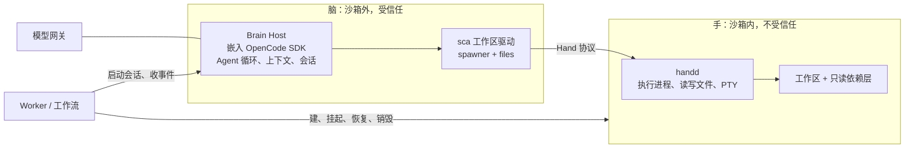

# 四期设计：脑手分离与大规模并行

> 2026-11-17。前三期把单个任务做“对”了，四期要把它做“多”：同样的机器跑更多任务，任务之间互不拖累，模型密钥彻底不进沙箱。本文先给出依据（今天测到的数据），再给设计，最后是分步计划和每步的退出条件。

## 1 为什么现在做

### 1.1 今天实测暴露的问题

| 现象 | 数据（2026-11-17，本机 2 核 3.7 GB） | 说明 |
| --- | --- | --- |
| 沙箱大部分时间空等模型 | OpenCode 评测任务中，Agent 工作时段里工具执行只占约 21%，其余约 80% 在等模型推理或流式返回 | 沙箱（CPU、内存、文件系统）和任务同生共死，模型思考时也被占着 |
| 准备开销比 Agent 工作还长 | 单题总耗时约 21 秒，Agent 工作约 9 秒，其余约 12 秒是建沙箱、setup、验证和隐藏验收 | 每个任务都从零开始 |
| 依赖按任务整份复制 | OpenCode 的依赖有 3 GB；一个修复任务的工作区 3.3 GB，一次编译再拷 3 GB；当天磁盘写满一次 | 没有共享的只读依赖层 |
| 模型密钥会进沙箱 | 现在是每轮签发一个临时 key 放进沙箱，由沙箱里的 Agent 直接调网关 | 风险已压到“有预算上限、一轮作废”，但沙箱仍能直接调模型，出口也必须开放到网关 |
| 并发全靠 Worker 进程 | 一个 Worker 内最多 8 个并发活动；评测默认串行 | 没有按租户的准入和公平调度，模型限流靠提供商报错 |

### 1.2 为什么可以做了

ADR-05 当时放弃“脑在外、手在内”，是因为现成的 Agent CLI 只能整体跑在沙箱里，要分离就得自研 Agent 循环。现在条件变了：

**OpenCode 2.3 原生支持“工具在别处执行”。** 它的所有文件读写和进程启动都经过 `Environment` 服务。`Environment` 由一个 `EnvironmentDriver` 提供，驱动只有两样东西：一个进程启动器（spawner），一组可选的文件操作覆盖。驱动来自可插拔的 `WorkspaceDriver`，接口是：

```ts
create({ workspaceID })              // 幂等：按 workspaceID 找到或创建后端资源，返回 binding
connect({ workspaceID, binding })    // 返回 EnvironmentDriver（spawner + files）
suspendForIdle({ workspaceID, binding })  // 空闲时挂起
destroy({ workspaceID, binding })    // 释放
```

SDK 的嵌入式宿主（`@opencode/sdk`，`EmbeddedHost.create({ workspaceProviders })`）允许注册自己的驱动，并且启动时会 `resumeSuspendedSessions`，即会话本身可以挂起和恢复。默认发行版没有附带任何远程驱动，这正是留给我们的扩展点。

所以脑手分离**不需要改 OpenCode，也不需要自研 Agent 循环**：在沙箱外运行一个嵌入 OpenCode 的“脑”进程，给它注册一个 `sca` 工作区驱动，把进程和文件操作转发进沙箱。

## 2 脑手分离

### 2.1 角色



| | 脑（Brain） | 手（Hand） |
| --- | --- | --- |
| 运行什么 | Agent 循环、模型调用、上下文管理、会话持久化 | 工具执行：命令、文件读写、搜索、PTY |
| 在哪 | 平台受信任的进程池，可多租户复用 | 每任务一个沙箱，gVisor/容器/Pod |
| 持有凭证 | 模型网关凭证（按任务签发） | **没有任何凭证** |
| 网络 | 能到网关 | 默认全部禁止；按任务开白名单（例如 PyPI） |
| 状态 | 会话（OpenCode 会话库 + 平台事件日志） | 工作区文件；可快照 |
| 死了怎么办 | 另一个脑从会话快照恢复 | 从最近的工作区快照重建，脑重放未完成的工具调用 |

### 2.2 Hand 协议

驱动需要的能力就是 OpenCode `EnvironmentDriver` 的能力。`exec-defaults.ts` 已经说明，文件操作可以全部用“启动进程”来实现（依赖目标环境有 GNU coreutils），所以最小协议只有一个 `exec`：

| 操作 | 说明 |
| --- | --- |
| `exec(argv, cwd, env, stdin) → stream(stdout, stderr, exit)` | 必需。带超时、输出上限、取消 |
| `files.read/write/stat/list/move` | 可选的快速路径；没有时退回 `exec` |
| `pty.open/resize/write/read` | 可选，交互式终端 |

传输分两档：

1. **第一步：`docker exec` / `kubectl exec` 直通。** 不往沙箱里放任何东西，驱动直接调平台已有的 `SandboxProvider.exec`。最快能跑起来，代价是每次调用一个 exec 会话（几十毫秒）。
2. **第二步：沙箱内的 `handd`。** 一个静态链接的小进程，通过一条长连接（unix socket 映射或 vsock）接收请求。省掉每次 exec 的开销，支持流式和 PTY。OpenCode 自带的 `process-daemon`（Rust，PTY 服务，带鉴权、所有权、交接协议）可以作为参考，甚至直接复用。

### 2.3 和平台现有部分怎么接

- `AgentBackend` 接口不变。新增 `opencode-brain` 后端：`run_turn` 不再在沙箱里启动 OpenCode，而是请脑池为任务开一个会话，并把 `workspaceID = task_id` 交给驱动。事件格式沿用现在 OpenCode JSON 事件的解析。
- 沙箱生命周期仍由工作流管（建、销毁），驱动只做连接。`suspendForIdle` 映射到 `SandboxProvider` 的暂停（Docker 用 `pause`/cgroup freeze；Kubernetes 先做“释放到快照”）。
- 验证、隐藏验收照旧在沙箱里由平台执行，与脑无关。
- Codex CLI 不支持远程执行，继续用“整体在沙箱内”的布局。两种布局并存，任务按后端选择。

### 2.4 收益与代价

| 收益 | 怎么体现 |
| --- | --- |
| 凭证彻底不进沙箱 | 沙箱里没有模型 key，出口可以全关；提示注入最多影响工作区 |
| 沙箱密度 | 等模型的约 80% 时间里沙箱可以冻结；同样内存能放更多沙箱 |
| 脑可横向扩 | 脑是 I/O 密集的，一个进程可以同时驱动大量会话 |
| 一个脑驱动多只手 | 同一会话分叉出 N 个沙箱做并行尝试（见 3.4） |
| 故障隔离 | 沙箱崩溃不丢会话；脑崩溃不丢工作区 |

| 代价 | 对策 |
| --- | --- |
| 每次工具调用多一跳 | `handd` 长连接；读文件走快速路径；对比测量 p50/p99 |
| 脑成为新的有状态组件 | 会话存平台库（OpenCode 支持自定义数据库路径）；脑池无亲和也能恢复，有亲和更快 |
| 依赖 OpenCode 内部接口 | 只依赖公开的 SDK 和 `WorkspaceDriver`；锁版本，升级时跑契约测试 |

## 3 大规模并行的关键技术

### 3.1 准入与公平调度

- **三层队列**：租户配额（并发、金额）→ 优先级（交互 > 评测 > 批量）→ 资源（沙箱、模型令牌）。拿不到资源的任务在 `QUEUED` 等待，不占沙箱。
- **加权公平**：同一优先级内按租户轮转，防止一个租户的批量评测占满。
- **反压**：模型网关或沙箱池告急时，准入层先停止放行新任务，而不是让已在跑的任务失败。

### 3.2 沙箱供给

- **预热池**按“到达率 × 准备时长”定容量，按镜像分池；B9 已有固定大小的 K8s 预热池，改为按负载伸缩。
- **镜像分层**：基础层（语言运行时）、依赖层（项目依赖）、工作区层（代码）。前两层在节点上预拉、只读共享。

### 3.3 写时复制的工作区和依赖

今天“每个任务拷 3 GB”的根治办法：

- **依赖层只读共享**：同一依赖指纹（例如 `bun.lock` 的哈希）对应节点上一份只读目录，以只读方式挂进沙箱。
- **工作区用 overlay**：下层是仓库镜像的检出（只读、跨任务共享），上层是任务自己的可写层。一个任务的磁盘占用 ≈ 它改动的文件。
- **快照就是上层**：检查点 = 冻结的上层 + Git 提交；恢复或换机器只需搬上层。

### 3.4 快照与分叉

- 一个任务准备好（克隆、装依赖、setup）后打一个快照，之后：
  - 评测的重复运行、Best-of-N 尝试，都从快照分叉，省掉准备的约 12 秒；
  - 子任务并行从同一个快照分叉。
- 实现由易到难：overlay 上层复制 → 文件系统快照（btrfs/ZFS） → 进程级（CRIU，Firecracker 快照）。前两种覆盖“文件状态”，已经够用。

### 3.5 模型网关在高并发下

- 按提供商、模型、租户三级令牌桶；超限排队，不直接报错；排队时间计入任务指标。
- **缓存亲和**：同一会话的请求固定到同一上游 key/区域，提高提示缓存命中（今天的数据里缓存命中的输入 token 占大头）。
- 重试带抖动，幂等键防重复计费；今天已修掉“网关闲置连接被重置导致首轮失败”的问题。

### 3.6 可观测在规模下

- 事件按任务分区写入；轨迹详情（工具输出全文）进对象存储，事件里只放摘要；
- 指标按“快 · 准 · 稳 · 省”四维汇总到运行和租户；
- 新增两类指标：沙箱活跃率（工具执行时间 / 沙箱存活时间）、准备开销占比，用来检验 3.3 和 3.4 的效果。

## 4 分步计划

每一步都必须在本机用真实 OpenCode 和模型跑通，并给出数据。

| 步 | 内容 | 退出条件 |
| --- | --- | --- |
| P4.1 | **脑手分离最小版**：Brain Host（Bun/Node 进程，嵌入 OpenCode SDK）+ `sca` 工作区驱动（经 `SandboxProvider.exec` 直通）+ `opencode-brain` 后端 | `opencode-demo` 评测在分离模式下结果与整体模式一致；沙箱环境变量和文件里找不到任何模型 key；沙箱出口全关时仍通过 |
| P4.1b | **常驻 brain 池**：每个 worker、版本复用一个 EmbeddedHost，经 Unix socket 并发驱动多个会话 | 假模型三容器并行且 PID 不变；key 按轮隔离；崩溃重启、取消、空闲退出有测试；量化 warm 开销及 RSS |
| P4.2 | **空闲挂起**：驱动的 `suspendForIdle` 接到沙箱暂停；模型调用期间冻结沙箱 | 记录每任务的沙箱活跃率；在同等内存下并发沙箱数提升，给出数字 |
| P4.3 | **只读依赖层 + overlay 工作区** | OpenCode 修复任务的工作区磁盘占用从 3.3 GB 降到 100 MB 以内；编译不再复制依赖 |
| P4.4 | **快照与分叉**：准备完成后打快照，评测重复和 Best-of-N 从快照分叉 | 评测单题平均耗时下降（目标：去掉大部分准备开销），结果不变 |
| P4.5 | **准入与网关限流**：租户配额、优先级、令牌桶、反压 | 用假模型做负载测试：几百个并发会话下无任务因限流失败，公平性有数据 |
| P4.6 | **handd**：沙箱内长连接执行守护进程 | 工具调用开销 p50/p99 相比直通下降，给出数字 |

P4.1–P4.3 解决今天实际碰到的问题，先做；P4.4–P4.6 在其后。每步完成后在本文末尾补“结果”，写清验证了什么、没验证什么。

## 5 P4.1 实现记录

### 接口调查与实现

已核对本机 `.data/opencode/src` 的 2.3.0 源码。`sdk/src/internal/host.ts` 的
`EmbeddedHost.create({ workspaceProviders })` 将驱动注册进工作区注册表；公开的
Effect SDK 同样支持该参数，Promise SDK 的公开创建参数则不支持它。
实现直接创建 EmbeddedHost，并用 `@opencode/client` 的 Promise 客户端连接其进程内 fetch，
没有监听 HTTP 端口，也没有自研 Agent 循环。

先调用 `host.workspace.create({ id: "wrk_sca_<task_id>", provider: "sca" })`，再用
`host.sessions.create({ location: Location.Ref.make({ directory: workdir, workspaceID }) })`
建会话。`wrk` 前缀是上游 ID schema 的要求，不能直接把平台 UUID 当 workspaceID。
`Environment` 看到 location 中的 workspaceID 后调用 Workspace.connect，后者按需 provision 并
调用驱动的 connect。create 仅绑定平台已经创建的容器；destroy 和 suspendForIdle 是空操作，
容器生命周期仍由平台负责，冻结留给 P4.2。恢复通过同一 session_dir 内的 SQLite 和 session_id。

非交互执行复用 `packages/cli/src/run/noninteractive.ts` 的 `runNonInteractivePrompt`：
先订阅事件、等待连接，再提交 prompt，自动批准权限、取消问题、等待后台任务结束。
它本身输出 CLI 的 JSON 行（step_start、tool_use、text、step_finish、error），因此 Python
直接复用 `parse_opencode_line`，保留用量和工具事件；text 增量在完成消息中拼接。
该函数通过 process.exitCode 报告失败，不能用它的返回值覆盖退出码。

Effect 4 的 ChildProcessSpawner 接收 StandardCommand 或 PipedCommand；其 handle 包含
stdin Sink、stdout/stderr/all Stream、exitCode Effect、isRunning、kill、unref 以及额外 fd。
这里保留原命令的流配置，将标准命令改写成 `docker exec -i -w <cwd> ... <container> <argv...>`，
管道两端递归改写，再交给 NodeChildProcessSpawner，从而复用 stdin 流、退出码和进程句柄。
`exec-defaults.ts` 用 sh + GNU coreutils/findutils 实现所有文件操作，无需覆盖 files；
BusyBox 镜像不满足要求。cwd 和文件绝对路径始终是容器路径（默认 `/workspace`），
不把它们映射成宿主机工作副本路径，宿主机只保存会话。

### 文件、配置与运行契约

- `deploy/opencode/brain/host.ts`：嵌入宿主；`driver.ts`：命令改写；`driver.test.ts`：假驱动契约测试。
- `launch.py <source> <bun> [JSON]`：在临时目录复制这几个小 TS 文件，把 sdk/core/cli 的依赖逐项链接进
  node_modules；退出即清理。原源码和依赖均只读，无安装、编译或 3 GB 依赖复制。
  不给 JSON 参数时从 stdin 读取。`--check-imports` 仅校验导入，`--test` 仅执行小型 Bun 单测。
- 输入字段：prompt、model、gateway_url（含 `/v1`）、container、workdir、session_dir（宿主路径）、
  task_id、可选 session_id、docker_prefix（`["docker"]` 或 `["sg", "docker", "-c"]`）。
  模型 key 仅由 brain 环境变量 `SCA_MODEL_KEY` 提供，不在输入 JSON 或 argv 中。
- 新后端 `opencode-brain` 已在 worker 注册；配置新增 `SCA_OPENCODE_BRAIN_BUN`、
  `SCA_OPENCODE_BRAIN_HOST`（指向 launch.py）、`SCA_OPENCODE_BRAIN_GATEWAY_URL`、
  `SCA_OPENCODE_BRAIN_DOCKER_PREFIX`（JSON 数组）。源码沿用 `SCA_OPENCODE_SRC_CACHE`，
  模型沿用 default_model。下方补齐后改为按 agent_version 导出源码。
  没有新 HTTP endpoint、数据库迁移或沙箱内安装。
- `sandbox_additions` 返回空 mounts/env；docker CLI 只继承 PATH，命令显式 env 过滤凭证变量，
  不继承 brain 的环境。启动时 inspect 容器网络，非 none 则拒绝执行。
  最初需要全局 `SCA_SANDBOX_NETWORK=none`；下方工程师 I 补齐后改为后端独立网络配置。
  网关使用 worker 可访问的 URL；临时 key 的签发与吊销继续复用平台逻辑。
- `scripts/brain_smoke.sh` 使用唯一名称创建 network=none 容器、验证文件并清理；需预先设置
  `SCA_MODEL_KEY`（临时网关 key）、`SCA_BRAIN_GATEWAY_URL`、`SCA_BRAIN_MODEL`，可选
  `SCA_BRAIN_IMAGE`。用 `timeout 900 bash scripts/brain_smoke.sh` 运行，不输出 key。

### 验证结果与阻塞

已运行：指定基线（附加独立 basetemp 避开 /tmp 目录所有权冲突）最终复跑 347 passed、1 skipped（91.71 秒）；
新 Python 单测（含错误、缺失完成事件与超时清理）最终运行 6 passed；小型 Bun 驱动测试 2 passed；SDK/CLI 导入检查通过；
`timeout 30 .venv/bin/ruff check src tests` 通过。首次 pytest 因默认临时目录归属错误未运行测试；
首次将同名 unit/integration 文件一起收集时发生模块名冲突，随后分别运行成功。
联合收集这两个文件加 `--import-mode=importlib` 后最终结果 6 passed、1 skipped；
不在本任务范围内修改 pytest 配置。

Docker 集成测试已写，需 `SCA_TEST_BRAIN_DOCKER=1`，标记 docker；默认运行结果为 1 skipped，
且项目尚未注册 docker 标记，需负责人在 pytest 配置中补登记。测试在宿主机启动脚本化
OpenAI-compatible SSE 模型服务，返回 shell/execute 调用，检查容器中的文件、环境和网络模式。
本工程师不能使用 Docker，未运行真实容器、真实网关 smoke 或 opencode-demo 评测，
因此 **P4.1 退出条件尚未完成**，不声称分离模式已达到整体模式的结果一致性。

### P4.1 补齐（工程师 I）

版本不再拒绝：未指定时使用 `SCA_OPENCODE_DEFAULT_VERSION`。读取
`SCA_OPENCODE_VERSIONS_DIR/<V>/meta.json` 的 commit（40 位十六进制）与 source_repo；
source_repo 必须与 `SCA_OPENCODE_REPO_URL` 一致。仅在该可信裸镜像上执行 git archive，
不在沙箱工作副本运行宿主 Git。导出到 `data_dir/opencode/brain-src/<V>/`，
全局 flock 串行、临时目录原子 rename、`.sca-commit` 校验后复用。每次取版本时顺便删除
已无 meta.json 的版本源码。第三方 node_modules 仅符号链接缓存，不安装、编译或复制依赖；
各层 `@opencode/*` 根据所选源码 package.json 重建链接，避免落回上游源码。
缓存由可信 worker 只读使用（符号链接本身不是操作系统写保护）。

brain 后端声明 `sandbox_network = "none"`，内核的任务及 acceptance 两处创建均优先使用
后端属性；其余后端保留全局网络配置。验证命令与验收命令也无网络，因此命令依赖必须预装。
无需全局设置 SCA_SANDBOX_NETWORK=none。宿主 URL 仅使用
`SCA_OPENCODE_BRAIN_GATEWAY_URL`，缺省从 `SCA_MODEL_GATEWAY_URL` 去尾斜线后加 `/v1`；
绝不回退到 ctx.model_base_url 的容器视角地址。

`POST /v1/evals/runs` 原有 variant 字符串契约已接受 `agent_backend: "opencode-brain"`；
`GET /v1/portal/config` 的 agent_backends 新增该值。无新 endpoint 或迁移。
事件继续复用原 mapper 的 started_at_ms、ended_at_ms、duration_ms、model_call_duration_ms；
完成前额外发出一条 agent.usage，`summary = "brain_turn"`，包含 brain_wall_time_ms、
total_model_call_ms（各模型步骤合计）、total_tool_ms（工具事件耗时合计）。
工具并行时合计可大于墙钟时间；模型耗时是 mapper 的首工具开始前估算，不是网关遥测。

输入新增 turn_marker（每轮随机标识，无凭证）。每个 docker exec 显式设置
SCA_BRAIN_TURN，brain 结束、超时或取消时杀宿主进程组，并执行独立清理命令扫描容器
/proc/*/environ，杀掉继承该标识的进程。清理最多等待 10 秒；真实容器取消回收仍需负责人复验。

新增验证：Python 单测 9 passed，Docker 集成默认 1 skipped；Bun 驱动测试 3 passed。
最初默认临时目录所有权错误导致基线 223 passed、1 skipped、124 errors，已使用独立
basetemp 重跑，结果为 350 passed、1 skipped（121.64 秒）。未运行 Docker、真实网关、OpenCode 构建或完整评测。
负责人需在当前版本 meta 对应可信镜像存在的环境重跑集成测试和 opencode-demo 新旧版本评测，
确认植入缺陷与修复版本各自被执行，再验证真实容器取消后没有遗留进程。
因此 P4.1 的评测一致性退出条件仍需现场验证。

### P4.1 现场验证结果（负责人，2026-11-17）

| 检查 | 结果 |
| --- | --- |
| Docker 集成测试（假模型，`--network=none` 容器） | 通过 |
| `scripts/brain_smoke.sh`，真实网关 + deepseek-flash | 6 秒内由沙箱外的 OpenCode 循环发起 shell 调用，在无网络容器里写出文件；输出中没有任何 key |
| 首次平台评测 | 6 题全部失败：版本源码的 `@opencode/*` 作用域只链接了工作区包，丢了发布到 npm 的 `@opencode/pty`。已修复（第三方 `@opencode/*` 包仍从缓存只读链接），并把 brain 的 stderr 尾部带进错误信息，避免再次“无声失败” |
| 评测一致性 | `2.3.0-sca.1`（含植入缺陷）：5/6，失败的正是 chinese-greeting，与整体模式一致；`2.3.0-sca.4`（修复版）：6/6 |
| 沙箱无网络、无 key | 后端强制 `network=none`；沙箱不加任何环境变量和挂载；模型 key 只在沙箱外的 brain 进程环境中 |
| 全量测试 | 518 passed，24 skipped |

**P4.1 的三个退出条件都已满足。**

新的观察（进入后续步骤）：

- 6 题合计 brain 墙钟 85 秒，其中模型调用约 11–15%、工具约 25%，剩下约 60% 是每轮新起 Bun 进程、加载 OpenCode 源码和会话初始化的开销。把 brain 从“每轮一个进程”改为**常驻的 brain 池**（一个进程驱动多个会话）是下一步收益最大的事，放在 P4.2 之前做（记为 P4.1b）。
- 模型耗时目前由事件时间推算，不是网关侧遥测；P4.5 接入网关后改为以网关数据为准。
- 取消时容器内子进程的回收逻辑已实现，但还没有真实容器的取消测试。

### P4.1b 常驻 brain 池（工程师 J，2026-11-17）

实现与契约：

- `deploy/opencode/brain/server.ts`：一个 Bun 进程只创建一次 EmbeddedHost；
  `driver.ts` 仍负责 docker exec 改写，每次 spawn 按 workspace 查当前 turn，取消后禁止新 spawn。
  不监听 TCP。`launch.py <source> <bun> --server <directory> <generation>` 链接原有依赖，
  用继承给 Bun 的 flock 防止同一 worker/version 同时启动两个宿主；不安装、构建或复制 node_modules。
- Unix socket 为 `data_dir/opencode/brain-run/<version>/<worker_id>/brain.sock`；
  同目录为 0700，保存 `brain.sqlite` 及 SQLite 辅助文件、`server.lock`。
  使用稳定 worker_id 保存数据库，进程重启及空闲退出后可以恢复 session_id。
  Linux 客户端通过打开目录后的 `/proc/self/fd/<fd>/brain.sock` 连接，服务端以 cwd 相对路径监听，
  避开 Unix socket 108 字节路径限制。
- 协议是 NDJSON。turn 请求字段为 `op:"turn"`、id、prompt、model、gateway_url、container、
  workdir、task_id、session_id（可选）、turn_marker、docker_prefix、model_key。
  返回原 CLI JSON 事件并增加 id，最后为 `{id,done:true,exit_code}`；
  `{op:"cancel",id}` 只取消该连接拥有的请求；断开连接也取消其请求。
  `{op:"ping",id}` 返回 `{id,pong:true,pid,rss,generation}`，RSS 单位为字节。
  无新增 HTTP endpoint 或数据库迁移。客户端校验请求 id、done 和退出码。
- `src/sca/agents/opencode_brain.py` 的 BrainPool 按版本延迟启动、每轮健康检查（2 秒）、
  启动等待最多 90 秒、崩溃后下一请求重启；不自动重放可能产生副作用的失败轮次。
  信号/超时先发 cancel，再按已有 turn_marker 清理容器进程。worker 的 finally、SIGTERM 和
  asyncio 的 SIGINT 路径关闭池；停止 launcher 时同时清理整个进程组。
  成功轮继续输出 `summary:"brain_turn"` 的 usage，新增 `pool:"cold"|"warm"`，
  原事件 mapper、模型/工具耗时和完成检查保留。
- 新配置：`SCA_OPENCODE_BRAIN_POOL=true`；设 false 回退原每轮进程模式；
  `SCA_OPENCODE_BRAIN_POOL_CONCURRENCY=3`（1–32）；
  `SCA_OPENCODE_BRAIN_POOL_IDLE_MINUTES=10`（正数）；
  `SCA_OPENCODE_BRAIN_POOL_WORKER_ID=local`（1–48 位英文字母、数字、下划线、短横线）。
  同一 data_dir 的多个 worker 必须设置不同且稳定的 worker_id。不要在未排空旧任务时切换模式：
  原每任务 session_dir 的 SQLite 与新共享库不自动迁移。跨 worker/session 库迁移尚未实现，
  因此本机池会话需要 worker 亲和；固定 worker_id 的重启恢复已测试。

凭证与会话选择：

核对本机 2.3.0 的 `sdk/src/internal/instances.ts`、插件 provider.transform 以及
`ai/src/route/auth.ts` 后，采用一个宿主加 instance-scoped provider，而不是每 key 一个宿主。
`instances.key` 为 workspace/model/gateway 组合，插件只注册无密钥的 provider settings。
`turn-provider.ts` 导出自定义 provider，其 `Auth.effect` 在每次模型 HTTP 请求时按 workspace
查 active-turn map 的 key；轮结束、取消立即删除。缓存模型只保留 workspace 标识；新轮可换 key。
同一 task 的重叠请求被拒绝，其他 task 并发。全局环境和配置均不写 key，key 只经 0700 目录内
socket 传输。宿主 stdout 仅在 upstream renderer 的 AsyncLocalStorage 上下文中转发并按请求标 id；
请求的 key 在出站事件再次脱敏，其他 stdout/stderr 丢弃，不落诊断文件。
Python mapper 也脱敏，包括旧模式。旧模式依然只通过子进程环境提供 key。

每版本、worker 共用一个 SQLite，workspace 为 `wrk_sca_<task_id>`；session 恢复时校验 workspace。
池模式不再把 SQLite 放在每任务 agent_home；该目录只保留兼容接口语义。
因此也没有实现把整个共享库当作单个任务会话归档的能力；后续多 worker 应接入会话导出/导入。
OpenCode instance 缓存仍由上游持有，已量 RSS，但没有做大量会话的长时间内存稳定性测试。

实测（真实 Bun/OpenCode SDK，假模型和空响应 fake hand；不是 Docker 隔离验证）：

| 项目 | 结果 |
| --- | --- |
| `scripts/brain_bench.py --turns 6 --fake-hand --source .data/opencode/src` | 每轮进程 overhead p50=2446.5 ms、p95=2705 ms；池含冷启动 p50=333.5 ms、p95=2325 ms；5 个 warm 轮 p50=332 ms、p95=356 ms |
| RSS | 仅启动约 174 MiB；6 轮后 396402688 字节（约 378 MiB）；三轮并发探针 358850560 字节（约 342 MiB） |
| 真实 SDK 的并发/恢复探针 | 三任务并发各自使用不同 key、结果和 session；同一 PID；同 session 换 key；关闭池再用相同 worker_id 重启后 session 恢复；重复宿主启动被锁拒绝且原 PID 保持；SQLite 和生成文件无 key，最终 1 passed（6.98 秒） |
| Python 单测 | 原 9 项加协议/生命周期等 7 项，16 passed（2.46 秒）；覆盖 warm/cold、崩溃重启、空闲退出、并发上限、超时 cancel、turn_marker 清理、坏协议及文件/argv 不含 key |
| 指定基线 | 最终 357 passed、1 skipped（82.73 秒）；先前复跑为 357 passed、1 skipped（79.43 秒） |
| Ruff | `timeout 30 .venv/bin/ruff check src tests` 与单独检查 `scripts/brain_bench.py` 均为 All checks passed |
| 小型 Bun driver 单测 | 3 passed、0 failed（163 ms）；未运行 OpenCode 全套测试 |

最终基线命令（只加独立 basetemp，避免已有 /tmp 目录的归属冲突）：

```bash
timeout 900 .venv/bin/pytest tests/unit tests/integration/test_store.py tests/integration/test_api.py tests/integration/test_workflow.py -q -p no:cacheprovider --basetemp=/tmp/j-brain-verified
```

overhead 定义为 brain_wall_time_ms 减 mapper 估算的模型和工具耗时，下限为零；
并行工具耗时不宜这样相减。基准使用无工具的假模型，每轮新建会话，warm 统计排除第一轮。
这不是生产网关遥测，也不能据此声称真实评测已有同样幅度的收益。

负责人仍需运行（本工程师遵守任务限制，完全未使用 Docker）：

```bash
timeout 300 sg docker -c 'env SCA_TEST_BRAIN_DOCKER=1 .venv/bin/pytest tests/integration/test_opencode_brain_docker.py -q -p no:cacheprovider'
timeout 900 sg docker -c '.venv/bin/python scripts/brain_bench.py --turns 6 --version 2.3.0-sca.1'
```

Docker 用例创建唯一名称的三个 network=none 容器、并发三轮假模型调用，校验各容器独立内容、
三个不同 key 和同一个服务端 PID，finally 移除容器。该测试默认跳过；需要负责人实跑。
还需以 pool 模式复跑 opencode-demo 的两个版本、真实容器取消回收、真实网关基准，
以及持续会话负载下的 RSS。不能把 fake hand 探针视为这些退出条件已完成。
真实 SDK 无 Docker 探针可用
`timeout 150 env SCA_TEST_BRAIN_HOST=1 .venv/bin/pytest tests/integration/test_opencode_brain_host.py -q -s -p no:cacheprovider`。

集成建议：worker 的 backend factory 当前仍依赖 backend 内的 get_settings；正常环境配置生效，
但若负责人要求传入的 Settings/model_copy 覆盖池配置，应给 factory 的 OpenCodeBrainBackend 调用
补 `settings=settings`。本任务限定 worker.py 只改关闭 hook，因此未改 factory。

### P4.1b 现场验证结果（负责人，2026-11-17）

已补 factory 的 `settings=settings`。

| 检查 | 结果 |
| --- | --- |
| Docker 集成测试：3 个 `--network=none` 容器并发、同一服务端 | 通过（3 个容器各得各的文件、3 个不同 key、同一 PID） |
| 真实 SDK 探针 | 通过 |
| `brain_bench.py --version 2.3.0-sca.1`（真实 OpenCode 源码 + 真实容器，假模型） | 每轮额外开销：每轮新进程 p50 2612 ms → 常驻池 warm p50 357 ms、p95 408 ms；冷启动一次 2742 ms；服务端 RSS 约 374 MiB |
| 真实模型评测，池模式，并发 3 | `2.3.0-sca.1` 5/6，失败题仍是 chinese-greeting；全程只有 1 个服务端进程；6 轮里 1 冷 5 热 |
| 真实模型评测，池模式，并发 1 | 6/6：chinese-greeting 这次也通过了。轨迹显示模型发现“edit/write 工具会丢中文”，改用 `git checkout` + `sed` 绕开，并写了一条记忆提议。缺陷仍在（版本正确），只是被 Agent 绕过；该题耗时 39 秒，是其余题的 2 倍，泳道和耗时异常规则都能看出来 |
| 每题耗时（除中文题外 5 题均值） | 每轮进程模式约 24.1 秒 → 池模式约 20.1 秒 |
| 全量测试 | 525 passed，25 skipped |

结论：常驻池把每轮约 2.3 秒的进程启动开销去掉了，结果不变。

两点观察：

- 评测验收只看最终文件，Agent 绕开缺陷也算通过。要让评测稳定暴露被测 Agent 自身的工具缺陷，需要再加一条“过程”检查：例如把“工具结果与预期不符”“同一文件被反复改写”作为证据规则，或在验收中检查轨迹（文件修改事件的内容是否被工具篡改）。已记入后续。
- 并发 3 时，2 核机器上三个沙箱互相抢 CPU，工具耗时占比从 25% 升到 37%。这正是 P4.2（模型思考时冻结沙箱、按真实活跃度调度）要解决的。

## 6 不做的事

- 不自研 Agent 循环。脑就是 OpenCode 本身；我们只提供手和编排。
- 不做跨地域调度、GPU 调度。
- 不在本阶段替换 Temporal 或 Postgres。规模瓶颈先测出来再说。

### P4.3 实现记录（工程师 M，2026-11-17；未满足退出条件）

新增 `workspace/layers.py`：基础层按租户、规范化仓库 URL、commit 的 SHA-256 标识。
任务镜像来自 RepoCache（或原有直接镜像路径）；只在可信镜像及新建 checkout 上运行宿主 Git。
首次 checkout 在临时目录构建，rename 发布；永久 flock 文件串行创建、引用更新与回收。
基础层文件和目录去掉写权限，不挂入任务；任务得到独立 inode 的 `cp -a --reflink=auto` 副本，
再恢复副本所有者写权限。没有使用 `cp -al`：任意 shell、编辑器、编译器都可能直接原地写，
平台无法拦截每次写入并先断开硬链接；仅靠 Git 或应用层的 break-on-write 会破坏其他任务及基础层。
Git 对象也独立，任务不依赖可被 RepoCache 淘汰的 alternates；因此现有 sync/K8s 路径保持原样。

配置与布局：

- `SCA_WORKSPACE_LAYERS=false`，显式开启仅作用于 Docker + mount transport。默认关闭是因为
  本机回退会额外保留一份完整基础层，不能把它当成已经完成的磁盘优化上线。
- `SCA_LAYER_RETENTION_HOURS=24`，非负；现有 `prune_repo_cache` maintenance 活动也回收层，
  日志 `Workspace layer bytes: <整数>` 是回收后基础层的 du 分配字节合计。
- `data_dir/layers/<key>/` 是只读 checkout（含独立 `.git`）；`locks/<key>.lock` 永久保留；
  `<key>.refs/<owner-hash>` 是持久引用。引用与任务 `workspace.layer` 标记配对，重复准备相同路径
  不会使旧层永久被引用；丢失引用第一次被观察到时开始保留期。
- `tasks/<id>/workspace` 是完整可写副本；`layer-source.json` 仅保存仓库 URL 哈希及租户，
  不保存 URL 凭证。缺少该元数据（例如跨机恢复）走原有 clone；检查点仍是 Git bundle + agent home，
  没有实现 overlay 上层快照或 P4.4 分叉。
- 普通 `coding.prepare_workspace` 的 `workspace.prepared` payload 和 task result 新增
  `workspace_bytes`（`du -s -B1`）及 `workspace_method`（`reflink-auto` 或 `clone`）。
  `reflink-auto` 指 cp 参数，并不保证文件系统确实共享块；du 在 reflink 文件系统上也会计入共享块，
  不能把它误称为独占物理块。镜像预备/合并工作区的指标尚未补齐。
- 构建使用 `git clone --shared`，本地 OpenCode 裸仓库以相同绝对路径只读挂进构建容器，
  使 alternates 在容器内有效；已有依赖继续按 node_modules 目录只读挂载，不安装或复制。
  构建期间可信裸仓库必须存在且不得运行破坏性的对象清理。远程 URL clone 不获得本地 alternates 收益。
  无新 HTTP endpoint、迁移或 Portal 修改。

本机能力和实测：用户命名空间内 kernel overlay mount 探针成功；但该 mount 只在私有 namespace，
不直接出现在宿主 Docker daemon 的 mount namespace。没有实现保持 namespace 的 helper 或传播挂载；
不能声称已支持 overlay。`fuse-overlayfs` 与 `/dev/fuse` 均不存在，reflink 强制探针失败。
因此本次实现的是安全的复制回退，**不是完整的 P4.3**。没有 sudo、Docker 或服务启停。

运行 `timeout 300 .venv/bin/python scripts/workspace_bench.py -n 2`，真实
`.data/opencode/opencode.git`，逐个删除任务，完成后删除整个临时目录：

| 方法 | 第一次/第二次秒数 | 每任务 workspace / 整个 task 字节 |
| --- | --- | --- |
| 原 clone | 8.045 / 5.533 | 263430144 / 337960960（第二次各少一个 4096 字节块） |
| 新层 + cp reflink auto（本机实际普通复制） | 9.883 / 2.418 | 263426048 / 337956864（第二次各多一个 4096 字节块） |
| 共享基础层 | — | 263413760 |

基准与测试曾并行，耗时仅作本次观测；不是隔离性能保证。脚本支持 `--repo`、`--ref`、`-n 1..10`，
打印 JSON 行，检测 reflink 和 fuse，在原裸仓库所在文件系统创建临时数据，不修改原仓库。

负责人仍需：提供宿主可见的非特权 overlay/FUSE 方案或支持 reflink 的存储，再实现并验证自动选择、
upper/work 生命周期与近零占用；补 Portal run summary 对 `workspace_bytes` 的展示（本任务禁止改 Portal），
补合并/恢复路径指标；用 Docker 实跑构建的 alternates 只读挂载、已有依赖挂载、两个 fix 任务的
commit/diff/push，以及新旧版本评测。真实构建、真实模型和完整 e2e 未运行，不声称退出条件通过。

本次自动化验证（真实运行结果）：

- `timeout 120 .venv/bin/pytest tests/unit/test_layers.py tests/integration/test_workspace.py tests/integration/test_workspace_transport.py tests/integration/test_workspace_layers.py tests/integration/test_workspace_cache.py -q -p no:cacheprovider --basetemp=/tmp/m-layer-focused3`：18 passed，36.84 秒。
- 最终原子发布权限调整后，`timeout 30 .venv/bin/pytest tests/unit/test_layers.py tests/unit/test_layers_build.py tests/integration/test_workspace_layers.py -q -p no:cacheprovider --basetemp=/tmp/m-layer-publication`：4 passed，0.76 秒。构建用例实际运行 Git，Docker 构建由 fake runner 替代，检查 alternates 和只读挂载参数。
- `timeout 900 .venv/bin/pytest tests/unit tests/integration/test_store.py tests/integration/test_api.py tests/integration/test_workflow.py -q -p no:cacheprovider --basetemp=/tmp/m-layer-finalbaseline`：385 passed、1 skipped，88.59 秒。较早基线为 384 passed、1 skipped，106.65 秒。
- `timeout 30 .venv/bin/ruff check src tests scripts/workspace_bench.py`：All checks passed。
- 最终重跑同一基准：旧方法 3.782 / 4.059 秒，新方法 8.741 / 3.010 秒；四个工作区各 263430144 字节，新方法 task 各 337965056 字节，基础层 263413760 字节。
  新增能力探针报告 private_namespace_overlay=true、host_visible_overlay=false、reflink=false、fuse_overlayfs=null、dev_fuse=false。

最初测试曾暴露只读目录 rename/删除权限问题；已调整为发布前保护内容、锁内短暂恢复顶层目录写权限后 rename，
并在失败清理时恢复权限。重跑结果如上。所有本次测试/基准临时目录已清理，原 OpenCode 裸仓库未改动。

### P4.3 Docker overlay 补充（工程师 N，2026-11-17；待现场验收）

新增开关 `SCA_WORKSPACE_OVERLAY=false`。开启只作用于 Docker + mount transport，
不依赖 `SCA_WORKSPACE_LAYERS`；关闭时新任务沿用原路径，已有 overlay 标记的本机任务继续使用原卷。
没有新增 HTTP endpoint、数据库迁移、Portal 或评测代码改动。

布局与执行契约：

- `layers/<key>/` 是按租户、仓库身份和 commit 隔离的共享基础 checkout（含独立 `.git`）。
  overlay 的 key 与 M 的复制层分开；overlay 下层保留正常 Unix 写权限，因为去掉写位会令
  同 UID 的 Agent 无法修改合并视图。其不可变性由只作为 overlay lowerdir 使用保证，
  不将该目录直接暴露给 Agent，也不对基础层运行任务命令。
- `tasks/<id>/overlay/{upper,work}` 是增量与工作目录；`workspace.overlay` 保存卷与下层路径，
  `overlay.layer` 与 `<key>.refs/` 配合固定下层。卷名 `sca-ws-<id>`，Docker local driver，
  `type=overlay,device=overlay`，挂载选项包含 lowerdir/upperdir/workdir、`userxattr`，并关闭
  redirect_dir/index/metacopy，避免快照依赖隐藏的重定向或元数据复制。
- 沙箱将卷挂到 `/workspace`。宿主的 `tasks/<id>/workspace` **不是合并工作副本**，只作为
  平台 `.sca` 上下文目录；其 `.sca` 单独 bind 到 `/workspace/.sca`。这样记忆和上下文写入不会
  在卷挂载时直接改 upper（内核不保证这种修改的可见性）。Git helper 不需要这个已排除的上下文挂载。
- checkpoint 的 commit 在可信短命 helper 中执行，使用与沙箱相同 UID/GID、无网络、只读根文件系统、
  无额外 capabilities、256 MiB 内存和 1 CPU。helper 只挂任务卷，bundle 经 stdout base64 返回，
  宿主在自己创建的 mirror 导入后生成 binary diff/patch，并带宿主凭证 push。
  helper 不挂凭证或宿主 mirror；超时/失败后按唯一容器名清理。
- 任务结束删除卷，idle release 保留卷；保留期内 upper 留存。maintenance 删除终态/孤儿卷，
  通过原有持久快照校验后删除 upper/work；Docker 的 root-owned work 目录由独立无网络清理 helper
  删除。只有该清理 helper 使用 root 和 DAC_OVERRIDE/FOWNER，仅挂载该任务 overlay 目录。
  下层引用至少保留到 upper 清理；任务目录意外丢失时保守保留引用，孤儿卷回收再释放。
- durable state 增加有 SHA-256 的 `overlay.json` blob（仍采用 manifest-last）：保存 upper tar、原始
  lower commit/仓库身份、白化删除记录、opaque 属性，以及独立平台上下文目录；与原 mirror bundle
  和 agent home 一起发布。恢复先释放沙箱，再通过合并视图重建白化记录，卸载卷后用 data-filter
  解包普通文件并恢复 `user.overlay.opaque` 原值，随后重新创建卷。特殊设备（白化节点除外）拒绝归档。
- `workspace.prepared` 和 task result 保留 `workspace_method`，另加 `method:"overlay"`；
  `workspace_bytes` 为 `du -s -B1 upper`，不包含共享下层、宿主 mirror 或平台上下文。
  setup 成功后追加同类型事件，`phase:"after_setup"`、去重键 `workspace.prepared.after_setup`，
  同时刷新 result，避免把准备时的占用误当作 setup 后占用。

验证与限制：本工程师遵守本任务的禁止 Docker 约束，没有执行 Docker、sudo、服务启停、
OpenCode 安装/编译、真实模型评测或完整 e2e。因此**没有 overlay N=5 的实测字节/秒数**，
也不能宣称 P4.3 的退出条件已经满足。新增测试通过 fake 验证 helper 参数、卷选项、命名卷挂载、
下层无复制与引用保留、opaque 属性、上下文与普通文件快照恢复、坏路径拒绝和失败清理。
Docker 标记的集成测试由 `SCA_TEST_OVERLAY=1` 开启，覆盖双任务共享下层/修改隔离、上层初始占用、
helper commit/bundle/diff、向本地 bare repo 推送、忽略文件和删除记录恢复、卷与上层回收。
初始上层已有 Git branch/index/exclude 元数据，测试上限 1 MiB（小仓库），不是严格零字节。

负责人必须现场运行：

```bash
timeout 300 sg docker -c 'env SCA_TEST_OVERLAY=1 .venv/bin/pytest tests/integration/test_overlay_workspace.py -q -p no:cacheprovider --basetemp=/tmp/n-overlay-live'
timeout 900 sg docker -c '.venv/bin/python scripts/workspace_bench.py --repo .data/opencode/opencode.git --overlay -n 5'
```

基准按 old/new/overlay 输出每任务 seconds、workspace_bytes、task_bytes 和共享 layer_bytes；
每个任务及时清理，方法之间移除基础层，卷名带随机临时目录前缀，避免多个基准互相占用。
需在上述命令后核对无遗留卷/容器，再以 overlay 开关运行真实 opencode-demo 评测和 fix 任务，
检查 patch、push、idle release/resume、重试恢复、取消与保留期回收，并补上 N=5 数值。
尤其需要验证本机 Docker local driver 接受 `userxattr` 及上述关闭选项、gVisor 命名卷兼容性、
真实删除/opaque 目录恢复和大仓库 helper 的内存上限。

需要集成负责人处理的范围外契约：`Mount.source` 注释目前仍说“宿主绝对路径”，需允许本次的
受限命名卷形式（无需字段或迁移）；`compile_intents` 对仓库相对路径的源文件仍使用宿主 workspace
读取，而 overlay 的宿主目录仅有平台上下文。启用 overlay 的此类任务需要改成经 helper 读取指定源，
或先导出受限的输入文件；本任务只允许改 kernel 的 workspace prepare/commit/cleanup 路径，未修改
intent 编译路径。不要把带仓库路径 intent 的 overlay 任务视为已支持。

自动化验证记录（不把 fake 当作 Docker 验证）：

- `timeout 30 .venv/bin/pytest tests/unit/test_overlay.py tests/integration/test_overlay_workspace.py tests/integration/test_workspace_layers.py tests/integration/test_workspace_transport.py -q -p no:cacheprovider --basetemp=/tmp/n-overlay-recovery`：17 passed、1 skipped，2.16 秒；跳过项为显式 opt-in 的 Docker overlay 集成测试。
- 指定基线曾通过 397 passed、1 skipped（81.82 秒）；最终交付基线结果见下方。
- `timeout 30 .venv/bin/ruff check src tests scripts/workspace_bench.py`：All checks passed。
- `timeout 20 .venv/bin/python scripts/workspace_bench.py --help`：正常显示 `--overlay` 参数；没有执行需 Docker 的基准。
- 中间测试曾发现下层 key 的命名空间分隔符进入路径规范化，以及内嵌清理/白化脚本的换行引用错误；均已修复，新增编译检查和 fake 快照恢复回归。没有隐去这些失败或将其计为通过。

最终交付基线（所有代码修正后）：
`timeout 900 .venv/bin/pytest tests/unit tests/integration/test_store.py tests/integration/test_api.py tests/integration/test_workflow.py -q -p no:cacheprovider --basetemp=/tmp/n-overlay-finalstate-baseline`
为 **397 passed、1 skipped，81.44 秒**。最终 Ruff 同样通过。测试临时目录随后恢复写权限并删除；
本次没有创建真实 Docker 卷或容器，也没有修改原 OpenCode 裸仓库。

### P4.3 现场验证结果（负责人，2026-11-18）

在主实例上打开 `SCA_WORKSPACE_OVERLAY=true`，用 Portal 走完整闭环（基线 → 诊断 → 修复 → 构建 → 重跑）。

| 环节 | 结果 |
|---|---|
| 基线 867435e6（2.3.0-sca.1） | 5/6。chinese-greeting 的验收通过，但轨迹检查不通过：agent 绕开了坏掉的写文件工具，K 的规则把它判为失败 |
| 修复任务 ae7a9c21 | overlay 工作区，约 2 分钟完成，进入 AWAITING_REVIEW |
| 构建 4969d9bf | 2.3.0-sca.6，成功 |
| 重跑 20fd5709（sca.6） | 6/6，总通过率 83% → 100%，结论卡“建议采纳” |
| 工作区占用 | 评测任务每个 86 KB（overlay 上层），方法字段为 `overlay` |

走查中发现并修复了三个问题：

1. **overlay 下修复沙箱没有依赖挂载（根因不在 overlay）。** `create_sandbox` 由内核的
   `KernelActivities` 实例执行，它调用的是自己的 `_backend()`，拿不到 coding 场景在
   `CodingActivities._backend()` 里加的 `DependencyBackend` 包装，所以 node_modules 只读挂载被整个丢掉。
   第一次 overlay 走查中，agent 因此找不到 `effect` 包，花了 20 多分钟去外网找依赖。
   修复：`_create_sandbox` 通过 `self.scenarios[task.kind]` 取场景自己的 backend
   （沙箱附加挂载和 network 都从它来）。回归测试是 `tests/unit/test_opencode.py::test_kernel_sandbox_uses_the_kinds_backend`，
   去掉修复后这个测试失败。
2. **出口白名单被域前置绕过。** 同一次走查中，agent 从白名单外的 cache.nixos.org 下载了内容，
   见下一节。
3. **Portal 的“构建”可能误构建 main。** 闭环的三个按钮默认是可点状态；页面刷新后、
   `recoverFlow` 还没加载完时点“构建”，会发出 `task_id: undefined`，API 回退为构建 main
   （这次误产出了 2.3.0-sca.5，内容就是 main，没有修复）。修复：按钮默认 `disabled`，
   由 `updateFlow` 按状态打开；批准和构建在没有 `flow.fixTask` 时直接报错。

`SCA_WORKSPACE_OVERLAY` 仍然默认关闭。原因：它依赖 Docker 驱动、mount 状态传输和宿主允许
`docker volume create --opt type=overlay`；另外 `overlay.py` 里写死了 `docker`，还没有改用
`settings.docker_bin`。需要时在 `.data/portal.env` 里加 `export SCA_WORKSPACE_OVERLAY=true`。

## 安全修复：出口白名单被域前置绕过

2026-11-18，工程师 O：原代理仅检查 CONNECT 的 dstdomain，攻击者可在允许的
CONNECT 内发送其他 SNI 或 HTTP Host，借共享 CDN 取得白名单外内容。
选择方案 A：Ubuntu 24.04 的 squid-openssl 二进制包，不编译 Squid。方案 B 的可信包索引
只能覆盖 pip，会改变现有模型服务、Git、Node 等域名白名单语义，因此本次不采用。

执行顺序：CONNECT/HTTP 请求先拒绝 IP 字面量、非法端口和私有目的地址，再按原白名单放行；
域名 ACL 使用 `dstdomain -n`，禁止通过反向 DNS 把 IP 请求变成允许的域名。
TLS 在 step1 peek，只读取 ClientHello；step2 必须有原始 SNI 且该 SNI 命中同一白名单，
随后 bump，没有 splice 分支。解密后每个 HTTP 请求重新执行 http_access，
`host_verify_strict on` 拒绝 URL/Host 不一致；上游证书验证错误一律拒绝。
不记录访问日志或缓存日志，避免请求 URL 中的凭证进入日志。

不能只用 `ssl::server_name --client-requested` 强制 SNI：官方文档说明缺少 SNI 时它会回退
到 CONNECT URI。因此额外通过 `%ssl::>sni` 和小型 external ACL helper 检查原始 SNI；
helper 拒绝缺失、IP 和不合法名称，只做元数据判断，不承担代理或 TLS 实现。
helper 最多两个子进程，缓存最多 256 项；签证书 helper 最多两个子进程、证书缓存 4 MiB。
Docker 代理限制 256 MiB、0.5 CPU、64 PID。配置语义依据
[Squid ACL](https://www.squid-cache.org/Doc/config/acl/)、
[ssl_bump](https://www.squid-cache.org/Doc/config/ssl_bump/)、
[external_acl_type](https://www.squid-cache.org/Doc/config/external_acl_type/)、
[host_verify_strict](https://www.squid-cache.org/Doc/config/host_verify_strict/)。

契约与文件布局：

- 无新增 HTTP endpoint、数据库表或迁移。`SCA_EGRESS_ALLOW` 保留精确域名和 `*.domain`
  语义（后者也包含裸域名）；IP 白名单条目现在直接报错。
- 新设置 `SCA_EGRESS_CA_DIR`（默认空）：默认目录为 `data_dir/egress/<name_prefix>/`，
  DockerSandboxProvider 也接受 `egress_ca_dir=Path(...)`。首次调用 ensure_egress 在宿主生成
  RSA 2048 CA，有效期十年；flock 串行化多个 worker，目录 0700、`ca.key` 0600。
  `ca.crt` 为公共证书，`ca-bundle.crt` 合并宿主公共根证书和部署 CA；`ca.lock` 是持久锁。
  不完整的 CA 状态报错，禁止静默换 CA；私钥备份和到期轮换由部署负责人执行。
- 新镜像 `sca-egress:tls-v1`：`deploy/egress/Dockerfile`、`entrypoint.sh`、`check-sni`。
  整个 CA 目录仅给代理只读挂载到 `/ca`；入口以 root 复制密钥到容器私有临时目录，
  然后用 proxy 用户运行 Squid。沙箱只挂载 `ca-bundle.crt` 到
  `/etc/sca-egress/ca-bundle.crt`，绝不挂 CA 目录或私钥。
- restricted 沙箱设置 `SSL_CERT_FILE`、`REQUESTS_CA_BUNDLE`、`PIP_CERT`、
  `NODE_EXTRA_CA_CERTS`、`GIT_SSL_CAINFO` 指向上述公共 bundle。现有沙箱镜像已有
  ca-certificates，无需为本修复修改镜像；系统信任目录不写入部署私钥，也无需让沙箱以 root 启动。
- `sca.egress_allow` 标签现在是配置、镜像、CA 路径和公共证书的 SHA-256 指纹，
  使旧的不解密代理不被误复用。上线会替换代理，必须由负责人安排；本次未操作线上容器或网络。
- K8s 共用同一 TLS 配置渲染，但尚未实现 Secret/公共 ConfigMap 的分离和 CA 注入。
  其 egress Deployment 命令明确 exit 1，因此真实 rollout 失败，restricted 出口不可用，
  不回退到旧隧道。补齐这条链路后才能恢复 K8s restricted；现有 Pod/代理需负责人另行处置。

验证与交付限制：本任务明确禁止 Docker，因此未执行 Docker、sg docker、镜像构建、
真实 pip 或网络攻击探针，也未重启/替换 `sca-egress` 或 `sca-sandbox-net`。
配置字符串和 fake 不能证明 Squid 已接受配置或攻击被真实阻止，当前交付尚未满足现场安全验收。
`tests/integration/test_egress_tls.py` 由 `SCA_TEST_EGRESS=1` 开启，使用唯一前缀的网络和代理，
测试允许的 HTTPS GET、six==1.17.0 的 pip download、非允许 CONNECT、SNI 前置、Host 前置、
IP CONNECT 和无 SNI；finally 清理探针容器、代理和网络。原 test_egress.py 也改为相同显式开关。
镜像需要负责人先构建，测试不会自行更新线上镜像或网络：

```bash
timeout 300 sg docker -c 'docker build -t sca-egress:tls-v1 deploy/egress'
timeout 900 sg docker -c 'env SCA_TEST_EGRESS=1 .venv/bin/pytest tests/integration/test_egress.py tests/integration/test_egress_tls.py -q -p no:cacheprovider --basetemp=/tmp/o-egress-live'
```

仍需检查：Ubuntu 包的实际配置解析、external ACL 在 bump 阶段的行为和 helper 故障时拒绝、
真实 curl/pip/Git/Node 的 CA 信任、镜像启动与 gVisor 兼容性。固定证书的工具可能拒绝 MITM，
不得为其增加 splice 例外；应另行提供可信下载通道。HTTP/2 连接合并、重复 Host/绝对 URL、
IP-literal SNI 和 ECH 应继续作为对抗回归；当前只有 IP-literal SNI 的 helper 单测，
没有真实握手的覆盖。已有沙箱不会自动获得新 CA，需在负责人安排的迁移中重建。

本次真实运行结果：

- `timeout 30 .venv/bin/pytest tests/unit/test_egress_rules.py tests/integration/test_egress.py tests/integration/test_egress_tls.py -q -p no:cacheprovider --basetemp=/tmp/o-egress-final-focused3`：16 passed、5 skipped，0.32 秒。
  单测涵盖配置顺序、无 splice、拒绝 IP 配置、原始 SNI helper、CA 持久化/权限/公共 bundle、
  Docker fake 的私钥挂载隔离和 K8s 明确拒绝启动；五项跳过均需要 Docker。
- `timeout 900 .venv/bin/pytest tests/unit tests/integration/test_store.py tests/integration/test_api.py tests/integration/test_workflow.py -q -p no:cacheprovider --basetemp=/tmp/o-egress-final-baseline`：406 passed、1 skipped，83.68 秒。
- `timeout 30 .venv/bin/ruff check src tests`：All checks passed。
- 初轮基线为 1 failed、402 passed、1 skipped：K8s 原单测要求驱动继续生成 Deployment，
  将拒绝启动从 provider 方法移到出口容器命令后，最终基线通过，未修改其他工程师的测试文件。

攻击探针对负例关闭客户端证书验证，并向 cache.nixos.org 请求 `/nix-cache-info`；
只有 TLS 关闭或 HTTP 403/409 才视为阻断，避免把客户端不信任证书或上游 404 误算为修复成功。
负责人仍需执行上述 opt-in 测试，确认 helper 失败/超载也拒绝连接，再安排上线；当前不能宣称漏洞已在运行环境关闭。

### 负责人现场验证（2026-11-18）

- 发现方式：overlay 走查中，修复任务的 agent 在 `restricted` 沙箱里从 cache.nixos.org 下载了 nix
  缓存（白名单只有 pypi.org、files.pythonhosted.org）。用 `.data/briefs/front_repro.py` 在旧代理上复现：
  `CONNECT pypi.org` + SNI `cache.nixos.org`、`CONNECT pypi.org` + Host `cache.nixos.org` 都拿到 CDN 的 200。
- 构建 `sca-egress:tls-v1`（只装 Ubuntu 的 squid-openssl 包，没有编译，内存上限 1.5 GB）后，
  测试代理上的结果：允许的 HTTPS 返回 200；`pip download six==1.17.0` 成功；直连非白名单返回 403；
  SNI 前置时 TLS 被关闭；IP CONNECT 返回 403；缺少 SNI 时 TLS 被关闭。
- Host 前置返回 503（`SQUID_X509_V_ERR_DOMAIN_MISMATCH`）。原因：bump 时 Squid 去连上游，
  pypi.org 的证书不覆盖 Host 里的 cache.nixos.org，Squid 拒绝转发，响应里没有任何上游内容。
  也就是说，这里的阻断靠的是证书校验，没有走到 http_access。为了覆盖“同一张 CDN 证书同时包含两个域名”
  的情况，负责人另外加了 `acl allowed_host req_header Host` 加 `http_access deny !CONNECT !allowed_host`：
  解密后的请求，Host 头也必须在白名单内。集成测试把 503 也算作阻断。
- 旧的 `test_other_hosts_are_refused_by_the_proxy` 原先断言 curl 失败。现在 Squid 在 bump 之后的
  会话里回 403，curl 退出码为 0，所以改成断言 HTTP 码是 403。
- `SCA_TEST_EGRESS=1` 下 egress 单测和两个集成测试共 21 个，全部通过。线上 `sca-egress` 在 worker
  重启时按指纹自动换成新镜像。
- 已知缺口：K8s 的 restricted 出口在补齐 CA 分发之前会主动拒绝启动（故意不回退到可被绕过的旧代理）。
