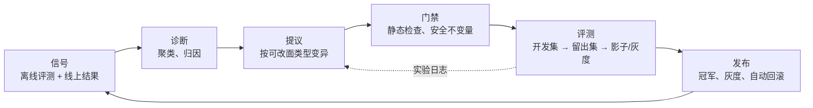
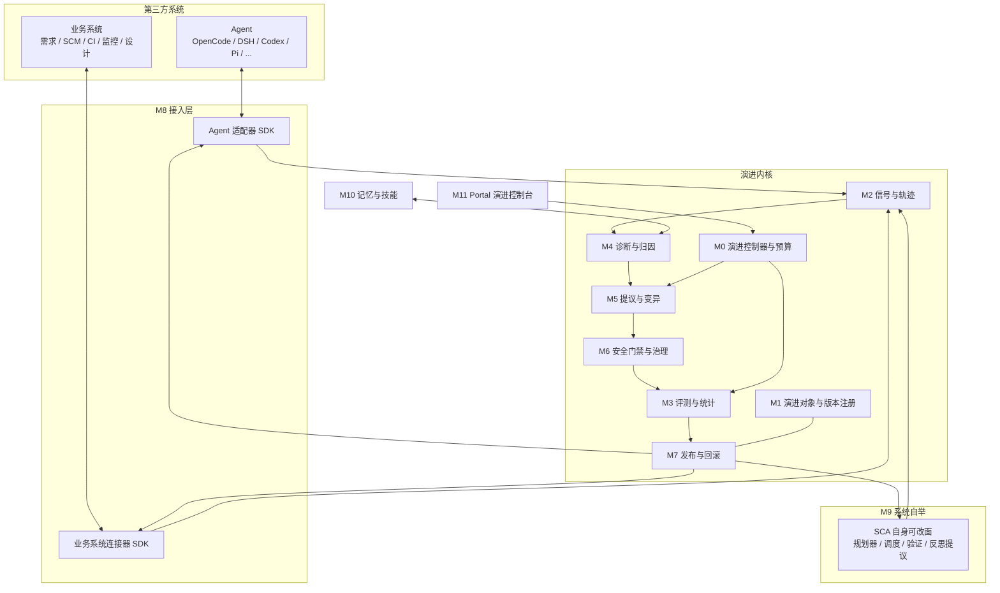

# 通用自演进平台设计（Phase 8）

状态：设计稿，未开始实现。各模块的关键技术按第 9 节的人员分工逐个落地。

读法：第 1–4 节讲目标和整体思路，第 5 节逐模块说明要做好的关键技术，第 6 节是模块间接口，
第 8–10 节是计划、人员分工和协作方式。

## 1 目标

现在的系统已经跑通了一条**流程**：任务 → 规划成 DAG → 多 Agent 并行 → 验证 → 写回；
评测 → 反思 → 提出覆盖内容 → 开发集/留出集门禁 → 冠军 → 灰度 → 回滚。但这条流程只对
**两个对象**、**一种可改面**生效：OpenCode 和 DSH 的提示词覆盖内容。演进的判断依据也只有
离线评测套件。

Phase 8 要把它做成**通用的自演进平台**，满足三件事：

1. **系统自身能自演进。** SCA 自己的规划器提示词、调度策略、验证策略、反思与提议提示词、
   记忆提炼规则，乃至 SCA 的源码，都能被同一套机制持续改进，并且每一步有证据、可回滚。
2. **接入的第三方 Agent 能自演进。** OpenCode、DSH、Codex、Pi，以及以后接入的任何 Agent，
   只要实现一份接入契约，就能被演进，不需要为每个 Agent 写一套专用逻辑。
3. **接入的第三方业务系统能参与并被演进。** 需求系统（Jira、Linear、飞书项目、禅道等）、
   SCM、CI、设计系统、监控等，既是演进的**信号来源**（需求是否真正交付、是否返工、线上是否
   出缺陷），也可以是**被演进对象**（需求拆解模板、验收标准生成规则、分派规则）。

一句话：**任何声明了「可改面」和「结果信号」的东西，都能放进同一个演进闭环。**

## 2 现状与差距

| 能力 | 现有基础（代码位置） | 差距 |
|---|---|---|
| 演进控制器 | `evolve/workflow.py`：代际搜索、K 候选、开发集 → 留出集门禁 | 被演进对象写死为 Agent 覆盖内容；搜索策略只有一种 |
| 评测 | `eval/`：套件、split、隐藏验收、配对符号检验、重判分、轨迹规则 | 只有离线评测；题量小；没有在线信号；无评测本身的健康度管理 |
| 失败收割 | `evolve/harvest.py`：失败任务转评测用例，人工审批 | 需人工逐个提交；没有聚类和去重 |
| 冠军与发布 | `evolve/champions.py`：冠军、按任务哈希灰度、回滚、固化（`solidify.py`） | 灰度不看线上指标，不会自动回滚；只对 Agent 版本+模型维度 |
| 定期演进 | `evolve/scheduler.py`：定时评测，低于阈值或回归时触发 | 触发信号只有离线通过率 |
| 人工介入 | `evolve/steering.py`、审批、Portal 对话 | 只能在单次演进内指引，没有长期「演进目标」管理 |
| Agent 接入 | `agents/*.py`：每个后端一个适配器 | 没有统一的可改面声明和一致性测试；新 Agent 接入要读代码 |
| 业务系统接入 | `intents/`（Figma、OpenAPI、工单）、`scm/`（GitHub/Gitea、webhook） | 只作为任务输入；结果不回流成演进信号；本身不可演进 |
| 轨迹 | 事件日志（ADR-07）、`live_timing.py`、`eval/trajectory.py` | 各后端事件粒度不一；DAG 多 Agent 时无法把失败归因到具体子任务/组件 |
| 记忆与知识 | `memory/`、`knowledge/`：人工确认的短条目、知识库检索 | 记忆质量不评测；没有可复用「技能」库 |

## 3 核心抽象

### 3.1 演进对象（Evolvable）

演进对象 = 一组**可改面（Surface）** + 一个**结果评估方式**。平台只认这个抽象。

```
Evolvable
  id                 e.g. "agent:dsh", "sca:planner", "sca:lane-policy", "ext:jira:decompose-template"
  owner              platform | tenant
  surfaces[]         可改面，见 3.2
  apply              如何把一个候选生效到一次执行里（覆盖文件 / 任务参数 / 第三方 API / 代码 PR）
  evaluate           离线评测套件 + 在线结果信号（见模块 M2、M3）
  invariants         不可改的约束（权限、安全提示、接口签名、成本上限）
```

### 3.2 可改面（Surface）

按「改起来多便宜、风险多大」分四类，每类有不同的变异算子、检查和发布通道：

| 类型 | 例子 | 生效方式 | 评测成本 | 风险 |
|---|---|---|---|---|
| **文本** | 系统提示词、工具描述、规划器提示词、需求拆解模板、验收标准模板 | 运行时覆盖，不构建 | 低 | 中 |
| **参数** | 并发上限、修复轮数、模型选择、温度、预算分配、停滞阈值、灰度比例 | 任务/配置参数 | 低 | 低 |
| **结构** | DAG 模板、流水线步骤（是否先写测试）、工具集合开关、路由规则 | 声明式配置 | 中 | 中 |
| **代码** | Agent 工具实现、SCA 自己的调度/验证代码 | 源码修改 → 构建 → 版本 | 高 | 高 |

### 3.3 版本（Variant）与谱系

每个候选是一个不可变版本：`{evolvable_id, surface 内容的哈希, parent, 生成它的诊断与假设, 生成者版本}`。
任务执行时**固定**它使用的所有版本（Agent 版本、各 SCA 组件版本、外部模板版本），
记进 `task.result.variants`，这是后续把结果归因到版本的前提。

### 3.4 统一闭环



## 4 总体架构



## 5 模块与关键技术

每个模块写四项：**职责**、**要做好的关键技术**、**完成标准**、**依赖**。
关键技术是这个模块做到「可用」和「做好」之间的差别所在，也是后续分工的单位。

### M0 演进控制器与预算调度

**职责**：把现在只服务 Agent 覆盖内容的 `EvolutionWorkflow` 泛化成对任意演进对象的搜索；
在多个演进对象、多个租户之间分配评测预算。

**关键技术**
1. **对象无关的工作流**：工作流只依赖 Evolvable 接口（提议、生效、评测、比较），
   OpenCode/DSH 的现有实现迁移成两个 Evolvable 插件；用 `workflow.patched` 保证旧历史可回放。
2. **多种搜索策略**：文本面用代际束搜索（现有）；参数面用贝叶斯优化或多臂老虎机；
   结构面用小种群进化。策略可按可改面类型选择。
3. **预算即调度**：把评测次数当稀缺资源，用 successive halving / Hyperband 思路，
   先用少量用例淘汰明显差的候选，再给有希望的候选加重复次数。
4. **跨对象优先级**：按「预期收益 × 线上流量 ÷ 评测成本」排序哪个对象先演进，避免把预算耗在
   没人用的对象上。
5. **可中断、可续跑**：现有暂停/恢复/立即生效语义推广到所有对象。

**完成标准**：用同一个工作流跑通 DSH 覆盖内容和一个 SCA 参数面（如并发上限）两类演进；
相同预算下，分级淘汰比均匀评测多评出至少 1.5 倍候选。
**依赖**：M1、M3。

### M1 演进对象与版本注册

**职责**：登记演进对象、可改面 schema、版本、谱系、冠军指针，并在任务启动时解析出要用的版本。

**关键技术**
1. **可改面声明（Surface Manifest）**：JSON Schema 描述每个可改面的类型、长度上限、
   必须保留的占位符、不可改字段；第三方通过它声明自己能被改什么。
2. **内容寻址版本**：版本 ID = 内容哈希；同内容去重；谱系是有向无环图。
3. **执行时版本固定与记录**：一次任务涉及的所有版本（Agent、SCA 各组件、外部模板）在启动时
   一次解析、写入 `task.result.variants`，DAG 子任务继承；这是归因（M4）和回放（M3）的基础。
4. **作用域**：平台默认 → 租户 → 项目 三级覆盖，冠军和灰度都按作用域解析（现有 champions 推广）。
5. **兼容性约束**：版本声明它适用的基线版本和模型；基线升级时自动标记需要重新评测。

**完成标准**：现有 OpenCode/DSH 冠军无损迁移；任意任务都能查到它用了哪些版本。
**依赖**：无（最先做）。

### M2 信号与轨迹

**职责**：把所有来源的结果统一成「某次执行、用了哪些版本、结果怎样」的信号，供诊断和评测使用。

**关键技术**
1. **统一轨迹格式**：参考 OpenTelemetry GenAI 语义约定，把各 Agent 的事件规整成
   span 树：任务 → 子任务 → 轮 → 模型调用 / 工具调用 / 命令。DAG 多 Agent 时保留泳道和依赖。
2. **结果信号分层**：
   - 即时：验证通过、轮数、用时、费用、停滞、被打断。
   - 人的判断：审批通过/拒绝、拒绝理由、插话内容（插话本身就是「Agent 走偏了」的信号）。
   - 延迟：写回后的人工二次修改量、CI 结果、合并后是否回滚、关联缺陷、需求是否被重新打开。
3. **延迟信号的关联**：通过提交哈希、分支、PR、工单 ID 把几天后的外部事件关联回原任务和版本；
   需要幂等和乱序处理。
4. **信号质量**：区分「Agent 的问题」和「环境的问题」（网络、配额、依赖安装失败），
   后者不能算进版本的成绩。现有 `provider_errors.py` 是起点。
5. **隐私**：信号进入演进前按租户隔离并脱敏；跨租户共享只用聚合指标，且需租户同意。

**完成标准**：任意任务都能给出一条标准化轨迹和完整的结果信号；环境类失败识别准确率 ≥ 95%（人工抽检）。
**依赖**：M1（版本记录）、M8（外部信号接入）。

### M3 评测与统计

**职责**：给出可信的「候选是否真的更好」的判断，包括离线评测和线上实验。

**关键技术**
1. **基准持续增长**：失败收割（现有 `harvest.py`）自动化——自动聚类、去重、生成隐藏验收草稿，
   人只做批准；按任务类型和难度分层抽样，保持开发集/留出集比例。
2. **基准健康度**：检测饱和（所有版本都过）、不稳定题（同版本重复结果不一致）、
   泄漏（提议内容出现题目特征，现有 n-gram 检查扩展到语义相似）。不稳定题自动隔离。
3. **统计方法**：配对比较（现有符号检验）之外，加入序贯检验（SPRT），评测过程中一旦
   有显著结论就提前停止，省预算；多候选比较做多重检验校正。
4. **评委模型（LLM-as-judge）**：给没有可执行验收的任务（文档、需求拆解质量）打分；
   评委要用人工标注集校准，定期测一致性；评委和被评者不能是同一演进对象的同一版本。
5. **线上实验**：影子模式（候选与冠军同时跑、只用冠军结果，仅限无副作用任务）与灰度 A/B
   （按任务哈希分桶，现有）；线上指标用 M2 的信号。
6. **可复现与回放**：记录模型请求与响应，支持「固定模型输出、只换可改面」的确定性回放，
   用于参数面和结构面的廉价评测。

**完成标准**：同一版本重复评测的通过率波动可量化并显示置信区间；SPRT 在不降低判断准确率的前提下
平均节省 30% 评测费用。
**依赖**：M2。

### M4 诊断与归因

**职责**：从大量失败中找出共性原因，并把原因落到具体的演进对象和可改面上。

**关键技术**
1. **失败聚类**：对失败轨迹做结构特征（失败阶段、错误类型、工具序列）+ 语义嵌入的聚类，
   输出带代表样本的失败模式，替代现在「把失败堆给 LLM 总结」的做法。
2. **失败分类体系**：理解需求错、规划拆分错、工具使用错、验证不充分、环境问题、预算耗尽、
   被人否决等；分类决定该演进哪个对象（例如拆分错 → 规划器，工具错 → Agent 工具描述）。
3. **DAG 归因（credit assignment）**：多 Agent 任务失败时，判断是哪个子任务、哪条泳道、
   哪个组件导致；用依赖关系和反事实重跑（只替换一个子任务的版本）定位。
4. **人的反馈结构化**：审批拒绝理由、插话、二次修改的 diff 转成结构化诊断条目。
5. **防过拟合**：诊断只能看开发集证据（现有约束），并要求每条诊断覆盖多个样本。

**完成标准**：失败模式聚类经人工抽检纯度 ≥ 80%；多 Agent 任务的失败能定位到子任务。
**依赖**：M2。

### M5 提议与变异

**职责**：针对诊断生成候选，按可改面类型使用不同变异算子。

**关键技术**
1. **文本变异**：基于诊断的定向改写（现有）、多样性约束（候选间差异下限）、
   对照实验日志避免重复失败的想法；支持「交叉」把两个冠军的有效片段合并。
2. **参数变异**：在声明的取值范围内做贝叶斯优化，不调用 LLM。
3. **结构变异**：在 DAG 模板、流水线步骤上做增删改，受 schema 约束。
4. **代码变异（慢通道）**：由编码 Agent 在 SCA 或第三方源码仓库上提出 PR，复用现有编码任务、
   验证和审批；构建后注册为新版本（现有 `solidify.py` 推广）。
5. **元演进**：反思和提议本身的提示词也是演进对象（`sca:proposer`），以「它产出的候选的
   晋升率」作为成绩。为防自我强化，元演进只能在独立的评测预算和人工批准下进行。

**完成标准**：四类变异算子都可用；同预算下候选晋升率高于现有单一 LLM 改写。
**依赖**：M1、M4。

### M6 安全门禁与治理

**职责**：保证演进不会让系统变得危险、不可控或作弊。

**关键技术**
1. **不变量检查**：每个演进对象声明不可改内容（权限、凭证边界、沙箱策略、安全提示）；
   候选必须通过静态检查和语义检查（LLM 审查 + 规则）。
2. **评测作弊检测**：检测候选或 Agent 是否修改测试、读取隐藏验收、硬编码答案、
   绕过验证命令（现有轨迹规则扩展）。
3. **裁判与选手分离**：评测器、门禁、统计代码不能被同一条演进链修改；修改它们走独立的、
   必须人工批准的流程，并保留冻结的参考版本做对照。
4. **风险分级审批**：按可改面类型和作用域决定自动晋升还是人工批准；代码类和平台级默认值
   一律人工批准。
5. **审计与熔断**：所有晋升、灰度、回滚写入 `evolution_events`；全局熔断开关一键冻结所有演进
   和灰度，回到最近的已批准冠军。
6. **预算硬上限**：每个演进对象、租户、全局三级预算，网关侧强制（现有 LiteLLM 预算机制推广）。

**完成标准**：红队用例（改测试、读隐藏验收、删安全提示）100% 被拦截；熔断后 1 分钟内所有新任务回到冠军。
**依赖**：M1。

### M7 发布与回滚

**职责**：把晋升的版本安全地推到真实流量，并在线上变差时自动退回。

**关键技术**
1. **渐进灰度**：按 1% → 10% → 50% → 100% 推进，每一级用 M3 的线上检验判断是否继续。
2. **自动回滚**：线上指标（通过率、审批拒绝率、费用、停滞率）出现显著回归时自动回滚并告警。
3. **多对象组合发布**：多个对象同时灰度时避免相互干扰（分层分桶或互斥实验组）。
4. **固化**：文本覆盖内容长期稳定后固化进正式版本（现有 OpenCode 固化推广到 DSH 和 SCA 自身）。
5. **第三方发布通道**：通过连接器把冠军模板写回需求系统等外部系统，支持外部审批和回滚。

**完成标准**：人为注入一个变差的候选，灰度阶段能自动发现并回滚。
**依赖**：M1、M3、M6。

### M8 第三方接入层（Agent 与业务系统）

**职责**：定义第三方接入契约，让新 Agent 和新业务系统接入后自动具备「被观测、被评测、被演进」能力。

**接入契约**：四个能力，按需实现，实现得越多能参与的演进越多。

| 能力 | 含义 | Agent 例子 | 业务系统例子 |
|---|---|---|---|
| **Act** 执行 | 接收输入、产生结果 | 在沙箱里完成一轮编码 | 创建/更新需求、触发 CI |
| **Observe** 观测 | 输出标准化事件和结果 | 模型调用、工具调用、命令 | 需求状态变化、缺陷关联、CI 结果 |
| **Mutate** 可改 | 声明可改面并接受候选生效 | 系统提示词、工具描述、插件配置 | 拆解模板、验收模板、分派规则 |
| **Measure** 度量 | 提供结果信号或评测方式 | 验证命令、隐藏验收 | 需求交付周期、返工率、上线缺陷数 |

**关键技术**
1. **Agent 适配器 SDK**：把 `agents/*.py` 中重复的部分（进程管理、事件规整、会话续接、打断、
   费用结算、覆盖内容注入）抽成基类；新 Agent 只实现命令行构造和事件解析。
2. **覆盖内容注入的标准方式**：优先用 Agent 官方扩展点（如 DSH 的 `--patch`、OpenCode 补丁、
   Codex 的 `AGENTS.md`/配置），没有扩展点时用沙箱内只读文件 + 环境变量；不修改用户仓库。
3. **一致性测试套件**：任何适配器必须通过一组标准测试（事件完整性、打断、续接、费用、覆盖生效、
   超时）才能注册；用 `fake` 后端做参照实现。
4. **业务系统连接器 SDK**：统一认证（凭证只在 Worker 侧，ADR-06）、webhook 验签与幂等、
   限流和重试、字段映射；把外部事件转成 M2 信号，把冠军模板通过 Mutate 写回。
5. **需求系统深度集成**：需求 → 任务（现有工单触发）之外，增加：
   - 需求质量信号：需求是否被澄清多次、是否返工、交付后缺陷；
   - 可演进对象：需求拆解模板、验收标准生成规则、需求到 DAG 的映射规则；
   - 闭环：任务结果回写需求（进度、PR、验证证据），需求关闭/重开回流成信号。
6. **能力协商**：连接器声明支持哪些能力和版本，平台按能力降级（例如只有 Act + Observe 的系统
   只能作为信号来源，不能被演进）。

**完成标准**：用 SDK 在 1 天内接入一个新 Agent（以 Codex 或 Pi 验证）并通过一致性测试，
能直接参与覆盖内容演进；接入一个需求系统（先 Jira 或 GitHub Issues），需求关闭/重开信号能回到对应任务和版本。
**依赖**：M1、M2。

### M9 系统自举（SCA 演进 SCA）

**职责**：让 SCA 自身的组件成为演进对象，最终由 SCA 改进 SCA 的源码。

**SCA 自身的可改面**

| 演进对象 | 可改面 | 类型 | 成绩来源 |
|---|---|---|---|
| `sca:planner` | 规划器提示词、拆分粒度规则 | 文本 | 子任务一次通过率、合并冲突率、总用时 |
| `sca:lane-policy` | 并发上限、泳道分配、排队策略 | 参数 | 总用时、费用、内存超限次数 |
| `sca:repair` | 修复轮数、失败日志截取策略、修复提示 | 参数 + 文本 | 修复成功率、轮数 |
| `sca:verify` | 验证命令推断、测试补全策略 | 文本 + 结构 | 线上回滚率、缺陷逃逸 |
| `sca:router` | 按任务类型选 Agent 和模型 | 参数 | 通过率 / 费用 |
| `sca:reflector`、`sca:proposer` | 反思与提议提示词 | 文本（元演进） | 候选晋升率 |
| `sca:memory` | 记忆提炼和检索规则 | 文本 + 参数 | 引用记忆后的通过率变化 |
| `sca:code` | SCA 源码 | 代码（慢通道） | SCA 自己的测试 + 历史任务回放 |

**关键技术**
1. **自举的评测集**：把 SCA 的历史真实任务（已有大量 Portal 任务和演进记录）做成回放基准；
   SCA 源码改动的评测 = 单元/集成测试 + 历史任务回放 + 关键流程冒烟（例如本文 3.4 的闭环跑一代）。
2. **稳定的锚点版本**：始终保留一个人工批准的「参考 SCA」运行评测和门禁；被演进的 SCA 只能作为
   候选运行，不能评测自己（见 M6 第 3 条）。
3. **双运行时**：候选 SCA 在隔离环境（独立数据目录、独立 Temporal 命名空间或独立进程）运行，
   不影响正在服务的实例；Windows 源码模式和 Docker 模式都要支持。
4. **代码演进的提交流程**：候选改动以 PR 形式提交到 `evolve` 分支，CI 三平台通过 + 回放不劣 +
   人工批准后合并；不允许自动合并到发布分支。
5. **数据库与工作流兼容**：自动检查迁移和 Temporal 工作流的确定性（`workflow.patched`、历史回放测试），
   不兼容的候选直接拒绝。

**完成标准**：至少三个 SCA 自身对象（规划器、并发策略、路由）完成一次完整的「演进 → 晋升 → 灰度」；
SCA 源码层面完成一次由 SCA 提出、经门禁和人工批准合入的改进。
**依赖**：M0–M7。

### M10 记忆与技能库

**职责**：把演进中学到的东西沉淀为可复用、可评测的知识，而不只是覆盖内容。

**关键技术**
1. **技能（Skill）**：从成功轨迹中提炼可复用的步骤（例如「给 Flask 项目加购物车」），带适用条件；
   技能本身是演进对象，成绩是引用后的成功率。
2. **记忆质量评测**：现有记忆条目在检索命中后的效果做 A/B，无效或有害的条目自动降权。
3. **租户边界**：技能和记忆默认租户私有；平台级技能需要脱敏和批准。
4. **检索评测**：检索召回率与引用后的任务通过率挂钩，而不是只看相似度。

**完成标准**：技能被引用的任务通过率显著高于未引用的同类任务；有害记忆能被自动发现。
**依赖**：M2、M3。

### M11 Portal 演进控制台

**职责**：让人能看懂、指挥、审批所有演进。

**关键技术**
1. **演进目标管理**：人用自然语言设定长期目标（「降低前端任务的返工率」），平台转成目标指标和
   要演进的对象；按目标展示进展。
2. **统一视图**：所有演进对象的冠军、灰度、线上指标、实验日志、谱系图；现有执行图 DAG 推广到演进谱系。
3. **证据化审批**：候选的差异、诊断依据、评测结果（含置信区间）、风险等级在一个审批卡片里。
4. **第三方视图**：每个接入系统的能力、健康度、参与了哪些演进。

**完成标准**：人在 Portal 上不看日志就能回答「现在哪个版本在跑、为什么晋升、效果如何、怎么回滚」。
**依赖**：M0–M8 的接口。

## 6 模块间接口契约

接口在 8a 开工第一周由技术负责人（P1）先合入仓库，各模块按接口并行开发，用 `fake` 实现互相解耦。
下列为契约草案，字段名以合入的代码为准。

### 6.1 演进对象（M1 提供，M0/M5/M7/M9 使用）

```python
class Surface(BaseModel):
    name: str                       # "system_prompt", "max_parallel_agents", "decompose_template"
    kind: Literal["text", "param", "structure", "code"]
    schema: dict                    # JSON Schema: length limits, ranges, required placeholders
    immutable: list[str] = []       # fields no candidate may change (M6 checks)

class Variant(BaseModel):
    id: str                         # sha256 of canonical content
    evolvable_id: str
    content: dict[str, Any]         # surface name -> value
    parent: str | None
    hypothesis: str | None          # from M5, shown in Portal
    compatible: dict                # base versions and models this variant applies to

class Evolvable(Protocol):
    id: str
    surfaces: list[Surface]
    def baseline(self) -> Variant: ...
    def apply(self, variant: Variant, execution: ExecutionContext) -> None: ...   # task spec / overlay / external API
    def suites(self) -> list[SuiteRef]: ...                                       # offline evaluation (M3)
    def online_metrics(self) -> list[MetricRef]: ...                              # online signals (M2)
```

任务启动时 M1 的 `resolve_variants(task)` 返回 `{evolvable_id: variant_id}`，写入
`task.result.variants`，DAG 子任务继承。

### 6.2 信号（M2 提供，M3/M4/M7/M10 使用）

```json
{
  "signal_id": "uuid", "task_id": "uuid", "subtask": "a", "agent_lane": 1,
  "variants": {"agent:dsh": "sha256:…", "sca:planner": "sha256:…"},
  "kind": "verification | review | steering | rework | ci | defect | requirement_reopened | cost | stall",
  "value": 1.0, "attribution": "agent | environment | human | unknown",
  "source": "sca | github | jira | …", "observed_at": "2026-11-24T08:00:00Z", "delay_s": 0
}
```

轨迹是 span 树：`task → subtask → turn → {llm_call, tool_call, command}`，每个 span 带
`started_at / ended_at / status / cost / tokens`，字段对齐 OpenTelemetry GenAI 语义约定。

### 6.3 评测判断（M3 提供，M0/M7 使用）

```python
class Verdict(BaseModel):
    candidate: str; reference: str
    metric: str                     # "pass_rate", "cost", "rework_rate"
    delta: float; ci_low: float; ci_high: float
    decision: Literal["better", "worse", "inconclusive"]
    samples: int; stopped_early: bool
```

### 6.4 诊断与提议（M4 → M5）

```python
class Diagnosis(BaseModel):
    category: str                   # failure taxonomy (M4)
    target: str                     # evolvable_id + surface to change
    evidence: list[str]             # dev-split signal ids only
    support: int                    # number of samples in the cluster
    summary: str

class Proposal(BaseModel):
    variant: Variant
    diagnoses: list[str]
    expected_effect: str
```

### 6.5 门禁（M6 提供，M0/M7 调用）

`check(variant, evolvable) -> GateResult{passed, risk: low|medium|high, approvals_required, reasons[]}`。
`high` 风险（代码、平台级默认值、安全相关面）必须人工批准。

### 6.6 第三方接入（M8 提供）

Agent 适配器：

```python
class AgentAdapter(Protocol):
    name: str
    capabilities: set[Literal["act", "observe", "mutate", "measure", "interrupt", "resume"]]
    surfaces: list[Surface]                       # what this agent lets SCA evolve
    def command(self, turn: TurnInput, overlay: Path | None) -> list[str]: ...
    def parse(self, line: bytes) -> list[AgentEvent]: ...                  # normalized events
```

业务系统连接器：

```python
class Connector(Protocol):
    name: str                                     # "jira", "github-issues", "feishu-project"
    capabilities: set[Literal["act", "observe", "mutate", "measure"]]
    surfaces: list[Surface]                       # e.g. decompose / acceptance templates
    async def verify_webhook(self, request) -> list[ExternalEvent]: ...    # signature + idempotency
    async def to_signals(self, event: ExternalEvent) -> list[Signal]: ...  # link to task/variant
    async def apply(self, variant: Variant) -> ExternalRevision: ...       # mutate (optional)
    async def rollback(self, revision: ExternalRevision) -> None: ...
```

两者都必须通过 M8 的一致性测试才能注册。

## 7 关键设计决定

- **ADR-P8-01 一个演进对象抽象覆盖所有场景。** 不为每个 Agent 或系统写专用演进逻辑；现有 OpenCode/DSH
  演进迁移为插件。
- **ADR-P8-02 评测是瓶颈，也是信任根。** 优先投资评测质量（M3）和信号（M2），其次才是提议能力（M5）。
  没有可信评测的对象不允许自动晋升。
- **ADR-P8-03 裁判与选手分离。** 评测、门禁、统计、预算代码不在任何自动演进链的可改面内。
- **ADR-P8-04 便宜的先演进。** 顺序：参数 → 文本 → 结构 → 代码。代码演进永远需要人工批准。
- **ADR-P8-05 线上信号要有归因。** 没有固定版本记录（M1 第 3 条）的执行不进入线上评测。
- **ADR-P8-06 第三方按能力降级接入。** 只实现 Act + Observe 的系统作为信号源；实现 Mutate + Measure
  才能被演进。
- **ADR-P8-07 租户隔离优先。** 跨租户学习只用聚合指标，平台默认值只在 `eval` 租户和经同意的数据上演进。

## 8 分阶段计划

| 阶段（约 4 周） | 内容 | 退出条件 |
|---|---|---|
| **8a 地基** | M1 注册与版本固定、M2 统一轨迹与即时信号、M8 Agent 适配器 SDK 与一致性测试 | 任意任务可查版本与标准轨迹；四个现有 Agent 通过一致性测试 |
| **8b 可信评测** | M3 基准健康度、SPRT、自动收割；M4 失败聚类与分类；M6 不变量与作弊检测 | 评测结果带置信区间；红队用例全拦截 |
| **8c 通用闭环** | M0 泛化控制器与预算调度、M5 参数与文本变异、M7 渐进灰度与自动回滚 | SCA 参数面和 DSH 文本面都跑通「演进 → 灰度 → 自动回滚演练」 |
| **8d 外部系统** | M8 需求系统连接器与延迟信号、M2 延迟信号关联、M7 外部发布通道 | 需求关闭/重开信号回流并影响一次演进决策 |
| **8e 自举** | M9 自身可改面、回放基准、双运行时、代码慢通道；M10 技能库；M11 控制台 | 完成第 M9 节的完成标准 |

## 9 人员分工

### 9.1 人数

**推荐 11 人**：1 名技术负责人 + 10 名模块负责人，每人负责一块模块，端到端负责该模块的设计细化、
实现、测试、文档和现场验证。整体周期约 **20 周**（见 8 节五个阶段，每阶段约 4 周）。

人手不足时可以按 9.4 的精简方案用 **6 人** 起步，周期延长到约 32 周。

### 9.2 每人负责的模块

| 编号 | 角色 | 负责模块 | 核心交付 | 主要协作方 | 投入阶段 | 关键能力要求 |
|---|---|---|---|---|---|---|
| **P1** | 技术负责人 / 演进内核 | M0 演进控制器与预算调度、M1 演进对象与版本注册 | 第 6 节全部接口代码；Evolvable 注册与版本固定；对象无关的演进工作流；分级淘汰预算调度；现有 OpenCode/DSH 演进迁移为插件；合并评审与阶段验收 | 所有人 | 全程 | Temporal 工作流确定性、Postgres、系统设计 |
| **P2** | 信号与轨迹 | M2 | 统一 span 轨迹；四个 Agent 后端事件规整；即时/人工/延迟三层信号；环境失败识别；信号脱敏与租户隔离 | P3、P4、P7、P8 | 8a 起全程 | 可观测性（OpenTelemetry）、事件建模 |
| **P3** | 评测与统计 | M3 | 基准健康度（饱和、不稳定、泄漏）；自动收割聚类；配对检验 + SPRT + 多重检验校正；评委模型校准；影子与 A/B 线上实验；确定性回放 | P1、P2、P6 | 8b 起全程 | 统计学、实验设计、评测基准建设 |
| **P4** | 诊断与提议 | M4 诊断与归因、M5 提议与变异 | 失败分类体系与聚类；DAG 子任务归因与反事实重跑；人工反馈结构化；文本/参数（贝叶斯优化）/结构变异算子；元演进 | P2、P1、P5 | 8b 起全程 | LLM 应用、提示工程、优化算法 |
| **P5** | 安全与治理 | M6 | 不变量声明与检查；评测作弊检测；裁判/选手分离机制；风险分级审批；审计与熔断；三级预算网关强制 | 所有人（评审每个可改面声明） | 8b 起全程 | 安全工程、权限模型、红队测试 |
| **P6** | 发布与回滚 | M7 | 渐进灰度；线上序贯检验与自动回滚；多对象组合发布（分层分桶）；固化流程推广到 DSH 和 SCA；外部发布通道 | P3、P5、P8 | 8c 起全程 | 发布工程、A/B 实验平台 |
| **P7** | Agent 接入 | M8（Agent 部分） | Agent 适配器基类与 SDK；覆盖内容注入标准化；一致性测试套件；OpenCode、DSH、Codex、Pi 迁移并通过一致性测试；新 Agent 接入指南 | P2、P1 | 8a 起全程 | 各 Agent CLI、进程管理、Node/Python |
| **P8** | 业务系统连接 | M8（业务系统部分） | 连接器 SDK；Jira、GitHub Issues 需求连接器（之后飞书项目、禅道）；webhook 验签与幂等；延迟信号关联；需求拆解/验收模板作为演进对象；结果回写需求 | P2、P6 | 8d 为主（8a 起做 SDK 设计） | 第三方 API 集成、OAuth、webhook |
| **P9** | 系统自举 | M9 | SCA 自身八个演进对象的接入；历史任务回放基准；隔离的候选 SCA 运行时；SCA 代码慢通道（PR → CI → 回放 → 人工批准）；迁移与工作流兼容检查 | P1、P3、P5 | 8c 起全程（8a/8b 做回放基准） | 熟悉 SCA 全部代码、CI、Temporal |
| **P10** | 记忆与技能 | M10 | 技能提炼与适用条件；技能和记忆的效果 A/B；有害记忆自动降权；检索效果评测 | P2、P3 | 8c 起 | 检索、嵌入、知识管理 |
| **P11** | Portal 前端 | M11 | 演进目标管理；所有对象的冠军、灰度、指标、谱系统一视图；证据化审批卡片；第三方接入视图；各阶段配套页面 | 所有人（消费各模块 API） | 全程 | 前端、数据可视化、交互设计 |

### 9.3 每个阶段谁在做什么

| 阶段（约 4 周） | 主力 | 并行准备 |
|---|---|---|
| **8a 地基** | P1 接口与注册、P2 轨迹、P7 Agent SDK | P3 盘点基准，P9 整理历史任务做回放集，P8 连接器 SDK 设计，P11 控制台原型 |
| **8b 可信评测** | P3 评测、P4 诊断、P5 门禁 | P1 控制器泛化设计，P6 灰度方案 |
| **8c 通用闭环** | P1 控制器、P4 变异算子、P6 发布 | P9 自身参数面接入，P10 技能提炼 |
| **8d 外部系统** | P8 连接器、P2 延迟信号、P6 外部发布 | P5 外部系统权限评审 |
| **8e 自举** | P9 自举、P10 技能库、P11 控制台收尾 | 全员回归与现场验证 |

### 9.4 精简方案（6 人）

| 编号 | 合并后负责的模块 |
|---|---|
| P1 | M0 + M1（技术负责人） |
| P2 | M2 + M10（信号、轨迹、记忆与技能） |
| P3 | M3 + M7（评测、统计、发布与回滚） |
| P4 | M4 + M5 + M6（诊断、提议、安全门禁） |
| P5 | M8（Agent 接入 + 业务系统连接器） |
| P6 | M9 + M11（系统自举 + Portal） |

精简方案下 M6 与 M4/M5 由同一人负责，违反「裁判与选手分离」的组织原则，门禁规则的变更必须由 P1 评审。

## 10 协作方式

- **代码与分支**：每个模块一个长期特性分支 `p8/<模块>`，以小 PR 合入 `evolve`；发布分支只由 P1 合并。
- **接口优先**：第 6 节接口由 P1 在 8a 第一周合入；接口变更走 RFC（在本文追加一节），受影响的负责人确认后才能改。
- **定义完成**：每个工作项需要单元测试、相关集成测试、文档更新、Windows 源码模式与 Docker 模式各一次冒烟，
  三平台 CI 通过；模块的「完成标准」由 P1 现场验收。
- **评测预算**：每人每周有独立的评测预算，由 P5 的三级预算机制强制；超过预算需 P1 批准。
- **周节奏**：每周一次接口与进展同步，每阶段末一次演示（用真实小任务现场跑一遍闭环）。
- **AI 协作**：每位负责人可以用 SCA 自身（编码任务、多 Agent DAG）和 codex worker 加速实现，
  但合入前的评审和验收由负责人本人负责。

## 11 风险

| 风险 | 应对 |
|---|---|
| 评测题量小，统计分不出好坏 | 8b 先做自动收割和 SPRT；题量不足的对象只允许人工晋升 |
| 演进出「讨好评测」的作弊行为 | M6 作弊检测 + 隐藏验收 + 裁判/选手分离 + 线上信号复核 |
| 自举时 SCA 把自己改坏 | 参考版本锚点、隔离双运行时、代码演进永远人工批准、熔断 |
| 第三方系统 API 变化或不可用 | 连接器能力协商与降级；外部故障不计入版本成绩 |
| 评测费用失控 | 三级预算硬上限、分级淘汰、确定性回放替代部分真实评测 |
| 本机资源不足 | 评测并发按内存自动计算（现有机制），重评测可放到 Mac 或云上 Worker |

## 12 相关文档

- [架构设计](architecture.md)
- [OpenCode 与 DSH 自演进](design-evolution.md)
- [执行图与对话](dag.md)
- [设计稿、Design Tokens 与工单](intents.md)
- [GitHub 与 Gitea 集成](scm.md)
- [MCP 工具与企业知识库](tools.md)
