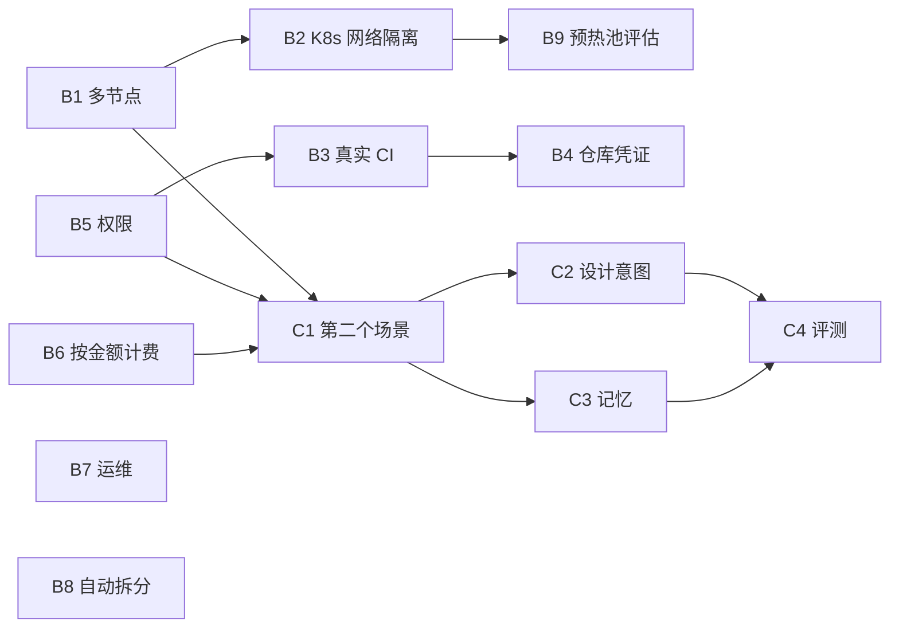

# 接手指南

> 给接着做二期收尾和三期的负责人（以及它带的 worker）。
> 先读这一份，再读 [`architecture.md`](architecture.md)，然后按顺序读要做的那一项的设计。

## 1 现在到哪了

| 阶段 | 状态 | 文档 |
| --- | --- | --- |
| 一期：MVP | 完成 | [`design.md`](design.md) |
| 二期：9 个组件 | 完成，单机部署下各自的目标有测试证明 | [`design-phase2.md`](design-phase2.md)，每节末尾的「结果」 |
| 二期收尾：B1–B9 | 完成，包括 B3 的 GitHub 路径和 Alertmanager；每项的验证结果在设计各节末尾 | [`design-phase2b.md`](design-phase2b.md) |
| 三期：C1–C4 | 完成，验证结果在设计各节末尾 | [`design-phase3.md`](design-phase3.md) |

最近一次全量回归（2026-11-16）：

| 部分 | 结果 |
| --- | --- |
| 单元 + 集成（不含 K8s、真实模型） | 431 通过 |
| 端到端，挂载模式 / sync 模式 | 34 / 34 通过 |
| 可选服务（S3、OIDC、Postgres 版 Temporal、Gitea + OpenBao、GitHub Runner、观测后端 + Alertmanager） | 全部通过，包括真实 GitHub App（2026-11-16） |
| Kubernetes（两节点 kind + Calico） | 48 通过 |
| 真实模型（Codex、LiteLLM 网关、两个模型的评测对比、记忆提炼） | 全部通过 |

开发环境的 Postgres 已换成 `pgvector/pgvector:pg16`。从旧的 `postgres:16-alpine` 数据卷切换时，排序规则的实现从 musl 变成 glibc，需要对每个库执行一次 `REINDEX DATABASE`。

## 2 做的顺序



建议的批次（每批内部可以并行分给两个 worker，前提是文件不重叠）：

| 批次 | 事项 | 说明 |
| --- | --- | --- |
| 1 | B1 ｜ B5 | B1 改沙箱、工作区、活动；B5 改 API 和数据库。互不重叠。 |
| 2 | B2 ｜ B6 | B2 基本是部署配置；B6 改网关和预算。 |
| 3 | B3 ｜ B7 | B3 要用 B5 的受限令牌。 |
| 4 | B4 ｜ B8 | B4 复用 B3 的 Gitea。 |
| 5 | B9 | 先量再决定，可能很快结束。 |
| 6 | C1 | **内核抽取不要并行**：它动工作流和活动的全部代码。抽取完成、测试全过之后，`analysis` 场景再分出去。 |
| 7 | C2 ｜ C3 | |
| 8 | C4 | |

## 3 用户已经做的决定

不要再问，也不要推翻：

- 平台定位：通用平台，Coding 先行。Agent 后端可插拔，先封装 Codex CLI。编排用 Temporal。
- **能用开源组件就用开源组件**，只写胶水。用户明确纠正过一次手写出口代理的做法。
- 真实 CI：**先试 GitHub 的自托管 Runner，不行再用 Gitea。**
- DeepSeek 的 key 可以继续用于测试，用最便宜的模型（配置里的 `deepseek-flash`）。它只存在于被忽略的 `.env` 里。**不要**把它写进代码、文档、日志、提交或任何发往外部的请求。
- 其余事项按设计文档里的默认方案做，自己判断，不必逐项请示。
- 用户用中文交流。文档用中文写，代码、注释、提交说明用英文。
- **提交和推送都要等用户开口。** 在默认分支上时先建分支。

## 4 完成的标准

每一项：

1. 设计文档里列的验证全部有对应的自动化测试，并且**你亲自跑过并通过**。
2. 已有测试保持通过（见第 6 节的命令）。
3. `ruff check src tests` 通过。
4. 在该项设计的末尾补「结果」一节：哪些测试证明了什么，**什么没有做到**。没做到的写清楚原因，不要含糊带过。实测数字照实写。
5. 与设计不一致的实现：改设计文档，写明为什么改。

不算完成的情况：测试写了但因为环境跳过了；worker 报告通过但你没有重跑；只在假实现上验证过而设计要求真实组件。

## 5 环境

机器：2 核、3.7 GiB 内存。**内存是主要约束**，各项要开哪些服务见 `design-phase2b.md` 末尾的表。

| 事项 | 说明 |
| --- | --- |
| Python | 3.12，虚拟环境 `.venv`。用 `.venv/bin/python`、`.venv/bin/pytest`、`.venv/bin/ruff`。 |
| Docker | 当前 shell 不在 `docker` 组里。所有 Docker 命令包在 `sg docker -c "…"` 里，包括会用到 Docker 的 pytest。 |
| 基础服务 | `make up`：Postgres（5432，用户、密码、库都是 `sca`）和 Temporal 开发服务（7233，界面 8233）。 |
| 可选服务 | compose profile：`gateway`（LiteLLM，约 670 MiB）、`s3`（SeaweedFS）、`oidc`（Dex）、`temporal-pg`（7234）。`make up-all` 全开。 |
| Kubernetes | kind 集群 `sca`，节点容器 `sca-control-plane`，平时是停的。`docker start sca-control-plane` 启动，用完 `docker stop`。`kubectl` 在 `~/.local/bin/`，上下文 `kind-sca`。 |
| gVisor | 已安装，运行时名 `runsc`。 |
| 沙箱镜像 | `make image` 构建 `sca-sandbox:latest`。往 kind 里加载要用 `docker save` 加 `kind load image-archive`，`kind load docker-image` 在这台机器上会失败。 |
| 迁移 | `.venv/bin/alembic upgrade head` |
| 密钥 | `.env`（权限 600，已忽略）：`DEEPSEEK_API_KEY`、`LITELLM_MASTER_KEY`、`SCA_MODEL_GATEWAY_MASTER_KEY`。 |
| GitHub | `gh` 已登录用户的账号。 |

## 6 测试

```bash
make test        # 单元 + 集成
make e2e         # 端到端，脚本化 Agent，不花钱
make e2e-live    # 需要可选服务（s3、oidc、temporal-pg）
make e2e-codex   # 真实 Codex，花 Token
```

标记：`integration`、`e2e`、`live`、`k8s`、`gateway`、`codex`。新增外部依赖时加新标记，并让测试在依赖不可用时**跳过而不是失败**。

全量回归的顺序（内存不够同时开）：

1. 开 `s3`、`oidc`、`temporal-pg`，跑 `-m "not codex and not gateway and not k8s"`。
2. 停掉它们，启动 kind，跑 `tests/integration/test_k8s_sandbox.py`，停 kind。
3. 开 `gateway`，跑 `-m "codex or gateway"`，停掉。

脚本化 Agent（`sca/agents/fake.py`）执行提示词里 ```` ```sca-fake ```` 代码块中的脚本，每轮取一个。端到端测试靠它在没有模型的情况下驱动完整流程，写法看 `tests/e2e/test_e2e_fake.py`。

## 7 带 worker 的方式

负责人做设计判断、集成和验证；worker（Codex，模型 `gpt-6.1-sol`）写代码。

启动一个 worker：

```bash
nohup codex exec -m gpt-6.1-sol -s workspace-write \
  -c sandbox_workspace_write.network_access=true \
  -C /home/ubuntu/projects/SuperCLoudAgent \
  -o <报告文件> - < <任务书> > <日志文件> 2>&1 &
```

行之有效的做法：

- **任务书要自足。** worker 看不到你的对话。写明：先读哪些文件、只能改哪些文件、要做什么（把设计决定直接写进去，不要让它自己选）、要写哪些测试、哪些命令必须通过、报告里要有什么。
- **同时最多两个，文件不重叠。** 它们在同一个工作目录里干活。任务书里列出「你的文件」，并说明别人正在改哪些。需要改清单之外的文件时，让它写进报告而不是直接改。
- **不让 worker 碰 Git**（不 add、不 commit、不 stash、不 checkout）。
- **worker 用不了 Docker。** 它的沙箱里 `sg docker` 不工作。凡是依赖 Docker、Kubernetes 的测试，它只能写不能跑，要在报告里说明；**你必须自己重跑**。
- **不要相信报告里的「通过」。** 每次交付后自己跑它声称跑过的测试，再跑它跑不了的那些。
- 要求报告简短：做了什么、跑了哪些测试及真实结果、哪些没验证、需要负责人做什么。

已知会踩的坑：

- **共享数据库。** worker 的集成测试各自建临时库，但 e2e 用的是共享的 `sca` 库。worker 加了迁移之后，你要自己执行 `alembic upgrade head`，并把新版本号加进 `tests/integration/conftest.py` 里的迁移列表（worker 倾向于在每个测试文件里各自打补丁，要清掉）。
- **默认网络是受限的。** 新写的、需要联网的沙箱测试要用 `make_sandbox_provider(settings)` 取得带出口白名单的驱动。
- **gVisor 没有 Docker 的内置 DNS。** 传给沙箱的服务地址要用 IP。
- **Kubernetes 新建命名空间后**默认服务账号是异步创建的，驱动里已经等待它；改这段代码时别删。
- **工作流必须是确定的。** I/O、随机数、当前时间都放进活动。给活动的输入加字段时带默认值，否则正在运行的工作流和测试里的假活动会对不上。
- **包的 `__init__.py` 里不能有任何导入。** Temporal 的工作流沙箱每次运行工作流都会重新导入工作流模块所在的包；一个导入曾让每次运行多占约 130 MB，测试越跑越慢直至卡死。`tests/unit/test_layering.py` 现在禁止它；内置场景在 `sca/kinds/builtin.py` 里显式注册。
- **内核活动只注册一份**（`KernelActivities.kernel_all()`）。场景只注册带自己前缀的活动；内核需要场景参与的地方（`_before_agent_turn`）按任务所属场景转发。
- **共享开发库会被残留任务占满配额。** e2e 夹具在每个测试结束时会删除本测试的沙箱、把未结束的任务标为取消；被强行杀掉的测试跑不到这一步，残留要手工清（把非终态任务标为 `CANCELLED`，终止 Temporal 里的残留工作流，`docker rm -f` 带 `sca.task_id` 标签的容器）。
- **`docker compose --profile X stop` 会连默认服务一起停**（Postgres、Temporal）。只停某个服务时写出服务名或用 `docker stop <容器>`。
- **用 `docker start` 拉起的容器不带 compose 里后加的重启策略。** 改了 `restart:` 之后要 `docker compose up -d --force-recreate <服务>`。Gitea 的 Runner 比 Gitea 先就绪时会直接退出，靠这个重启策略恢复。
- **测试的内存。** 这台机器 3.7 GB。worker 跑测试时可能把内存吃满；用 `/usr/bin/time -f %M` 量峰值，必要时只杀测试进程。`prlimit --as` 不适用：Temporal 的 Rust 运行时会预留大量虚拟内存。
- **事件用去重键。** 活动会被重试，`append_event` 的 `dedup_key` 保证不重复。新增事件照此办理。

## 8 代码地图

```text
src/sca/
  core/           模型、接口（Protocol）、错误。别的模块只依赖这里的接口。
  config.py       全部配置，环境变量前缀 SCA_
  db/             表、Store（唯一的数据库访问入口）、迁移
  api/            FastAPI：路由、认证、静态页面
  orchestration/  Temporal 客户端与 Worker 入口
  kinds/coding/   编码场景：规格、提示词、活动、工作流、子任务
  sandbox/        Docker 与 Kubernetes 驱动、出口代理配置
  agents/         Codex 后端、脚本化后端
  gateway/        LiteLLM 客户端
  workspace/      Git 工作区、仓库缓存、合并
  storage/        本地与 S3 对象存储
  archive.py      事件归档
  observability.py  指标与追踪
deploy/           compose、沙箱镜像、kind、各服务的配置、备份脚本
tests/            unit、integration、e2e
```

可替换的接口（`sca/core/interfaces.py`）：`SandboxProvider`、`AgentBackend`、`ObjectStore`、`Authenticator`、`Orchestrator`、`ModelGateway`。二期收尾和三期新增的接口也放在这里。

## 9 安全规则

这些规则是平台存在的理由，任何一项工作都不能破坏它们。改动涉及时，先想清楚再动手：

1. **宿主机不在不可信的工作副本里运行 Git。** 工作副本进过沙箱就不可信。宿主机只在自己建的裸镜像里操作，从工作副本取东西只用 `fetch`。
2. **仓库凭证不进沙箱。** 克隆和推送都在沙箱外。
3. **真实模型密钥不进沙箱。** 有网关时沙箱只拿到每轮的临时密钥。
4. **沙箱默认没有直连外网的路由。** 出口只能经代理到白名单里的域名；代理拒绝私有地址段，即使它被写进白名单。
5. **租户隔离有两道**：应用层的条件和数据库的行级安全。新表都要有租户列并启用行级安全。
6. **来自沙箱的任何东西都是不可信输入**：输出、文件、归档、提交。解析和解包都按不可信处理。
7. **密钥不进事件、日志、工作流历史、提交。**
